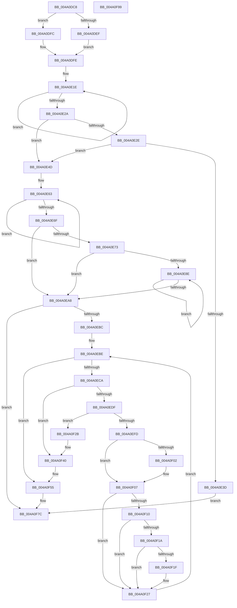

# PopFxActivateDevice

- RVA: `0x004A0DC8`–`0x004A0F9A` (길이 `466` bytes)
- VA: `0x00000001404A0DC8`
- 실행 섹션: `.text`
- PDB 이름 있음: `예`; PDB Function 태그: `아니요`
- unwind 정보 RVA: `0x0008C20C`
- 디코드: `129`개 명령, `466/466` bytes 표시
- 미해석 바이트: `0` (있으면 어셈블리에 `.byte`로 보존)

> 이 문서는 커널 이미지의 기계어와 PDB 기호를 분석해 생성했습니다. 4번과 5번은 함수 원형과 자료형을 바이너리 사용 방식에서 추정한 C 해석이며 원본 소스 복구 결과는 아닙니다.

## 1. Dependencies

- 직접 호출 지점: **11**; 고유 호출 대상: **8**
- 직접 호출자로 확인된 함수: **9**
- RIP 상대 이미지 참조: **0**

### Outgoing calls
- `0x004A0E05` → [ExAcquireSpinLockExclusive](../24/ExAcquireSpinLockExclusive_function_00248690.md) (function, `0x00248690`)
- `0x004A0E43` → [ExReleaseSpinLockExclusive](../2C/ExReleaseSpinLockExclusive_function_002C0EF0.md) (function, `0x002C0EF0`)
- `0x004A0E7F` → [PopFxReferenceDevice](../2B/PopFxReferenceDevice_function_002BFD9C.md) (function, `0x002BFD9C`)
- `0x004A0E99` → [PoFxActivateComponent](../2D/PoFxActivateComponent_function_002D9D30.md) (function, `0x002D9D30`)
- `0x004A0EAE` → [ExReleaseSpinLockExclusive](../2C/ExReleaseSpinLockExclusive_function_002C0EF0.md) (function, `0x002C0EF0`)
- `0x004A0EF1` → [KeWaitForSingleObject](../20/KeWaitForSingleObject_function_0020E6B0.md) (function, `0x0020E6B0`)
- `0x004A0F07` → [Feature_Sx_PEP_Notification_Synchronization__private_IsEnabledNoReportingNoInline](../4F/Feature_Sx_PEP_Notification_Synchronization__private_IsEnabledNoReportingNoInline_function_004F4E70.md) (function, `0x004F4E70`)
- `0x004A0F3A` → [PopFxBugCheck](../2B/PopFxBugCheck_function_002BFC6C.md) (function, `0x002BFC6C`)
- `0x004A0F4F` → [PopFxBugCheck](../2B/PopFxBugCheck_function_002BFC6C.md) (function, `0x002BFC6C`)
- `0x004A0F6A` → [KeWaitForSingleObject](../20/KeWaitForSingleObject_function_0020E6B0.md) (function, `0x0020E6B0`)
- `0x004A0F77` → [PopFxDereferenceDevice](../27/PopFxDereferenceDevice_function_0027038C.md) (function, `0x0027038C`)

### Direct callers
- [PopFxActivateDevicesForSx](PopFxActivateDevicesForSx_function_004A0CAC.md) at `0x004A0D58`
- [PoFxActivateDeviceForSystemTransition](PoFxActivateDeviceForSystemTransition_function_004A0D90.md) at `0x004A0D99`
- [PoFxActivateDevice](PoFxActivateDevice_function_004A0DAC.md) at `0x004A0DB5`
- [PopFxClearDeviceConstraints](../4B/PopFxClearDeviceConstraints_function_004B05F8.md) at `0x004B068D`
- [PoFxStartDevicePowerManagement](../4B/PoFxStartDevicePowerManagement_function_004B5740.md) at `0x004B58BA`
- [PoFxAddDeviceRelation](../5D/PoFxAddDeviceRelation_function_005D1850.md) at `0x005D199F`
- [PoFxRemoveDeviceRelation](../5D/PoFxRemoveDeviceRelation_function_005D1EF0.md) at `0x005D1FD3`
- [PopPepPlatformStateRegistered](../5D/PopPepPlatformStateRegistered_function_005DCDB8.md) at `0x005DCF03`
- [PopPlActivateDeviceIterator](../5D/PopPlActivateDeviceIterator_function_005DD8F0.md) at `0x005DD91F`

### Static image references
- 디코드된 RIP-relative 메모리 참조가 없습니다.

## 2. Other-region calls and transfers

- 다른 실행 섹션으로 향하는 call: **0**
- 별도 외부 분기/꼬리 이동을 확인하지 못했습니다.

## 3. Assembly (complete function range)

```asm
004A0DC8  48 89 5C 24 08                  mov qword ptr [rsp + 8], rbx
004A0DCD  48 89 6C 24 10                  mov qword ptr [rsp + 0x10], rbp
004A0DD2  48 89 74 24 18                  mov qword ptr [rsp + 0x18], rsi
004A0DD7  57                              push rdi
004A0DD8  41 54                           push r12
004A0DDA  41 55                           push r13
004A0DDC  41 56                           push r14
004A0DDE  41 57                           push r15
004A0DE0  48 83 EC 30                     sub rsp, 0x30
004A0DE4  45 8A E0                        mov r12b, r8b
004A0DE7  44 8A EA                        mov r13b, dl
004A0DEA  48 85 C9                        test rcx, rcx
004A0DED  74 0D                           je 0x1404a0dfc
004A0DEF  48 8B 81 38 01 00 00            mov rax, qword ptr [rcx + 0x138]
004A0DF6  48 8B 78 28                     mov rdi, qword ptr [rax + 0x28]
004A0DFA  EB 02                           jmp 0x1404a0dfe
004A0DFC  33 FF                           xor edi, edi
004A0DFE  48 8D 77 58                     lea rsi, [rdi + 0x58]
004A0E02  48 8B CE                        mov rcx, rsi
004A0E05  E8 86 78 DA FF                  call 0x140248690
004A0E0A  44 8B 47 78                     mov r8d, dword ptr [rdi + 0x78]
004A0E0E  40 8A E8                        mov bpl, al
004A0E11  0F 0D 8F 28 01 00 00            prefetchw byte ptr [rdi + 0x128]
004A0E18  8B 87 28 01 00 00               mov eax, dword ptr [rdi + 0x128]
004A0E1E  8B C8                           mov ecx, eax
004A0E20  F0 0F B1 8F 28 01 00 00         lock cmpxchg dword ptr [rdi + 0x128], ecx
004A0E28  75 F4                           jne 0x1404a0e1e
004A0E2A  A8 04                           test al, 4
004A0E2C  74 1F                           je 0x1404a0e4d
004A0E2E  48 8B 47 50                     mov rax, qword ptr [rdi + 0x50]
004A0E32  8B 90 60 03 00 00               mov edx, dword ptr [rax + 0x360]
004A0E38  F6 C2 01                        test dl, 1
004A0E3B  74 10                           je 0x1404a0e4d
004A0E3D  40 8A D5                        mov dl, bpl
004A0E40  48 8B CE                        mov rcx, rsi
004A0E43  E8 A8 00 E2 FF                  call 0x1402c0ef0
004A0E48  E9 2F 01 00 00                  jmp 0x1404a0f7c
004A0E4D  41 8D 40 01                     lea eax, [r8 + 1]
004A0E51  33 DB                           xor ebx, ebx
004A0E53  89 47 78                        mov dword ptr [rdi + 0x78], eax
004A0E56  0F 0D 8F 28 01 00 00            prefetchw byte ptr [rdi + 0x128]
004A0E5D  8B 87 28 01 00 00               mov eax, dword ptr [rdi + 0x128]
004A0E63  8B C8                           mov ecx, eax
004A0E65  F0 0F B1 8F 28 01 00 00         lock cmpxchg dword ptr [rdi + 0x128], ecx
004A0E6D  75 F4                           jne 0x1404a0e63
004A0E6F  A8 04                           test al, 4
004A0E71  74 35                           je 0x1404a0ea8
004A0E73  48 8B 5F 50                     mov rbx, qword ptr [rdi + 0x50]
004A0E77  BA 07 00 00 00                  mov edx, 7
004A0E7C  48 8B CB                        mov rcx, rbx
004A0E7F  E8 18 EF E1 FF                  call 0x1402bfd9c
004A0E84  33 FF                           xor edi, edi
004A0E86  39 BB 64 03 00 00               cmp dword ptr [rbx + 0x364], edi
004A0E8C  76 1A                           jbe 0x1404a0ea8
004A0E8E  41 B8 02 00 00 00               mov r8d, 2
004A0E94  8B D7                           mov edx, edi
004A0E96  48 8B CB                        mov rcx, rbx
004A0E99  E8 92 8E E3 FF                  call 0x1402d9d30
004A0E9E  FF C7                           inc edi
004A0EA0  3B BB 64 03 00 00               cmp edi, dword ptr [rbx + 0x364]
004A0EA6  72 E6                           jb 0x1404a0e8e
004A0EA8  40 8A D5                        mov dl, bpl
004A0EAB  48 8B CE                        mov rcx, rsi
004A0EAE  E8 3D 00 E2 FF                  call 0x1402c0ef0
004A0EB3  48 85 DB                        test rbx, rbx
004A0EB6  0F 84 C0 00 00 00               je 0x1404a0f7c
004A0EBC  33 FF                           xor edi, edi
004A0EBE  3B BB 64 03 00 00               cmp edi, dword ptr [rbx + 0x364]
004A0EC4  0F 83 8B 00 00 00               jae 0x1404a0f55
004A0ECA  48 8B 83 68 03 00 00            mov rax, qword ptr [rbx + 0x368]
004A0ED1  48 8B 34 F8                     mov rsi, qword ptr [rax + rdi*8]
004A0ED5  8B 46 58                        mov eax, dword ptr [rsi + 0x58]
004A0ED8  A9 FF FF FF 3F                  test eax, 0x3fffffff
004A0EDD  74 61                           je 0x1404a0f40
004A0EDF  48 83 64 24 20 00               and qword ptr [rsp + 0x20], 0
004A0EE5  48 8D 4E 68                     lea rcx, [rsi + 0x68]
004A0EE9  45 33 C9                        xor r9d, r9d
004A0EEC  45 33 C0                        xor r8d, r8d
004A0EEF  33 D2                           xor edx, edx
004A0EF1  E8 BA D7 D6 FF                  call 0x14020e6b0
004A0EF6  8B 46 58                        mov eax, dword ptr [rsi + 0x58]
004A0EF9  85 C0                           test eax, eax
004A0EFB  79 2E                           jns 0x1404a0f2b
004A0EFD  45 84 ED                        test r13b, r13b
004A0F00  74 05                           je 0x1404a0f07
004A0F02  F0 83 4B 20 01                  lock or dword ptr [rbx + 0x20], 1
004A0F07  E8 64 3F 05 00                  call 0x1404f4e70
004A0F0C  85 C0                           test eax, eax
004A0F0E  75 17                           jne 0x1404a0f27
004A0F10  8B 83 60 03 00 00               mov eax, dword ptr [rbx + 0x360]
004A0F16  84 C0                           test al, al
004A0F18  79 0D                           jns 0x1404a0f27
004A0F1A  45 84 E4                        test r12b, r12b
004A0F1D  74 08                           je 0x1404a0f27
004A0F1F  F0 81 4B 20 00 08 00 00         lock or dword ptr [rbx + 0x20], 0x800
004A0F27  FF C7                           inc edi
004A0F29  EB 93                           jmp 0x1404a0ebe
004A0F2B  45 33 C9                        xor r9d, r9d
004A0F2E  4C 8D 46 58                     lea r8, [rsi + 0x58]
004A0F32  48 8B D6                        mov rdx, rsi
004A0F35  B9 08 06 00 00                  mov ecx, 0x608
004A0F3A  E8 2D ED E1 FF                  call 0x1402bfc6c
004A0F3F  CC                              int3
004A0F40  45 33 C9                        xor r9d, r9d
004A0F43  4C 8D 46 58                     lea r8, [rsi + 0x58]
004A0F47  48 8B D6                        mov rdx, rsi
004A0F4A  B9 08 06 00 00                  mov ecx, 0x608
004A0F4F  E8 18 ED E1 FF                  call 0x1402bfc6c
004A0F54  CC                              int3
004A0F55  48 83 64 24 20 00               and qword ptr [rsp + 0x20], 0
004A0F5B  48 8D 8B 60 02 00 00            lea rcx, [rbx + 0x260]
004A0F62  45 33 C9                        xor r9d, r9d
004A0F65  45 33 C0                        xor r8d, r8d
004A0F68  33 D2                           xor edx, edx
004A0F6A  E8 41 D7 D6 FF                  call 0x14020e6b0
004A0F6F  BA 07 00 00 00                  mov edx, 7
004A0F74  48 8B CB                        mov rcx, rbx
004A0F77  E8 10 F4 DC FF                  call 0x14027038c
004A0F7C  48 8B 5C 24 60                  mov rbx, qword ptr [rsp + 0x60]
004A0F81  48 8B 6C 24 68                  mov rbp, qword ptr [rsp + 0x68]
004A0F86  48 8B 74 24 70                  mov rsi, qword ptr [rsp + 0x70]
004A0F8B  48 83 C4 30                     add rsp, 0x30
004A0F8F  41 5F                           pop r15
004A0F91  41 5E                           pop r14
004A0F93  41 5D                           pop r13
004A0F95  41 5C                           pop r12
004A0F97  5F                              pop rdi
004A0F98  C3                              ret
004A0F99  CC                              int3
```

## 4. C-style interpretation (structured pseudocode)

```c
__int64 __fastcall PopFxActivateDevice(__int64 a1, unsigned __int8 a2, unsigned __int8 a3, int a4)
{
    __int64 result;
    __int64 v_rbx;
    __int64 v_rdi;
    __int64 v_rsp;
    unsigned __int64 v_stack_m38;
    unsigned __int64 v_stack_p10;
    unsigned __int64 v_stack_p18;
    unsigned __int64 v_stack_p8;

    v_stack_p8 = v_rbx;
    v_stack_p10 = v_rbp;
    v_stack_p18 = v_rsi;
    v_rsp = (v_rsp) - (48);
    if (a1 == 0) goto loc_004A0DFC;
    goto loc_004A0DFE;
loc_004A0DFC:
    v_rdi = 0;
loc_004A0DFE:
    result = ExAcquireSpinLockExclusive(v_rdi + 88, a2, a3, a4);
loc_004A0E1E:
    if (condition_is_not_equal) goto loc_004A0E1E;
    if ((((unsigned __int8)((unsigned int)(*(unsigned int *)(v_rdi + 296)))) & (4)) == 0) goto loc_004A0E4D;
    if ((((unsigned __int8)((unsigned int)(*(unsigned int *)(*(unsigned __int64 *)(v_rdi + 80) + 864)))) & (1)) == 0) goto loc_004A0E4D;
    result = ExReleaseSpinLockExclusive(v_rdi + 88, (unsigned __int8)((unsigned __int8)(result)), (unsigned int)(*(unsigned int *)(v_rdi + 120)), a4);
    goto loc_004A0F7C;
loc_004A0E4D:
    v_rbx = 0;
    *(unsigned int *)(v_rdi + 120) = (unsigned int)((unsigned int)(*(unsigned int *)(v_rdi + 120)) + 1);
loc_004A0E63:
    if (condition_is_not_equal) goto loc_004A0E63;
    if ((((unsigned __int8)((unsigned int)(*(unsigned int *)(v_rdi + 296)))) & (4)) == 0) goto loc_004A0EA8;
    result = PopFxReferenceDevice(*(unsigned __int64 *)(v_rdi + 80), 7, (unsigned int)(*(unsigned int *)(v_rdi + 120)), a4);
    v_rdi = 0;
    if ((*(unsigned int *)(*(unsigned __int64 *)(v_rdi + 80) + 868)) <= 0) goto loc_004A0EA8;
loc_004A0E8E:
    result = PoFxActivateComponent(*(unsigned __int64 *)(v_rdi + 80), 0, 2, a4);
    v_rdi = (unsigned int)((v_rdi) + 1);
    if (((unsigned int)(v_rdi)) < (*(unsigned int *)(*(unsigned __int64 *)(v_rdi + 80) + 868))) goto loc_004A0E8E;
loc_004A0EA8:
    result = ExReleaseSpinLockExclusive(v_rdi + 88, (unsigned __int8)((unsigned __int8)(result)), 2, a4);
    if (*(unsigned __int64 *)(v_rdi + 80) == 0) goto loc_004A0F7C;
    v_rdi = 0;
loc_004A0EBE:
    if (0 >= (*(unsigned int *)(*(unsigned __int64 *)(v_rdi + 80) + 868))) goto loc_004A0F55;
    if ((((unsigned int)((unsigned int)(*(unsigned int *)(*(unsigned __int64 *)(*(unsigned __int64 *)(*(unsigned __int64 *)(v_rdi + 80) + 872) + v_rdi * 8) + 88)))) & (0x3FFFFFFFULL)) == 0) goto loc_004A0F40;
    a4 = 0;
    a3 = 0;
    a2 = 0;
    result = KeWaitForSingleObject(*(unsigned __int64 *)(*(unsigned __int64 *)(*(unsigned __int64 *)(v_rdi + 80) + 872) + v_rdi * 8) + 104, a2, a3, a4);
    if (!sign_flag) goto loc_004A0F2B;
    if (0 != 0) {
    }
    result = Feature_Sx_PEP_Notification_Synchronization__private_IsEnabledNoReportingNoInline(*(unsigned __int64 *)(*(unsigned __int64 *)(*(unsigned __int64 *)(v_rdi + 80) + 872) + v_rdi * 8) + 104, a2, a3, a4);
    if ((unsigned int)(result) != 0) goto loc_004A0F27;
    if (!sign_flag) goto loc_004A0F27;
    if (0 != 0) {
    }
    v_rdi = (unsigned int)((v_rdi) + 1);
    goto loc_004A0EBE;
loc_004A0F2B:
    a4 = 0;
    result = PopFxBugCheck((unsigned int)(0x608ULL), *(unsigned __int64 *)(*(unsigned __int64 *)(*(unsigned __int64 *)(v_rdi + 80) + 872) + v_rdi * 8), *(unsigned __int64 *)(*(unsigned __int64 *)(*(unsigned __int64 *)(v_rdi + 80) + 872) + v_rdi * 8) + 88, a4);
loc_004A0F40:
    a4 = 0;
    result = PopFxBugCheck((unsigned int)(0x608ULL), *(unsigned __int64 *)(*(unsigned __int64 *)(*(unsigned __int64 *)(v_rdi + 80) + 872) + v_rdi * 8), *(unsigned __int64 *)(*(unsigned __int64 *)(*(unsigned __int64 *)(v_rdi + 80) + 872) + v_rdi * 8) + 88, a4);
loc_004A0F55:
    a4 = 0;
    a3 = 0;
    a2 = 0;
    result = KeWaitForSingleObject(*(unsigned __int64 *)(v_rdi + 80) + 608, a2, a3, a4);
    result = PopFxDereferenceDevice(*(unsigned __int64 *)(v_rdi + 80), 7, a3, a4);
loc_004A0F7C:
    v_rsp = (v_rsp) + (48);
    return result;
}
```

## 5. (Beta) C Style

```c
int64_t PopFxActivateDevice(int64_t Arg1, uint8_t Arg2, uint8_t Arg3, int32_t Arg4)
{
    int64_t result;
    int64_t local_rbx;
    int64_t local_rdi;
    int64_t local_rsp;
    uint64_t v_stack_m38;
    uint64_t v_stack_p10;
    uint64_t v_stack_p18;
    uint64_t v_stack_p8;

    v_stack_p8 = local_rbx;
    v_stack_p10 = local_rbp;
    v_stack_p18 = local_rsi;
    local_rsp = (local_rsp) - (48);
    if (Arg1 == 0) goto loc_004A0DFC;
    goto loc_004A0DFE;
loc_004A0DFC:
    local_rdi = 0;
loc_004A0DFE:
    result = ExAcquireSpinLockExclusive(local_rdi + 88, Arg2, Arg3, Arg4);
loc_004A0E1E:
    if (condition_is_not_equal) goto loc_004A0E1E;
    if ((((uint8_t)((uint32_t)(*(uint32_t *)(local_rdi + 0x128)))) & (4)) == 0) goto loc_004A0E4D;
    if ((((uint8_t)((uint32_t)(*(uint32_t *)(*(uint64_t *)(local_rdi + 0x50) + 0x360)))) & (1)) == 0) goto loc_004A0E4D;
    result = ExReleaseSpinLockExclusive(local_rdi + 88, (uint8_t)((uint8_t)(result)), (uint32_t)(*(uint32_t *)(local_rdi + 0x78)), Arg4);
    goto loc_004A0F7C;
loc_004A0E4D:
    local_rbx = 0;
    *(uint32_t *)(local_rdi + 0x78) = (uint32_t)((uint32_t)(*(uint32_t *)(local_rdi + 0x78)) + 1);
loc_004A0E63:
    if (condition_is_not_equal) goto loc_004A0E63;
    if ((((uint8_t)((uint32_t)(*(uint32_t *)(local_rdi + 0x128)))) & (4)) == 0) goto loc_004A0EA8;
    result = PopFxReferenceDevice(*(uint64_t *)(local_rdi + 0x50), 7, (uint32_t)(*(uint32_t *)(local_rdi + 0x78)), Arg4);
    local_rdi = 0;
    if ((*(uint32_t *)(*(uint64_t *)(local_rdi + 0x50) + 0x364)) <= 0) goto loc_004A0EA8;
loc_004A0E8E:
    result = PoFxActivateComponent(*(uint64_t *)(local_rdi + 0x50), 0, 2, Arg4);
    local_rdi = (uint32_t)((local_rdi) + 1);
    if (((uint32_t)(local_rdi)) < (*(uint32_t *)(*(uint64_t *)(local_rdi + 0x50) + 0x364))) goto loc_004A0E8E;
loc_004A0EA8:
    result = ExReleaseSpinLockExclusive(local_rdi + 88, (uint8_t)((uint8_t)(result)), 2, Arg4);
    if (*(uint64_t *)(local_rdi + 0x50) == 0) goto loc_004A0F7C;
    local_rdi = 0;
loc_004A0EBE:
    if (0 >= (*(uint32_t *)(*(uint64_t *)(local_rdi + 0x50) + 0x364))) goto loc_004A0F55;
    if ((((uint32_t)((uint32_t)(*(uint32_t *)(*(uint64_t *)(*(uint64_t *)(*(uint64_t *)(local_rdi + 0x50) + 0x368) + local_rdi * 8) + 0x58)))) & (0x3FFFFFFFULL)) == 0) goto loc_004A0F40;
    Arg4 = 0;
    Arg3 = 0;
    Arg2 = 0;
    result = KeWaitForSingleObject(*(uint64_t *)(*(uint64_t *)(*(uint64_t *)(local_rdi + 0x50) + 0x368) + local_rdi * 8) + 104, Arg2, Arg3, Arg4);
    if (!sign_flag) goto loc_004A0F2B;
    if (0 != 0) {
    }
    result = Feature_Sx_PEP_Notification_Synchronization__private_IsEnabledNoReportingNoInline(*(uint64_t *)(*(uint64_t *)(*(uint64_t *)(local_rdi + 0x50) + 0x368) + local_rdi * 8) + 104, Arg2, Arg3, Arg4);
    if ((uint32_t)(result) != 0) goto loc_004A0F27;
    if (!sign_flag) goto loc_004A0F27;
    if (0 != 0) {
    }
    local_rdi = (uint32_t)((local_rdi) + 1);
    goto loc_004A0EBE;
loc_004A0F2B:
    Arg4 = 0;
    result = PopFxBugCheck((uint32_t)(0x608ULL), *(uint64_t *)(*(uint64_t *)(*(uint64_t *)(local_rdi + 0x50) + 0x368) + local_rdi * 8), *(uint64_t *)(*(uint64_t *)(*(uint64_t *)(local_rdi + 0x50) + 0x368) + local_rdi * 8) + 88, Arg4);
loc_004A0F40:
    Arg4 = 0;
    result = PopFxBugCheck((uint32_t)(0x608ULL), *(uint64_t *)(*(uint64_t *)(*(uint64_t *)(local_rdi + 0x50) + 0x368) + local_rdi * 8), *(uint64_t *)(*(uint64_t *)(*(uint64_t *)(local_rdi + 0x50) + 0x368) + local_rdi * 8) + 88, Arg4);
loc_004A0F55:
    Arg4 = 0;
    Arg3 = 0;
    Arg2 = 0;
    result = KeWaitForSingleObject(*(uint64_t *)(local_rdi + 0x50) + 608, Arg2, Arg3, Arg4);
    result = PopFxDereferenceDevice(*(uint64_t *)(local_rdi + 0x50), 7, Arg3, Arg4);
loc_004A0F7C:
    local_rsp = (local_rsp) + (48);
    return result;
}
```

## 6. Execution-region graph

[열기: 2D/3D 그래프와 함수 탐색 컨트롤 패널](../../../control-panel.html?section=text&rva=0x004A0DC8&view=graph)

- 2D 그래프는 위에서 아래로 흐르고, 3D 그래프는 빈 공간을 드래그해 회전합니다. Shift+드래그는 이동, 휠은 확대·축소, 함수 노드 선택은 대상 보고서 이동입니다.

### Static fallback


