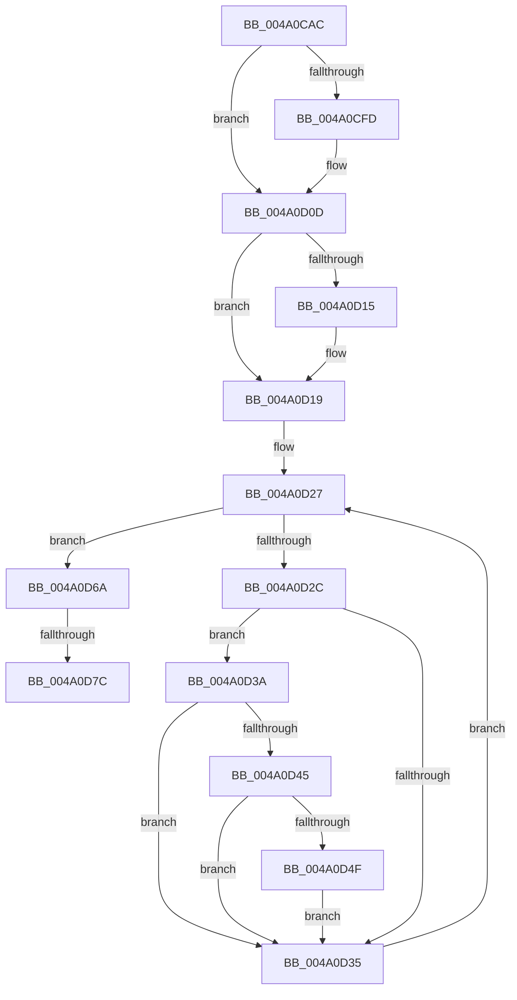

# PopFxActivateDevicesForSx

- RVA: `0x004A0CAC`–`0x004A0D8A` (길이 `222` bytes)
- VA: `0x00000001404A0CAC`
- 실행 섹션: `.text`
- PDB 이름 있음: `예`; PDB Function 태그: `예`
- unwind 정보 RVA: `0x000B5898`
- 디코드: `59`개 명령, `222/222` bytes 표시
- 미해석 바이트: `0` (있으면 어셈블리에 `.byte`로 보존)

> 이 문서는 커널 이미지의 기계어와 PDB 기호를 분석해 생성했습니다. 4번과 5번은 함수 원형과 자료형을 바이너리 사용 방식에서 추정한 C 해석이며 원본 소스 복구 결과는 아닙니다.

## 1. Dependencies

- 직접 호출 지점: **4**; 고유 호출 대상: **4**
- 직접 호출자로 확인된 함수: **2**
- RIP 상대 이미지 참조: **2**

### Outgoing calls
- `0x004A0CE4` → [KeAbPreAcquire](../21/KeAbPreAcquire_function_00210230.md) (function, `0x00210230`)
- `0x004A0D08` → [ExfAcquirePushLockSharedEx](../21/ExfAcquirePushLockSharedEx_function_0021044C.md) (function, `0x0021044C`)
- `0x004A0D58` → [PopFxActivateDevice](PopFxActivateDevice_function_004A0DC8.md) (function, `0x004A0DC8`)
- `0x004A0D7F` → [ExfReleasePushLockShared](../26/ExfReleasePushLockShared_function_00263440.md) (function, `0x00263440`)

### Direct callers
- [PopFxPrepareDevicesForShutdown](../4F/PopFxPrepareDevicesForShutdown_function_004F5DF4.md) at `0x004F5E80`
- [PoBroadcastSystemState](../../pagelk/B7/PoBroadcastSystemState_function_00B761B0.md) at `0x00B762E8`
- [PoBroadcastSystemState](../../pagelk/B7/PoBroadcastSystemState_function_00B761B0.md) at `0x00B765F9`

### Static image references
- `0x004A0CCB` → RVA `0x00F0E408` (`.data`; read)
- `0x004A0D19` → RVA `0x00F0E3F0` (`.data`; read)

## 2. Other-region calls and transfers

- 다른 실행 섹션으로 향하는 call: **0**
- call이 아닌 외부 분기/꼬리 이동: **2**
  - `0x004A0D76` → [sub_006F869A](../6F/Unknown_function_006F869A.md) (`tail-transfer`)
  - `0x004A0D85` → [sub_006F869A](../6F/Unknown_function_006F869A.md) (`tail-transfer`)

## 3. Assembly (complete function range)

```asm
004A0CAC  48 89 5C 24 08                  mov qword ptr [rsp + 8], rbx
004A0CB1  48 89 6C 24 18                  mov qword ptr [rsp + 0x18], rbp
004A0CB6  56                              push rsi
004A0CB7  57                              push rdi
004A0CB8  41 54                           push r12
004A0CBA  41 56                           push r14
004A0CBC  41 57                           push r15
004A0CBE  48 83 EC 20                     sub rsp, 0x20
004A0CC2  65 48 8B 04 25 88 01 00 00      mov rax, qword ptr gs:[0x188]
004A0CCB  48 8D 2D 36 D7 A6 00            lea rbp, [rip + 0xa6d736]
004A0CD2  8B F1                           mov esi, ecx
004A0CD4  45 33 C0                        xor r8d, r8d
004A0CD7  33 D2                           xor edx, edx
004A0CD9  48 8B CD                        mov rcx, rbp
004A0CDC  66 FF 88 E4 01 00 00            dec word ptr [rax + 0x1e4]
004A0CE3  90                              nop
004A0CE4  E8 47 F5 D6 FF                  call 0x140210230
004A0CE9  48 8B D8                        mov rbx, rax
004A0CEC  33 C0                           xor eax, eax
004A0CEE  44 8D 60 11                     lea r12d, [rax + 0x11]
004A0CF2  F0 4C 0F B1 25 0D D7 A6 00      lock cmpxchg qword ptr [rip + 0xa6d70d], r12
004A0CFB  74 10                           je 0x1404a0d0d
004A0CFD  4C 8B CD                        mov r9, rbp
004A0D00  4C 8B C3                        mov r8, rbx
004A0D03  33 D2                           xor edx, edx
004A0D05  48 8B CD                        mov rcx, rbp
004A0D08  E8 3F F7 D6 FF                  call 0x14021044c
004A0D0D  45 33 F6                        xor r14d, r14d
004A0D10  48 85 DB                        test rbx, rbx
004A0D13  74 04                           je 0x1404a0d19
004A0D15  C6 43 0A 01                     mov byte ptr [rbx + 0xa], 1
004A0D19  48 8B 1D D0 D6 A6 00            mov rbx, qword ptr [rip + 0xa6d6d0]
004A0D20  4C 8D 3D C9 D6 A6 00            lea r15, [rip + 0xa6d6c9]
004A0D27  49 3B DF                        cmp rbx, r15
004A0D2A  74 3E                           je 0x1404a0d6a
004A0D2C  48 8B 7B 30                     mov rdi, qword ptr [rbx + 0x30]
004A0D30  48 85 FF                        test rdi, rdi
004A0D33  75 05                           jne 0x1404a0d3a
004A0D35  48 8B 1B                        mov rbx, qword ptr [rbx]
004A0D38  EB ED                           jmp 0x1404a0d27
004A0D3A  0F B6 87 D8 00 00 00            movzx eax, byte ptr [rdi + 0xd8]
004A0D41  3B C6                           cmp eax, esi
004A0D43  73 F0                           jae 0x1404a0d35
004A0D45  8B 83 60 03 00 00               mov eax, dword ptr [rbx + 0x360]
004A0D4B  A8 01                           test al, 1
004A0D4D  75 E6                           jne 0x1404a0d35
004A0D4F  48 8B 4F 20                     mov rcx, qword ptr [rdi + 0x20]
004A0D53  45 33 C0                        xor r8d, r8d
004A0D56  33 D2                           xor edx, edx
004A0D58  E8 6B 00 00 00                  call 0x1404a0dc8
004A0D5D  F0 81 8F 28 01 00 00 00 10 00 00  lock or dword ptr [rdi + 0x128], 0x1000
004A0D68  EB CB                           jmp 0x1404a0d35
004A0D6A  49 8B C4                        mov rax, r12
004A0D6D  F0 4C 0F B1 35 92 D6 A6 00      lock cmpxchg qword ptr [rip + 0xa6d692], r14
004A0D76  0F 84 1E 79 25 00               je 0x1406f869a
004A0D7C  48 8B CD                        mov rcx, rbp
004A0D7F  E8 BC 26 DC FF                  call 0x140263440
004A0D84  90                              nop
004A0D85  E9 10 79 25 00                  jmp 0x1406f869a
```

## 4. C-style interpretation (structured pseudocode)

```c
__int64 __fastcall PopFxActivateDevicesForSx(int a1, int a2, int a3)
{
    __int64 result;
    __int64 v_r14;
    __int64 v_rsp;
    unsigned __int64 v_stack_p18;
    unsigned __int64 v_stack_p8;

    v_stack_p8 = v_rbx;
    v_stack_p18 = v_rbp;
    v_rsp = (v_rsp) - (32);
    a3 = 0;
    a2 = 0;
    result = KeAbPreAcquire(v_rip + 10934070, a2, a3, a4);
    result = 0;
    if (!(condition_is_equal)) {
        a4 = v_rip + 10934070;
        a3 = 0;
        a2 = 0;
        a1 = v_rip + 10934070;
        result = ExfAcquirePushLockSharedEx(a1, a2, a3, a4);
    }
    v_r14 = 0;
    if (result != 0) {
        *(unsigned __int8 *)(result + 10) = 1;
    }
loc_004A0D27:
    if ((*(unsigned __int64 *)(v_rip + 10933968)) == (v_rip + 10933961)) goto loc_004A0D6A;
    if (*(unsigned __int64 *)(*(unsigned __int64 *)(v_rip + 10933968) + 48) != 0) goto loc_004A0D3A;
loc_004A0D35:
    goto loc_004A0D27;
loc_004A0D3A:
    if (((unsigned int)(*(unsigned __int8 *)(*(unsigned __int64 *)(*(unsigned __int64 *)(v_rip + 10933968) + 48) + 216))) >= ((unsigned int)((unsigned int)(a1)))) goto loc_004A0D35;
    if ((((unsigned __int8)((unsigned int)(*(unsigned int *)(*(unsigned __int64 *)(*(unsigned __int64 *)(v_rip + 10933968)) + 864)))) & (1)) != 0) goto loc_004A0D35;
    a3 = 0;
    a2 = 0;
    result = PopFxActivateDevice(*(unsigned __int64 *)(*(unsigned __int64 *)(*(unsigned __int64 *)(v_rip + 10933968) + 48) + 32), a2, a3, a4);
    goto loc_004A0D35;
loc_004A0D6A:
    result = ExfReleasePushLockShared(v_rip + 10934070, a2, a3, a4);
}
```

## 5. (Beta) C Style

```c
int64_t PopFxActivateDevicesForSx(int32_t Arg1, int32_t Arg2, int32_t Arg3)
{
    int64_t result;
    int64_t local_r14;
    int64_t local_rsp;
    uint64_t v_stack_p18;
    uint64_t v_stack_p8;

    v_stack_p8 = local_rbx;
    v_stack_p18 = local_rbp;
    local_rsp = (local_rsp) - (32);
    Arg3 = 0;
    Arg2 = 0;
    result = KeAbPreAcquire(v_rip + 10934070, Arg2, Arg3, a4);
    result = 0;
    if (!(condition_is_equal)) {
        a4 = v_rip + 10934070;
        Arg3 = 0;
        Arg2 = 0;
        Arg1 = v_rip + 10934070;
        result = ExfAcquirePushLockSharedEx(Arg1, Arg2, Arg3, a4);
    }
    local_r14 = 0;
    if (result != 0) {
        *(uint8_t *)(result + 0xA) = 1;
    }
loc_004A0D27:
    if ((*(uint64_t *)(v_rip + 0xA6D6D0)) == (v_rip + 10933961)) goto loc_004A0D6A;
    if (*(uint64_t *)(*(uint64_t *)(v_rip + 0xA6D6D0) + 0x30) != 0) goto loc_004A0D3A;
loc_004A0D35:
    goto loc_004A0D27;
loc_004A0D3A:
    if (((uint32_t)(*(uint8_t *)(*(uint64_t *)(*(uint64_t *)(v_rip + 0xA6D6D0) + 0x30) + 0xD8))) >= ((uint32_t)((uint32_t)(Arg1)))) goto loc_004A0D35;
    if ((((uint8_t)((uint32_t)(*(uint32_t *)(*(uint64_t *)(*(uint64_t *)(v_rip + 0xA6D6D0)) + 0x360)))) & (1)) != 0) goto loc_004A0D35;
    Arg3 = 0;
    Arg2 = 0;
    result = PopFxActivateDevice(*(uint64_t *)(*(uint64_t *)(*(uint64_t *)(v_rip + 0xA6D6D0) + 0x30) + 0x20), Arg2, Arg3, a4);
    goto loc_004A0D35;
loc_004A0D6A:
    result = ExfReleasePushLockShared(v_rip + 10934070, Arg2, Arg3, a4);
}
```

## 6. Execution-region graph

[열기: 2D/3D 그래프와 함수 탐색 컨트롤 패널](../../../control-panel.html?section=text&rva=0x004A0CAC&view=graph)

- 2D 그래프는 위에서 아래로 흐르고, 3D 그래프는 빈 공간을 드래그해 회전합니다. Shift+드래그는 이동, 휠은 확대·축소, 함수 노드 선택은 대상 보고서 이동입니다.

### Static fallback


