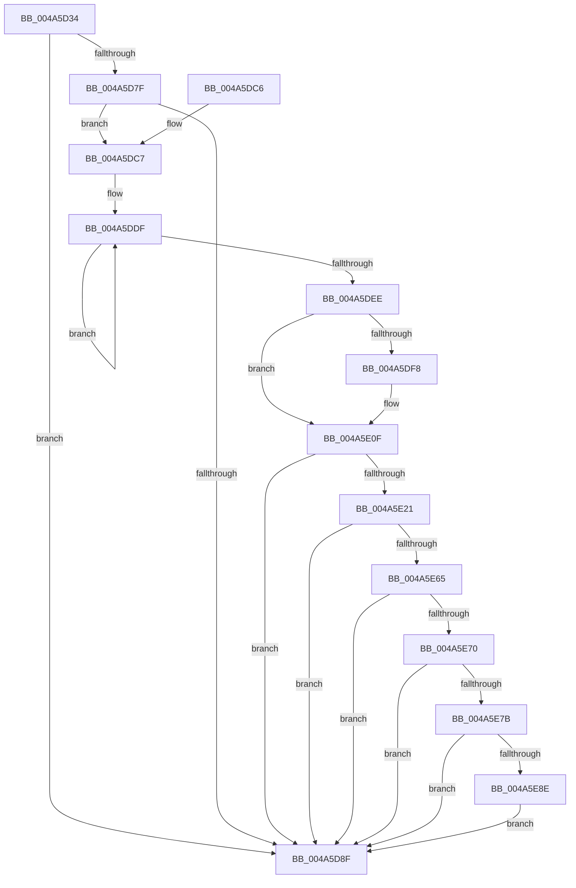

# PopFxIsDevicePotentialDripsConstraint

- RVA: `0x004A5D34`–`0x004A5EAE` (길이 `378` bytes)
- VA: `0x00000001404A5D34`
- 실행 섹션: `.text`
- PDB 이름 있음: `예`; PDB Function 태그: `아니요`
- unwind 정보 RVA: `0x000B6BB0`
- 디코드: `93`개 명령, `378/378` bytes 표시
- 미해석 바이트: `0` (있으면 어셈블리에 `.byte`로 보존)

> 이 문서는 커널 이미지의 기계어와 PDB 기호를 분석해 생성했습니다. 4번과 5번은 함수 원형과 자료형을 바이너리 사용 방식에서 추정한 C 해석이며 원본 소스 복구 결과는 아닙니다.

## 1. Dependencies

- 직접 호출 지점: **7**; 고유 호출 대상: **7**
- 직접 호출자로 확인된 함수: **1**
- RIP 상대 이미지 참조: **3**

### Outgoing calls
- `0x004A5D75` → [ObfReferenceObjectWithTag](../21/ObfReferenceObjectWithTag_function_00210710.md) (function, `0x00210710`)
- `0x004A5D97` → [ObfDereferenceObjectWithTag](../2F/ObfDereferenceObjectWithTag_function_002F78E0.md) (function, `0x002F78E0`)
- `0x004A5DA7` → [_security_check_cookie](../6A/_security_check_cookie_function_006AC640.md) (function, `0x006AC640`)
- `0x004A5DCB` → [ExAcquireSpinLockExclusive](../24/ExAcquireSpinLockExclusive_function_00248690.md) (function, `0x00248690`)
- `0x004A5E13` → [ExReleaseSpinLockExclusive](../2C/ExReleaseSpinLockExclusive_function_002C0EF0.md) (function, `0x002C0EF0`)
- `0x004A5E58` → [IoGetDevicePropertyData](../../page/90/IoGetDevicePropertyData_function_009005E0.md) (function, `0x009005E0`)
- `0x004A5E9A` → [wcsicmp](../50/wcsicmp_function_00500080.md) (function, `0x00500080`)

### Direct callers
- [NtPowerInformation](../../page/95/NtPowerInformation_function_00955D80.md) at `0x00957C37`

### Static image references
- `0x004A5D4C` → RVA `0x00E0A740` (`.data`; read)
- `0x004A5E2F` → RVA `0x0001BB28` (`.rdata`; read)
- `0x004A5E8E` → RVA `0x006CBF10` (` ?? ::FNODOBFM::`string'`; read)

## 2. Other-region calls and transfers

- 다른 실행 섹션으로 향하는 call: **1**
  - `0x004A5E58` → [IoGetDevicePropertyData](../../page/90/IoGetDevicePropertyData_function_009005E0.md) (`.text` → `PAGE`)
- 별도 외부 분기/꼬리 이동을 확인하지 못했습니다.

## 3. Assembly (complete function range)

```asm
004A5D34  4C 8B DC                        mov r11, rsp
004A5D37  49 89 5B 10                     mov qword ptr [r11 + 0x10], rbx
004A5D3B  49 89 6B 18                     mov qword ptr [r11 + 0x18], rbp
004A5D3F  49 89 73 20                     mov qword ptr [r11 + 0x20], rsi
004A5D43  57                              push rdi
004A5D44  41 54                           push r12
004A5D46  41 56                           push r14
004A5D48  48 83 EC 60                     sub rsp, 0x60
004A5D4C  48 8B 05 ED 49 96 00            mov rax, qword ptr [rip + 0x9649ed]
004A5D53  48 33 C4                        xor rax, rsp
004A5D56  48 89 44 24 50                  mov qword ptr [rsp + 0x50], rax
004A5D5B  45 33 F6                        xor r14d, r14d
004A5D5E  BA 50 6F 46 78                  mov edx, 0x78466f50
004A5D63  4D 89 73 D0                     mov qword ptr [r11 - 0x30], r14
004A5D67  41 8A FE                        mov dil, r14b
004A5D6A  45 89 73 C8                     mov dword ptr [r11 - 0x38], r14d
004A5D6E  48 8B F1                        mov rsi, rcx
004A5D71  45 89 73 CC                     mov dword ptr [r11 - 0x34], r14d
004A5D75  E8 96 A9 D6 FF                  call 0x140210710
004A5D7A  48 85 F6                        test rsi, rsi
004A5D7D  74 10                           je 0x1404a5d8f
004A5D7F  48 8B 86 38 01 00 00            mov rax, qword ptr [rsi + 0x138]
004A5D86  48 8B 58 28                     mov rbx, qword ptr [rax + 0x28]
004A5D8A  48 85 DB                        test rbx, rbx
004A5D8D  75 38                           jne 0x1404a5dc7
004A5D8F  BA 50 6F 46 78                  mov edx, 0x78466f50
004A5D94  48 8B CE                        mov rcx, rsi
004A5D97  E8 44 1B E5 FF                  call 0x1402f78e0
004A5D9C  40 8A C7                        mov al, dil
004A5D9F  48 8B 4C 24 50                  mov rcx, qword ptr [rsp + 0x50]
004A5DA4  48 33 CC                        xor rcx, rsp
004A5DA7  E8 94 68 20 00                  call 0x1406ac640
004A5DAC  4C 8D 5C 24 60                  lea r11, [rsp + 0x60]
004A5DB1  49 8B 5B 28                     mov rbx, qword ptr [r11 + 0x28]
004A5DB5  49 8B 6B 30                     mov rbp, qword ptr [r11 + 0x30]
004A5DB9  49 8B 73 38                     mov rsi, qword ptr [r11 + 0x38]
004A5DBD  49 8B E3                        mov rsp, r11
004A5DC0  41 5E                           pop r14
004A5DC2  41 5C                           pop r12
004A5DC4  5F                              pop rdi
004A5DC5  C3                              ret
004A5DC6  CC                              int3
004A5DC7  48 8D 4B 58                     lea rcx, [rbx + 0x58]
004A5DCB  E8 C0 28 DA FF                  call 0x140248690
004A5DD0  8A D0                           mov dl, al
004A5DD2  0F 0D 8B 28 01 00 00            prefetchw byte ptr [rbx + 0x128]
004A5DD9  8B 83 28 01 00 00               mov eax, dword ptr [rbx + 0x128]
004A5DDF  8B C8                           mov ecx, eax
004A5DE1  41 0B CE                        or ecx, r14d
004A5DE4  F0 0F B1 8B 28 01 00 00         lock cmpxchg dword ptr [rbx + 0x128], ecx
004A5DEC  75 F1                           jne 0x1404a5ddf
004A5DEE  41 BC 01 00 00 00               mov r12d, 1
004A5DF4  A8 04                           test al, 4
004A5DF6  74 17                           je 0x1404a5e0f
004A5DF8  48 8B 4B 50                     mov rcx, qword ptr [rbx + 0x50]
004A5DFC  33 C0                           xor eax, eax
004A5DFE  F0 44 0F B1 B1 60 03 00 00      lock cmpxchg dword ptr [rcx + 0x360], r14d
004A5E07  8B F8                           mov edi, eax
004A5E09  C1 EF 04                        shr edi, 4
004A5E0C  41 22 FC                        and dil, r12b
004A5E0F  48 8D 4B 58                     lea rcx, [rbx + 0x58]
004A5E13  E8 D8 B0 E1 FF                  call 0x1402c0ef0
004A5E18  40 84 FF                        test dil, dil
004A5E1B  0F 85 6E FF FF FF               jne 0x1404a5d8f
004A5E21  48 8B 4B 20                     mov rcx, qword ptr [rbx + 0x20]
004A5E25  48 8D 44 24 44                  lea rax, [rsp + 0x44]
004A5E2A  48 89 44 24 38                  mov qword ptr [rsp + 0x38], rax
004A5E2F  48 8D 15 F2 5C B7 FF            lea rdx, [rip - 0x48a30e]
004A5E36  48 8D 44 24 40                  lea rax, [rsp + 0x40]
004A5E3B  45 33 C9                        xor r9d, r9d
004A5E3E  48 89 44 24 30                  mov qword ptr [rsp + 0x30], rax
004A5E43  45 33 C0                        xor r8d, r8d
004A5E46  48 8D 44 24 48                  lea rax, [rsp + 0x48]
004A5E4B  48 89 44 24 28                  mov qword ptr [rsp + 0x28], rax
004A5E50  C7 44 24 20 08 00 00 00         mov dword ptr [rsp + 0x20], 8
004A5E58  E8 83 A7 45 00                  call 0x1409005e0
004A5E5D  85 C0                           test eax, eax
004A5E5F  0F 88 2A FF FF FF               js 0x1404a5d8f
004A5E65  83 7C 24 44 12                  cmp dword ptr [rsp + 0x44], 0x12
004A5E6A  0F 85 1F FF FF FF               jne 0x1404a5d8f
004A5E70  83 7C 24 40 02                  cmp dword ptr [rsp + 0x40], 2
004A5E75  0F 86 14 FF FF FF               jbe 0x1404a5d8f
004A5E7B  8B 44 24 40                     mov eax, dword ptr [rsp + 0x40]
004A5E7F  48 D1 E8                        shr rax, 1
004A5E82  66 44 39 74 44 46               cmp word ptr [rsp + rax*2 + 0x46], r14w
004A5E88  0F 85 01 FF FF FF               jne 0x1404a5d8f
004A5E8E  48 8D 15 7B 60 22 00            lea rdx, [rip + 0x22607b]
004A5E95  48 8D 4C 24 48                  lea rcx, [rsp + 0x48]
004A5E9A  E8 E1 A1 05 00                  call 0x140500080
004A5E9F  85 C0                           test eax, eax
004A5EA1  40 0F B6 FF                     movzx edi, dil
004A5EA5  41 0F 44 FC                     cmove edi, r12d
004A5EA9  E9 E1 FE FF FF                  jmp 0x1404a5d8f
```

## 4. C-style interpretation (structured pseudocode)

```c
__int64 __fastcall PopFxIsDevicePotentialDripsConstraint(__int64 a1, __int64 a2, int a3, int a4)
{
    __int64 result;
    __int64 v_r14;
    __int64 v_rdi;
    __int64 v_rsp;
    unsigned __int64 v_stack_m18;
    unsigned __int64 v_stack_m1C;
    unsigned __int64 v_stack_m20;
    unsigned __int64 v_stack_m28;
    unsigned __int64 v_stack_m30;
    unsigned __int64 v_stack_m38;
    unsigned int v_stack_m40;

    *(unsigned __int64 *)(v_rsp + 16) = v_rbx;
    *(unsigned __int64 *)(v_rsp + 24) = v_rbp;
    *(unsigned __int64 *)(v_rsp + 32) = v_rsi;
    v_rsp = (v_rsp) - (96);
    result = (*(unsigned __int64 *)(v_rip + 9849325)) ^ (v_rsp);
    v_stack_m28 = result;
    v_r14 = 0;
    *(unsigned __int64 *)(v_rsp - 48) = 0;
    *(unsigned int *)(v_rsp - 56) = 0;
    *(unsigned int *)(v_rsp - 52) = 0;
    result = ObfReferenceObjectWithTag(a1, (unsigned int)(0x78466F50ULL), a3, a4);
    if (a1 == 0) goto loc_004A5D8F;
    if (*(unsigned __int64 *)(*(unsigned __int64 *)(a1 + 312) + 40) != 0) goto loc_004A5DC7;
loc_004A5D8F:
    result = ObfDereferenceObjectWithTag(a1, (unsigned int)(0x78466F50ULL), a3, a4);
    a1 = (v_stack_m28) ^ (v_rsp);
    result = _security_check_cookie(a1, (unsigned int)(0x78466F50ULL), a3, a4);
    return result;
loc_004A5DC7:
    result = ExAcquireSpinLockExclusive(*(unsigned __int64 *)(v_stack_m18 + 40) + 88, (unsigned int)(0x78466F50ULL), a3, a4);
loc_004A5DDF:
    a1 = (unsigned int)(((unsigned int)((unsigned int)((unsigned int)(*(unsigned int *)(*(unsigned __int64 *)(v_stack_m18 + 40) + 296))))) | (0));
    if (condition_is_not_equal) goto loc_004A5DDF;
    result = (unsigned int)(*(unsigned int *)(*(unsigned __int64 *)(v_stack_m18 + 40) + 296));
    v_rdi = 0;
    if ((((unsigned __int8)((unsigned int)(*(unsigned int *)(*(unsigned __int64 *)(v_stack_m18 + 40) + 296)))) & (4)) != 0) {
        a1 = *(unsigned __int64 *)(*(unsigned __int64 *)(v_stack_m18 + 40) + 80);
        result = 0;
        v_rdi = 0;
        v_rdi = (unsigned int)((v_rdi) >> (4));
        v_rdi = (unsigned __int8)((v_rdi) & (1));
    }
    result = ExReleaseSpinLockExclusive(*(unsigned __int64 *)(v_stack_m18 + 40) + 88, (unsigned __int8)(result), a3, a4);
    if ((unsigned __int8)(v_rdi) != 0) goto loc_004A5D8F;
    v_stack_m28 = v_stack_m1C;
    a4 = 0;
    v_stack_m30 = v_stack_m20;
    a3 = 0;
    v_stack_m38 = v_stack_m18;
    v_stack_m40 = 8;
    result = IoGetDevicePropertyData(*(unsigned __int64 *)(*(unsigned __int64 *)(v_stack_m18 + 40) + 32), v_rip - 4760334, a3, a4);
    if (sign_flag) goto loc_004A5D8F;
    if (v_stack_m1C != 18) goto loc_004A5D8F;
    if (v_stack_m20 <= 2) goto loc_004A5D8F;
    result = ((unsigned int)(v_stack_m20)) >> (1);
    if ((*(unsigned __int16 *)(v_stack_m18 + result * 2 + 70)) != 0) goto loc_004A5D8F;
    result = wcsicmp(v_stack_m18, v_rip + 2252923, a3, a4);
    v_rdi = (unsigned __int8)(v_rdi);
    if ((unsigned int)(result) == 0) { v_rdi = 1; }
    goto loc_004A5D8F;
}
```

## 5. (Beta) C Style

```c
int64_t PopFxIsDevicePotentialDripsConstraint(int64_t Arg1, int64_t Arg2, int32_t Arg3, int32_t Arg4)
{
    int64_t result;
    int64_t local_r14;
    int64_t local_rdi;
    int64_t local_rsp;
    uint64_t v_stack_m18;
    uint64_t v_stack_m1C;
    uint64_t v_stack_m20;
    uint64_t v_stack_m28;
    uint64_t v_stack_m30;
    uint64_t v_stack_m38;
    uint32_t v_stack_m40;

    *(uint64_t *)(local_rsp + 0x10) = local_rbx;
    *(uint64_t *)(local_rsp + 0x18) = local_rbp;
    *(uint64_t *)(local_rsp + 0x20) = local_rsi;
    local_rsp = (local_rsp) - (96);
    result = (*(uint64_t *)(v_rip + 0x9649ED)) ^ (local_rsp);
    v_stack_m28 = result;
    local_r14 = 0;
    *(uint64_t *)(local_rsp - 0x30) = 0;
    *(uint32_t *)(local_rsp - 0x38) = 0;
    *(uint32_t *)(local_rsp - 0x34) = 0;
    result = ObfReferenceObjectWithTag(Arg1, (uint32_t)(0x78466F50ULL), Arg3, Arg4);
    if (Arg1 == 0) goto loc_004A5D8F;
    if (*(uint64_t *)(*(uint64_t *)(Arg1 + 0x138) + 0x28) != 0) goto loc_004A5DC7;
loc_004A5D8F:
    result = ObfDereferenceObjectWithTag(Arg1, (uint32_t)(0x78466F50ULL), Arg3, Arg4);
    Arg1 = (v_stack_m28) ^ (local_rsp);
    result = _security_check_cookie(Arg1, (uint32_t)(0x78466F50ULL), Arg3, Arg4);
    return result;
loc_004A5DC7:
    result = ExAcquireSpinLockExclusive(*(uint64_t *)(v_stack_m18 + 0x28) + 88, (uint32_t)(0x78466F50ULL), Arg3, Arg4);
loc_004A5DDF:
    Arg1 = (uint32_t)(((uint32_t)((uint32_t)((uint32_t)(*(uint32_t *)(*(uint64_t *)(v_stack_m18 + 0x28) + 0x128))))) | (0));
    if (condition_is_not_equal) goto loc_004A5DDF;
    result = (uint32_t)(*(uint32_t *)(*(uint64_t *)(v_stack_m18 + 0x28) + 0x128));
    local_rdi = 0;
    if ((((uint8_t)((uint32_t)(*(uint32_t *)(*(uint64_t *)(v_stack_m18 + 0x28) + 0x128)))) & (4)) != 0) {
        Arg1 = *(uint64_t *)(*(uint64_t *)(v_stack_m18 + 0x28) + 0x50);
        result = 0;
        local_rdi = 0;
        local_rdi = (uint32_t)((local_rdi) >> (4));
        local_rdi = (uint8_t)((local_rdi) & (1));
    }
    result = ExReleaseSpinLockExclusive(*(uint64_t *)(v_stack_m18 + 0x28) + 88, (uint8_t)(result), Arg3, Arg4);
    if ((uint8_t)(local_rdi) != 0) goto loc_004A5D8F;
    v_stack_m28 = v_stack_m1C;
    Arg4 = 0;
    v_stack_m30 = v_stack_m20;
    Arg3 = 0;
    v_stack_m38 = v_stack_m18;
    v_stack_m40 = 8;
    result = IoGetDevicePropertyData(*(uint64_t *)(*(uint64_t *)(v_stack_m18 + 0x28) + 0x20), v_rip - 4760334, Arg3, Arg4);
    if (sign_flag) goto loc_004A5D8F;
    if (v_stack_m1C != 18) goto loc_004A5D8F;
    if (v_stack_m20 <= 2) goto loc_004A5D8F;
    result = ((uint32_t)(v_stack_m20)) >> (1);
    if ((*(uint16_t *)(v_stack_m18 + result * 2 + 0x46)) != 0) goto loc_004A5D8F;
    result = wcsicmp(v_stack_m18, v_rip + 2252923, Arg3, Arg4);
    local_rdi = (uint8_t)(local_rdi);
    if ((uint32_t)(result) == 0) { local_rdi = 1; }
    goto loc_004A5D8F;
}
```

## 6. Execution-region graph

[열기: 2D/3D 그래프와 함수 탐색 컨트롤 패널](../../../control-panel.html?section=text&rva=0x004A5D34&view=graph)

- 2D 그래프는 위에서 아래로 흐르고, 3D 그래프는 빈 공간을 드래그해 회전합니다. Shift+드래그는 이동, 휠은 확대·축소, 함수 노드 선택은 대상 보고서 이동입니다.

### Static fallback


