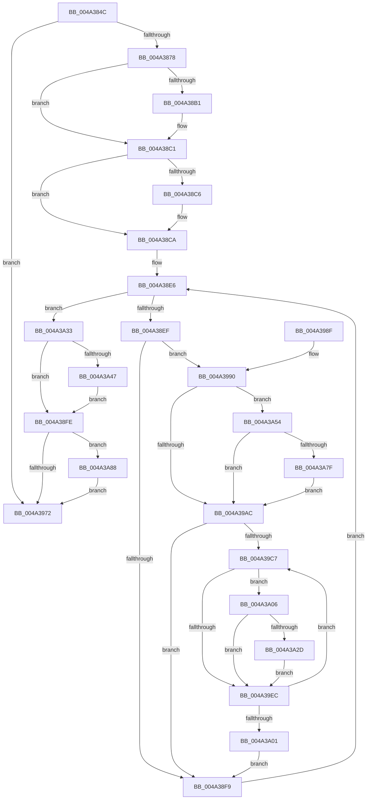

# PopFxStartDeviceAccounting

- RVA: `0x004A384C`–`0x004A3A92` (길이 `582` bytes)
- VA: `0x00000001404A384C`
- 실행 섹션: `.text`
- PDB 이름 있음: `예`; PDB Function 태그: `아니요`
- unwind 정보 RVA: `0x000B63E4`
- 디코드: `135`개 명령, `582/582` bytes 표시
- 미해석 바이트: `0` (있으면 어셈블리에 `.byte`로 보존)

> 이 문서는 커널 이미지의 기계어와 PDB 기호를 분석해 생성했습니다. 4번과 5번은 함수 원형과 자료형을 바이너리 사용 방식에서 추정한 C 해석이며 원본 소스 복구 결과는 아닙니다.

## 1. Dependencies

- 직접 호출 지점: **16**; 고유 호출 대상: **9**
- 직접 호출자로 확인된 함수: **1**
- RIP 상대 이미지 참조: **12**

### Outgoing calls
- `0x004A3898` → [KeAbPreAcquire](../21/KeAbPreAcquire_function_00210230.md) (function, `0x00210230`)
- `0x004A38BC` → [ExfAcquirePushLockSharedEx](../21/ExfAcquirePushLockSharedEx_function_0021044C.md) (function, `0x0021044C`)
- `0x004A3901` → [KeAbPostRelease](../2E/KeAbPostRelease_function_002E1600.md) (function, `0x002E1600`)
- `0x004A3906` → [KeLeaveCriticalRegion](../25/KeLeaveCriticalRegion_function_0025D8B0.md) (function, `0x0025D8B0`)
- `0x004A3912` → [KeAcquireSpinLockRaiseToDpc](../20/KeAcquireSpinLockRaiseToDpc_function_00208470.md) (function, `0x00208470`)
- `0x004A3960` → [KeReleaseSpinLock](../39/KeReleaseSpinLock_function_00392BA0.md) (function, `0x00392BA0`)
- `0x004A399A` → [KeAcquireSpinLockRaiseToDpc](../20/KeAcquireSpinLockRaiseToDpc_function_00208470.md) (function, `0x00208470`)
- `0x004A39B2` → [KeReleaseSpinLock](../39/KeReleaseSpinLock_function_00392BA0.md) (function, `0x00392BA0`)
- `0x004A39DE` → [KeAcquireSpinLockRaiseToDpc](../20/KeAcquireSpinLockRaiseToDpc_function_00208470.md) (function, `0x00208470`)
- `0x004A39F2` → [KeReleaseSpinLock](../39/KeReleaseSpinLock_function_00392BA0.md) (function, `0x00392BA0`)
- `0x004A3A10` → [memset](../6C/memset_function_006C6C40.md) (function, `0x006C6C40`)
- `0x004A3A22` → [memset](../6C/memset_function_006C6C40.md) (function, `0x006C6C40`)
- `0x004A3A4A` → [ExfReleasePushLockShared](../26/ExfReleasePushLockShared_function_00263440.md) (function, `0x00263440`)
- `0x004A3A5E` → [memset](../6C/memset_function_006C6C40.md) (function, `0x006C6C40`)
- `0x004A3A70` → [memset](../6C/memset_function_006C6C40.md) (function, `0x006C6C40`)
- `0x004A3A88` → [PopFxResumeDeviceAccounting](../43/PopFxResumeDeviceAccounting_function_0043D4D8.md) (function, `0x0043D4D8`)

### Direct callers
- [PopCaptureSleepStudyStatistics](../43/PopCaptureSleepStudyStatistics_function_004399F4.md) at `0x00439E73`

### Static image references
- `0x004A386B` → RVA `0x00E676B0` (`.data`; read)
- `0x004A3881` → RVA `0x00F0E408` (`.data`; read)
- `0x004A38D4` → RVA `0x00F0E3F0` (`.data`; read)
- `0x004A390B` → RVA `0x00F0E570` (`.data`; read)
- `0x004A3919` → RVA `0x00F0E6D0` (`.data`; write)
- `0x004A3923` → RVA `0x00F0E700` (`.data`; write)
- `0x004A392D` → RVA `0x00F0E728` (`.data`; write)
- `0x004A3936` → RVA `0x00F0E6D8` (`.data`; write)
- `0x004A3944` → RVA `0x00F0E6E0` (`.data`; read)
- `0x004A394B` → RVA `0x00F0E6F0` (`.data`; read)
- `0x004A3952` → RVA `0x00F0E708` (`.data`; read)
- `0x004A3959` → RVA `0x00F0E718` (`.data`; read)

## 2. Other-region calls and transfers

- 다른 실행 섹션으로 향하는 call: **0**
- 별도 외부 분기/꼬리 이동을 확인하지 못했습니다.

## 3. Assembly (complete function range)

```asm
004A384C  48 89 5C 24 10                  mov qword ptr [rsp + 0x10], rbx
004A3851  48 89 6C 24 18                  mov qword ptr [rsp + 0x18], rbp
004A3856  48 89 74 24 20                  mov qword ptr [rsp + 0x20], rsi
004A385B  57                              push rdi
004A385C  41 54                           push r12
004A385E  41 55                           push r13
004A3860  41 56                           push r14
004A3862  41 57                           push r15
004A3864  48 83 EC 20                     sub rsp, 0x20
004A3868  45 33 FF                        xor r15d, r15d
004A386B  44 39 3D 3E 3E 9C 00            cmp dword ptr [rip + 0x9c3e3e], r15d
004A3872  0F 84 FA 00 00 00               je 0x1404a3972
004A3878  65 48 8B 04 25 88 01 00 00      mov rax, qword ptr gs:[0x188]
004A3881  4C 8D 25 80 AB A6 00            lea r12, [rip + 0xa6ab80]
004A3888  45 33 C0                        xor r8d, r8d
004A388B  33 D2                           xor edx, edx
004A388D  49 8B CC                        mov rcx, r12
004A3890  66 FF 88 E4 01 00 00            dec word ptr [rax + 0x1e4]
004A3897  90                              nop
004A3898  E8 93 C9 D6 FF                  call 0x140210230
004A389D  48 8B D8                        mov rbx, rax
004A38A0  41 8D 4F 11                     lea ecx, [r15 + 0x11]
004A38A4  33 C0                           xor eax, eax
004A38A6  F0 48 0F B1 0D 59 AB A6 00      lock cmpxchg qword ptr [rip + 0xa6ab59], rcx
004A38AF  74 10                           je 0x1404a38c1
004A38B1  4D 8B CC                        mov r9, r12
004A38B4  4C 8B C3                        mov r8, rbx
004A38B7  33 D2                           xor edx, edx
004A38B9  49 8B CC                        mov rcx, r12
004A38BC  E8 8B CB D6 FF                  call 0x14021044c
004A38C1  48 85 DB                        test rbx, rbx
004A38C4  74 04                           je 0x1404a38ca
004A38C6  C6 43 0A 01                     mov byte ptr [rbx + 0xa], 1
004A38CA  48 BD 08 00 00 00 80 F7 FF FF   movabs rbp, 0xfffff78000000008
004A38D4  4C 8D 2D 15 AB A6 00            lea r13, [rip + 0xa6ab15]
004A38DB  48 8B 6D 00                     mov rbp, qword ptr [rbp]
004A38DF  48 8B 1D 0A AB A6 00            mov rbx, qword ptr [rip + 0xa6ab0a]
004A38E6  49 3B DD                        cmp rbx, r13
004A38E9  0F 84 44 01 00 00               je 0x1404a3a33
004A38EF  4C 39 7B 30                     cmp qword ptr [rbx + 0x30], r15
004A38F3  0F 85 97 00 00 00               jne 0x1404a3990
004A38F9  48 8B 1B                        mov rbx, qword ptr [rbx]
004A38FC  EB E8                           jmp 0x1404a38e6
004A38FE  49 8B CC                        mov rcx, r12
004A3901  E8 FA DC E3 FF                  call 0x1402e1600
004A3906  E8 A5 9F DB FF                  call 0x14025d8b0
004A390B  48 8D 0D 5E AC A6 00            lea rcx, [rip + 0xa6ac5e]
004A3912  E8 59 4B D6 FF                  call 0x140208470
004A3917  33 D2                           xor edx, edx
004A3919  4C 89 3D B0 AD A6 00            mov qword ptr [rip + 0xa6adb0], r15
004A3920  0F 57 C0                        xorps xmm0, xmm0
004A3923  48 89 15 D6 AD A6 00            mov qword ptr [rip + 0xa6add6], rdx
004A392A  0F 57 C9                        xorps xmm1, xmm1
004A392D  48 89 15 F4 AD A6 00            mov qword ptr [rip + 0xa6adf4], rdx
004A3934  8A D0                           mov dl, al
004A3936  4C 89 3D 9B AD A6 00            mov qword ptr [rip + 0xa6ad9b], r15
004A393D  48 8D 0D 2C AC A6 00            lea rcx, [rip + 0xa6ac2c]
004A3944  0F 11 05 95 AD A6 00            movups xmmword ptr [rip + 0xa6ad95], xmm0
004A394B  0F 11 05 9E AD A6 00            movups xmmword ptr [rip + 0xa6ad9e], xmm0
004A3952  0F 11 0D AF AD A6 00            movups xmmword ptr [rip + 0xa6adaf], xmm1
004A3959  0F 11 0D B8 AD A6 00            movups xmmword ptr [rip + 0xa6adb8], xmm1
004A3960  E8 3B F2 EE FF                  call 0x140392ba0
004A3965  83 3D 44 3D 9C 00 01            cmp dword ptr [rip + 0x9c3d44], 1
004A396C  0F 84 16 01 00 00               je 0x1404a3a88
004A3972  48 8B 5C 24 58                  mov rbx, qword ptr [rsp + 0x58]
004A3977  48 8B 6C 24 60                  mov rbp, qword ptr [rsp + 0x60]
004A397C  48 8B 74 24 68                  mov rsi, qword ptr [rsp + 0x68]
004A3981  48 83 C4 20                     add rsp, 0x20
004A3985  41 5F                           pop r15
004A3987  41 5E                           pop r14
004A3989  41 5D                           pop r13
004A398B  41 5C                           pop r12
004A398D  5F                              pop rdi
004A398E  C3                              ret
004A398F  CC                              int3
004A3990  48 8D BB 80 02 00 00            lea rdi, [rbx + 0x280]
004A3997  48 8B CF                        mov rcx, rdi
004A399A  E8 D1 4A D6 FF                  call 0x140208470
004A399F  40 8A F0                        mov sil, al
004A39A2  44 39 7F 10                     cmp dword ptr [rdi + 0x10], r15d
004A39A6  0F 85 A8 00 00 00               jne 0x1404a3a54
004A39AC  40 8A D6                        mov dl, sil
004A39AF  48 8B CF                        mov rcx, rdi
004A39B2  E8 E9 F1 EE FF                  call 0x140392ba0
004A39B7  41 8B F7                        mov esi, r15d
004A39BA  44 39 BB 64 03 00 00            cmp dword ptr [rbx + 0x364], r15d
004A39C1  0F 86 32 FF FF FF               jbe 0x1404a38f9
004A39C7  48 8B 83 68 03 00 00            mov rax, qword ptr [rbx + 0x368]
004A39CE  8B CE                           mov ecx, esi
004A39D0  48 8B 3C C8                     mov rdi, qword ptr [rax + rcx*8]
004A39D4  48 81 C7 C8 00 00 00            add rdi, 0xc8
004A39DB  48 8B CF                        mov rcx, rdi
004A39DE  E8 8D 4A D6 FF                  call 0x140208470
004A39E3  44 8A F0                        mov r14b, al
004A39E6  44 39 7F 10                     cmp dword ptr [rdi + 0x10], r15d
004A39EA  75 1A                           jne 0x1404a3a06
004A39EC  41 8A D6                        mov dl, r14b
004A39EF  48 8B CF                        mov rcx, rdi
004A39F2  E8 A9 F1 EE FF                  call 0x140392ba0
004A39F7  FF C6                           inc esi
004A39F9  3B B3 64 03 00 00               cmp esi, dword ptr [rbx + 0x364]
004A39FF  72 C6                           jb 0x1404a39c7
004A3A01  E9 F3 FE FF FF                  jmp 0x1404a38f9
004A3A06  33 D2                           xor edx, edx
004A3A08  48 8D 4F 20                     lea rcx, [rdi + 0x20]
004A3A0C  44 8D 42 60                     lea r8d, [rdx + 0x60]
004A3A10  E8 2B 32 22 00                  call 0x1406c6c40
004A3A15  33 D2                           xor edx, edx
004A3A17  48 8D 8F 80 00 00 00            lea rcx, [rdi + 0x80]
004A3A1E  44 8D 42 60                     lea r8d, [rdx + 0x60]
004A3A22  E8 19 32 22 00                  call 0x1406c6c40
004A3A27  44 38 7F 08                     cmp byte ptr [rdi + 8], r15b
004A3A2B  74 BF                           je 0x1404a39ec
004A3A2D  48 89 6F 18                     mov qword ptr [rdi + 0x18], rbp
004A3A31  EB B9                           jmp 0x1404a39ec
004A3A33  B8 11 00 00 00                  mov eax, 0x11
004A3A38  F0 4C 0F B1 3D C7 A9 A6 00      lock cmpxchg qword ptr [rip + 0xa6a9c7], r15
004A3A41  0F 84 B7 FE FF FF               je 0x1404a38fe
004A3A47  49 8B CC                        mov rcx, r12
004A3A4A  E8 F1 F9 DB FF                  call 0x140263440
004A3A4F  E9 AA FE FF FF                  jmp 0x1404a38fe
004A3A54  33 D2                           xor edx, edx
004A3A56  48 8D 4F 20                     lea rcx, [rdi + 0x20]
004A3A5A  44 8D 42 60                     lea r8d, [rdx + 0x60]
004A3A5E  E8 DD 31 22 00                  call 0x1406c6c40
004A3A63  33 D2                           xor edx, edx
004A3A65  48 8D 8F 80 00 00 00            lea rcx, [rdi + 0x80]
004A3A6C  44 8D 42 60                     lea r8d, [rdx + 0x60]
004A3A70  E8 CB 31 22 00                  call 0x1406c6c40
004A3A75  44 38 7F 08                     cmp byte ptr [rdi + 8], r15b
004A3A79  0F 84 2D FF FF FF               je 0x1404a39ac
004A3A7F  48 89 6F 18                     mov qword ptr [rdi + 0x18], rbp
004A3A83  E9 24 FF FF FF                  jmp 0x1404a39ac
004A3A88  E8 4B 9A F9 FF                  call 0x14043d4d8
004A3A8D  E9 E0 FE FF FF                  jmp 0x1404a3972
```

## 4. C-style interpretation (structured pseudocode)

```c
__int64 __fastcall PopFxStartDeviceAccounting(__int64 a1, int a2, int a3)
{
    __int64 result;
    __int64 v_r15;
    __int64 v_rdi;
    __int64 v_rsi;
    __int64 v_rsp;
    unsigned __int64 v_stack_p10;
    unsigned __int64 v_stack_p18;
    unsigned __int64 v_stack_p20;

    v_stack_p10 = v_rbx;
    v_stack_p18 = v_rbp;
    v_stack_p20 = v_rsi;
    v_rsp = (v_rsp) - (32);
    v_r15 = 0;
    if ((*(unsigned int *)(v_rip + 10239550)) == 0) goto loc_004A3972;
    a3 = 0;
    a2 = 0;
    result = KeAbPreAcquire(v_rip + 10922880, a2, a3, a4);
    result = 0;
    if (!(condition_is_equal)) {
        a4 = v_rip + 10922880;
        a3 = 0;
        a2 = 0;
        a1 = v_rip + 10922880;
        result = ExfAcquirePushLockSharedEx(a1, a2, a3, a4);
    }
    if (result != 0) {
        *(unsigned __int8 *)(result + 10) = 1;
    }
loc_004A38E6:
    if ((*(unsigned __int64 *)(v_rip + 10922762)) == (v_rip + 10922773)) goto loc_004A3A33;
    if ((*(unsigned __int64 *)(*(unsigned __int64 *)(v_rip + 10922762) + 48)) != 0) goto loc_004A3990;
loc_004A38F9:
    goto loc_004A38E6;
loc_004A38FE:
    result = KeAbPostRelease(v_rip + 10922880, a2, a3, a4);
    result = KeLeaveCriticalRegion(v_rip + 10922880, a2, a3, a4);
    result = KeAcquireSpinLockRaiseToDpc(v_rip + 10923102, a2, a3, a4);
    a2 = 0;
    *(unsigned __int64 *)(v_rip + 10923440) = 0;
    *(unsigned __int64 *)(v_rip + 10923478) = 0;
    *(unsigned __int64 *)(v_rip + 10923508) = 0;
    *(unsigned __int64 *)(v_rip + 10923419) = 0;
    *(unsigned __int64 *)(v_rip + 10923413) = v_xmm0;
    *(unsigned __int64 *)(v_rip + 10923422) = v_xmm0;
    *(unsigned __int64 *)(v_rip + 10923439) = v_xmm1;
    *(unsigned __int64 *)(v_rip + 10923448) = v_xmm1;
    result = KeReleaseSpinLock(v_rip + 10923052, (unsigned __int8)(result), a3, a4);
    if ((*(unsigned int *)(v_rip + 10239300)) == 1) goto loc_004A3A88;
loc_004A3972:
    v_rsp = (v_rsp) + (32);
    return result;
loc_004A3990:
    result = KeAcquireSpinLockRaiseToDpc(v_stack_p10 + 640, (unsigned __int8)(result), a3, a4);
    if ((*(unsigned int *)(v_stack_p10 + 640 + 16)) != 0) goto loc_004A3A54;
loc_004A39AC:
    result = KeReleaseSpinLock(v_stack_p10 + 640, (unsigned __int8)((unsigned __int8)(result)), a3, a4);
    if ((*(unsigned int *)(v_stack_p10 + 868)) <= 0) goto loc_004A38F9;
loc_004A39C7:
    v_rdi = (*(unsigned __int64 *)(*(unsigned __int64 *)(v_stack_p10 + 872) + 0 * 8)) + (200);
    result = KeAcquireSpinLockRaiseToDpc(v_rdi, (unsigned __int8)((unsigned __int8)(result)), a3, a4);
    if ((*(unsigned int *)(v_rdi + 16)) != 0) goto loc_004A3A06;
loc_004A39EC:
    result = KeReleaseSpinLock(v_rdi, (unsigned __int8)((unsigned __int8)(result)), a3, a4);
    v_rsi = (unsigned int)((0) + 1);
    if (((unsigned int)(v_rsi)) < (*(unsigned int *)(v_stack_p10 + 868))) goto loc_004A39C7;
    goto loc_004A38F9;
loc_004A3A06:
    a2 = 0;
    result = memset(v_rdi + 32, a2, a2 + 96, a4);
    a2 = 0;
    result = memset(v_rdi + 128, a2, a2 + 96, a4);
    if ((*(unsigned __int8 *)(v_rdi + 8)) == 0) goto loc_004A39EC;
    *(unsigned __int64 *)(v_rdi + 24) = v_stack_p18;
    goto loc_004A39EC;
loc_004A3A33:
    if ((*(unsigned __int8 *)(v_rdi + 8)) == 0) goto loc_004A38FE;
    result = ExfReleasePushLockShared(v_rip + 10922880, a2, a2 + 96, a4);
    goto loc_004A38FE;
loc_004A3A54:
    a2 = 0;
    result = memset(v_rdi + 32, a2, a2 + 96, a4);
    a2 = 0;
    result = memset(v_rdi + 128, a2, a2 + 96, a4);
    if ((*(unsigned __int8 *)(v_rdi + 8)) == 0) goto loc_004A39AC;
    *(unsigned __int64 *)(v_rdi + 24) = v_stack_p18;
    goto loc_004A39AC;
loc_004A3A88:
    result = PopFxResumeDeviceAccounting(v_rdi + 128, a2, a2 + 96, a4);
    goto loc_004A3972;
}
```

## 5. (Beta) C Style

```c
int64_t PopFxStartDeviceAccounting(int64_t Arg1, int32_t Arg2, int32_t Arg3)
{
    int64_t result;
    int64_t local_r15;
    int64_t local_rdi;
    int64_t local_rsi;
    int64_t local_rsp;
    uint64_t v_stack_p10;
    uint64_t v_stack_p18;
    uint64_t v_stack_p20;

    v_stack_p10 = local_rbx;
    v_stack_p18 = local_rbp;
    v_stack_p20 = local_rsi;
    local_rsp = (local_rsp) - (32);
    local_r15 = 0;
    if ((*(uint32_t *)(v_rip + 0x9C3E3E)) == 0) goto loc_004A3972;
    Arg3 = 0;
    Arg2 = 0;
    result = KeAbPreAcquire(v_rip + 10922880, Arg2, Arg3, a4);
    result = 0;
    if (!(condition_is_equal)) {
        a4 = v_rip + 10922880;
        Arg3 = 0;
        Arg2 = 0;
        Arg1 = v_rip + 10922880;
        result = ExfAcquirePushLockSharedEx(Arg1, Arg2, Arg3, a4);
    }
    if (result != 0) {
        *(uint8_t *)(result + 0xA) = 1;
    }
loc_004A38E6:
    if ((*(uint64_t *)(v_rip + 0xA6AB0A)) == (v_rip + 10922773)) goto loc_004A3A33;
    if ((*(uint64_t *)(*(uint64_t *)(v_rip + 0xA6AB0A) + 0x30)) != 0) goto loc_004A3990;
loc_004A38F9:
    goto loc_004A38E6;
loc_004A38FE:
    result = KeAbPostRelease(v_rip + 10922880, Arg2, Arg3, a4);
    result = KeLeaveCriticalRegion(v_rip + 10922880, Arg2, Arg3, a4);
    result = KeAcquireSpinLockRaiseToDpc(v_rip + 10923102, Arg2, Arg3, a4);
    Arg2 = 0;
    *(uint64_t *)(v_rip + 0xA6ADB0) = 0;
    *(uint64_t *)(v_rip + 0xA6ADD6) = 0;
    *(uint64_t *)(v_rip + 0xA6ADF4) = 0;
    *(uint64_t *)(v_rip + 0xA6AD9B) = 0;
    *(uint64_t *)(v_rip + 0xA6AD95) = v_xmm0;
    *(uint64_t *)(v_rip + 0xA6AD9E) = v_xmm0;
    *(uint64_t *)(v_rip + 0xA6ADAF) = v_xmm1;
    *(uint64_t *)(v_rip + 0xA6ADB8) = v_xmm1;
    result = KeReleaseSpinLock(v_rip + 10923052, (uint8_t)(result), Arg3, a4);
    if ((*(uint32_t *)(v_rip + 0x9C3D44)) == 1) goto loc_004A3A88;
loc_004A3972:
    local_rsp = (local_rsp) + (32);
    return result;
loc_004A3990:
    result = KeAcquireSpinLockRaiseToDpc(v_stack_p10 + 640, (uint8_t)(result), Arg3, a4);
    if ((*(uint32_t *)(v_stack_p10 + 0x280 + 0x10)) != 0) goto loc_004A3A54;
loc_004A39AC:
    result = KeReleaseSpinLock(v_stack_p10 + 640, (uint8_t)((uint8_t)(result)), Arg3, a4);
    if ((*(uint32_t *)(v_stack_p10 + 0x364)) <= 0) goto loc_004A38F9;
loc_004A39C7:
    local_rdi = (*(uint64_t *)(*(uint64_t *)(v_stack_p10 + 0x368) + 0x0 * 8)) + (200);
    result = KeAcquireSpinLockRaiseToDpc(local_rdi, (uint8_t)((uint8_t)(result)), Arg3, a4);
    if ((*(uint32_t *)(local_rdi + 0x10)) != 0) goto loc_004A3A06;
loc_004A39EC:
    result = KeReleaseSpinLock(local_rdi, (uint8_t)((uint8_t)(result)), Arg3, a4);
    local_rsi = (uint32_t)((0) + 1);
    if (((uint32_t)(local_rsi)) < (*(uint32_t *)(v_stack_p10 + 0x364))) goto loc_004A39C7;
    goto loc_004A38F9;
loc_004A3A06:
    Arg2 = 0;
    result = memset(local_rdi + 32, Arg2, Arg2 + 96, a4);
    Arg2 = 0;
    result = memset(local_rdi + 128, Arg2, Arg2 + 96, a4);
    if ((*(uint8_t *)(local_rdi + 0x8)) == 0) goto loc_004A39EC;
    *(uint64_t *)(local_rdi + 0x18) = v_stack_p18;
    goto loc_004A39EC;
loc_004A3A33:
    if ((*(uint8_t *)(local_rdi + 0x8)) == 0) goto loc_004A38FE;
    result = ExfReleasePushLockShared(v_rip + 10922880, Arg2, Arg2 + 96, a4);
    goto loc_004A38FE;
loc_004A3A54:
    Arg2 = 0;
    result = memset(local_rdi + 32, Arg2, Arg2 + 96, a4);
    Arg2 = 0;
    result = memset(local_rdi + 128, Arg2, Arg2 + 96, a4);
    if ((*(uint8_t *)(local_rdi + 0x8)) == 0) goto loc_004A39AC;
    *(uint64_t *)(local_rdi + 0x18) = v_stack_p18;
    goto loc_004A39AC;
loc_004A3A88:
    result = PopFxResumeDeviceAccounting(local_rdi + 128, Arg2, Arg2 + 96, a4);
    goto loc_004A3972;
}
```

## 6. Execution-region graph

[열기: 2D/3D 그래프와 함수 탐색 컨트롤 패널](../../../control-panel.html?section=text&rva=0x004A384C&view=graph)

- 2D 그래프는 위에서 아래로 흐르고, 3D 그래프는 빈 공간을 드래그해 회전합니다. Shift+드래그는 이동, 휠은 확대·축소, 함수 노드 선택은 대상 보고서 이동입니다.

### Static fallback


