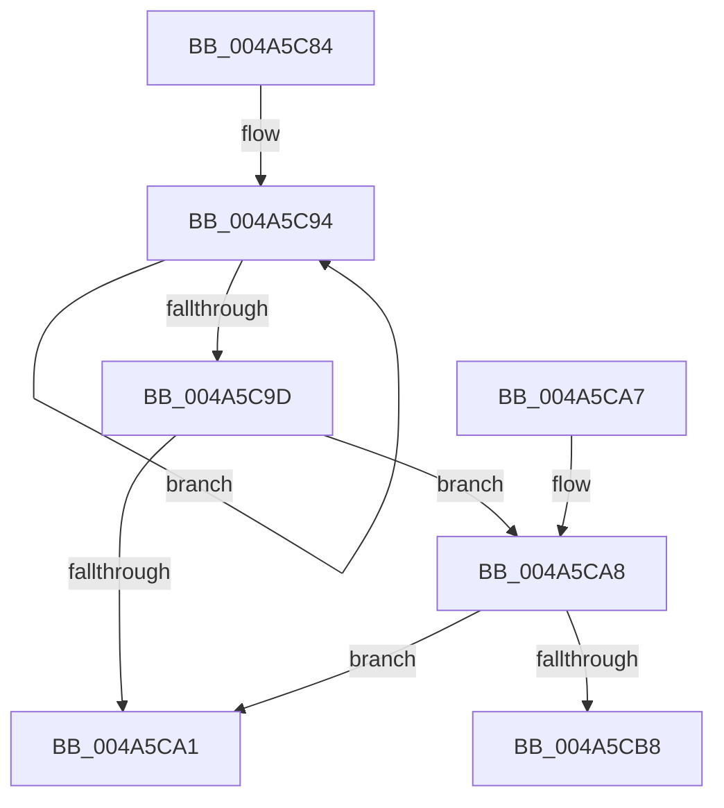

# PopFxUpdateDeviceIdleTimer

- RVA: `0x004A5C84`–`0x004A5CBD` (길이 `57` bytes)
- VA: `0x00000001404A5C84`
- 실행 섹션: `.text`
- PDB 이름 있음: `예`; PDB Function 태그: `예`
- unwind 정보 RVA: `0x0008C670`
- 디코드: `19`개 명령, `57/57` bytes 표시
- 미해석 바이트: `0` (있으면 어셈블리에 `.byte`로 보존)

> 이 문서는 커널 이미지의 기계어와 PDB 기호를 분석해 생성했습니다. 4번과 5번은 함수 원형과 자료형을 바이너리 사용 방식에서 추정한 C 해석이며 원본 소스 복구 결과는 아닙니다.

## 1. Dependencies

- 직접 호출 지점: **1**; 고유 호출 대상: **1**
- 직접 호출자로 확인된 함수: **2**
- RIP 상대 이미지 참조: **0**

### Outgoing calls
- `0x004A5CAF` → [KeCancelTimer](../23/KeCancelTimer_function_002327E0.md) (function, `0x002327E0`)

### Direct callers
- [sub_002BD6E6](../2B/Unknown_function_002BD6E6.md) at `0x002BD7F6`
- [PoFxSetDeviceIdleTimeout](PoFxSetDeviceIdleTimeout_function_004A5C10.md) at `0x004A5C56`

### Static image references
- 디코드된 RIP-relative 메모리 참조가 없습니다.

## 2. Other-region calls and transfers

- 다른 실행 섹션으로 향하는 call: **0**
- call이 아닌 외부 분기/꼬리 이동: **1**
  - `0x004A5CB8` → [sub_006F985C](../6F/Unknown_function_006F985C.md) (`tail-transfer`)

## 3. Assembly (complete function range)

```asm
004A5C84  40 53                           push rbx
004A5C86  48 83 EC 20                     sub rsp, 0x20
004A5C8A  48 8B D9                        mov rbx, rcx
004A5C8D  0F 0D 49 20                     prefetchw byte ptr [rcx + 0x20]
004A5C91  8B 41 20                        mov eax, dword ptr [rcx + 0x20]
004A5C94  8B D0                           mov edx, eax
004A5C96  F0 0F B1 51 20                  lock cmpxchg dword ptr [rcx + 0x20], edx
004A5C9B  75 F7                           jne 0x1404a5c94
004A5C9D  A8 04                           test al, 4
004A5C9F  75 07                           jne 0x1404a5ca8
004A5CA1  48 83 C4 20                     add rsp, 0x20
004A5CA5  5B                              pop rbx
004A5CA6  C3                              ret
004A5CA7  CC                              int3
004A5CA8  48 81 C1 98 01 00 00            add rcx, 0x198
004A5CAF  E8 2C CB D8 FF                  call 0x1402327e0
004A5CB4  84 C0                           test al, al
004A5CB6  74 E9                           je 0x1404a5ca1
004A5CB8  E9 9F 3B 25 00                  jmp 0x1406f985c
```

## 4. C-style interpretation (structured pseudocode)

```c
__int64 __fastcall PopFxUpdateDeviceIdleTimer(__int64 a1)
{
    __int64 result;
    __int64 v_rsp;

    v_rsp = (v_rsp) - (32);
loc_004A5C94:
    if (condition_is_not_equal) goto loc_004A5C94;
    if ((((unsigned __int8)((unsigned int)(*(unsigned int *)(a1 + 32)))) & (4)) != 0) goto loc_004A5CA8;
loc_004A5CA1:
    v_rsp = (v_rsp) + (32);
    return (unsigned int)(*(unsigned int *)(a1 + 32));
loc_004A5CA8:
    a1 = (a1) + (408);
    result = KeCancelTimer(a1, (unsigned int)((unsigned int)((unsigned int)(*(unsigned int *)(a1 + 32)))), a3, a4);
    if ((unsigned __int8)(result) == 0) goto loc_004A5CA1;
}
```

## 5. (Beta) C Style

```c
int64_t PopFxUpdateDeviceIdleTimer(void *Arg1)
{
    uint8_t *arg1 = (uint8_t *)Arg1;

    int64_t result;
    int64_t local_rsp;

    local_rsp = (local_rsp) - (32);
loc_004A5C94:
    if (condition_is_not_equal) goto loc_004A5C94;
    if ((((uint8_t)((uint32_t)(*(uint32_t *)(arg1 + 0x20)))) & (4)) != 0) goto loc_004A5CA8;
loc_004A5CA1:
    local_rsp = (local_rsp) + (32);
    return (uint32_t)(*(uint32_t *)(arg1 + 0x20));
loc_004A5CA8:
    Arg1 = (Arg1) + (408);
    result = KeCancelTimer(Arg1, (uint32_t)((uint32_t)((uint32_t)(*(uint32_t *)(arg1 + 0x20)))), a3, a4);
    if ((uint8_t)(result) == 0) goto loc_004A5CA1;
}
```

### 관측된 메모리 오프셋

구조체 형식이 확인되지 않은 접근은 인자 기준의 오프셋으로만 기록했습니다.

| 기준 인자 | 오프셋 표현 | 폭 (bit) | 접근 |
|---|---:|---:|---|
| `Arg1` | `+ 0x20` | `8` | `R` |
| `Arg1` | `+ 0x20` | `32` | `R` |

## 6. Execution-region graph

[열기: 2D/3D 그래프와 함수 탐색 컨트롤 패널](../../../control-panel.html?section=text&rva=0x004A5C84&view=graph)

- 2D 그래프는 위에서 아래로 흐르고, 3D 그래프는 빈 공간을 드래그해 회전합니다. Shift+드래그는 이동, 휠은 확대·축소, 함수 노드 선택은 대상 보고서 이동입니다.

### Static fallback


