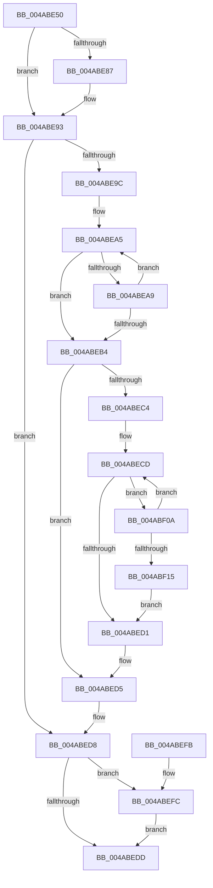

# PopPepGetMinimumDevicePowerState

- RVA: `0x004ABE50`–`0x004ABF17` (길이 `199` bytes)
- VA: `0x00000001404ABE50`
- 실행 섹션: `.text`
- PDB 이름 있음: `예`; PDB Function 태그: `아니요`
- unwind 정보 RVA: `0x000B817C`
- 디코드: `62`개 명령, `199/199` bytes 표시
- 미해석 바이트: `0` (있으면 어셈블리에 `.byte`로 보존)

> 이 문서는 커널 이미지의 기계어와 PDB 기호를 분석해 생성했습니다. 4번과 5번은 함수 원형과 자료형을 바이너리 사용 방식에서 추정한 C 해석이며 원본 소스 복구 결과는 아닙니다.

## 1. Dependencies

- 직접 호출 지점: **2**; 고유 호출 대상: **2**
- 직접 호출자로 확인된 함수: **1**
- RIP 상대 이미지 참조: **0**

### Outgoing calls
- `0x004ABE8B` → [ExAcquireSpinLockShared](../24/ExAcquireSpinLockShared_function_0024DCE0.md) (function, `0x0024DCE0`)
- `0x004ABF03` → [ExReleaseSpinLockShared](../2F/ExReleaseSpinLockShared_function_002F0EF0.md) (function, `0x002F0EF0`)

### Direct callers
- [PoFxSetTargetDripsDevicePowerState](../../page/A8/PoFxSetTargetDripsDevicePowerState_function_00A88EB0.md) at `0x00A88F72`

### Static image references
- 디코드된 RIP-relative 메모리 참조가 없습니다.

## 2. Other-region calls and transfers

- 다른 실행 섹션으로 향하는 call: **0**
- 별도 외부 분기/꼬리 이동을 확인하지 못했습니다.

## 3. Assembly (complete function range)

```asm
004ABE50  48 8B C4                        mov rax, rsp
004ABE53  48 89 58 08                     mov qword ptr [rax + 8], rbx
004ABE57  48 89 68 10                     mov qword ptr [rax + 0x10], rbp
004ABE5B  48 89 70 18                     mov qword ptr [rax + 0x18], rsi
004ABE5F  48 89 78 20                     mov qword ptr [rax + 0x20], rdi
004ABE63  41 56                           push r14
004ABE65  48 83 EC 20                     sub rsp, 0x20
004ABE69  48 8B D9                        mov rbx, rcx
004ABE6C  40 32 FF                        xor dil, dil
004ABE6F  8B CA                           mov ecx, edx
004ABE71  BE 01 00 00 00                  mov esi, 1
004ABE76  D3 E6                           shl esi, cl
004ABE78  4D 8B F1                        mov r14, r9
004ABE7B  41 8A E8                        mov bpl, r8b
004ABE7E  45 0F 20 C2                     mov r10, cr8
004ABE82  45 84 C0                        test r8b, r8b
004ABE85  74 0C                           je 0x1404abe93
004ABE87  48 8D 4B 40                     lea rcx, [rbx + 0x40]
004ABE8B  E8 50 1E DA FF                  call 0x14024dce0
004ABE90  44 8A D0                        mov r10b, al
004ABE93  83 BB AC 00 00 00 02            cmp dword ptr [rbx + 0xac], 2
004ABE9A  75 3C                           jne 0x1404abed8
004ABE9C  33 C9                           xor ecx, ecx
004ABE9E  48 8D 93 90 00 00 00            lea rdx, [rbx + 0x90]
004ABEA5  85 32                           test dword ptr [rdx], esi
004ABEA7  74 0B                           je 0x1404abeb4
004ABEA9  FF C1                           inc ecx
004ABEAB  48 83 C2 04                     add rdx, 4
004ABEAF  83 F9 03                        cmp ecx, 3
004ABEB2  72 F1                           jb 0x1404abea5
004ABEB4  48 8B 54 24 50                  mov rdx, qword ptr [rsp + 0x50]
004ABEB9  8D 41 01                        lea eax, [rcx + 1]
004ABEBC  41 89 06                        mov dword ptr [r14], eax
004ABEBF  48 85 D2                        test rdx, rdx
004ABEC2  74 11                           je 0x1404abed5
004ABEC4  33 C0                           xor eax, eax
004ABEC6  48 8D 8B 9C 00 00 00            lea rcx, [rbx + 0x9c]
004ABECD  85 31                           test dword ptr [rcx], esi
004ABECF  75 39                           jne 0x1404abf0a
004ABED1  FF C0                           inc eax
004ABED3  89 02                           mov dword ptr [rdx], eax
004ABED5  40 B7 01                        mov dil, 1
004ABED8  40 84 ED                        test bpl, bpl
004ABEDB  75 1F                           jne 0x1404abefc
004ABEDD  48 8B 5C 24 30                  mov rbx, qword ptr [rsp + 0x30]
004ABEE2  40 8A C7                        mov al, dil
004ABEE5  48 8B 7C 24 48                  mov rdi, qword ptr [rsp + 0x48]
004ABEEA  48 8B 6C 24 38                  mov rbp, qword ptr [rsp + 0x38]
004ABEEF  48 8B 74 24 40                  mov rsi, qword ptr [rsp + 0x40]
004ABEF4  48 83 C4 20                     add rsp, 0x20
004ABEF8  41 5E                           pop r14
004ABEFA  C3                              ret
004ABEFB  CC                              int3
004ABEFC  48 8D 4B 40                     lea rcx, [rbx + 0x40]
004ABF00  41 8A D2                        mov dl, r10b
004ABF03  E8 E8 4F E4 FF                  call 0x1402f0ef0
004ABF08  EB D3                           jmp 0x1404abedd
004ABF0A  FF C0                           inc eax
004ABF0C  48 83 C1 04                     add rcx, 4
004ABF10  83 F8 03                        cmp eax, 3
004ABF13  72 B8                           jb 0x1404abecd
004ABF15  EB BA                           jmp 0x1404abed1
```

## 4. C-style interpretation (structured pseudocode)

```c
__int64 __fastcall PopPepGetMinimumDevicePowerState(__int64 a1, int a2, unsigned __int8 a3, __int64 a4, __int64 a5)
{
    __int64 result;
    __int64 v_r10;
    __int64 v_rdi;
    __int64 v_rsi;
    __int64 v_rsp;
    unsigned __int64 v_stack_p10;
    unsigned __int64 v_stack_p18;
    unsigned __int64 v_stack_p20;
    unsigned __int64 v_stack_p8;

    *(unsigned __int64 *)(v_rsp + 8) = v_rbx;
    *(unsigned __int64 *)(v_rsp + 16) = v_rbp;
    *(unsigned __int64 *)(v_rsp + 24) = v_rsi;
    *(unsigned __int64 *)(v_rsp + 32) = v_rdi;
    v_rsp = (v_rsp) - (32);
    v_rdi = 0;
    v_rsi = (unsigned int)((1) << ((unsigned __int8)((unsigned int)(a2))));
    result = v_rsp;
    v_r10 = v_cr8;
    if (a3 != 0) {
        a1 = a1 + 64;
        result = ExAcquireSpinLockShared(a1, a2, a3, a4);
        v_r10 = (unsigned __int8)(result);
    }
    if ((*(unsigned int *)(a1 + 172)) != 2) goto loc_004ABED8;
    a1 = 0;
loc_004ABEA5:
    if (((*(unsigned int *)(a1 + 144)) & ((unsigned int)(v_rsi))) == 0) goto loc_004ABEB4;
    a1 = (unsigned int)((a1) + 1);
    a2 = (a1 + 144) + (4);
    if (((unsigned int)(a1)) < 3) goto loc_004ABEA5;
loc_004ABEB4:
    *(unsigned int *)(a4) = (unsigned int)(a1 + 1);
    if (a5 == 0) goto loc_004ABED5;
    result = 0;
loc_004ABECD:
    if (((*(unsigned int *)(a1 + 156)) & ((unsigned int)(v_rsi))) != 0) goto loc_004ABF0A;
loc_004ABED1:
    result = (unsigned int)((result) + 1);
    *(unsigned int *)(a5) = (unsigned int)(result);
loc_004ABED5:
loc_004ABED8:
    if (a3 != 0) goto loc_004ABEFC;
loc_004ABEDD:
    v_rsp = (v_rsp) + (32);
    return 1;
loc_004ABEFC:
    result = ExReleaseSpinLockShared(v_stack_p8 + 64, (unsigned __int8)(v_r10), a3, a4);
    goto loc_004ABEDD;
loc_004ABF0A:
    result = (unsigned int)((result) + 1);
    a1 = (v_stack_p8 + 64) + (4);
    if (((unsigned int)(result)) < 3) goto loc_004ABECD;
    goto loc_004ABED1;
}
```

## 5. (Beta) C Style

```c
int64_t PopPepGetMinimumDevicePowerState(void *Arg1, int32_t Arg2, uint8_t Arg3, void *Arg4, int64_t Arg5)
{
    uint8_t *arg1 = (uint8_t *)Arg1;
    uint8_t *arg4 = (uint8_t *)Arg4;

    int64_t result;
    int64_t local_r10;
    int64_t local_rdi;
    int64_t local_rsi;
    int64_t local_rsp;
    uint64_t v_stack_p10;
    uint64_t v_stack_p18;
    uint64_t v_stack_p20;
    uint64_t v_stack_p8;

    *(uint64_t *)(local_rsp + 0x8) = local_rbx;
    *(uint64_t *)(local_rsp + 0x10) = local_rbp;
    *(uint64_t *)(local_rsp + 0x18) = local_rsi;
    *(uint64_t *)(local_rsp + 0x20) = local_rdi;
    local_rsp = (local_rsp) - (32);
    local_rdi = 0;
    local_rsi = (uint32_t)((1) << ((uint8_t)((uint32_t)(Arg2))));
    result = local_rsp;
    local_r10 = v_cr8;
    if (Arg3 != 0) {
        Arg1 = Arg1 + 64;
        result = ExAcquireSpinLockShared(Arg1, Arg2, Arg3, Arg4);
        local_r10 = (uint8_t)(result);
    }
    if ((*(uint32_t *)(arg1 + 0xAC)) != 2) goto loc_004ABED8;
    Arg1 = 0;
loc_004ABEA5:
    if (((*(uint32_t *)(arg1 + 0x90)) & ((uint32_t)(local_rsi))) == 0) goto loc_004ABEB4;
    Arg1 = (uint32_t)((Arg1) + 1);
    Arg2 = (Arg1 + 144) + (4);
    if (((uint32_t)(Arg1)) < 3) goto loc_004ABEA5;
loc_004ABEB4:
    *(uint32_t *)(arg4) = (uint32_t)(Arg1 + 1);
    if (Arg5 == 0) goto loc_004ABED5;
    result = 0;
loc_004ABECD:
    if (((*(uint32_t *)(arg1 + 0x9C)) & ((uint32_t)(local_rsi))) != 0) goto loc_004ABF0A;
loc_004ABED1:
    result = (uint32_t)((result) + 1);
    *(uint32_t *)(Arg5) = (uint32_t)(result);
loc_004ABED5:
loc_004ABED8:
    if (Arg3 != 0) goto loc_004ABEFC;
loc_004ABEDD:
    local_rsp = (local_rsp) + (32);
    return 1;
loc_004ABEFC:
    result = ExReleaseSpinLockShared(v_stack_p8 + 64, (uint8_t)(local_r10), Arg3, Arg4);
    goto loc_004ABEDD;
loc_004ABF0A:
    result = (uint32_t)((result) + 1);
    Arg1 = (v_stack_p8 + 64) + (4);
    if (((uint32_t)(result)) < 3) goto loc_004ABECD;
    goto loc_004ABED1;
}
```

### 관측된 메모리 오프셋

구조체 형식이 확인되지 않은 접근은 인자 기준의 오프셋으로만 기록했습니다.

| 기준 인자 | 오프셋 표현 | 폭 (bit) | 접근 |
|---|---:|---:|---|
| `Arg1` | `+ 0x0` | `32` | `R` |
| `Arg1` | `+ 0x40` | `64` | `R` |
| `Arg1` | `+ 0x90` | `64` | `R` |
| `Arg1` | `+ 0x9C` | `64` | `R` |
| `Arg1` | `+ 0xAC` | `32` | `R` |
| `Arg4` | `+ 0x0` | `32` | `W` |

## 6. Execution-region graph

[열기: 2D/3D 그래프와 함수 탐색 컨트롤 패널](../../../control-panel.html?section=text&rva=0x004ABE50&view=graph)

- 2D 그래프는 위에서 아래로 흐르고, 3D 그래프는 빈 공간을 드래그해 회전합니다. Shift+드래그는 이동, 휠은 확대·축소, 함수 노드 선택은 대상 보고서 이동입니다.

### Static fallback


