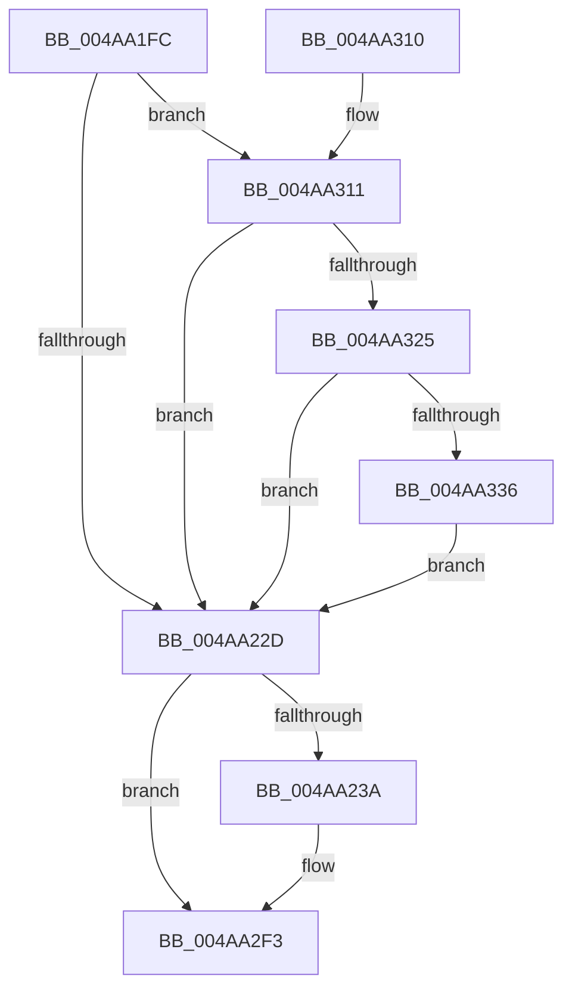

# PopPlRegisterComponent

- RVA: `0x004AA1FC`–`0x004AA342` (길이 `326` bytes)
- VA: `0x00000001404AA1FC`
- 실행 섹션: `.text`
- PDB 이름 있음: `예`; PDB Function 태그: `아니요`
- unwind 정보 RVA: `0x000B7C38`
- 디코드: `71`개 명령, `326/326` bytes 표시
- 미해석 바이트: `0` (있으면 어셈블리에 `.byte`로 보존)

> 이 문서는 커널 이미지의 기계어와 PDB 기호를 분석해 생성했습니다. 4번과 5번은 함수 원형과 자료형을 바이너리 사용 방식에서 추정한 C 해석이며 원본 소스 복구 결과는 아닙니다.

## 1. Dependencies

- 직접 호출 지점: **3**; 고유 호출 대상: **3**
- 직접 호출자로 확인된 함수: **2**
- RIP 상대 이미지 참조: **4**

### Outgoing calls
- `0x004AA2EE` → [tlgWriteEx_EtwWriteEx](tlgWriteEx_EtwWriteEx_function_004AA348.md) (function, `0x004AA348`)
- `0x004AA2FA` → [_security_check_cookie](../6A/_security_check_cookie_function_006AC640.md) (function, `0x006AC640`)
- `0x004AA328` → [PopPlLookupComponentPowerProfile](../5D/PopPlLookupComponentPowerProfile_function_005DDA80.md) (function, `0x005DDA80`)

### Direct callers
- [PopPlRegisterDeviceIterator](../5D/PopPlRegisterDeviceIterator_function_005DDE20.md) at `0x005DDE7A`
- [PopFxRegisterDeviceWorker](../../page/75/PopFxRegisterDeviceWorker_function_00759E20.md) at `0x0075A5EE`

### Static image references
- `0x004AA20E` → RVA `0x00E0A740` (`.data`; read)
- `0x004AA21C` → RVA `0x00F070C0` (`.data`; read)
- `0x004AA22D` → RVA `0x00E07748` (`.data`; read)
- `0x004AA2D6` → RVA `0x00050700` (`.rdata`; read)

## 2. Other-region calls and transfers

- 다른 실행 섹션으로 향하는 call: **0**
- 별도 외부 분기/꼬리 이동을 확인하지 못했습니다.

## 3. Assembly (complete function range)

```asm
004AA1FC  48 89 5C 24 10                  mov qword ptr [rsp + 0x10], rbx
004AA201  55                              push rbp
004AA202  48 8D 6C 24 A9                  lea rbp, [rsp - 0x57]
004AA207  48 81 EC E0 00 00 00            sub rsp, 0xe0
004AA20E  48 8B 05 2B 05 96 00            mov rax, qword ptr [rip + 0x96052b]
004AA215  48 33 C4                        xor rax, rsp
004AA218  48 89 45 47                     mov qword ptr [rbp + 0x47], rax
004AA21C  48 83 3D 9C CE A5 00 00         cmp qword ptr [rip + 0xa5ce9c], 0
004AA224  48 8B D9                        mov rbx, rcx
004AA227  0F 85 E4 00 00 00               jne 0x1404aa311
004AA22D  83 3D 14 D5 95 00 05            cmp dword ptr [rip + 0x95d514], 5
004AA234  0F 86 B9 00 00 00               jbe 0x1404aa2f3
004AA23A  83 65 F3 00                     and dword ptr [rbp - 0xd], 0
004AA23E  48 8D 45 B7                     lea rax, [rbp - 0x49]
004AA242  83 65 03 00                     and dword ptr [rbp + 3], 0
004AA246  41 B9 01 00 00 00               mov r9d, 1
004AA24C  48 89 45 E7                     mov qword ptr [rbp - 0x19], rax
004AA250  33 C0                           xor eax, eax
004AA252  48 39 83 B0 01 00 00            cmp qword ptr [rbx + 0x1b0], rax
004AA259  66 44 89 4D B7                  mov word ptr [rbp - 0x49], r9w
004AA25E  0F 95 C0                        setne al
004AA261  48 89 5D F7                     mov qword ptr [rbp - 9], rbx
004AA265  83 65 13 00                     and dword ptr [rbp + 0x13], 0
004AA269  41 8D 49 03                     lea ecx, [r9 + 3]
004AA26D  83 65 23 00                     and dword ptr [rbp + 0x23], 0
004AA271  45 8D 41 01                     lea r8d, [r9 + 1]
004AA275  89 45 BB                        mov dword ptr [rbp - 0x45], eax
004AA278  48 8D 45 BB                     lea rax, [rbp - 0x45]
004AA27C  48 89 45 07                     mov qword ptr [rbp + 7], rax
004AA280  8B 83 9C 00 00 00               mov eax, dword ptr [rbx + 0x9c]
004AA286  89 45 BF                        mov dword ptr [rbp - 0x41], eax
004AA289  48 8D 45 BF                     lea rax, [rbp - 0x41]
004AA28D  48 89 45 17                     mov qword ptr [rbp + 0x17], rax
004AA291  48 8B 43 50                     mov rax, qword ptr [rbx + 0x50]
004AA295  89 4D 0F                        mov dword ptr [rbp + 0xf], ecx
004AA298  89 4D 1F                        mov dword ptr [rbp + 0x1f], ecx
004AA29B  44 89 45 EF                     mov dword ptr [rbp - 0x11], r8d
004AA29F  C7 45 FF 10 00 00 00            mov dword ptr [rbp - 1], 0x10
004AA2A6  0F B7 90 D8 00 00 00            movzx edx, word ptr [rax + 0xd8]
004AA2AD  48 8B 88 E0 00 00 00            mov rcx, qword ptr [rax + 0xe0]
004AA2B4  48 8D 45 3F                     lea rax, [rbp + 0x3f]
004AA2B8  83 65 33 00                     and dword ptr [rbp + 0x33], 0
004AA2BC  83 65 43 00                     and dword ptr [rbp + 0x43], 0
004AA2C0  48 89 45 27                     mov qword ptr [rbp + 0x27], rax
004AA2C4  48 8D 45 C7                     lea rax, [rbp - 0x39]
004AA2C8  48 89 4D 37                     mov qword ptr [rbp + 0x37], rcx
004AA2CC  48 8D 0D 75 D4 95 00            lea rcx, [rip + 0x95d475]
004AA2D3  89 55 3F                        mov dword ptr [rbp + 0x3f], edx
004AA2D6  48 8D 15 23 64 BA FF            lea rdx, [rip - 0x459bdd]
004AA2DD  48 89 44 24 38                  mov qword ptr [rsp + 0x38], rax
004AA2E2  C7 44 24 30 08 00 00 00         mov dword ptr [rsp + 0x30], 8
004AA2EA  44 89 45 2F                     mov dword ptr [rbp + 0x2f], r8d
004AA2EE  E8 55 00 00 00                  call 0x1404aa348
004AA2F3  48 8B 4D 47                     mov rcx, qword ptr [rbp + 0x47]
004AA2F7  48 33 CC                        xor rcx, rsp
004AA2FA  E8 41 23 20 00                  call 0x1406ac640
004AA2FF  48 8B 9C 24 F8 00 00 00         mov rbx, qword ptr [rsp + 0xf8]
004AA307  48 81 C4 E0 00 00 00            add rsp, 0xe0
004AA30E  5D                              pop rbp
004AA30F  C3                              ret
004AA310  CC                              int3
004AA311  48 8B 41 50                     mov rax, qword ptr [rcx + 0x50]
004AA315  48 8B 88 C8 04 00 00            mov rcx, qword ptr [rax + 0x4c8]
004AA31C  48 85 C9                        test rcx, rcx
004AA31F  0F 84 08 FF FF FF               je 0x1404aa22d
004AA325  48 8B D3                        mov rdx, rbx
004AA328  E8 53 37 13 00                  call 0x1405dda80
004AA32D  48 85 C0                        test rax, rax
004AA330  0F 84 F7 FE FF FF               je 0x1404aa22d
004AA336  48 89 83 B0 01 00 00            mov qword ptr [rbx + 0x1b0], rax
004AA33D  E9 EB FE FF FF                  jmp 0x1404aa22d
```

## 4. C-style interpretation (structured pseudocode)

```c
__int64 __fastcall PopPlRegisterComponent(__int64 a1)
{
    __int64 result;
    __int64 v_rsp;
    unsigned __int64 v_stack_m18;
    unsigned int v_stack_m1C;
    unsigned __int64 v_stack_m20;
    unsigned __int64 v_stack_m28;
    unsigned int v_stack_m2C;
    unsigned int v_stack_m30;
    unsigned __int64 v_stack_m38;
    unsigned int v_stack_m3C;
    unsigned int v_stack_m40;
    unsigned __int64 v_stack_m48;
    unsigned int v_stack_m4C;
    unsigned int v_stack_m50;
    unsigned __int64 v_stack_m58;
    unsigned int v_stack_m5C;
    unsigned __int64 v_stack_m5F;
    unsigned int v_stack_m60;
    unsigned __int64 v_stack_m68;
    unsigned int v_stack_m6C;
    unsigned int v_stack_m70;
    unsigned __int64 v_stack_m78;
    unsigned __int64 v_stack_m98;
    unsigned int v_stack_mA0;
    unsigned int v_stack_mA4;
    unsigned __int64 v_stack_mA8;
    unsigned __int64 v_stack_mB0;
    unsigned int v_stack_mB8;
    unsigned __int64 v_stack_p10;

    v_stack_p10 = v_rbx;
    v_rsp = (v_rsp) - (224);
    result = (*(unsigned __int64 *)(v_rip + 9831723)) ^ (v_rsp);
    v_stack_m18 = result;
    if ((*(unsigned __int64 *)(v_rip + 10866332)) != 0) goto loc_004AA311;
loc_004AA22D:
    if ((*(unsigned int *)(v_rip + 9819412)) >= = 5) {
        result = v_stack_mA8;
        a4 = 1;
        v_stack_m78 = result;
        result = 0;
        v_stack_mA8 = (unsigned __int16)(a4);
        result = ((*(unsigned __int64 *)(a1 + 432)) != 0) ? 1 : 0;
        v_stack_m68 = a1;
        a1 = a4 + 3;
        a3 = a4 + 1;
        v_stack_mA4 = (unsigned int)(result);
        result = v_stack_mA4;
        v_stack_m58 = result;
        result = *(unsigned int *)(a1 + 156);
        v_stack_mA0 = (unsigned int)(result);
        result = v_stack_mA0;
        v_stack_m48 = result;
        result = *(unsigned __int64 *)(a1 + 80);
        v_stack_m50 = (unsigned int)(a1);
        v_stack_m40 = (unsigned int)(a1);
        v_stack_m70 = (unsigned int)(a3);
        v_stack_m60 = 16;
        a2 = *(unsigned __int16 *)(result + 216);
        a1 = *(unsigned __int64 *)(result + 224);
        result = v_stack_m20;
        v_stack_m38 = result;
        result = v_stack_m98;
        v_stack_m28 = a1;
        a1 = v_rip + 9819253;
        v_stack_m20 = (unsigned int)(a2);
        a2 = v_rip - 4561885;
        v_stack_mB0 = result;
        v_stack_mB8 = 8;
        v_stack_m30 = (unsigned int)(a3);
        result = tlgWriteEx_EtwWriteEx(a1, a2, a3, a4);
    }
    a1 = (v_stack_m18) ^ (v_rsp);
    result = _security_check_cookie(a1, a2, a3, a4);
    v_rsp = (v_rsp) + (224);
    return result;
loc_004AA311:
    if (*(unsigned __int64 *)(*(unsigned __int64 *)(a1 + 80) + 1224) == 0) goto loc_004AA22D;
    result = PopPlLookupComponentPowerProfile(*(unsigned __int64 *)(*(unsigned __int64 *)(a1 + 80) + 1224), v_stack_p10, a3, a4);
    if (result == 0) goto loc_004AA22D;
    *(unsigned __int64 *)(v_stack_p10 + 432) = result;
    goto loc_004AA22D;
}
```

## 5. (Beta) C Style

```c
int64_t PopPlRegisterComponent(void *Arg1)
{
    uint8_t *arg1 = (uint8_t *)Arg1;

    int64_t result;
    int64_t local_rsp;
    uint64_t v_stack_m18;
    uint32_t v_stack_m1C;
    uint64_t v_stack_m20;
    uint64_t v_stack_m28;
    uint32_t v_stack_m2C;
    uint32_t v_stack_m30;
    uint64_t v_stack_m38;
    uint32_t v_stack_m3C;
    uint32_t v_stack_m40;
    uint64_t v_stack_m48;
    uint32_t v_stack_m4C;
    uint32_t v_stack_m50;
    uint64_t v_stack_m58;
    uint32_t v_stack_m5C;
    uint64_t v_stack_m5F;
    uint32_t v_stack_m60;
    uint64_t v_stack_m68;
    uint32_t v_stack_m6C;
    uint32_t v_stack_m70;
    uint64_t v_stack_m78;
    uint64_t v_stack_m98;
    uint32_t v_stack_mA0;
    uint32_t v_stack_mA4;
    uint64_t v_stack_mA8;
    uint64_t v_stack_mB0;
    uint32_t v_stack_mB8;
    uint64_t v_stack_p10;

    v_stack_p10 = local_rbx;
    local_rsp = (local_rsp) - (224);
    result = (*(uint64_t *)(v_rip + 0x96052B)) ^ (local_rsp);
    v_stack_m18 = result;
    if ((*(uint64_t *)(v_rip + 0xA5CE9C)) != 0) goto loc_004AA311;
loc_004AA22D:
    if ((*(uint32_t *)(v_rip + 0x95D514)) >= = 5) {
        result = v_stack_mA8;
        a4 = 1;
        v_stack_m78 = result;
        result = 0;
        v_stack_mA8 = (uint16_t)(a4);
        result = ((*(uint64_t *)(arg1 + 0x1B0)) != 0) ? 1 : 0;
        v_stack_m68 = Arg1;
        Arg1 = a4 + 3;
        a3 = a4 + 1;
        v_stack_mA4 = (uint32_t)(result);
        result = v_stack_mA4;
        v_stack_m58 = result;
        result = *(uint32_t *)(arg1 + 0x9C);
        v_stack_mA0 = (uint32_t)(result);
        result = v_stack_mA0;
        v_stack_m48 = result;
        result = *(uint64_t *)(arg1 + 0x50);
        v_stack_m50 = (uint32_t)(Arg1);
        v_stack_m40 = (uint32_t)(Arg1);
        v_stack_m70 = (uint32_t)(a3);
        v_stack_m60 = 16;
        a2 = *(uint16_t *)(result + 0xD8);
        Arg1 = *(uint64_t *)(result + 0xE0);
        result = v_stack_m20;
        v_stack_m38 = result;
        result = v_stack_m98;
        v_stack_m28 = Arg1;
        Arg1 = v_rip + 9819253;
        v_stack_m20 = (uint32_t)(a2);
        a2 = v_rip - 4561885;
        v_stack_mB0 = result;
        v_stack_mB8 = 8;
        v_stack_m30 = (uint32_t)(a3);
        result = tlgWriteEx_EtwWriteEx(Arg1, a2, a3, a4);
    }
    Arg1 = (v_stack_m18) ^ (local_rsp);
    result = _security_check_cookie(Arg1, a2, a3, a4);
    local_rsp = (local_rsp) + (224);
    return result;
loc_004AA311:
    if (*(uint64_t *)(*(uint64_t *)(arg1 + 0x50) + 0x4C8) == 0) goto loc_004AA22D;
    result = PopPlLookupComponentPowerProfile(*(uint64_t *)(*(uint64_t *)(arg1 + 0x50) + 0x4C8), v_stack_p10, a3, a4);
    if (result == 0) goto loc_004AA22D;
    *(uint64_t *)(v_stack_p10 + 0x1B0) = result;
    goto loc_004AA22D;
}
```

### 관측된 메모리 오프셋

구조체 형식이 확인되지 않은 접근은 인자 기준의 오프셋으로만 기록했습니다.

| 기준 인자 | 오프셋 표현 | 폭 (bit) | 접근 |
|---|---:|---:|---|
| `Arg1` | `+ 0x50` | `64` | `R` |
| `Arg1` | `+ 0x9C` | `32` | `R` |
| `Arg1` | `+ 0x1B0` | `64` | `R` |
| `Arg1` | `+ 0x1B0` | `64` | `W` |

## 6. Execution-region graph

[열기: 2D/3D 그래프와 함수 탐색 컨트롤 패널](../../../control-panel.html?section=text&rva=0x004AA1FC&view=graph)

- 2D 그래프는 위에서 아래로 흐르고, 3D 그래프는 빈 공간을 드래그해 회전합니다. Shift+드래그는 이동, 휠은 확대·축소, 함수 노드 선택은 대상 보고서 이동입니다.

### Static fallback


