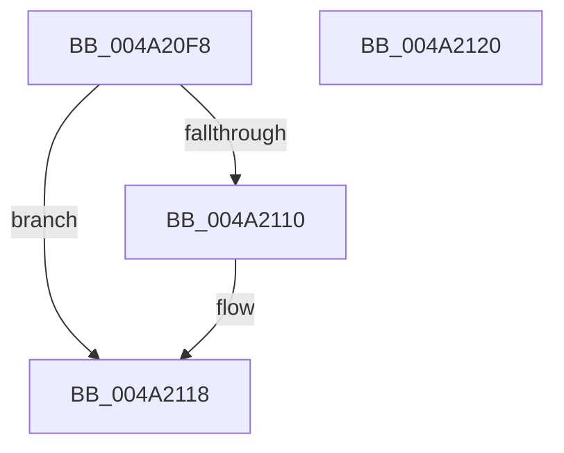

# PopQueueWorkItem

- RVA: `0x004A20F8`–`0x004A2121` (길이 `41` bytes)
- VA: `0x00000001404A20F8`
- 실행 섹션: `.text`
- PDB 이름 있음: `예`; PDB Function 태그: `아니요`
- unwind 정보 RVA: `0x0005C788`
- 디코드: `13`개 명령, `41/41` bytes 표시
- 미해석 바이트: `0` (있으면 어셈블리에 `.byte`로 보존)

> 이 문서는 커널 이미지의 기계어와 PDB 기호를 분석해 생성했습니다. 4번과 5번은 함수 원형과 자료형을 바이너리 사용 방식에서 추정한 C 해석이며 원본 소스 복구 결과는 아닙니다.

## 1. Dependencies

- 직접 호출 지점: **1**; 고유 호출 대상: **1**
- 직접 호출자로 확인된 함수: **31**
- RIP 상대 이미지 참조: **0**

### Outgoing calls
- `0x004A2110` → [ExQueueWorkItem](../2F/ExQueueWorkItem_function_002F9520.md) (function, `0x002F9520`)

### Direct callers
- [PopApplyLegacyPowerRequestFlags](../47/PopApplyLegacyPowerRequestFlags_function_00477364.md) at `0x0047747E`
- [PopPowerRequestReferenceRelease](../47/PopPowerRequestReferenceRelease_function_004775B0.md) at `0x004776AD`
- [PopDripsWatchdogTimerCallback](../4B/PopDripsWatchdogTimerCallback_function_004BE460.md) at `0x004BE48E`
- [PopNetEvaluationTimerCallback](../4C/PopNetEvaluationTimerCallback_function_004C4D20.md) at `0x004C4D45`
- [PopUpdatePowerButtonHoldState](../4D/PopUpdatePowerButtonHoldState_function_004D4EB4.md) at `0x004D4F55`
- [PopPowerRequestDebounceTimerCallback](../5C/PopPowerRequestDebounceTimerCallback_function_005CF170.md) at `0x005CF180`
- [PopPowerRequestExecutionRequiredTimeoutCallback](../5C/PopPowerRequestExecutionRequiredTimeoutCallback_function_005CF1A0.md) at `0x005CF1B0`
- [PpmPerfTelemetryCallback](../5D/PpmPerfTelemetryCallback_function_005D45F0.md) at `0x005D4600`
- [PopUserShutdownCalloutDelayTimerCallback](../5D/PopUserShutdownCalloutDelayTimerCallback_function_005D53D0.md) at `0x005D53E0`
- [PopThermalCsExit](../5D/PopThermalCsExit_function_005D54C8.md) at `0x005D5533`
- [PopThermalSxExit](../5D/PopThermalSxExit_function_005D55F8.md) at `0x005D5783`
- [PopThermalTelemetryCallback](../5D/PopThermalTelemetryCallback_function_005D57C0.md) at `0x005D57D0`
- [PopCheckPowerSourceAfterRtcWakeTimerCallback](../5D/PopCheckPowerSourceAfterRtcWakeTimerCallback_function_005D5AE0.md) at `0x005D5AF0`
- [PopKsrCallback](../5D/PopKsrCallback_function_005D5B10.md) at `0x005D5B48`
- [PopNetRefreshTimerCallback](../5D/PopNetRefreshTimerCallback_function_005D99D0.md) at `0x005D99EF`
- [PopPowerButtonTimerCallback](../5D/PopPowerButtonTimerCallback_function_005D9A00.md) at `0x005D9A46`
- [PopAdaptiveStandbyPolicyTimerCallback](../5D/PopAdaptiveStandbyPolicyTimerCallback_function_005DC7C0.md) at `0x005DC7D0`
- [sub_006F9E40](../6F/Unknown_function_006F9E40.md) at `0x006F9EB5`
- [sub_006FCB58](../6F/Unknown_function_006FCB58.md) at `0x006FCB73`
- [PopPowerAggregatorDisengageAggressiveStandbyActions](../../page/6F/PopPowerAggregatorDisengageAggressiveStandbyActions_function_006FEB30.md) at `0x006FEB59`
- [PopPowerAggregatorDisengageAggressiveStandbyActions](../../page/6F/PopPowerAggregatorDisengageAggressiveStandbyActions_function_006FEB30.md) at `0x006FEB7F`
- [PopSwitchUpdateUserShutdownScenarioState](../../page/75/PopSwitchUpdateUserShutdownScenarioState_function_0075F260.md) at `0x0075F2DF`
- [PopSwitchUpdateUserShutdownScenarioState](../../page/75/PopSwitchUpdateUserShutdownScenarioState_function_0075F260.md) at `0x0075F336`
- [PopWnfUsb4DisplayPresenceCallback](../../page/76/PopWnfUsb4DisplayPresenceCallback_function_007656E0.md) at `0x007657C2`
- [PopNetResiliencyPhaseStateChanged](../../page/76/PopNetResiliencyPhaseStateChanged_function_00768DD8.md) at `0x00768E72`
- [PopNetSetConnectivityConstraint](../../page/76/PopNetSetConnectivityConstraint_function_00768E90.md) at `0x00768ED6`
- [PopUpdateExternalDisplayState](../../page/76/PopUpdateExternalDisplayState_function_0076C0DC.md) at `0x0076C11A`
- [CmCompleteRegistryInitialization](../../page/7D/CmCompleteRegistryInitialization_function_007DF1EC.md) at `0x007DF36E`
- [PopDirectedDripsHandleResiliencyNotification](../../page/A4/PopDirectedDripsHandleResiliencyNotification_function_00A4DC3C.md) at `0x00A4DD54`
- [PopNotifyWin32kRequestStatus](../../page/A8/PopNotifyWin32kRequestStatus_function_00A80220.md) at `0x00A8026A`
- [PopIssueActionRequest](../../page/A9/PopIssueActionRequest_function_00A9CE54.md) at `0x00A9D2DA`
- [PopLidSwitchChangeCallback](../../page/AB/PopLidSwitchChangeCallback_function_00AB8FF0.md) at `0x00AB909A`
- [PopNetClearConnectivityConstraint](../../page/AD/PopNetClearConnectivityConstraint_function_00ADB124.md) at `0x00ADB167`

### Static image references
- 디코드된 RIP-relative 메모리 참조가 없습니다.

## 2. Other-region calls and transfers

- 다른 실행 섹션으로 향하는 call: **0**
- 별도 외부 분기/꼬리 이동을 확인하지 못했습니다.

## 3. Assembly (complete function range)

```asm
004A20F8  48 83 EC 28                     sub rsp, 0x28
004A20FC  45 32 C0                        xor r8b, r8b
004A20FF  B8 01 00 00 00                  mov eax, 1
004A2104  F0 0F C1 41 20                  lock xadd dword ptr [rcx + 0x20], eax
004A2109  FF C0                           inc eax
004A210B  83 F8 01                        cmp eax, 1
004A210E  75 08                           jne 0x1404a2118
004A2110  E8 0B 74 E5 FF                  call 0x1402f9520
004A2115  41 B0 01                        mov r8b, 1
004A2118  41 8A C0                        mov al, r8b
004A211B  48 83 C4 28                     add rsp, 0x28
004A211F  C3                              ret
004A2120  CC                              int3
```

## 4. C-style interpretation (structured pseudocode)

```c
__int64 __fastcall PopQueueWorkItem(__int64 a1, __int64 a2, unsigned __int8 a3)
{
    __int64 result;
    __int64 v_rsp;

    v_rsp = (v_rsp) - (40);
    a3 = 0;
    result = (unsigned int)((1) + 1);
    if (((unsigned int)(result)) == 1) {
        result = ExQueueWorkItem(a1, a2, a3, a4);
        a3 = 1;
    }
    v_rsp = (v_rsp) + (40);
    return a3;
}
```

## 5. (Beta) C Style

```c
int64_t PopQueueWorkItem(void *Arg1, int64_t Arg2, uint8_t Arg3)
{
    uint8_t *arg1 = (uint8_t *)Arg1;

    int64_t result;
    int64_t local_rsp;

    local_rsp = (local_rsp) - (40);
    Arg3 = 0;
    result = (uint32_t)((1) + 1);
    if (((uint32_t)(result)) == 1) {
        result = ExQueueWorkItem(Arg1, Arg2, Arg3, a4);
        Arg3 = 1;
    }
    local_rsp = (local_rsp) + (40);
    return Arg3;
}
```

### 관측된 메모리 오프셋

구조체 형식이 확인되지 않은 접근은 인자 기준의 오프셋으로만 기록했습니다.

| 기준 인자 | 오프셋 표현 | 폭 (bit) | 접근 |
|---|---:|---:|---|
| `Arg1` | `+ 0x20` | `32` | `R/W` |

## 6. Execution-region graph

[열기: 2D/3D 그래프와 함수 탐색 컨트롤 패널](../../../control-panel.html?section=text&rva=0x004A20F8&view=graph)

- 2D 그래프는 위에서 아래로 흐르고, 3D 그래프는 빈 공간을 드래그해 회전합니다. Shift+드래그는 이동, 휠은 확대·축소, 함수 노드 선택은 대상 보고서 이동입니다.

### Static fallback


