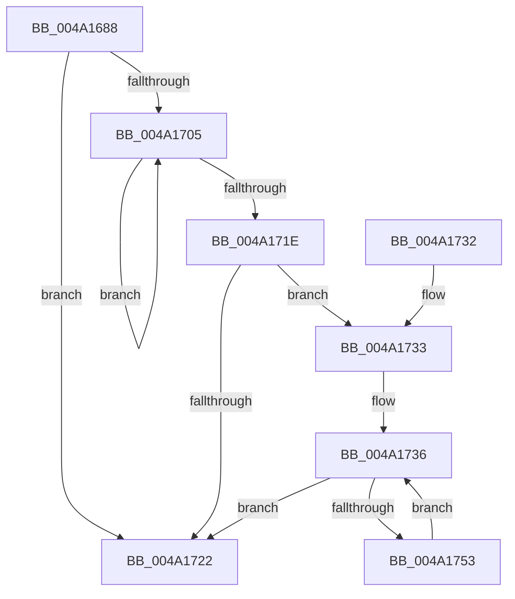

# PopRunMaximumIrpWorkers

- RVA: `0x004A1688`–`0x004A1755` (길이 `205` bytes)
- VA: `0x00000001404A1688`
- 실행 섹션: `.text`
- PDB 이름 있음: `예`; PDB Function 태그: `아니요`
- unwind 정보 RVA: `0x000B5C14`
- 디코드: `56`개 명령, `205/205` bytes 표시
- 미해석 바이트: `0` (있으면 어셈블리에 `.byte`로 보존)

> 이 문서는 커널 이미지의 기계어와 PDB 기호를 분석해 생성했습니다. 4번과 5번은 함수 원형과 자료형을 바이너리 사용 방식에서 추정한 C 해석이며 원본 소스 복구 결과는 아닙니다.

## 1. Dependencies

- 직접 호출 지점: **4**; 고유 호출 대상: **4**
- 직접 호출자로 확인된 함수: **1**
- RIP 상대 이미지 참조: **5**

### Outgoing calls
- `0x004A16AD` → [ExAcquireFastMutex](../20/ExAcquireFastMutex_function_0020E5A0.md) (function, `0x0020E5A0`)
- `0x004A16DB` → [ExReleaseFastMutex](../25/ExReleaseFastMutex_function_002519C0.md) (function, `0x002519C0`)
- `0x004A1709` → [PopCreateDynamicIrpWorker](PopCreateDynamicIrpWorker_function_004A175C.md) (function, `0x004A175C`)
- `0x004A1748` → [KeWaitForSingleObject](../20/KeWaitForSingleObject_function_0020E6B0.md) (function, `0x0020E6B0`)

### Direct callers
- [PopTransitionSystemPowerStateEx](../../pagelk/B7/PopTransitionSystemPowerStateEx_function_00B7E8C0.md) at `0x00B7E9E6`

### Static image references
- `0x004A169E` → RVA `0x00F091A0` (`.data`; read)
- `0x004A16B2` → RVA `0x00F091DC` (`.data`; read)
- `0x004A16C4` → RVA `0x00F091D8` (`.data`; write)
- `0x004A16CD` → RVA `0x00F09198` (`.data`; read)
- `0x004A16D5` → RVA `0x00F091DC` (`.data`; write)

## 2. Other-region calls and transfers

- 다른 실행 섹션으로 향하는 call: **0**
- 별도 외부 분기/꼬리 이동을 확인하지 못했습니다.

## 3. Assembly (complete function range)

```asm
004A1688  48 89 5C 24 08                  mov qword ptr [rsp + 8], rbx
004A168D  48 89 7C 24 10                  mov qword ptr [rsp + 0x10], rdi
004A1692  55                              push rbp
004A1693  48 8B EC                        mov rbp, rsp
004A1696  48 83 EC 50                     sub rsp, 0x50
004A169A  83 65 FC 00                     and dword ptr [rbp - 4], 0
004A169E  48 8D 0D FB 7A A6 00            lea rcx, [rip + 0xa67afb]
004A16A5  C6 45 E1 00                     mov byte ptr [rbp - 0x1f], 0
004A16A9  C6 45 E3 00                     mov byte ptr [rbp - 0x1d], 0
004A16AD  E8 EE CE D6 FF                  call 0x14020e5a0
004A16B2  8B 05 24 7B A6 00               mov eax, dword ptr [rip + 0xa67b24]
004A16B8  48 8D 0D E1 7A A6 00            lea rcx, [rip + 0xa67ae1]
004A16BF  BB 0F 00 00 00                  mov ebx, 0xf
004A16C4  C6 05 0D 7B A6 00 00            mov byte ptr [rip + 0xa67b0d], 0
004A16CB  2B D8                           sub ebx, eax
004A16CD  2B 1D C5 7A A6 00               sub ebx, dword ptr [rip + 0xa67ac5]
004A16D3  03 C3                           add eax, ebx
004A16D5  89 05 01 7B A6 00               mov dword ptr [rip + 0xa67b01], eax
004A16DB  E8 E0 02 DB FF                  call 0x1402519c0
004A16E0  83 65 E4 00                     and dword ptr [rbp - 0x1c], 0
004A16E4  48 8D 45 E8                     lea rax, [rbp - 0x18]
004A16E8  48 89 45 F0                     mov qword ptr [rbp - 0x10], rax
004A16EC  33 FF                           xor edi, edi
004A16EE  C6 45 E0 05                     mov byte ptr [rbp - 0x20], 5
004A16F2  48 8D 45 E8                     lea rax, [rbp - 0x18]
004A16F6  48 89 45 E8                     mov qword ptr [rbp - 0x18], rax
004A16FA  C6 45 E2 08                     mov byte ptr [rbp - 0x1e], 8
004A16FE  89 5D F8                        mov dword ptr [rbp - 8], ebx
004A1701  85 DB                           test ebx, ebx
004A1703  74 1D                           je 0x1404a1722
004A1705  48 8D 4D E0                     lea rcx, [rbp - 0x20]
004A1709  E8 4E 00 00 00                  call 0x1404a175c
004A170E  85 C0                           test eax, eax
004A1710  8D 4F 01                        lea ecx, [rdi + 1]
004A1713  0F 48 CF                        cmovs ecx, edi
004A1716  8B F9                           mov edi, ecx
004A1718  48 83 EB 01                     sub rbx, 1
004A171C  75 E7                           jne 0x1404a1705
004A171E  85 C9                           test ecx, ecx
004A1720  75 11                           jne 0x1404a1733
004A1722  48 8B 5C 24 60                  mov rbx, qword ptr [rsp + 0x60]
004A1727  48 8B 7C 24 68                  mov rdi, qword ptr [rsp + 0x68]
004A172C  48 83 C4 50                     add rsp, 0x50
004A1730  5D                              pop rbp
004A1731  C3                              ret
004A1732  CC                              int3
004A1733  48 8B DF                        mov rbx, rdi
004A1736  48 83 64 24 20 00               and qword ptr [rsp + 0x20], 0
004A173C  48 8D 4D E0                     lea rcx, [rbp - 0x20]
004A1740  45 33 C9                        xor r9d, r9d
004A1743  45 33 C0                        xor r8d, r8d
004A1746  33 D2                           xor edx, edx
004A1748  E8 63 CF D6 FF                  call 0x14020e6b0
004A174D  48 83 EB 01                     sub rbx, 1
004A1751  74 CF                           je 0x1404a1722
004A1753  EB E1                           jmp 0x1404a1736
```

## 4. C-style interpretation (structured pseudocode)

```c
__int64 __fastcall PopRunMaximumIrpWorkers(__int64 a1, int a2, int a3, int a4)
{
    __int64 result;
    __int64 v_rbx;
    __int64 v_rdi;
    __int64 v_rsp;
    unsigned int v_stack_m10;
    unsigned __int64 v_stack_m18;
    unsigned __int64 v_stack_m20;
    unsigned int v_stack_m24;
    unsigned __int8 v_stack_m25;
    unsigned __int8 v_stack_m26;
    unsigned __int8 v_stack_m27;
    unsigned __int8 v_stack_m28;
    unsigned int v_stack_mC;
    unsigned __int64 v_stack_p10;
    unsigned __int64 v_stack_p20;
    unsigned __int64 v_stack_p8;

    v_stack_p8 = v_rbx;
    v_stack_p10 = v_rdi;
    v_rsp = (v_rsp) - (80);
    v_stack_m27 = 0;
    v_stack_m25 = 0;
    result = ExAcquireFastMutex(v_rip + 10910459, a2, a3, a4);
    *(unsigned __int8 *)(v_rip + 10910477) = 0;
    v_rbx = (unsigned int)((15) - ((unsigned int)((unsigned int)(*(unsigned int *)(v_rip + 10910500)))));
    v_rbx = (unsigned int)((v_rbx) - (*(unsigned int *)(v_rip + 10910405)));
    result = (unsigned int)(((unsigned int)(*(unsigned int *)(v_rip + 10910500))) + ((unsigned int)(v_rbx)));
    *(unsigned int *)(v_rip + 10910465) = (unsigned int)(result);
    result = ExReleaseFastMutex(v_rip + 10910433, a2, a3, a4);
    v_stack_m18 = v_stack_m20;
    v_rdi = 0;
    v_stack_m28 = 5;
    v_stack_m20 = v_stack_m20;
    v_stack_m26 = 8;
    v_stack_m10 = (unsigned int)(v_rbx);
    if ((unsigned int)(v_rbx) == 0) goto loc_004A1722;
loc_004A1705:
    result = PopCreateDynamicIrpWorker(v_stack_m28, a2, a3, a4);
    a1 = v_rdi + 1;
    if (sign_flag) { a1 = 0; }
    v_rbx = (v_rbx) - (1);
    if (condition_is_not_equal) goto loc_004A1705;
    if ((unsigned int)(a1) != 0) goto loc_004A1733;
loc_004A1722:
    v_rsp = (v_rsp) + (80);
    return result;
loc_004A1733:
loc_004A1736:
    a4 = 0;
    a3 = 0;
    a2 = 0;
    result = KeWaitForSingleObject(v_stack_m28, a2, a3, a4);
    v_rbx = (v_stack_p10) - (1);
    if (condition_is_equal) goto loc_004A1722;
    goto loc_004A1736;
}
```

## 5. (Beta) C Style

```c
int64_t PopRunMaximumIrpWorkers(int64_t Arg1, int32_t Arg2, int32_t Arg3, int32_t Arg4)
{
    int64_t result;
    int64_t local_rbx;
    int64_t local_rdi;
    int64_t local_rsp;
    uint32_t v_stack_m10;
    uint64_t v_stack_m18;
    uint64_t v_stack_m20;
    uint32_t v_stack_m24;
    uint8_t v_stack_m25;
    uint8_t v_stack_m26;
    uint8_t v_stack_m27;
    uint8_t v_stack_m28;
    uint32_t v_stack_mC;
    uint64_t v_stack_p10;
    uint64_t v_stack_p20;
    uint64_t v_stack_p8;

    v_stack_p8 = local_rbx;
    v_stack_p10 = local_rdi;
    local_rsp = (local_rsp) - (80);
    v_stack_m27 = 0;
    v_stack_m25 = 0;
    result = ExAcquireFastMutex(v_rip + 10910459, Arg2, Arg3, Arg4);
    *(uint8_t *)(v_rip + 0xA67B0D) = 0;
    local_rbx = (uint32_t)((15) - ((uint32_t)((uint32_t)(*(uint32_t *)(v_rip + 0xA67B24)))));
    local_rbx = (uint32_t)((local_rbx) - (*(uint32_t *)(v_rip + 0xA67AC5)));
    result = (uint32_t)(((uint32_t)(*(uint32_t *)(v_rip + 0xA67B24))) + ((uint32_t)(local_rbx)));
    *(uint32_t *)(v_rip + 0xA67B01) = (uint32_t)(result);
    result = ExReleaseFastMutex(v_rip + 10910433, Arg2, Arg3, Arg4);
    v_stack_m18 = v_stack_m20;
    local_rdi = 0;
    v_stack_m28 = 5;
    v_stack_m20 = v_stack_m20;
    v_stack_m26 = 8;
    v_stack_m10 = (uint32_t)(local_rbx);
    if ((uint32_t)(local_rbx) == 0) goto loc_004A1722;
loc_004A1705:
    result = PopCreateDynamicIrpWorker(v_stack_m28, Arg2, Arg3, Arg4);
    Arg1 = local_rdi + 1;
    if (sign_flag) { Arg1 = 0; }
    local_rbx = (local_rbx) - (1);
    if (condition_is_not_equal) goto loc_004A1705;
    if ((uint32_t)(Arg1) != 0) goto loc_004A1733;
loc_004A1722:
    local_rsp = (local_rsp) + (80);
    return result;
loc_004A1733:
loc_004A1736:
    Arg4 = 0;
    Arg3 = 0;
    Arg2 = 0;
    result = KeWaitForSingleObject(v_stack_m28, Arg2, Arg3, Arg4);
    local_rbx = (v_stack_p10) - (1);
    if (condition_is_equal) goto loc_004A1722;
    goto loc_004A1736;
}
```

## 6. Execution-region graph

[열기: 2D/3D 그래프와 함수 탐색 컨트롤 패널](../../../control-panel.html?section=text&rva=0x004A1688&view=graph)

- 2D 그래프는 위에서 아래로 흐르고, 3D 그래프는 빈 공간을 드래그해 회전합니다. Shift+드래그는 이동, 휠은 확대·축소, 함수 노드 선택은 대상 보고서 이동입니다.

### Static fallback


