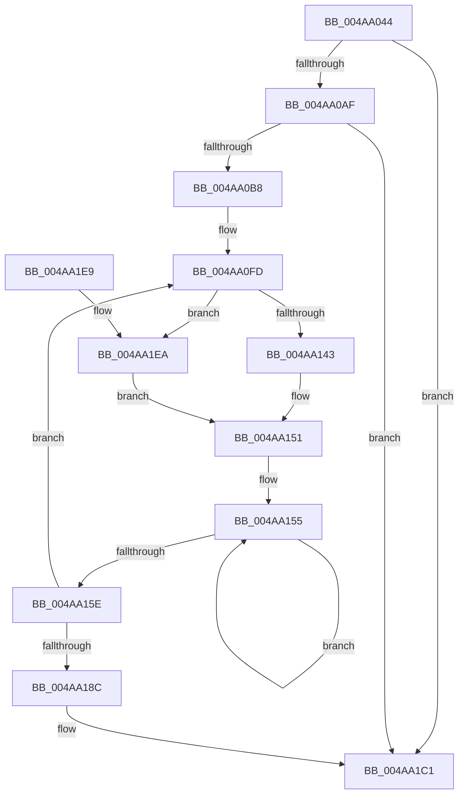

# PopSqmAddToStream

- RVA: `0x004AA044`–`0x004AA1F5` (길이 `433` bytes)
- VA: `0x00000001404AA044`
- 실행 섹션: `.text`
- PDB 이름 있음: `예`; PDB Function 태그: `아니요`
- unwind 정보 RVA: `0x000B7C14`
- 디코드: `95`개 명령, `433/433` bytes 표시
- 미해석 바이트: `0` (있으면 어셈블리에 `.byte`로 보존)

> 이 문서는 커널 이미지의 기계어와 PDB 기호를 분석해 생성했습니다. 4번과 5번은 함수 원형과 자료형을 바이너리 사용 방식에서 추정한 C 해석이며 원본 소스 복구 결과는 아닙니다.

## 1. Dependencies

- 직접 호출 지점: **3**; 고유 호출 대상: **3**
- 직접 호출자로 확인된 함수: **1**
- RIP 상대 이미지 참조: **7**

### Outgoing calls
- `0x004AA093` → [memset](../6C/memset_function_006C6C40.md) (function, `0x006C6C40`)
- `0x004AA1BC` → [EtwWriteEx](../25/EtwWriteEx_function_0025F0D0.md) (function, `0x0025F0D0`)
- `0x004AA1CB` → [_security_check_cookie](../6A/_security_check_cookie_function_006AC640.md) (function, `0x006AC640`)

### Direct callers
- [PopSqmBatteryUpdate](../../page/AC/PopSqmBatteryUpdate_function_00AC1794.md) at `0x00AC17F5`

### Static image references
- `0x004AA062` → RVA `0x00E0A740` (`.data`; read)
- `0x004AA0A2` → RVA `0x00E67858` (`.data`; read)
- `0x004AA0CB` → RVA `0x0001BD60` (`.rdata`; read)
- `0x004AA10F` → RVA `0x0001BD58` (`.rdata`; read)
- `0x004AA143` → RVA `0x0001BD5C` (`.rdata`; read)
- `0x004AA18C` → RVA `0x00F0B408` (`.data`; read)
- `0x004AA19D` → RVA `0x0001BD70` (`.rdata`; read)

## 2. Other-region calls and transfers

- 다른 실행 섹션으로 향하는 call: **0**
- 별도 외부 분기/꼬리 이동을 확인하지 못했습니다.

## 3. Assembly (complete function range)

```asm
004AA044  48 8B C4                        mov rax, rsp
004AA047  48 89 58 08                     mov qword ptr [rax + 8], rbx
004AA04B  48 89 70 10                     mov qword ptr [rax + 0x10], rsi
004AA04F  48 89 78 18                     mov qword ptr [rax + 0x18], rdi
004AA053  55                              push rbp
004AA054  48 8D A8 98 FE FF FF            lea rbp, [rax - 0x168]
004AA05B  48 81 EC 60 02 00 00            sub rsp, 0x260
004AA062  48 8B 05 D7 06 96 00            mov rax, qword ptr [rip + 0x9606d7]
004AA069  48 33 C4                        xor rax, rsp
004AA06C  48 89 85 50 01 00 00            mov qword ptr [rbp + 0x150], rax
004AA073  BE 04 00 00 00                  mov esi, 4
004AA078  C7 44 24 48 7B 2B 00 00         mov dword ptr [rsp + 0x48], 0x2b7b
004AA080  33 D2                           xor edx, edx
004AA082  89 74 24 50                     mov dword ptr [rsp + 0x50], esi
004AA086  41 B8 B0 01 00 00               mov r8d, 0x1b0
004AA08C  48 8D 4D A0                     lea rcx, [rbp - 0x60]
004AA090  49 8B D9                        mov rbx, r9
004AA093  E8 A8 CB 21 00                  call 0x1406c6c40
004AA098  33 FF                           xor edi, edi
004AA09A  C7 44 24 40 0B 00 00 00         mov dword ptr [rsp + 0x40], 0xb
004AA0A2  40 38 3D AF D7 9B 00            cmp byte ptr [rip + 0x9bd7af], dil
004AA0A9  0F 84 12 01 00 00               je 0x1404aa1c1
004AA0AF  48 85 DB                        test rbx, rbx
004AA0B2  0F 84 09 01 00 00               je 0x1404aa1c1
004AA0B8  48 8D 44 24 40                  lea rax, [rsp + 0x40]
004AA0BD  48 89 74 24 68                  mov qword ptr [rsp + 0x68], rsi
004AA0C2  48 89 44 24 60                  mov qword ptr [rsp + 0x60], rax
004AA0C7  4C 8D 53 08                     lea r10, [rbx + 8]
004AA0CB  48 8D 05 8E 1C B7 FF            lea rax, [rip - 0x48e372]
004AA0D2  48 C7 44 24 78 10 00 00 00      mov qword ptr [rsp + 0x78], 0x10
004AA0DB  48 89 44 24 70                  mov qword ptr [rsp + 0x70], rax
004AA0E0  44 8B DF                        mov r11d, edi
004AA0E3  48 8D 44 24 48                  lea rax, [rsp + 0x48]
004AA0E8  48 89 75 88                     mov qword ptr [rbp - 0x78], rsi
004AA0EC  48 89 45 80                     mov qword ptr [rbp - 0x80], rax
004AA0F0  48 8D 44 24 50                  lea rax, [rsp + 0x50]
004AA0F5  48 89 45 90                     mov qword ptr [rbp - 0x70], rax
004AA0F9  48 89 75 98                     mov qword ptr [rbp - 0x68], rsi
004AA0FD  47 8D 0C 5B                     lea r9d, [r11 + r11*2]
004AA101  49 8D 42 F8                     lea rax, [r10 - 8]
004AA105  44 8B 00                        mov r8d, dword ptr [rax]
004AA108  41 8D 49 04                     lea ecx, [r9 + 4]
004AA10C  48 03 C9                        add rcx, rcx
004AA10F  48 8D 15 42 1C B7 FF            lea rdx, [rip - 0x48e3be]
004AA116  41 83 F8 01                     cmp r8d, 1
004AA11A  49 0F 44 D2                     cmove rdx, r10
004AA11E  48 89 44 CC 60                  mov qword ptr [rsp + rcx*8 + 0x60], rax
004AA123  48 89 74 CC 68                  mov qword ptr [rsp + rcx*8 + 0x68], rsi
004AA128  41 8D 49 05                     lea ecx, [r9 + 5]
004AA12C  48 03 C9                        add rcx, rcx
004AA12F  48 89 54 CC 60                  mov qword ptr [rsp + rcx*8 + 0x60], rdx
004AA134  48 89 74 CC 68                  mov qword ptr [rsp + rcx*8 + 0x68], rsi
004AA139  41 83 F8 02                     cmp r8d, 2
004AA13D  0F 84 A7 00 00 00               je 0x1404aa1ea
004AA143  48 8D 05 12 1C B7 FF            lea rax, [rip - 0x48e3ee]
004AA14A  4C 8D 05 0B 1C B7 FF            lea r8, [rip - 0x48e3f5]
004AA151  48 83 CA FF                     or rdx, 0xffffffffffffffff
004AA155  48 FF C2                        inc rdx
004AA158  66 39 3C 50                     cmp word ptr [rax + rdx*2], di
004AA15C  75 F7                           jne 0x1404aa155
004AA15E  41 8D 43 02                     lea eax, [r11 + 2]
004AA162  49 83 C2 10                     add r10, 0x10
004AA166  8D 04 40                        lea eax, [rax + rax*2]
004AA169  41 FF C3                        inc r11d
004AA16C  48 03 C0                        add rax, rax
004AA16F  8D 14 55 02 00 00 00            lea edx, [rdx*2 + 2]
004AA176  4C 89 44 C4 60                  mov qword ptr [rsp + rax*8 + 0x60], r8
004AA17B  89 54 C4 68                     mov dword ptr [rsp + rax*8 + 0x68], edx
004AA17F  89 7C C4 6C                     mov dword ptr [rsp + rax*8 + 0x6c], edi
004AA183  44 3B DE                        cmp r11d, esi
004AA186  0F 82 71 FF FF FF               jb 0x1404aa0fd
004AA18C  48 8B 0D 75 12 A6 00            mov rcx, qword ptr [rip + 0xa61275]
004AA193  48 8D 44 24 60                  lea rax, [rsp + 0x60]
004AA198  48 89 44 24 38                  mov qword ptr [rsp + 0x38], rax
004AA19D  48 8D 15 CC 1B B7 FF            lea rdx, [rip - 0x48e434]
004AA1A4  C7 44 24 30 1F 00 00 00         mov dword ptr [rsp + 0x30], 0x1f
004AA1AC  45 33 C9                        xor r9d, r9d
004AA1AF  48 89 7C 24 28                  mov qword ptr [rsp + 0x28], rdi
004AA1B4  45 33 C0                        xor r8d, r8d
004AA1B7  48 89 7C 24 20                  mov qword ptr [rsp + 0x20], rdi
004AA1BC  E8 0F 4F DB FF                  call 0x14025f0d0
004AA1C1  48 8B 8D 50 01 00 00            mov rcx, qword ptr [rbp + 0x150]
004AA1C8  48 33 CC                        xor rcx, rsp
004AA1CB  E8 70 24 20 00                  call 0x1406ac640
004AA1D0  4C 8D 9C 24 60 02 00 00         lea r11, [rsp + 0x260]
004AA1D8  49 8B 5B 10                     mov rbx, qword ptr [r11 + 0x10]
004AA1DC  49 8B 73 18                     mov rsi, qword ptr [r11 + 0x18]
004AA1E0  49 8B 7B 20                     mov rdi, qword ptr [r11 + 0x20]
004AA1E4  49 8B E3                        mov rsp, r11
004AA1E7  5D                              pop rbp
004AA1E8  C3                              ret
004AA1E9  CC                              int3
004AA1EA  49 8B 02                        mov rax, qword ptr [r10]
004AA1ED  4C 8B C0                        mov r8, rax
004AA1F0  E9 5C FF FF FF                  jmp 0x1404aa151
```

## 4. C-style interpretation (structured pseudocode)

```c
__int64 __fastcall PopSqmAddToStream(__int64 a1, int a2, __int64 a3, __int64 a4)
{
    __int64 result;
    __int64 v_r10;
    __int64 v_r11;
    __int64 v_rdi;
    __int64 v_rsp;
    unsigned __int64 v_stack_m1F0;
    unsigned __int64 v_stack_m1F8;
    unsigned __int64 v_stack_m200;
    unsigned __int64 v_stack_m208;
    unsigned int v_stack_m218;
    unsigned int v_stack_m220;
    unsigned int v_stack_m228;
    unsigned __int64 v_stack_m230;
    unsigned int v_stack_m238;
    unsigned __int64 v_stack_m240;
    unsigned __int64 v_stack_m248;
    unsigned __int64 v_stack_m8;

    *(unsigned __int64 *)(v_rsp + 8) = v_rbx;
    *(unsigned __int64 *)(v_rsp + 16) = v_rsi;
    *(unsigned __int64 *)(v_rsp + 24) = v_rdi;
    v_rsp = (v_rsp) - (608);
    result = (*(unsigned __int64 *)(v_rip + 9832151)) ^ (v_rsp);
    *(unsigned __int64 *)(v_rsp - 360 + 336) = result;
    v_stack_m220 = 0x2B7BULL;
    a2 = 0;
    v_stack_m218 = 4;
    result = memset(v_rsp - 360 - 96, a2, 432, a4);
    v_rdi = 0;
    v_stack_m228 = 11;
    if ((*(unsigned __int8 *)(v_rip + 10213295)) == 0) goto loc_004AA1C1;
    if (a4 == 0) goto loc_004AA1C1;
    v_stack_m200 = 4;
    v_stack_m208 = v_stack_m228;
    v_stack_m1F0 = 16;
    v_stack_m1F8 = v_rip - 4776818;
    *(unsigned __int64 *)(v_rsp - 360 - 120) = 4;
    *(unsigned __int64 *)(v_rsp - 360 - 128) = v_stack_m220;
    *(unsigned __int64 *)(v_rsp - 360 - 112) = v_stack_m218;
    *(unsigned __int64 *)(v_rsp - 360 - 104) = 4;
loc_004AA0FD:
    a1 = (0 + 0 * 2 + 4) + (0 + 0 * 2 + 4);
    a2 = v_rip - 4776894;
    if (((unsigned int)((unsigned int)(*(unsigned int *)(a4 + 8 - 8)))) == 1) { a2 = a4 + 8; }
    *(unsigned __int64 *)(v_rsp + a1 * 8 + 96) = a4 + 8 - 8;
    *(unsigned __int64 *)(v_rsp + a1 * 8 + 104) = 4;
    a1 = (0 + 0 * 2 + 5) + (0 + 0 * 2 + 5);
    *(unsigned __int64 *)(v_rsp + a1 * 8 + 96) = a2;
    *(unsigned __int64 *)(v_rsp + a1 * 8 + 104) = 4;
    if (((unsigned int)((unsigned int)(*(unsigned int *)(a4 + 8 - 8)))) == 2) goto loc_004AA1EA;
loc_004AA151:
    a2 = (a2) | (-1);
loc_004AA155:
    a2 = (a2) + 1;
    if ((*(unsigned __int16 *)(v_rip - 4776942 + a2 * 2)) != 0) goto loc_004AA155;
    v_r10 = (a4 + 8) + (16);
    v_r11 = (unsigned int)((0) + 1);
    result = (0 + 2 + 0 + 2 * 2) + (0 + 2 + 0 + 2 * 2);
    *(unsigned __int64 *)(v_rsp + result * 8 + 96) = v_rip - 4776949;
    *(unsigned int *)(v_rsp + result * 8 + 104) = (unsigned int)(a2 * 2 + 2);
    *(unsigned int *)(v_rsp + result * 8 + 108) = 0;
    if (((unsigned int)(v_r11)) < 4) goto loc_004AA0FD;
    v_stack_m230 = v_stack_m208;
    v_stack_m238 = 31;
    a4 = 0;
    v_stack_m240 = 0;
    a3 = 0;
    v_stack_m248 = 0;
    result = EtwWriteEx(*(unsigned __int64 *)(v_rip + 10883701), v_rip - 4777012, a3, a4);
loc_004AA1C1:
    a1 = (*(unsigned __int64 *)(v_rsp - 360 + 336)) ^ (v_rsp);
    result = _security_check_cookie(a1, v_rip - 4777012, a3, a4);
    return result;
loc_004AA1EA:
    goto loc_004AA151;
}
```

## 5. (Beta) C Style

```c
int64_t PopSqmAddToStream(int64_t Arg1, int32_t Arg2, int64_t Arg3, int64_t Arg4)
{
    int64_t result;
    int64_t local_r10;
    int64_t local_r11;
    int64_t local_rdi;
    int64_t local_rsp;
    uint64_t v_stack_m1F0;
    uint64_t v_stack_m1F8;
    uint64_t v_stack_m200;
    uint64_t v_stack_m208;
    uint32_t v_stack_m218;
    uint32_t v_stack_m220;
    uint32_t v_stack_m228;
    uint64_t v_stack_m230;
    uint32_t v_stack_m238;
    uint64_t v_stack_m240;
    uint64_t v_stack_m248;
    uint64_t v_stack_m8;

    *(uint64_t *)(local_rsp + 0x8) = local_rbx;
    *(uint64_t *)(local_rsp + 0x10) = local_rsi;
    *(uint64_t *)(local_rsp + 0x18) = local_rdi;
    local_rsp = (local_rsp) - (608);
    result = (*(uint64_t *)(v_rip + 0x9606D7)) ^ (local_rsp);
    *(uint64_t *)(local_rsp - 0x168 + 0x150) = result;
    v_stack_m220 = 0x2B7BULL;
    Arg2 = 0;
    v_stack_m218 = 4;
    result = memset(local_rsp - 360 - 96, Arg2, 432, Arg4);
    local_rdi = 0;
    v_stack_m228 = 11;
    if ((*(uint8_t *)(v_rip + 0x9BD7AF)) == 0) goto loc_004AA1C1;
    if (Arg4 == 0) goto loc_004AA1C1;
    v_stack_m200 = 4;
    v_stack_m208 = v_stack_m228;
    v_stack_m1F0 = 16;
    v_stack_m1F8 = v_rip - 4776818;
    *(uint64_t *)(local_rsp - 0x168 - 0x78) = 4;
    *(uint64_t *)(local_rsp - 0x168 - 0x80) = v_stack_m220;
    *(uint64_t *)(local_rsp - 0x168 - 0x70) = v_stack_m218;
    *(uint64_t *)(local_rsp - 0x168 - 0x68) = 4;
loc_004AA0FD:
    Arg1 = (0 + 0 * 2 + 4) + (0 + 0 * 2 + 4);
    Arg2 = v_rip - 4776894;
    if (((uint32_t)((uint32_t)(*(uint32_t *)(Arg4 + 0x8 - 0x8)))) == 1) { Arg2 = Arg4 + 8; }
    *(uint64_t *)(local_rsp + Arg1 * 8 + 0x60) = Arg4 + 8 - 8;
    *(uint64_t *)(local_rsp + Arg1 * 8 + 0x68) = 4;
    Arg1 = (0 + 0 * 2 + 5) + (0 + 0 * 2 + 5);
    *(uint64_t *)(local_rsp + Arg1 * 8 + 0x60) = Arg2;
    *(uint64_t *)(local_rsp + Arg1 * 8 + 0x68) = 4;
    if (((uint32_t)((uint32_t)(*(uint32_t *)(Arg4 + 0x8 - 0x8)))) == 2) goto loc_004AA1EA;
loc_004AA151:
    Arg2 = (Arg2) | (-1);
loc_004AA155:
    Arg2 = (Arg2) + 1;
    if ((*(uint16_t *)(v_rip - 0x48E3EE + Arg2 * 2)) != 0) goto loc_004AA155;
    local_r10 = (Arg4 + 8) + (16);
    local_r11 = (uint32_t)((0) + 1);
    result = (0 + 2 + 0 + 2 * 2) + (0 + 2 + 0 + 2 * 2);
    *(uint64_t *)(local_rsp + result * 8 + 0x60) = v_rip - 4776949;
    *(uint32_t *)(local_rsp + result * 8 + 0x68) = (uint32_t)(Arg2 * 2 + 2);
    *(uint32_t *)(local_rsp + result * 8 + 0x6C) = 0;
    if (((uint32_t)(local_r11)) < 4) goto loc_004AA0FD;
    v_stack_m230 = v_stack_m208;
    v_stack_m238 = 31;
    Arg4 = 0;
    v_stack_m240 = 0;
    Arg3 = 0;
    v_stack_m248 = 0;
    result = EtwWriteEx(*(uint64_t *)(v_rip + 0xA61275), v_rip - 4777012, Arg3, Arg4);
loc_004AA1C1:
    Arg1 = (*(uint64_t *)(local_rsp - 0x168 + 0x150)) ^ (local_rsp);
    result = _security_check_cookie(Arg1, v_rip - 4777012, Arg3, Arg4);
    return result;
loc_004AA1EA:
    goto loc_004AA151;
}
```

## 6. Execution-region graph

[열기: 2D/3D 그래프와 함수 탐색 컨트롤 패널](../../../control-panel.html?section=text&rva=0x004AA044&view=graph)

- 2D 그래프는 위에서 아래로 흐르고, 3D 그래프는 빈 공간을 드래그해 회전합니다. Shift+드래그는 이동, 휠은 확대·축소, 함수 노드 선택은 대상 보고서 이동입니다.

### Static fallback


