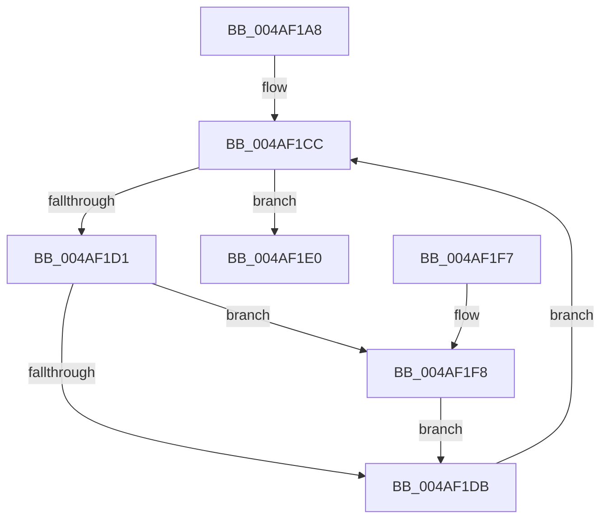

# PopThermalTraceRundownEvents

- RVA: `0x004AF1A8`–`0x004AF23A` (길이 `146` bytes)
- VA: `0x00000001404AF1A8`
- 실행 섹션: `.text`
- PDB 이름 있음: `예`; PDB Function 태그: `아니요`
- unwind 정보 RVA: `0x000B8720`
- 디코드: `37`개 명령, `146/146` bytes 표시
- 미해석 바이트: `0` (있으면 어셈블리에 `.byte`로 보존)

> 이 문서는 커널 이미지의 기계어와 PDB 기호를 분석해 생성했습니다. 4번과 5번은 함수 원형과 자료형을 바이너리 사용 방식에서 추정한 C 해석이며 원본 소스 복구 결과는 아닙니다.

## 1. Dependencies

- 직접 호출 지점: **3**; 고유 호출 대상: **3**
- 직접 호출자로 확인된 함수: **1**
- RIP 상대 이미지 참조: **2**

### Outgoing calls
- `0x004AF1B9` → [PopAcquireRwLockShared](../2D/PopAcquireRwLockShared_function_002D9A40.md) (function, `0x002D9A40`)
- `0x004AF1E7` → [PopReleaseRwLock](../2D/PopReleaseRwLock_function_002DFBBC.md) (function, `0x002DFBBC`)
- `0x004AF233` → [PopDiagTraceThermalZoneRundown](PopDiagTraceThermalZoneRundown_function_004AF240.md) (function, `0x004AF240`)

### Direct callers
- [PopDiagTraceControlCallback](../../page/A3/PopDiagTraceControlCallback_function_00A38CB0.md) at `0x00A38D96`

### Static image references
- `0x004AF1B2` → RVA `0x00F0C900` (`.data`; read)
- `0x004AF1BE` → RVA `0x00F0CE80` (`.data`; read)

## 2. Other-region calls and transfers

- 다른 실행 섹션으로 향하는 call: **0**
- 별도 외부 분기/꼬리 이동을 확인하지 못했습니다.

## 3. Assembly (complete function range)

```asm
004AF1A8  48 89 5C 24 08                  mov qword ptr [rsp + 8], rbx
004AF1AD  57                              push rdi
004AF1AE  48 83 EC 40                     sub rsp, 0x40
004AF1B2  48 8D 0D 47 D7 A5 00            lea rcx, [rip + 0xa5d747]
004AF1B9  E8 82 A8 E2 FF                  call 0x1402d9a40
004AF1BE  48 8B 1D BB DC A5 00            mov rbx, qword ptr [rip + 0xa5dcbb]
004AF1C5  48 8D 3D B4 DC A5 00            lea rdi, [rip + 0xa5dcb4]
004AF1CC  48 3B DF                        cmp rbx, rdi
004AF1CF  74 0F                           je 0x1404af1e0
004AF1D1  44 8A 43 41                     mov r8b, byte ptr [rbx + 0x41]
004AF1D5  41 F6 C0 02                     test r8b, 2
004AF1D9  75 1D                           jne 0x1404af1f8
004AF1DB  48 8B 1B                        mov rbx, qword ptr [rbx]
004AF1DE  EB EC                           jmp 0x1404af1cc
004AF1E0  48 8D 0D 19 D7 A5 00            lea rcx, [rip + 0xa5d719]
004AF1E7  E8 D0 09 E3 FF                  call 0x1402dfbbc
004AF1EC  48 8B 5C 24 50                  mov rbx, qword ptr [rsp + 0x50]
004AF1F1  48 83 C4 40                     add rsp, 0x40
004AF1F5  5F                              pop rdi
004AF1F6  C3                              ret
004AF1F7  CC                              int3
004AF1F8  0F B6 43 49                     movzx eax, byte ptr [rbx + 0x49]
004AF1FC  48 8D 93 10 04 00 00            lea rdx, [rbx + 0x410]
004AF203  0F B6 4B 48                     movzx ecx, byte ptr [rbx + 0x48]
004AF207  45 8A D0                        mov r10b, r8b
004AF20A  44 0F B6 4B 45                  movzx r9d, byte ptr [rbx + 0x45]
004AF20F  41 80 E2 01                     and r10b, 1
004AF213  89 44 24 38                     mov dword ptr [rsp + 0x38], eax
004AF217  8B 43 50                        mov eax, dword ptr [rbx + 0x50]
004AF21A  89 4C 24 30                     mov dword ptr [rsp + 0x30], ecx
004AF21E  48 8B 4B 30                     mov rcx, qword ptr [rbx + 0x30]
004AF222  41 C0 E8 02                     shr r8b, 2
004AF226  89 44 24 28                     mov dword ptr [rsp + 0x28], eax
004AF22A  41 80 E0 01                     and r8b, 1
004AF22E  44 88 54 24 20                  mov byte ptr [rsp + 0x20], r10b
004AF233  E8 08 00 00 00                  call 0x1404af240
004AF238  EB A1                           jmp 0x1404af1db
```

## 4. C-style interpretation (structured pseudocode)

```c
__int64 __fastcall PopThermalTraceRundownEvents(void)
{
    __int64 result;
    __int64 v_r10;
    __int64 v_rsp;
    unsigned __int8 v_stack_p20;
    unsigned int v_stack_p28;
    unsigned int v_stack_p30;
    unsigned int v_stack_p38;
    unsigned __int64 v_stack_p8;

    v_stack_p8 = v_rbx;
    v_rsp = (v_rsp) - (64);
    result = PopAcquireRwLockShared(v_rip + 10868551, a2, a3, a4);
loc_004AF1CC:
    if ((*(unsigned __int64 *)(v_rip + 10869947)) == (v_rip + 10869940)) goto loc_004AF1E0;
    if ((((unsigned __int8)(*(unsigned __int8 *)(*(unsigned __int64 *)(v_rip + 10869947) + 65))) & (2)) != 0) goto loc_004AF1F8;
loc_004AF1DB:
    goto loc_004AF1CC;
loc_004AF1E0:
    result = PopReleaseRwLock(v_rip + 10868505, a2, *(unsigned __int8 *)(*(unsigned __int64 *)(v_rip + 10869947) + 65), a4);
    v_rsp = (v_rsp) + (64);
    return result;
loc_004AF1F8:
    v_r10 = (unsigned __int8)(((unsigned __int8)(*(unsigned __int8 *)(*(unsigned __int64 *)(v_rip + 10869947) + 65))) & (1));
    v_stack_p38 = (unsigned int)(*(unsigned __int8 *)(v_stack_p8 + 73));
    v_stack_p30 = (unsigned int)(*(unsigned __int8 *)(v_stack_p8 + 72));
    a3 = (unsigned __int8)((*(unsigned __int8 *)(*(unsigned __int64 *)(v_rip + 10869947) + 65)) >> (2));
    v_stack_p28 = (unsigned int)((unsigned int)(*(unsigned int *)(v_stack_p8 + 80)));
    a3 = (unsigned __int8)((a3) & (1));
    v_stack_p20 = (unsigned __int8)(v_r10);
    result = PopDiagTraceThermalZoneRundown(*(unsigned __int64 *)(v_stack_p8 + 48), v_stack_p8 + 1040, a3, *(unsigned __int8 *)(v_stack_p8 + 69));
    goto loc_004AF1DB;
}
```

## 5. (Beta) C Style

```c
void PopThermalTraceRundownEvents(void)
{
    int64_t result;
    int64_t local_r10;
    int64_t local_rsp;
    uint8_t v_stack_p20;
    uint32_t v_stack_p28;
    uint32_t v_stack_p30;
    uint32_t v_stack_p38;
    uint64_t v_stack_p8;

    v_stack_p8 = local_rbx;
    local_rsp = (local_rsp) - (64);
    result = PopAcquireRwLockShared(v_rip + 10868551, a2, a3, a4);
loc_004AF1CC:
    if ((*(uint64_t *)(v_rip + 0xA5DCBB)) == (v_rip + 10869940)) goto loc_004AF1E0;
    if ((((uint8_t)(*(uint8_t *)(*(uint64_t *)(v_rip + 0xA5DCBB) + 0x41))) & (2)) != 0) goto loc_004AF1F8;
loc_004AF1DB:
    goto loc_004AF1CC;
loc_004AF1E0:
    result = PopReleaseRwLock(v_rip + 10868505, a2, *(uint8_t *)(*(uint64_t *)(v_rip + 0xA5DCBB) + 0x41), a4);
    local_rsp = (local_rsp) + (64);
    return result;
loc_004AF1F8:
    local_r10 = (uint8_t)(((uint8_t)(*(uint8_t *)(*(uint64_t *)(v_rip + 0xA5DCBB) + 0x41))) & (1));
    v_stack_p38 = (uint32_t)(*(uint8_t *)(v_stack_p8 + 0x49));
    v_stack_p30 = (uint32_t)(*(uint8_t *)(v_stack_p8 + 0x48));
    a3 = (uint8_t)((*(uint8_t *)(*(uint64_t *)(v_rip + 0xA5DCBB) + 0x41)) >> (2));
    v_stack_p28 = (uint32_t)((uint32_t)(*(uint32_t *)(v_stack_p8 + 0x50)));
    a3 = (uint8_t)((a3) & (1));
    v_stack_p20 = (uint8_t)(local_r10);
    result = PopDiagTraceThermalZoneRundown(*(uint64_t *)(v_stack_p8 + 0x30), v_stack_p8 + 1040, a3, *(uint8_t *)(v_stack_p8 + 0x45));
    goto loc_004AF1DB;
}
```

## 6. Execution-region graph

[열기: 2D/3D 그래프와 함수 탐색 컨트롤 패널](../../../control-panel.html?section=text&rva=0x004AF1A8&view=graph)

- 2D 그래프는 위에서 아래로 흐르고, 3D 그래프는 빈 공간을 드래그해 회전합니다. Shift+드래그는 이동, 휠은 확대·축소, 함수 노드 선택은 대상 보고서 이동입니다.

### Static fallback


