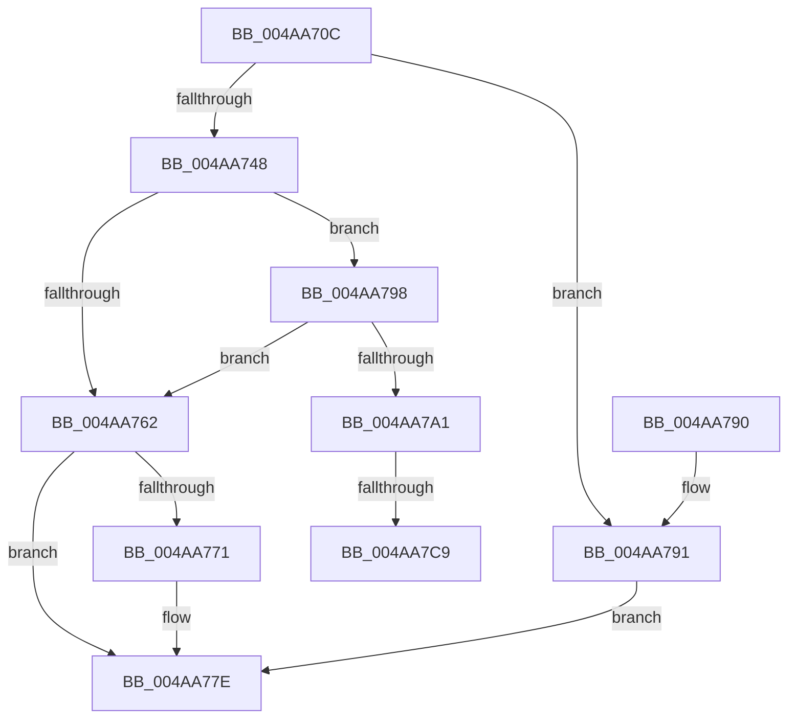

# PopUpdateWakeSource

- RVA: `0x004AA70C`–`0x004AA7D0` (길이 `196` bytes)
- VA: `0x00000001404AA70C`
- 실행 섹션: `.text`
- PDB 이름 있음: `예`; PDB Function 태그: `예`
- unwind 정보 RVA: `0x000B7CB0`
- 디코드: `50`개 명령, `196/196` bytes 표시
- 미해석 바이트: `0` (있으면 어셈블리에 `.byte`로 보존)

> 이 문서는 커널 이미지의 기계어와 PDB 기호를 분석해 생성했습니다. 4번과 5번은 함수 원형과 자료형을 바이너리 사용 방식에서 추정한 C 해석이며 원본 소스 복구 결과는 아닙니다.

## 1. Dependencies

- 직접 호출 지점: **5**; 고유 호출 대상: **5**
- 직접 호출자로 확인된 함수: **2**
- RIP 상대 이미지 참조: **5**

### Outgoing calls
- `0x004AA739` → [ExAllocatePool2](../../poolcode/B8/ExAllocatePool2_function_00B820F0.md) (function, `0x00B820F0`)
- `0x004AA754` → [KeAcquireInStackQueuedSpinLock](../27/KeAcquireInStackQueuedSpinLock_function_002757A0.md) (function, `0x002757A0`)
- `0x004AA767` → [KeReleaseInStackQueuedSpinLock](../34/KeReleaseInStackQueuedSpinLock_function_00342CE0.md) (function, `0x00342CE0`)
- `0x004AA779` → [ExFreePoolWithTag](../../poolcode/B8/ExFreePoolWithTag_function_00B82870.md) (function, `0x00B82870`)
- `0x004AA7A9` → [ObfReferenceObjectWithTag](../21/ObfReferenceObjectWithTag_function_00210710.md) (function, `0x00210710`)

### Direct callers
- [PopRequestCompletion](../26/PopRequestCompletion_function_0026EEF0.md) at `0x0026F01F`
- [PoSetSystemWakeDevice](PoSetSystemWakeDevice_function_004AA6D0.md) at `0x004AA6EB`

### Static image references
- `0x004AA74D` → RVA `0x00F0DEA8` (`.data`; read)
- `0x004AA759` → RVA `0x00F0DEB0` (`.data`; read)
- `0x004AA798` → RVA `0x00F0DEF0` (`.data`; read)
- `0x004AA7B2` → RVA `0x00F0DEE0` (`.data`; read)
- `0x004AA7B9` → RVA `0x00F0DEE8` (`.data`; read)

## 2. Other-region calls and transfers

- 다른 실행 섹션으로 향하는 call: **2**
  - `0x004AA739` → [ExAllocatePool2](../../poolcode/B8/ExAllocatePool2_function_00B820F0.md) (`.text` → `POOLCODE`)
  - `0x004AA779` → [ExFreePoolWithTag](../../poolcode/B8/ExFreePoolWithTag_function_00B82870.md) (`.text` → `POOLCODE`)
- call이 아닌 외부 분기/꼬리 이동: **1**
  - `0x004AA7C3` → [sub_006FA094](../6F/Unknown_function_006FA094.md) (`tail-transfer`)

## 3. Assembly (complete function range)

```asm
004AA70C  48 89 5C 24 08                  mov qword ptr [rsp + 8], rbx
004AA711  48 89 74 24 10                  mov qword ptr [rsp + 0x10], rsi
004AA716  57                              push rdi
004AA717  48 83 EC 40                     sub rsp, 0x40
004AA71B  33 C0                           xor eax, eax
004AA71D  48 8B F1                        mov rsi, rcx
004AA720  0F 57 C0                        xorps xmm0, xmm0
004AA723  48 89 44 24 30                  mov qword ptr [rsp + 0x30], rax
004AA728  41 B8 4D 65 6D 20               mov r8d, 0x206d654d
004AA72E  0F 11 44 24 20                  movups xmmword ptr [rsp + 0x20], xmm0
004AA733  8D 50 18                        lea edx, [rax + 0x18]
004AA736  8D 48 40                        lea ecx, [rax + 0x40]
004AA739  E8 B2 79 6D 00                  call 0x140b820f0
004AA73E  33 FF                           xor edi, edi
004AA740  48 8B D8                        mov rbx, rax
004AA743  48 85 C0                        test rax, rax
004AA746  74 49                           je 0x1404aa791
004AA748  48 8D 54 24 20                  lea rdx, [rsp + 0x20]
004AA74D  48 8D 0D 54 37 A6 00            lea rcx, [rip + 0xa63754]
004AA754  E8 47 B0 DC FF                  call 0x1402757a0
004AA759  48 39 3D 50 37 A6 00            cmp qword ptr [rip + 0xa63750], rdi
004AA760  75 36                           jne 0x1404aa798
004AA762  48 8D 4C 24 20                  lea rcx, [rsp + 0x20]
004AA767  E8 74 85 E9 FF                  call 0x140342ce0
004AA76C  48 85 DB                        test rbx, rbx
004AA76F  74 0D                           je 0x1404aa77e
004AA771  BA 4D 65 6D 20                  mov edx, 0x206d654d
004AA776  48 8B CB                        mov rcx, rbx
004AA779  E8 F2 80 6D 00                  call 0x140b82870
004AA77E  48 8B 5C 24 50                  mov rbx, qword ptr [rsp + 0x50]
004AA783  8B C7                           mov eax, edi
004AA785  48 8B 74 24 58                  mov rsi, qword ptr [rsp + 0x58]
004AA78A  48 83 C4 40                     add rsp, 0x40
004AA78E  5F                              pop rdi
004AA78F  C3                              ret
004AA790  CC                              int3
004AA791  BF 9A 00 00 C0                  mov edi, 0xc000009a
004AA796  EB E6                           jmp 0x1404aa77e
004AA798  83 3D 51 37 A6 00 01            cmp dword ptr [rip + 0xa63751], 1
004AA79F  77 C1                           ja 0x1404aa762
004AA7A1  BA 50 6F 44 67                  mov edx, 0x67446f50
004AA7A6  48 8B CE                        mov rcx, rsi
004AA7A9  E8 62 5F D6 FF                  call 0x140210710
004AA7AE  48 89 73 10                     mov qword ptr [rbx + 0x10], rsi
004AA7B2  48 8D 0D 27 37 A6 00            lea rcx, [rip + 0xa63727]
004AA7B9  48 8B 05 28 37 A6 00            mov rax, qword ptr [rip + 0xa63728]
004AA7C0  48 39 08                        cmp qword ptr [rax], rcx
004AA7C3  0F 84 CB F8 24 00               je 0x1406fa094
004AA7C9  B9 03 00 00 00                  mov ecx, 3
004AA7CE  CD 29                           int 0x29
```

## 4. C-style interpretation (structured pseudocode)

```c
__int64 __fastcall PopUpdateWakeSource(__int64 a1)
{
    __int64 result;
    __int64 v_rdi;
    __int64 v_rsp;
    unsigned __int64 v_stack_m18;
    unsigned __int64 v_stack_m28;
    unsigned __int64 v_stack_p10;
    unsigned __int64 v_stack_p8;

    v_stack_p8 = v_rbx;
    v_stack_p10 = v_rsi;
    v_rsp = (v_rsp) - (64);
    result = 0;
    v_stack_m18 = 0;
    v_stack_m28 = v_xmm0;
    result = ExAllocatePool2(result + 64, result + 24, (unsigned int)(0x206D654DULL), a4);
    v_rdi = 0;
    if (result == 0) goto loc_004AA791;
    result = KeAcquireInStackQueuedSpinLock(v_rip + 10893140, v_stack_m28, (unsigned int)(0x206D654DULL), a4);
    if ((*(unsigned __int64 *)(v_rip + 10893136)) != 0) goto loc_004AA798;
loc_004AA762:
    result = KeReleaseInStackQueuedSpinLock(v_stack_m28, v_stack_m28, (unsigned int)(0x206D654DULL), a4);
    if (result != 0) {
        a2 = 0x206D654DULL;
        a1 = result;
        result = ExFreePoolWithTag(a1, a2, (unsigned int)(0x206D654DULL), a4);
    }
    v_rsp = (v_rsp) + (64);
    return 0;
loc_004AA791:
    goto loc_004AA77E;
loc_004AA798:
    if ((*(unsigned int *)(v_rip + 10893137)) > 1) goto loc_004AA762;
    result = ObfReferenceObjectWithTag(v_stack_p10, (unsigned int)(0x67446F50ULL), (unsigned int)(0x206D654DULL), a4);
    *(unsigned __int64 *)(v_stack_p8 + 16) = v_stack_p10;
    return *(unsigned __int64 *)(v_rip + 10893096);
}
```

## 5. (Beta) C Style

```c
int64_t PopUpdateWakeSource(int64_t Arg1)
{
    int64_t result;
    int64_t local_rdi;
    int64_t local_rsp;
    uint64_t v_stack_m18;
    uint64_t v_stack_m28;
    uint64_t v_stack_p10;
    uint64_t v_stack_p8;

    v_stack_p8 = local_rbx;
    v_stack_p10 = local_rsi;
    local_rsp = (local_rsp) - (64);
    result = 0;
    v_stack_m18 = 0;
    v_stack_m28 = v_xmm0;
    result = ExAllocatePool2(result + 64, result + 24, (uint32_t)(0x206D654DULL), a4);
    local_rdi = 0;
    if (result == 0) goto loc_004AA791;
    result = KeAcquireInStackQueuedSpinLock(v_rip + 10893140, v_stack_m28, (uint32_t)(0x206D654DULL), a4);
    if ((*(uint64_t *)(v_rip + 0xA63750)) != 0) goto loc_004AA798;
loc_004AA762:
    result = KeReleaseInStackQueuedSpinLock(v_stack_m28, v_stack_m28, (uint32_t)(0x206D654DULL), a4);
    if (result != 0) {
        a2 = 0x206D654DULL;
        Arg1 = result;
        result = ExFreePoolWithTag(Arg1, a2, (uint32_t)(0x206D654DULL), a4);
    }
    local_rsp = (local_rsp) + (64);
    return 0;
loc_004AA791:
    goto loc_004AA77E;
loc_004AA798:
    if ((*(uint32_t *)(v_rip + 0xA63751)) > 1) goto loc_004AA762;
    result = ObfReferenceObjectWithTag(v_stack_p10, (uint32_t)(0x67446F50ULL), (uint32_t)(0x206D654DULL), a4);
    *(uint64_t *)(v_stack_p8 + 0x10) = v_stack_p10;
    return *(uint64_t *)(v_rip + 0xA63728);
}
```

## 6. Execution-region graph

[열기: 2D/3D 그래프와 함수 탐색 컨트롤 패널](../../../control-panel.html?section=text&rva=0x004AA70C&view=graph)

- 2D 그래프는 위에서 아래로 흐르고, 3D 그래프는 빈 공간을 드래그해 회전합니다. Shift+드래그는 이동, 휠은 확대·축소, 함수 노드 선택은 대상 보고서 이동입니다.

### Static fallback


