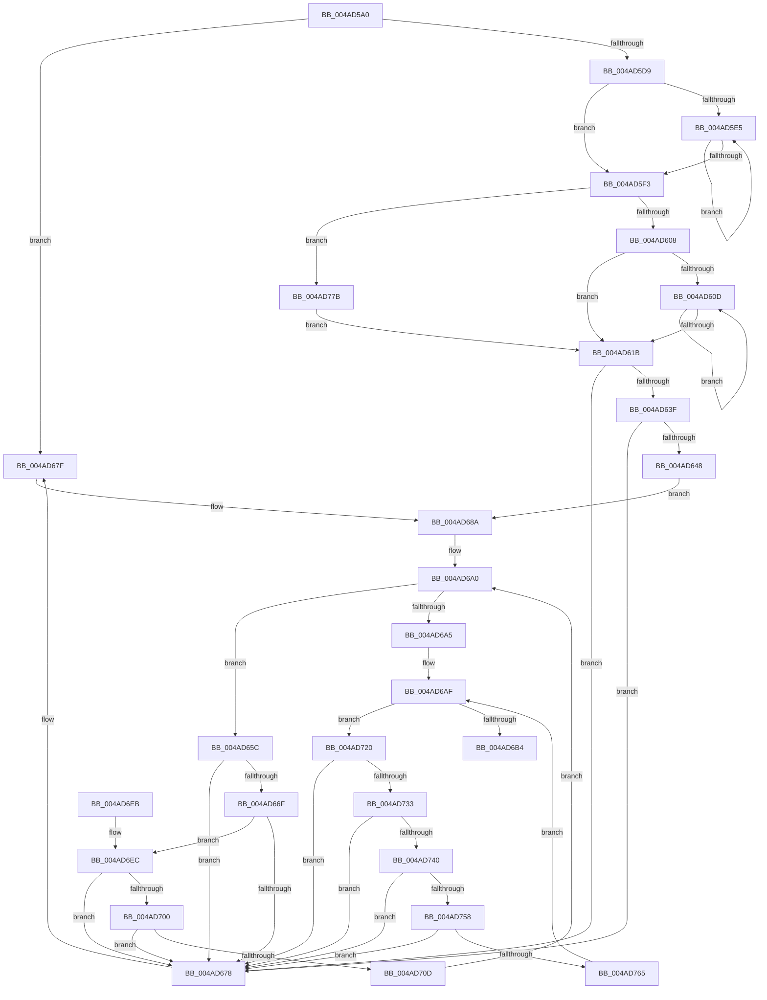

# PpDevNodeRemoveFromTree

- RVA: `0x004AD5A0`–`0x004AD782` (길이 `482` bytes)
- VA: `0x00000001404AD5A0`
- 실행 섹션: `.text`
- PDB 이름 있음: `예`; PDB Function 태그: `아니요`
- unwind 정보 RVA: `0x0008323C`
- 디코드: `128`개 명령, `482/482` bytes 표시
- 미해석 바이트: `0` (있으면 어셈블리에 `.byte`로 보존)

> 이 문서는 커널 이미지의 기계어와 PDB 기호를 분석해 생성했습니다. 4번과 5번은 함수 원형과 자료형을 바이너리 사용 방식에서 추정한 C 해석이며 원본 소스 복구 결과는 아닙니다.

## 1. Dependencies

- 직접 호출 지점: **8**; 고유 호출 대상: **6**
- 직접 호출자로 확인된 함수: **2**
- RIP 상대 이미지 참조: **2**

### Outgoing calls
- `0x004AD5C4` → [KeAcquireSpinLockRaiseToDpc](../20/KeAcquireSpinLockRaiseToDpc_function_00208470.md) (function, `0x00208470`)
- `0x004AD62A` → [KeReleaseSpinLock](../39/KeReleaseSpinLock_function_00392BA0.md) (function, `0x00392BA0`)
- `0x004AD652` → [PnpOrphanNotification](../../page/AA/PnpOrphanNotification_function_00AAF78C.md) (function, `0x00AAF78C`)
- `0x004AD685` → [KeReleaseSpinLock](../39/KeReleaseSpinLock_function_00392BA0.md) (function, `0x00392BA0`)
- `0x004AD691` → [ExAcquireFastMutex](../20/ExAcquireFastMutex_function_0020E5A0.md) (function, `0x0020E5A0`)
- `0x004AD6BB` → [ExReleaseFastMutex](../25/ExReleaseFastMutex_function_002519C0.md) (function, `0x002519C0`)
- `0x004AD719` → [ExFreePoolWithTag](../../poolcode/B8/ExFreePoolWithTag_function_00B82870.md) (function, `0x00B82870`)
- `0x004AD771` → [ExFreePoolWithTag](../../poolcode/B8/ExFreePoolWithTag_function_00B82870.md) (function, `0x00B82870`)

### Direct callers
- [IoReportDetectedDevice](../../page/72/IoReportDetectedDevice_function_00725CD0.md) at `0x00726051`
- [PnpUnlinkDeviceRemovalRelations](../../page/A0/PnpUnlinkDeviceRemovalRelations_function_00A063D8.md) at `0x00A0650F`

### Static image references
- `0x004AD5B7` → RVA `0x00F8AD90` (`.data`; read)
- `0x004AD68A` → RVA `0x00F8C3A0` (`.data`; read)

## 2. Other-region calls and transfers

- 다른 실행 섹션으로 향하는 call: **3**
  - `0x004AD652` → [PnpOrphanNotification](../../page/AA/PnpOrphanNotification_function_00AAF78C.md) (`.text` → `PAGE`)
  - `0x004AD719` → [ExFreePoolWithTag](../../poolcode/B8/ExFreePoolWithTag_function_00B82870.md) (`.text` → `POOLCODE`)
  - `0x004AD771` → [ExFreePoolWithTag](../../poolcode/B8/ExFreePoolWithTag_function_00B82870.md) (`.text` → `POOLCODE`)
- 별도 외부 분기/꼬리 이동을 확인하지 못했습니다.

## 3. Assembly (complete function range)

```asm
004AD5A0  48 89 5C 24 08                  mov qword ptr [rsp + 8], rbx
004AD5A5  48 89 6C 24 10                  mov qword ptr [rsp + 0x10], rbp
004AD5AA  48 89 74 24 18                  mov qword ptr [rsp + 0x18], rsi
004AD5AF  57                              push rdi
004AD5B0  48 83 EC 20                     sub rsp, 0x20
004AD5B4  48 8B D9                        mov rbx, rcx
004AD5B7  48 8D 3D D2 D7 AD 00            lea rdi, [rip + 0xadd7d2]
004AD5BE  48 8B CF                        mov rcx, rdi
004AD5C1  40 32 ED                        xor bpl, bpl
004AD5C4  E8 A7 AE D5 FF                  call 0x140208470
004AD5C9  48 8B 4B 10                     mov rcx, qword ptr [rbx + 0x10]
004AD5CD  44 8A C8                        mov r9b, al
004AD5D0  48 85 C9                        test rcx, rcx
004AD5D3  0F 84 A6 00 00 00               je 0x1404ad67f
004AD5D9  48 83 C1 08                     add rcx, 8
004AD5DD  48 8B 11                        mov rdx, qword ptr [rcx]
004AD5E0  48 3B D3                        cmp rdx, rbx
004AD5E3  74 0E                           je 0x1404ad5f3
004AD5E5  48 8B 02                        mov rax, qword ptr [rdx]
004AD5E8  48 8B CA                        mov rcx, rdx
004AD5EB  48 8B D0                        mov rdx, rax
004AD5EE  48 3B C3                        cmp rax, rbx
004AD5F1  75 F2                           jne 0x1404ad5e5
004AD5F3  48 8B 13                        mov rdx, qword ptr [rbx]
004AD5F6  48 89 11                        mov qword ptr [rcx], rdx
004AD5F9  4C 8B 43 10                     mov r8, qword ptr [rbx + 0x10]
004AD5FD  49 83 78 08 00                  cmp qword ptr [r8 + 8], 0
004AD602  0F 84 73 01 00 00               je 0x1404ad77b
004AD608  48 85 D2                        test rdx, rdx
004AD60B  74 0E                           je 0x1404ad61b
004AD60D  48 8B 02                        mov rax, qword ptr [rdx]
004AD610  48 8B CA                        mov rcx, rdx
004AD613  48 8B D0                        mov rdx, rax
004AD616  48 85 C0                        test rax, rax
004AD619  75 F2                           jne 0x1404ad60d
004AD61B  B8 18 00 00 00                  mov eax, 0x18
004AD620  41 8A D1                        mov dl, r9b
004AD623  49 89 0C 00                     mov qword ptr [r8 + rax], rcx
004AD627  48 8B CF                        mov rcx, rdi
004AD62A  E8 71 55 EE FF                  call 0x140392ba0
004AD62F  48 8D 8B 70 02 00 00            lea rcx, [rbx + 0x270]
004AD636  48 8B 11                        mov rdx, qword ptr [rcx]
004AD639  48 39 4A 08                     cmp qword ptr [rdx + 8], rcx
004AD63D  75 39                           jne 0x1404ad678
004AD63F  48 8B 41 08                     mov rax, qword ptr [rcx + 8]
004AD643  48 39 08                        cmp qword ptr [rax], rcx
004AD646  75 30                           jne 0x1404ad678
004AD648  48 89 10                        mov qword ptr [rax], rdx
004AD64B  48 8B CB                        mov rcx, rbx
004AD64E  48 89 42 08                     mov qword ptr [rdx + 8], rax
004AD652  E8 35 21 60 00                  call 0x140aaf78c
004AD657  40 B5 01                        mov bpl, 1
004AD65A  EB 2E                           jmp 0x1404ad68a
004AD65C  48 8D 4F E8                     lea rcx, [rdi - 0x18]
004AD660  48 8B C7                        mov rax, rdi
004AD663  4C 8B 01                        mov r8, qword ptr [rcx]
004AD666  48 8B 3F                        mov rdi, qword ptr [rdi]
004AD669  49 39 48 08                     cmp qword ptr [r8 + 8], rcx
004AD66D  75 09                           jne 0x1404ad678
004AD66F  48 8B 51 08                     mov rdx, qword ptr [rcx + 8]
004AD673  48 39 0A                        cmp qword ptr [rdx], rcx
004AD676  74 74                           je 0x1404ad6ec
004AD678  B9 03 00 00 00                  mov ecx, 3
004AD67D  CD 29                           int 0x29
004AD67F  41 8A D1                        mov dl, r9b
004AD682  48 8B CF                        mov rcx, rdi
004AD685  E8 16 55 EE FF                  call 0x140392ba0
004AD68A  48 8D 0D 0F ED AD 00            lea rcx, [rip + 0xaded0f]
004AD691  E8 0A 0F D6 FF                  call 0x14020e5a0
004AD696  48 8D B3 B0 00 00 00            lea rsi, [rbx + 0xb0]
004AD69D  48 8B 3E                        mov rdi, qword ptr [rsi]
004AD6A0  48 3B FE                        cmp rdi, rsi
004AD6A3  75 B7                           jne 0x1404ad65c
004AD6A5  48 8D B3 C0 00 00 00            lea rsi, [rbx + 0xc0]
004AD6AC  48 8B 3E                        mov rdi, qword ptr [rsi]
004AD6AF  48 3B FE                        cmp rdi, rsi
004AD6B2  75 6C                           jne 0x1404ad720
004AD6B4  48 8D 0D E5 EC AD 00            lea rcx, [rip + 0xadece5]
004AD6BB  E8 00 43 DA FF                  call 0x1402519c0
004AD6C0  48 83 63 10 00                  and qword ptr [rbx + 0x10], 0
004AD6C5  40 8A C5                        mov al, bpl
004AD6C8  48 83 63 08 00                  and qword ptr [rbx + 8], 0
004AD6CD  48 83 23 00                     and qword ptr [rbx], 0
004AD6D1  48 83 63 18 00                  and qword ptr [rbx + 0x18], 0
004AD6D6  48 8B 5C 24 30                  mov rbx, qword ptr [rsp + 0x30]
004AD6DB  48 8B 6C 24 38                  mov rbp, qword ptr [rsp + 0x38]
004AD6E0  48 8B 74 24 40                  mov rsi, qword ptr [rsp + 0x40]
004AD6E5  48 83 C4 20                     add rsp, 0x20
004AD6E9  5F                              pop rdi
004AD6EA  C3                              ret
004AD6EB  CC                              int3
004AD6EC  4C 89 02                        mov qword ptr [rdx], r8
004AD6EF  49 89 50 08                     mov qword ptr [r8 + 8], rdx
004AD6F3  4C 8B 00                        mov r8, qword ptr [rax]
004AD6F6  49 39 40 08                     cmp qword ptr [r8 + 8], rax
004AD6FA  0F 85 78 FF FF FF               jne 0x1404ad678
004AD700  48 8B 50 08                     mov rdx, qword ptr [rax + 8]
004AD704  48 39 02                        cmp qword ptr [rdx], rax
004AD707  0F 85 6B FF FF FF               jne 0x1404ad678
004AD70D  4C 89 02                        mov qword ptr [rdx], r8
004AD710  49 89 50 08                     mov qword ptr [r8 + 8], rdx
004AD714  BA 44 50 77 72                  mov edx, 0x72775044
004AD719  E8 52 51 6D 00                  call 0x140b82870
004AD71E  EB 80                           jmp 0x1404ad6a0
004AD720  48 8B 07                        mov rax, qword ptr [rdi]
004AD723  48 8B CF                        mov rcx, rdi
004AD726  48 8B F8                        mov rdi, rax
004AD729  48 39 48 08                     cmp qword ptr [rax + 8], rcx
004AD72D  0F 85 45 FF FF FF               jne 0x1404ad678
004AD733  48 8B 51 08                     mov rdx, qword ptr [rcx + 8]
004AD737  48 39 0A                        cmp qword ptr [rdx], rcx
004AD73A  0F 85 38 FF FF FF               jne 0x1404ad678
004AD740  48 89 02                        mov qword ptr [rdx], rax
004AD743  48 89 50 08                     mov qword ptr [rax + 8], rdx
004AD747  48 8D 41 18                     lea rax, [rcx + 0x18]
004AD74B  4C 8B 00                        mov r8, qword ptr [rax]
004AD74E  49 39 40 08                     cmp qword ptr [r8 + 8], rax
004AD752  0F 85 20 FF FF FF               jne 0x1404ad678
004AD758  48 8B 50 08                     mov rdx, qword ptr [rax + 8]
004AD75C  48 39 02                        cmp qword ptr [rdx], rax
004AD75F  0F 85 13 FF FF FF               jne 0x1404ad678
004AD765  4C 89 02                        mov qword ptr [rdx], r8
004AD768  49 89 50 08                     mov qword ptr [r8 + 8], rdx
004AD76C  BA 44 50 77 72                  mov edx, 0x72775044
004AD771  E8 FA 50 6D 00                  call 0x140b82870
004AD776  E9 34 FF FF FF                  jmp 0x1404ad6af
004AD77B  33 C9                           xor ecx, ecx
004AD77D  E9 99 FE FF FF                  jmp 0x1404ad61b
```

## 4. C-style interpretation (structured pseudocode)

```c
__int64 __fastcall PpDevNodeRemoveFromTree(__int64 a1)
{
    __int64 result;
    __int64 v_rbp;
    __int64 v_rsp;
    unsigned __int64 v_stack_p10;
    unsigned __int64 v_stack_p18;
    unsigned __int64 v_stack_p8;

    v_stack_p8 = v_rbx;
    v_stack_p10 = v_rbp;
    v_stack_p18 = v_rsi;
    v_rsp = (v_rsp) - (32);
    v_rbp = 0;
    result = KeAcquireSpinLockRaiseToDpc(v_rip + 11392978, a2, a3, a4);
    if (*(unsigned __int64 *)(a1 + 16) == 0) goto loc_004AD67F;
    a1 = (*(unsigned __int64 *)(a1 + 16)) + (8);
    if ((*(unsigned __int64 *)(a1)) == a1) goto loc_004AD5F3;
loc_004AD5E5:
    if ((*(unsigned __int64 *)(*(unsigned __int64 *)(a1))) != a1) goto loc_004AD5E5;
loc_004AD5F3:
    *(unsigned __int64 *)(*(unsigned __int64 *)(a1)) = *(unsigned __int64 *)(a1);
    if ((*(unsigned __int64 *)(*(unsigned __int64 *)(a1 + 16) + 8)) == 0) goto loc_004AD77B;
    if (*(unsigned __int64 *)(a1) == 0) goto loc_004AD61B;
loc_004AD60D:
    if (*(unsigned __int64 *)(*(unsigned __int64 *)(a1)) != 0) goto loc_004AD60D;
loc_004AD61B:
    *(unsigned __int64 *)(*(unsigned __int64 *)(a1 + 16) + 24 * 1) = *(unsigned __int64 *)(a1);
    result = KeReleaseSpinLock(v_rip + 11392978, (unsigned __int8)((unsigned __int8)(result)), *(unsigned __int64 *)(a1 + 16), (unsigned __int8)(result));
    if ((*(unsigned __int64 *)(*(unsigned __int64 *)(a1 + 624) + 8)) != (a1 + 624)) goto loc_004AD678;
    if ((*(unsigned __int64 *)(*(unsigned __int64 *)(a1 + 624 + 8))) != (a1 + 624)) goto loc_004AD678;
    *(unsigned __int64 *)(*(unsigned __int64 *)(a1 + 624 + 8)) = *(unsigned __int64 *)(a1 + 624);
    *(unsigned __int64 *)(*(unsigned __int64 *)(a1 + 624) + 8) = *(unsigned __int64 *)(a1 + 624 + 8);
    result = PnpOrphanNotification(a1, *(unsigned __int64 *)(a1 + 624), *(unsigned __int64 *)(a1 + 16), (unsigned __int8)(result));
    goto loc_004AD68A;
loc_004AD65C:
    if ((*(unsigned __int64 *)(*(unsigned __int64 *)(v_rip + 11392978 - 24) + 8)) != (v_rip + 11392978 - 24)) goto loc_004AD678;
    if ((*(unsigned __int64 *)(*(unsigned __int64 *)(v_rip + 11392978 - 24 + 8))) == (v_rip + 11392978 - 24)) goto loc_004AD6EC;
loc_004AD678:
loc_004AD67F:
    result = KeReleaseSpinLock(*(unsigned __int64 *)(v_rip + 11392978), (unsigned __int8)((unsigned __int8)(result)), *(unsigned __int64 *)(v_rip + 11392978 - 24), (unsigned __int8)(result));
loc_004AD68A:
    result = ExAcquireFastMutex(v_rip + 11398415, (unsigned __int8)((unsigned __int8)(result)), *(unsigned __int64 *)(v_rip + 11392978 - 24), (unsigned __int8)(result));
loc_004AD6A0:
    if ((*(unsigned __int64 *)(a1 + 176)) != (a1 + 176)) goto loc_004AD65C;
loc_004AD6AF:
    if ((*(unsigned __int64 *)(a1 + 192)) != (a1 + 192)) goto loc_004AD720;
    result = ExReleaseFastMutex(v_rip + 11398373, (unsigned __int8)((unsigned __int8)(result)), *(unsigned __int64 *)(v_rip + 11392978 - 24), (unsigned __int8)(result));
    v_rsp = (v_rsp) + (32);
    return 1;
loc_004AD6EC:
    *(unsigned __int64 *)((unsigned __int8)((unsigned __int8)(result))) = *(unsigned __int64 *)(v_rip + 11392978 - 24);
    *(unsigned __int64 *)(*(unsigned __int64 *)(v_rip + 11392978 - 24) + 8) = (unsigned __int8)((unsigned __int8)(result));
    if ((*(unsigned __int64 *)(*(unsigned __int64 *)(1) + 8)) != 1) goto loc_004AD678;
    if ((*(unsigned __int64 *)(*(unsigned __int64 *)(1 + 8))) != 1) goto loc_004AD678;
    *(unsigned __int64 *)(*(unsigned __int64 *)(1 + 8)) = *(unsigned __int64 *)(1);
    *(unsigned __int64 *)(*(unsigned __int64 *)(1) + 8) = *(unsigned __int64 *)(1 + 8);
    result = ExFreePoolWithTag(v_rip + 11398373, (unsigned int)(0x72775044ULL), *(unsigned __int64 *)(1), (unsigned __int8)(result));
    goto loc_004AD6A0;
loc_004AD720:
    if ((*(unsigned __int64 *)(*(unsigned __int64 *)(*(unsigned __int64 *)(a1 + 192)) + 8)) != (*(unsigned __int64 *)(a1 + 192))) goto loc_004AD678;
    if ((*(unsigned __int64 *)(*(unsigned __int64 *)(*(unsigned __int64 *)(a1 + 192) + 8))) != (*(unsigned __int64 *)(a1 + 192))) goto loc_004AD678;
    *(unsigned __int64 *)(*(unsigned __int64 *)(*(unsigned __int64 *)(a1 + 192) + 8)) = *(unsigned __int64 *)(*(unsigned __int64 *)(a1 + 192));
    *(unsigned __int64 *)(*(unsigned __int64 *)(*(unsigned __int64 *)(a1 + 192)) + 8) = *(unsigned __int64 *)(*(unsigned __int64 *)(a1 + 192) + 8);
    if ((*(unsigned __int64 *)(*(unsigned __int64 *)(*(unsigned __int64 *)(a1 + 192) + 24) + 8)) != (*(unsigned __int64 *)(a1 + 192) + 24)) goto loc_004AD678;
    if ((*(unsigned __int64 *)(*(unsigned __int64 *)(*(unsigned __int64 *)(a1 + 192) + 24 + 8))) != (*(unsigned __int64 *)(a1 + 192) + 24)) goto loc_004AD678;
    *(unsigned __int64 *)(*(unsigned __int64 *)(*(unsigned __int64 *)(a1 + 192) + 24 + 8)) = *(unsigned __int64 *)(*(unsigned __int64 *)(a1 + 192) + 24);
    *(unsigned __int64 *)(*(unsigned __int64 *)(*(unsigned __int64 *)(a1 + 192) + 24) + 8) = *(unsigned __int64 *)(*(unsigned __int64 *)(a1 + 192) + 24 + 8);
    result = ExFreePoolWithTag(*(unsigned __int64 *)(a1 + 192), (unsigned int)(0x72775044ULL), *(unsigned __int64 *)(*(unsigned __int64 *)(a1 + 192) + 24), (unsigned __int8)(result));
    goto loc_004AD6AF;
loc_004AD77B:
    a1 = 0;
    goto loc_004AD61B;
}
```

## 5. (Beta) C Style

```c
int64_t PpDevNodeRemoveFromTree(void *Arg1)
{
    uint8_t *arg1 = (uint8_t *)Arg1;

    int64_t result;
    int64_t local_rbp;
    int64_t local_rsp;
    uint64_t v_stack_p10;
    uint64_t v_stack_p18;
    uint64_t v_stack_p8;

    v_stack_p8 = local_rbx;
    v_stack_p10 = local_rbp;
    v_stack_p18 = local_rsi;
    local_rsp = (local_rsp) - (32);
    local_rbp = 0;
    result = KeAcquireSpinLockRaiseToDpc(v_rip + 11392978, a2, a3, a4);
    if (*(uint64_t *)(arg1 + 0x10) == 0) goto loc_004AD67F;
    Arg1 = (*(uint64_t *)(arg1 + 0x10)) + (8);
    if ((*(uint64_t *)(arg1)) == Arg1) goto loc_004AD5F3;
loc_004AD5E5:
    if ((*(uint64_t *)(*(uint64_t *)(arg1))) != Arg1) goto loc_004AD5E5;
loc_004AD5F3:
    *(uint64_t *)(*(uint64_t *)(arg1)) = *(uint64_t *)(arg1);
    if ((*(uint64_t *)(*(uint64_t *)(arg1 + 0x10) + 0x8)) == 0) goto loc_004AD77B;
    if (*(uint64_t *)(arg1) == 0) goto loc_004AD61B;
loc_004AD60D:
    if (*(uint64_t *)(*(uint64_t *)(arg1)) != 0) goto loc_004AD60D;
loc_004AD61B:
    *(uint64_t *)(*(uint64_t *)(arg1 + 0x10) + 0x18 * 1) = *(uint64_t *)(arg1);
    result = KeReleaseSpinLock(v_rip + 11392978, (uint8_t)((uint8_t)(result)), *(uint64_t *)(arg1 + 0x10), (uint8_t)(result));
    if ((*(uint64_t *)(*(uint64_t *)(arg1 + 0x270) + 0x8)) != (Arg1 + 624)) goto loc_004AD678;
    if ((*(uint64_t *)(*(uint64_t *)(arg1 + 0x270 + 0x8))) != (Arg1 + 624)) goto loc_004AD678;
    *(uint64_t *)(*(uint64_t *)(arg1 + 0x270 + 0x8)) = *(uint64_t *)(arg1 + 0x270);
    *(uint64_t *)(*(uint64_t *)(arg1 + 0x270) + 0x8) = *(uint64_t *)(arg1 + 0x270 + 0x8);
    result = PnpOrphanNotification(Arg1, *(uint64_t *)(arg1 + 0x270), *(uint64_t *)(arg1 + 0x10), (uint8_t)(result));
    goto loc_004AD68A;
loc_004AD65C:
    if ((*(uint64_t *)(*(uint64_t *)(v_rip + 0xADD7D2 - 0x18) + 0x8)) != (v_rip + 11392978 - 24)) goto loc_004AD678;
    if ((*(uint64_t *)(*(uint64_t *)(v_rip + 0xADD7D2 - 0x18 + 0x8))) == (v_rip + 11392978 - 24)) goto loc_004AD6EC;
loc_004AD678:
loc_004AD67F:
    result = KeReleaseSpinLock(*(uint64_t *)(v_rip + 0xADD7D2), (uint8_t)((uint8_t)(result)), *(uint64_t *)(v_rip + 0xADD7D2 - 0x18), (uint8_t)(result));
loc_004AD68A:
    result = ExAcquireFastMutex(v_rip + 11398415, (uint8_t)((uint8_t)(result)), *(uint64_t *)(v_rip + 0xADD7D2 - 0x18), (uint8_t)(result));
loc_004AD6A0:
    if ((*(uint64_t *)(arg1 + 0xB0)) != (Arg1 + 176)) goto loc_004AD65C;
loc_004AD6AF:
    if ((*(uint64_t *)(arg1 + 0xC0)) != (Arg1 + 192)) goto loc_004AD720;
    result = ExReleaseFastMutex(v_rip + 11398373, (uint8_t)((uint8_t)(result)), *(uint64_t *)(v_rip + 0xADD7D2 - 0x18), (uint8_t)(result));
    local_rsp = (local_rsp) + (32);
    return 1;
loc_004AD6EC:
    *(uint64_t *)((uint8_t)((uint8_t)(result))) = *(uint64_t *)(v_rip + 0xADD7D2 - 0x18);
    *(uint64_t *)(*(uint64_t *)(v_rip + 0xADD7D2 - 0x18) + 0x8) = (uint8_t)((uint8_t)(result));
    if ((*(uint64_t *)(*(uint64_t *)(1) + 0x8)) != 1) goto loc_004AD678;
    if ((*(uint64_t *)(*(uint64_t *)(1 + 0x8))) != 1) goto loc_004AD678;
    *(uint64_t *)(*(uint64_t *)(1 + 0x8)) = *(uint64_t *)(1);
    *(uint64_t *)(*(uint64_t *)(1) + 0x8) = *(uint64_t *)(1 + 0x8);
    result = ExFreePoolWithTag(v_rip + 11398373, (uint32_t)(0x72775044ULL), *(uint64_t *)(1), (uint8_t)(result));
    goto loc_004AD6A0;
loc_004AD720:
    if ((*(uint64_t *)(*(uint64_t *)(*(uint64_t *)(arg1 + 0xC0)) + 0x8)) != (*(uint64_t *)(arg1 + 0xC0))) goto loc_004AD678;
    if ((*(uint64_t *)(*(uint64_t *)(*(uint64_t *)(arg1 + 0xC0) + 0x8))) != (*(uint64_t *)(arg1 + 0xC0))) goto loc_004AD678;
    *(uint64_t *)(*(uint64_t *)(*(uint64_t *)(arg1 + 0xC0) + 0x8)) = *(uint64_t *)(*(uint64_t *)(arg1 + 0xC0));
    *(uint64_t *)(*(uint64_t *)(*(uint64_t *)(arg1 + 0xC0)) + 0x8) = *(uint64_t *)(*(uint64_t *)(arg1 + 0xC0) + 0x8);
    if ((*(uint64_t *)(*(uint64_t *)(*(uint64_t *)(arg1 + 0xC0) + 0x18) + 0x8)) != (*(uint64_t *)(arg1 + 0xC0) + 24)) goto loc_004AD678;
    if ((*(uint64_t *)(*(uint64_t *)(*(uint64_t *)(arg1 + 0xC0) + 0x18 + 0x8))) != (*(uint64_t *)(arg1 + 0xC0) + 24)) goto loc_004AD678;
    *(uint64_t *)(*(uint64_t *)(*(uint64_t *)(arg1 + 0xC0) + 0x18 + 0x8)) = *(uint64_t *)(*(uint64_t *)(arg1 + 0xC0) + 0x18);
    *(uint64_t *)(*(uint64_t *)(*(uint64_t *)(arg1 + 0xC0) + 0x18) + 0x8) = *(uint64_t *)(*(uint64_t *)(arg1 + 0xC0) + 0x18 + 0x8);
    result = ExFreePoolWithTag(*(uint64_t *)(arg1 + 0xC0), (uint32_t)(0x72775044ULL), *(uint64_t *)(*(uint64_t *)(arg1 + 0xC0) + 0x18), (uint8_t)(result));
    goto loc_004AD6AF;
loc_004AD77B:
    Arg1 = 0;
    goto loc_004AD61B;
}
```

### 관측된 메모리 오프셋

구조체 형식이 확인되지 않은 접근은 인자 기준의 오프셋으로만 기록했습니다.

| 기준 인자 | 오프셋 표현 | 폭 (bit) | 접근 |
|---|---:|---:|---|
| `Arg1` | `+ 0x0` | `64` | `R` |
| `Arg1` | `+ 0x0` | `64` | `R/W` |
| `Arg1` | `+ 0x8` | `64` | `R` |
| `Arg1` | `+ 0x8` | `64` | `R/W` |
| `Arg1` | `+ 0x10` | `64` | `R` |
| `Arg1` | `+ 0x10` | `64` | `R/W` |
| `Arg1` | `+ 0x18` | `64` | `R/W` |
| `Arg1` | `+ 0xB0` | `64` | `R` |
| `Arg1` | `+ 0xC0` | `64` | `R` |
| `Arg1` | `+ 0x270` | `64` | `R` |

## 6. Execution-region graph

[열기: 2D/3D 그래프와 함수 탐색 컨트롤 패널](../../../control-panel.html?section=text&rva=0x004AD5A0&view=graph)

- 2D 그래프는 위에서 아래로 흐르고, 3D 그래프는 빈 공간을 드래그해 회전합니다. Shift+드래그는 이동, 휠은 확대·축소, 함수 노드 선택은 대상 보고서 이동입니다.

### Static fallback


