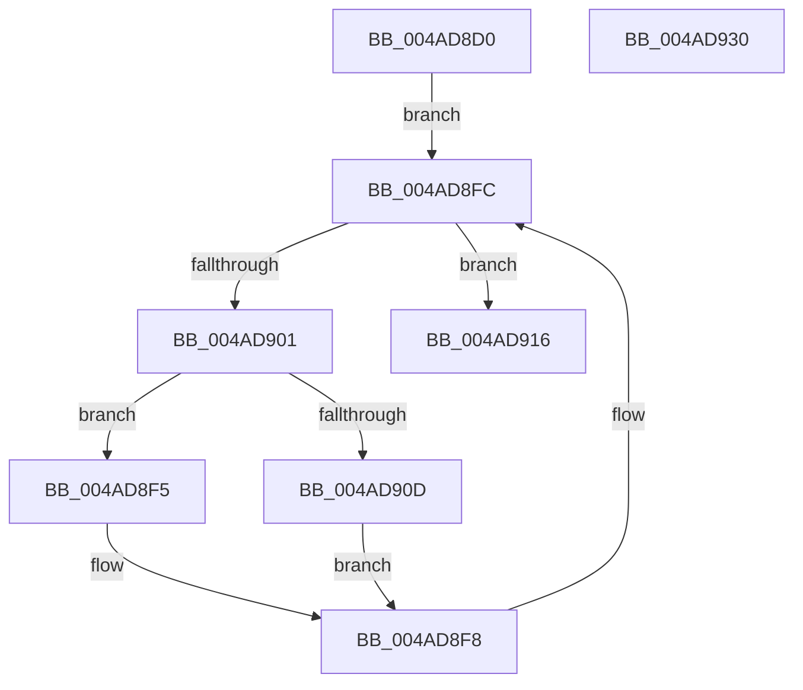

# PpMarkDeviceStackExtensionFlag

- RVA: `0x004AD8D0`–`0x004AD931` (길이 `97` bytes)
- VA: `0x00000001404AD8D0`
- 실행 섹션: `.text`
- PDB 이름 있음: `예`; PDB Function 태그: `아니요`
- unwind 정보 RVA: `0x00060BC4`
- 디코드: `30`개 명령, `97/97` bytes 표시
- 미해석 바이트: `0` (있으면 어셈블리에 `.byte`로 보존)

> 이 문서는 커널 이미지의 기계어와 PDB 기호를 분석해 생성했습니다. 4번과 5번은 함수 원형과 자료형을 바이너리 사용 방식에서 추정한 C 해석이며 원본 소스 복구 결과는 아닙니다.

## 1. Dependencies

- 직접 호출 지점: **2**; 고유 호출 대상: **2**
- 직접 호출자로 확인된 함수: **3**
- RIP 상대 이미지 참조: **0**

### Outgoing calls
- `0x004AD8EC` → [KeAcquireQueuedSpinLock](../27/KeAcquireQueuedSpinLock_function_00273D80.md) (function, `0x00273D80`)
- `0x004AD91B` → [KeReleaseQueuedSpinLock](../27/KeReleaseQueuedSpinLock_function_00272540.md) (function, `0x00272540`)

### Direct callers
- [PnpStartDeviceNode](../../page/8F/PnpStartDeviceNode_function_008FE38C.md) at `0x008FE598`
- [IopDoDeferredSetInterfaceState](../../page/94/IopDoDeferredSetInterfaceState_function_0094EF68.md) at `0x0094EF9F`
- [PiProcessNewDeviceNode](../../page/A2/PiProcessNewDeviceNode_function_00A28F20.md) at `0x00A292FD`

### Static image references
- 디코드된 RIP-relative 메모리 참조가 없습니다.

## 2. Other-region calls and transfers

- 다른 실행 섹션으로 향하는 call: **0**
- 별도 외부 분기/꼬리 이동을 확인하지 못했습니다.

## 3. Assembly (complete function range)

```asm
004AD8D0  48 89 5C 24 08                  mov qword ptr [rsp + 8], rbx
004AD8D5  48 89 74 24 10                  mov qword ptr [rsp + 0x10], rsi
004AD8DA  57                              push rdi
004AD8DB  48 83 EC 20                     sub rsp, 0x20
004AD8DF  48 8B D9                        mov rbx, rcx
004AD8E2  41 8A F0                        mov sil, r8b
004AD8E5  B9 0A 00 00 00                  mov ecx, 0xa
004AD8EA  8B FA                           mov edi, edx
004AD8EC  E8 8F 64 DC FF                  call 0x140273d80
004AD8F1  8A D0                           mov dl, al
004AD8F3  EB 07                           jmp 0x1404ad8fc
004AD8F5  09 79 20                        or dword ptr [rcx + 0x20], edi
004AD8F8  48 8B 5B 18                     mov rbx, qword ptr [rbx + 0x18]
004AD8FC  48 85 DB                        test rbx, rbx
004AD8FF  74 15                           je 0x1404ad916
004AD901  48 8B 8B 38 01 00 00            mov rcx, qword ptr [rbx + 0x138]
004AD908  40 84 F6                        test sil, sil
004AD90B  75 E8                           jne 0x1404ad8f5
004AD90D  8B C7                           mov eax, edi
004AD90F  F7 D0                           not eax
004AD911  21 41 20                        and dword ptr [rcx + 0x20], eax
004AD914  EB E2                           jmp 0x1404ad8f8
004AD916  B9 0A 00 00 00                  mov ecx, 0xa
004AD91B  E8 20 4C DC FF                  call 0x140272540
004AD920  48 8B 5C 24 30                  mov rbx, qword ptr [rsp + 0x30]
004AD925  48 8B 74 24 38                  mov rsi, qword ptr [rsp + 0x38]
004AD92A  48 83 C4 20                     add rsp, 0x20
004AD92E  5F                              pop rdi
004AD92F  C3                              ret
004AD930  CC                              int3
```

## 4. C-style interpretation (structured pseudocode)

```c
__int64 __fastcall PpMarkDeviceStackExtensionFlag(__int64 a1, int a2, unsigned __int8 a3)
{
    __int64 result;
    __int64 v_rsp;
    unsigned __int64 v_stack_p10;
    unsigned __int64 v_stack_p8;

    v_stack_p8 = v_rbx;
    v_stack_p10 = v_rsi;
    v_rsp = (v_rsp) - (32);
    result = KeAcquireQueuedSpinLock(10, a2, a3, a4);
    goto loc_004AD8FC;
loc_004AD8F5:
loc_004AD8F8:
loc_004AD8FC:
    if (*(unsigned __int64 *)(a1 + 24) == 0) goto loc_004AD916;
    if (a3 != 0) goto loc_004AD8F5;
    result = (unsigned int)(~((unsigned int)((unsigned int)((unsigned int)(a2)))));
    goto loc_004AD8F8;
loc_004AD916:
    result = KeReleaseQueuedSpinLock(10, (unsigned __int8)(result), a3, a4);
    v_rsp = (v_rsp) + (32);
    return result;
}
```

## 5. (Beta) C Style

```c
int64_t PpMarkDeviceStackExtensionFlag(int64_t Arg1, int32_t Arg2, uint8_t Arg3)
{
    int64_t result;
    int64_t local_rsp;
    uint64_t v_stack_p10;
    uint64_t v_stack_p8;

    v_stack_p8 = local_rbx;
    v_stack_p10 = local_rsi;
    local_rsp = (local_rsp) - (32);
    result = KeAcquireQueuedSpinLock(10, Arg2, Arg3, a4);
    goto loc_004AD8FC;
loc_004AD8F5:
loc_004AD8F8:
loc_004AD8FC:
    if (*(uint64_t *)(Arg1 + 0x18) == 0) goto loc_004AD916;
    if (Arg3 != 0) goto loc_004AD8F5;
    result = (uint32_t)(~((uint32_t)((uint32_t)((uint32_t)(Arg2)))));
    goto loc_004AD8F8;
loc_004AD916:
    result = KeReleaseQueuedSpinLock(10, (uint8_t)(result), Arg3, a4);
    local_rsp = (local_rsp) + (32);
    return result;
}
```

## 6. Execution-region graph

[열기: 2D/3D 그래프와 함수 탐색 컨트롤 패널](../../../control-panel.html?section=text&rva=0x004AD8D0&view=graph)

- 2D 그래프는 위에서 아래로 흐르고, 3D 그래프는 빈 공간을 드래그해 회전합니다. Shift+드래그는 이동, 휠은 확대·축소, 함수 노드 선택은 대상 보고서 이동입니다.

### Static fallback


