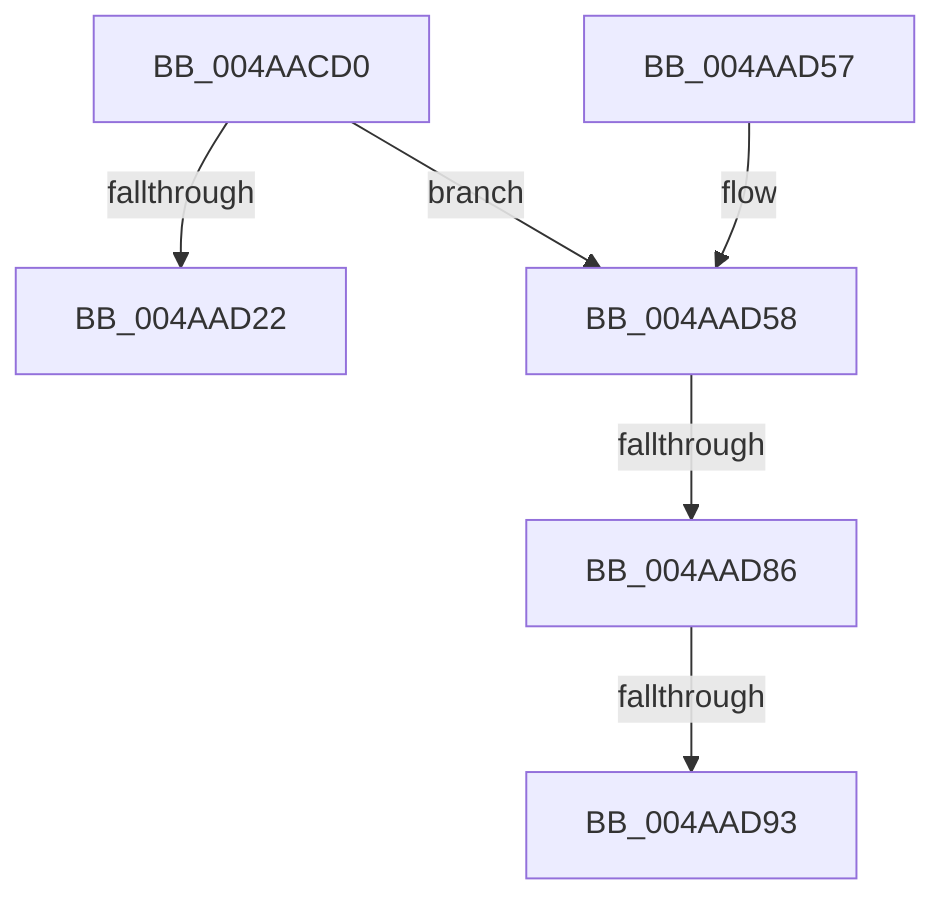

# PpmCheckComputeHeteroResponse

- RVA: `0x004AACD0`–`0x004AAD9E` (길이 `206` bytes)
- VA: `0x00000001404AACD0`
- 실행 섹션: `.text`
- PDB 이름 있음: `예`; PDB Function 태그: `예`
- unwind 정보 RVA: `0x000B7E44`
- 디코드: `52`개 명령, `206/206` bytes 표시
- 미해석 바이트: `0` (있으면 어셈블리에 `.byte`로 보존)

> 이 문서는 커널 이미지의 기계어와 PDB 기호를 분석해 생성했습니다. 4번과 5번은 함수 원형과 자료형을 바이너리 사용 방식에서 추정한 C 해석이며 원본 소스 복구 결과는 아닙니다.

## 1. Dependencies

- 직접 호출 지점: **5**; 고유 호출 대상: **5**
- 직접 호출자로 확인된 함수: **0**
- RIP 상대 이미지 참조: **4**

### Outgoing calls
- `0x004AAD16` → [Feature_PpmParkEx__private_IsEnabledDeviceUsageNoInline](../4F/Feature_PpmParkEx__private_IsEnabledDeviceUsageNoInline_function_004F135C.md) (function, `0x004F135C`)
- `0x004AAD22` → [PpmCheckComputeHeteroResponseEx](../5D/PpmCheckComputeHeteroResponseEx_function_005DECA0.md) (function, `0x005DECA0`)
- `0x004AAD31` → [_security_check_cookie](../6A/_security_check_cookie_function_006AC640.md) (function, `0x006AC640`)
- `0x004AAD86` → [PpmHeteroIsMultiClassParkingEnabled](../41/PpmHeteroIsMultiClassParkingEnabled_function_00414310.md) (function, `0x00414310`)
- `0x004AAD93` → [PpmCheckComputeMultiClassHeteroResponse](../41/PpmCheckComputeMultiClassHeteroResponse_function_00412534.md) (function, `0x00412534`)

### Direct callers
- 이 함수 시작 RVA로 연결되는 직접 call은 확인되지 않았습니다. 간접 호출은 완전히 역산할 수 없습니다.

### Static image references
- `0x004AACF6` → RVA `0x00E0A740` (`.data`; read)
- `0x004AAD58` → RVA `0x00E08380` (`.data`; read)
- `0x004AAD5F` → RVA `0x00F0CE0C` (`.data`; read)
- `0x004AAD74` → RVA `0x00FC5038` (`ALMOSTRO`; read)

## 2. Other-region calls and transfers

- 다른 실행 섹션으로 향하는 call: **0**
- call이 아닌 외부 분기/꼬리 이동: **3**
  - `0x004AAD80` → [sub_006FA0AE + 0x387](../6F/Unknown_function_006FA0AE.md) (`tail-transfer`)
  - `0x004AAD8D` → [sub_006FA0AE](../6F/Unknown_function_006FA0AE.md) (`tail-transfer`)
  - `0x004AAD99` → [sub_006FA0AE + 0x38C](../6F/Unknown_function_006FA0AE.md) (`tail-transfer`)

## 3. Assembly (complete function range)

```asm
004AACD0  48 8B C4                        mov rax, rsp
004AACD3  48 89 58 08                     mov qword ptr [rax + 8], rbx
004AACD7  48 89 70 10                     mov qword ptr [rax + 0x10], rsi
004AACDB  48 89 78 18                     mov qword ptr [rax + 0x18], rdi
004AACDF  55                              push rbp
004AACE0  41 54                           push r12
004AACE2  41 55                           push r13
004AACE4  41 56                           push r14
004AACE6  41 57                           push r15
004AACE8  48 8D A8 58 FC FF FF            lea rbp, [rax - 0x3a8]
004AACEF  48 81 EC 80 04 00 00            sub rsp, 0x480
004AACF6  48 8B 05 43 FA 95 00            mov rax, qword ptr [rip + 0x95fa43]
004AACFD  48 33 C4                        xor rax, rsp
004AAD00  48 89 85 70 03 00 00            mov qword ptr [rbp + 0x370], rax
004AAD07  0F 57 C0                        xorps xmm0, xmm0
004AAD0A  33 C0                           xor eax, eax
004AAD0C  0F 11 44 24 48                  movups xmmword ptr [rsp + 0x48], xmm0
004AAD11  48 89 44 24 58                  mov qword ptr [rsp + 0x58], rax
004AAD16  E8 41 66 04 00                  call 0x1404f135c
004AAD1B  45 33 ED                        xor r13d, r13d
004AAD1E  85 C0                           test eax, eax
004AAD20  74 36                           je 0x1404aad58
004AAD22  E8 79 3F 13 00                  call 0x1405deca0
004AAD27  48 8B 8D 70 03 00 00            mov rcx, qword ptr [rbp + 0x370]
004AAD2E  48 33 CC                        xor rcx, rsp
004AAD31  E8 0A 19 20 00                  call 0x1406ac640
004AAD36  4C 8D 9C 24 80 04 00 00         lea r11, [rsp + 0x480]
004AAD3E  49 8B 5B 30                     mov rbx, qword ptr [r11 + 0x30]
004AAD42  49 8B 73 38                     mov rsi, qword ptr [r11 + 0x38]
004AAD46  49 8B 7B 40                     mov rdi, qword ptr [r11 + 0x40]
004AAD4A  49 8B E3                        mov rsp, r11
004AAD4D  41 5F                           pop r15
004AAD4F  41 5E                           pop r14
004AAD51  41 5D                           pop r13
004AAD53  41 5C                           pop r12
004AAD55  5D                              pop rbp
004AAD56  C3                              ret
004AAD57  CC                              int3
004AAD58  48 8B 15 21 D6 95 00            mov rdx, qword ptr [rip + 0x95d621]
004AAD5F  48 63 05 A6 20 A6 00            movsxd rax, dword ptr [rip + 0xa620a6]
004AAD66  48 69 C8 E8 01 00 00            imul rcx, rax, 0x1e8
004AAD6D  48 8D 42 28                     lea rax, [rdx + 0x28]
004AAD71  48 03 C1                        add rax, rcx
004AAD74  83 3D BD A2 B1 00 04            cmp dword ptr [rip + 0xb1a2bd], 4
004AAD7B  48 89 44 24 40                  mov qword ptr [rsp + 0x40], rax
004AAD80  0F 85 AF F6 24 00               jne 0x1406fa435
004AAD86  E8 85 95 F6 FF                  call 0x140414310
004AAD8B  84 C0                           test al, al
004AAD8D  0F 84 1B F3 24 00               je 0x1406fa0ae
004AAD93  E8 9C 77 F6 FF                  call 0x140412534
004AAD98  90                              nop
004AAD99  E9 9C F6 24 00                  jmp 0x1406fa43a
```

## 4. C-style interpretation (structured pseudocode)

```c
__int64 __fastcall PpmCheckComputeHeteroResponse(void)
{
    __int64 result;
    __int64 v_r13;
    __int64 v_rsp;
    unsigned __int64 v_stack_m28;
    unsigned __int64 v_stack_m440;
    unsigned __int64 v_stack_m450;
    unsigned __int64 v_stack_m460;

    *(unsigned __int64 *)(v_rsp + 8) = v_rbx;
    *(unsigned __int64 *)(v_rsp + 16) = v_rsi;
    *(unsigned __int64 *)(v_rsp + 24) = v_rdi;
    v_rsp = (v_rsp) - (0x480ULL);
    result = (*(unsigned __int64 *)(v_rip + 9828931)) ^ (v_rsp);
    *(unsigned __int64 *)(v_rsp - 936 + 880) = result;
    result = 0;
    v_stack_m460 = v_xmm0;
    v_stack_m450 = 0;
    result = Feature_PpmParkEx__private_IsEnabledDeviceUsageNoInline(a1, a2, a3, a4);
    v_r13 = 0;
    if ((unsigned int)(result) == 0) goto loc_004AAD58;
    result = PpmCheckComputeHeteroResponseEx(a1, a2, a3, a4);
    a1 = (*(unsigned __int64 *)(v_rsp - 936 + 880)) ^ (v_rsp);
    result = _security_check_cookie(a1, a2, a3, a4);
    return result;
loc_004AAD58:
    a1 = (a1) * ((int)(*(unsigned int *)(v_rip + 10887334)));
    result = (*(unsigned __int64 *)(v_rip + 9819681) + 40) + (a1);
    v_stack_m440 = result;
    result = PpmHeteroIsMultiClassParkingEnabled(a1, *(unsigned __int64 *)(v_rip + 9819681), a3, a4);
    result = PpmCheckComputeMultiClassHeteroResponse(a1, *(unsigned __int64 *)(v_rip + 9819681), a3, a4);
}
```

## 5. (Beta) C Style

```c
void PpmCheckComputeHeteroResponse(void)
{
    int64_t result;
    int64_t local_r13;
    int64_t local_rsp;
    uint64_t v_stack_m28;
    uint64_t v_stack_m440;
    uint64_t v_stack_m450;
    uint64_t v_stack_m460;

    *(uint64_t *)(local_rsp + 0x8) = local_rbx;
    *(uint64_t *)(local_rsp + 0x10) = local_rsi;
    *(uint64_t *)(local_rsp + 0x18) = local_rdi;
    local_rsp = (local_rsp) - (0x480ULL);
    result = (*(uint64_t *)(v_rip + 0x95FA43)) ^ (local_rsp);
    *(uint64_t *)(local_rsp - 0x3A8 + 0x370) = result;
    result = 0;
    v_stack_m460 = v_xmm0;
    v_stack_m450 = 0;
    result = Feature_PpmParkEx__private_IsEnabledDeviceUsageNoInline(a1, a2, a3, a4);
    local_r13 = 0;
    if ((uint32_t)(result) == 0) goto loc_004AAD58;
    result = PpmCheckComputeHeteroResponseEx(a1, a2, a3, a4);
    a1 = (*(uint64_t *)(local_rsp - 0x3A8 + 0x370)) ^ (local_rsp);
    result = _security_check_cookie(a1, a2, a3, a4);
    return result;
loc_004AAD58:
    a1 = (a1) * ((int32_t)(*(uint32_t *)(v_rip + 0xA620A6)));
    result = (*(uint64_t *)(v_rip + 0x95D621) + 40) + (a1);
    v_stack_m440 = result;
    result = PpmHeteroIsMultiClassParkingEnabled(a1, *(uint64_t *)(v_rip + 0x95D621), a3, a4);
    result = PpmCheckComputeMultiClassHeteroResponse(a1, *(uint64_t *)(v_rip + 0x95D621), a3, a4);
}
```

## 6. Execution-region graph

[열기: 2D/3D 그래프와 함수 탐색 컨트롤 패널](../../../control-panel.html?section=text&rva=0x004AACD0&view=graph)

- 2D 그래프는 위에서 아래로 흐르고, 3D 그래프는 빈 공간을 드래그해 회전합니다. Shift+드래그는 이동, 휠은 확대·축소, 함수 노드 선택은 대상 보고서 이동입니다.

### Static fallback


