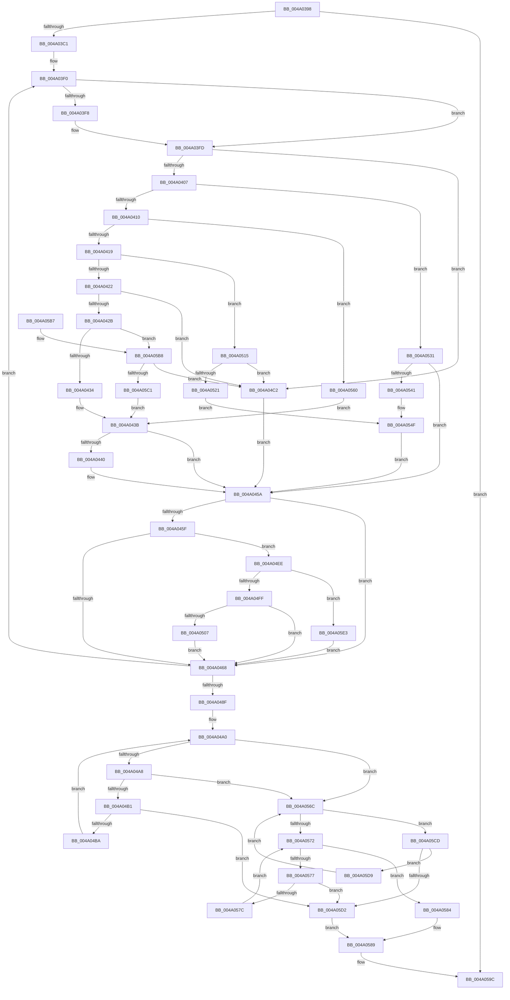

# PpmConfigureRestrictionPolicy

- RVA: `0x004A0398`–`0x004A05EC` (길이 `596` bytes)
- VA: `0x00000001404A0398`
- 실행 섹션: `.text`
- PDB 이름 있음: `예`; PDB Function 태그: `아니요`
- unwind 정보 RVA: `0x000B57A8`
- 디코드: `141`개 명령, `596/596` bytes 표시
- 미해석 바이트: `0` (있으면 어셈블리에 `.byte`로 보존)

> 이 문서는 커널 이미지의 기계어와 PDB 기호를 분석해 생성했습니다. 4번과 5번은 함수 원형과 자료형을 바이너리 사용 방식에서 추정한 C 해석이며 원본 소스 복구 결과는 아닙니다.

## 1. Dependencies

- 직접 호출 지점: **0**; 고유 호출 대상: **0**
- 직접 호출자로 확인된 함수: **2**
- RIP 상대 이미지 참조: **8**

### Outgoing calls
- 직접 디코드된 call 명령이 없습니다.

### Direct callers
- [PpmParkApplyPolicy](../4B/PpmParkApplyPolicy_function_004B613C.md) at `0x004B65D0`
- [PpmParkApplyPolicyEx](../4F/PpmParkApplyPolicyEx_function_004F3090.md) at `0x004F36AB`

### Static image references
- `0x004A03C6` → RVA `0x00E0B3F4` (`.data`; read)
- `0x004A03CD` → RVA `0x00F0CE0C` (`.data`; read)
- `0x004A0434` → RVA `0x00F07798` (`.data`; read)
- `0x004A04C2` → RVA `0x00E08380` (`.data`; read)
- `0x004A0515` → RVA `0x00F07780` (`.data`; read)
- `0x004A0531` → RVA `0x00F07790` (`.data`; read)
- `0x004A0560` → RVA `0x00F07788` (`.data`; read)
- `0x004A05C1` → RVA `0x00F077A0` (`.data`; read)

## 2. Other-region calls and transfers

- 다른 실행 섹션으로 향하는 call: **0**
- 별도 외부 분기/꼬리 이동을 확인하지 못했습니다.

## 3. Assembly (complete function range)

```asm
004A0398  48 8B C4                        mov rax, rsp
004A039B  48 89 58 08                     mov qword ptr [rax + 8], rbx
004A039F  48 89 68 10                     mov qword ptr [rax + 0x10], rbp
004A03A3  48 89 70 18                     mov qword ptr [rax + 0x18], rsi
004A03A7  48 89 78 20                     mov qword ptr [rax + 0x20], rdi
004A03AB  41 56                           push r14
004A03AD  48 83 EC 10                     sub rsp, 0x10
004A03B1  83 B9 D0 04 00 00 01            cmp dword ptr [rcx + 0x4d0], 1
004A03B8  4C 8B C1                        mov r8, rcx
004A03BB  0F 86 DB 01 00 00               jbe 0x1404a059c
004A03C1  44 0F B7 49 0A                  movzx r9d, word ptr [rcx + 0xa]
004A03C6  48 8D 1D 27 B0 96 00            lea rbx, [rip + 0x96b027]
004A03CD  4C 63 1D 38 CA A6 00            movsxd r11, dword ptr [rip + 0xa6ca38]
004A03D4  33 ED                           xor ebp, ebp
004A03D6  0F 57 C0                        xorps xmm0, xmm0
004A03D9  8B CD                           mov ecx, ebp
004A03DB  0F 11 04 24                     movups xmmword ptr [rsp], xmm0
004A03DF  48 8B 14 24                     mov rdx, qword ptr [rsp]
004A03E3  49 BE 00 00 00 00 00 00 02 00   movabs r14, 0x2000000000000
004A03ED  8D 75 07                        lea esi, [rbp + 7]
004A03F0  8B 7B FC                        mov edi, dword ptr [rbx - 4]
004A03F3  40 38 2B                        cmp byte ptr [rbx], bpl
004A03F6  75 05                           jne 0x1404a03fd
004A03F8  45 0F B7 48 0A                  movzx r9d, word ptr [r8 + 0xa]
004A03FD  8B C7                           mov eax, edi
004A03FF  85 FF                           test edi, edi
004A0401  0F 84 BB 00 00 00               je 0x1404a04c2
004A0407  83 E8 01                        sub eax, 1
004A040A  0F 84 21 01 00 00               je 0x1404a0531
004A0410  83 E8 01                        sub eax, 1
004A0413  0F 84 47 01 00 00               je 0x1404a0560
004A0419  83 E8 01                        sub eax, 1
004A041C  0F 84 F3 00 00 00               je 0x1404a0515
004A0422  83 E8 01                        sub eax, 1
004A0425  0F 84 97 00 00 00               je 0x1404a04c2
004A042B  83 E8 01                        sub eax, 1
004A042E  0F 85 84 01 00 00               jne 0x1404a05b8
004A0434  4C 8B 15 5D 73 A6 00            mov r10, qword ptr [rip + 0xa6735d]
004A043B  4D 85 D2                        test r10, r10
004A043E  74 1A                           je 0x1404a045a
004A0440  49 69 CB E8 01 00 00            imul rcx, r11, 0x1e8
004A0447  48 83 C1 28                     add rcx, 0x28
004A044B  49 03 CA                        add rcx, r10
004A044E  0F 10 01                        movups xmm0, xmmword ptr [rcx]
004A0451  0F 11 04 24                     movups xmmword ptr [rsp], xmm0
004A0455  66 48 0F 7E C2                  movq rdx, xmm0
004A045A  48 85 C9                        test rcx, rcx
004A045D  74 09                           je 0x1404a0468
004A045F  49 85 D6                        test r14, rdx
004A0462  0F 85 86 00 00 00               jne 0x1404a04ee
004A0468  66 45 3B 48 0A                  cmp r9w, word ptr [r8 + 0xa]
004A046D  66 1B C0                        sbb ax, ax
004A0470  48 83 C3 08                     add rbx, 8
004A0474  66 41 23 C1                     and ax, r9w
004A0478  66 41 89 84 78 D6 04 00 00      mov word ptr [r8 + rdi*2 + 0x4d6], ax
004A0481  44 0F B7 C8                     movzx r9d, ax
004A0485  48 83 EE 01                     sub rsi, 1
004A0489  0F 85 61 FF FF FF               jne 0x1404a03f0
004A048F  41 8B 90 D0 04 00 00            mov edx, dword ptr [r8 + 0x4d0]
004A0496  8D 4E 0E                        lea ecx, [rsi + 0xe]
004A0499  49 8D 80 D6 04 00 00            lea rax, [r8 + 0x4d6]
004A04A0  A8 07                           test al, 7
004A04A2  0F 84 C4 00 00 00               je 0x1404a056c
004A04A8  48 85 C9                        test rcx, rcx
004A04AB  0F 84 BB 00 00 00               je 0x1404a056c
004A04B1  40 38 28                        cmp byte ptr [rax], bpl
004A04B4  0F 85 18 01 00 00               jne 0x1404a05d2
004A04BA  48 FF C0                        inc rax
004A04BD  48 FF C9                        dec rcx
004A04C0  EB DE                           jmp 0x1404a04a0
004A04C2  48 8B 15 B7 7E 96 00            mov rdx, qword ptr [rip + 0x967eb7]
004A04C9  48 63 05 3C C9 A6 00            movsxd rax, dword ptr [rip + 0xa6c93c]
004A04D0  48 83 C2 28                     add rdx, 0x28
004A04D4  48 69 C8 E8 01 00 00            imul rcx, rax, 0x1e8
004A04DB  48 03 CA                        add rcx, rdx
004A04DE  48 8B 14 24                     mov rdx, qword ptr [rsp]
004A04E2  49 0B D6                        or rdx, r14
004A04E5  48 89 14 24                     mov qword ptr [rsp], rdx
004A04E9  E9 6C FF FF FF                  jmp 0x1404a045a
004A04EE  0F B6 81 E4 01 00 00            movzx eax, byte ptr [rcx + 0x1e4]
004A04F5  66 45 85 C9                     test r9w, r9w
004A04F9  0F 84 E4 00 00 00               je 0x1404a05e3
004A04FF  84 C0                           test al, al
004A0501  0F 84 61 FF FF FF               je 0x1404a0468
004A0507  66 44 3B C8                     cmp r9w, ax
004A050B  66 44 0F 43 C8                  cmovae r9w, ax
004A0510  E9 53 FF FF FF                  jmp 0x1404a0468
004A0515  48 8B 0D 64 72 A6 00            mov rcx, qword ptr [rip + 0xa67264]
004A051C  48 85 C9                        test rcx, rcx
004A051F  74 A1                           je 0x1404a04c2
004A0521  49 69 C3 E8 01 00 00            imul rax, r11, 0x1e8
004A0528  48 83 C1 28                     add rcx, 0x28
004A052C  48 03 C8                        add rcx, rax
004A052F  EB 1E                           jmp 0x1404a054f
004A0531  4C 8B 15 58 72 A6 00            mov r10, qword ptr [rip + 0xa67258]
004A0538  4D 85 D2                        test r10, r10
004A053B  0F 84 19 FF FF FF               je 0x1404a045a
004A0541  49 69 CB E8 01 00 00            imul rcx, r11, 0x1e8
004A0548  48 83 C1 28                     add rcx, 0x28
004A054C  49 03 CA                        add rcx, r10
004A054F  0F 10 01                        movups xmm0, xmmword ptr [rcx]
004A0552  66 48 0F 7E C2                  movq rdx, xmm0
004A0557  0F 11 04 24                     movups xmmword ptr [rsp], xmm0
004A055B  E9 FA FE FF FF                  jmp 0x1404a045a
004A0560  4C 8B 15 21 72 A6 00            mov r10, qword ptr [rip + 0xa67221]
004A0567  E9 CF FE FF FF                  jmp 0x1404a043b
004A056C  48 83 F9 08                     cmp rcx, 8
004A0570  73 5B                           jae 0x1404a05cd
004A0572  48 85 C9                        test rcx, rcx
004A0575  74 0D                           je 0x1404a0584
004A0577  40 38 28                        cmp byte ptr [rax], bpl
004A057A  75 56                           jne 0x1404a05d2
004A057C  48 FF C0                        inc rax
004A057F  48 FF C9                        dec rcx
004A0582  EB EE                           jmp 0x1404a0572
004A0584  B8 02 00 00 00                  mov eax, 2
004A0589  41 89 80 D0 04 00 00            mov dword ptr [r8 + 0x4d0], eax
004A0590  3B C2                           cmp eax, edx
004A0592  0F 95 C0                        setne al
004A0595  41 88 80 D4 04 00 00            mov byte ptr [r8 + 0x4d4], al
004A059C  48 8B 5C 24 20                  mov rbx, qword ptr [rsp + 0x20]
004A05A1  48 8B 6C 24 28                  mov rbp, qword ptr [rsp + 0x28]
004A05A6  48 8B 74 24 30                  mov rsi, qword ptr [rsp + 0x30]
004A05AB  48 8B 7C 24 38                  mov rdi, qword ptr [rsp + 0x38]
004A05B0  48 83 C4 10                     add rsp, 0x10
004A05B4  41 5E                           pop r14
004A05B6  C3                              ret
004A05B7  CC                              int3
004A05B8  83 F8 01                        cmp eax, 1
004A05BB  0F 85 01 FF FF FF               jne 0x1404a04c2
004A05C1  4C 8B 15 D8 71 A6 00            mov r10, qword ptr [rip + 0xa671d8]
004A05C8  E9 6E FE FF FF                  jmp 0x1404a043b
004A05CD  48 39 28                        cmp qword ptr [rax], rbp
004A05D0  74 07                           je 0x1404a05d9
004A05D2  B8 03 00 00 00                  mov eax, 3
004A05D7  EB B0                           jmp 0x1404a0589
004A05D9  48 83 C0 08                     add rax, 8
004A05DD  48 83 E9 08                     sub rcx, 8
004A05E1  EB 89                           jmp 0x1404a056c
004A05E3  44 0F B7 C8                     movzx r9d, ax
004A05E7  E9 7C FE FF FF                  jmp 0x1404a0468
```

## 4. C-style interpretation (structured pseudocode)

```c
__int64 __fastcall PpmConfigureRestrictionPolicy(__int64 a1)
{
    __int64 result;
    __int64 v_rbp;
    __int64 v_rbx;
    __int64 v_rsi;
    __int64 v_rsp;
    unsigned __int64 v_stack_m18;
    unsigned __int64 v_stack_p10;
    unsigned __int64 v_stack_p18;
    unsigned __int64 v_stack_p20;
    unsigned __int64 v_stack_p8;

    *(unsigned __int64 *)(v_rsp + 8) = v_rbx;
    *(unsigned __int64 *)(v_rsp + 16) = v_rbp;
    *(unsigned __int64 *)(v_rsp + 24) = v_rsi;
    *(unsigned __int64 *)(v_rsp + 32) = v_rdi;
    v_rsp = (v_rsp) - (16);
    if ((*(unsigned int *)(a1 + 1232)) <= 1) goto loc_004A059C;
    v_rbp = 0;
    v_stack_m18 = v_xmm0;
loc_004A03F0:
    if ((*(unsigned __int8 *)(v_rip + 9875495)) == 0) {
        a4 = *(unsigned __int16 *)(a1 + 10);
    }
    if ((unsigned int)((unsigned int)(*(unsigned int *)(v_rip + 9875495 - 4))) == 0) goto loc_004A04C2;
    result = (unsigned int)(((unsigned int)((unsigned int)((unsigned int)(*(unsigned int *)(v_rip + 9875495 - 4))))) - (1));
    if (condition_is_equal) goto loc_004A0531;
    result = (unsigned int)((result) - (1));
    if (condition_is_equal) goto loc_004A0560;
    result = (unsigned int)((result) - (1));
    if (condition_is_equal) goto loc_004A0515;
    result = (unsigned int)((result) - (1));
    if (condition_is_equal) goto loc_004A04C2;
    result = (unsigned int)((result) - (1));
    if (condition_is_not_equal) goto loc_004A05B8;
loc_004A043B:
    if (*(unsigned __int64 *)(v_rip + 10908509) != 0) {
        a1 = (0) * ((int)(*(unsigned int *)(v_rip + 10930744)));
        a1 = (a1) + (40);
        a1 = (a1) + (*(unsigned __int64 *)(v_rip + 10908509));
        v_stack_m18 = v_xmm0;
    }
    if (a1 == 0) goto loc_004A0468;
    if (((v_r14) & (v_stack_m18)) != 0) goto loc_004A04EE;
loc_004A0468:
    v_rbx = (v_rip + 9875495) + (8);
    result = (unsigned __int16)((result) & ((unsigned __int16)(a4)));
    *(unsigned __int16 *)(a1 + (unsigned int)(*(unsigned int *)(v_rip + 9875495 - 4)) * 2 + 1238) = (unsigned __int16)(result);
    v_rsi = (v_rbp + 7) - (1);
    if (condition_is_not_equal) goto loc_004A03F0;
loc_004A04A0:
    if ((((unsigned __int8)(a1 + 1238)) & (7)) == 0) goto loc_004A056C;
    if (v_rsi + 14 == 0) goto loc_004A056C;
    if ((*(unsigned __int8 *)(a1 + 1238)) != 0) goto loc_004A05D2;
    result = (a1 + 1238) + 1;
    a1 = (v_rsi + 14) - 1;
    goto loc_004A04A0;
loc_004A04C2:
    a2 = (*(unsigned __int64 *)(v_rip + 9862839)) + (40);
    a1 = (a1) * ((int)(*(unsigned int *)(v_rip + 10930492)));
    a1 = (a1) + (a2);
    a2 = (v_stack_m18) | (v_r14);
    v_stack_m18 = a2;
    goto loc_004A045A;
loc_004A04EE:
    if ((unsigned __int16)((unsigned __int16)(result)) == 0) goto loc_004A05E3;
    if ((unsigned __int8)(*(unsigned __int8 *)(a1 + 484)) == 0) goto loc_004A0468;
    a4 = (unsigned __int16)(result);
    if (((unsigned __int16)((unsigned __int16)(result))) >= ((unsigned __int16)(*(unsigned __int8 *)(a1 + 484)))) { a4 = (unsigned __int16)(*(unsigned __int8 *)(a1 + 484)); }
    goto loc_004A0468;
loc_004A0515:
    if (*(unsigned __int64 *)(v_rip + 10908260) == 0) goto loc_004A04C2;
    result = (*(unsigned __int8 *)(a1 + 484)) * ((int)(*(unsigned int *)(v_rip + 10930744)));
    a1 = (*(unsigned __int64 *)(v_rip + 10908260)) + (40);
    a1 = (a1) + (result);
    goto loc_004A054F;
loc_004A0531:
    if (*(unsigned __int64 *)(v_rip + 10908248) == 0) goto loc_004A045A;
    a1 = (a1) * ((int)(*(unsigned int *)(v_rip + 10930744)));
    a1 = (a1) + (40);
    a1 = (a1) + (*(unsigned __int64 *)(v_rip + 10908248));
loc_004A054F:
    v_stack_m18 = v_xmm0;
    goto loc_004A045A;
loc_004A0560:
    goto loc_004A043B;
loc_004A056C:
    if (a1 >= 8) goto loc_004A05CD;
loc_004A0572:
    if (a1 == 0) goto loc_004A0584;
    if ((*(unsigned __int8 *)(result)) != 0) goto loc_004A05D2;
    result = (result) + 1;
    a1 = (a1) - 1;
    goto loc_004A0572;
loc_004A0584:
loc_004A0589:
    *(unsigned int *)(a1 + 1232) = 2;
    result = (2 != ((unsigned int)(a2))) ? 1 : 0;
    *(unsigned __int8 *)(a1 + 1236) = (unsigned __int8)(result);
loc_004A059C:
    v_rsp = (v_rsp) + (16);
    return result;
loc_004A05B8:
    if (((unsigned int)(result)) != 1) goto loc_004A04C2;
    goto loc_004A043B;
loc_004A05CD:
    if ((*(unsigned __int64 *)(result)) == v_stack_p10) goto loc_004A05D9;
loc_004A05D2:
    goto loc_004A0589;
loc_004A05D9:
    result = (3) + (8);
    a1 = (a1) - (8);
    goto loc_004A056C;
loc_004A05E3:
    goto loc_004A0468;
}
```

## 5. (Beta) C Style

```c
int64_t PpmConfigureRestrictionPolicy(void *Arg1)
{
    uint8_t *arg1 = (uint8_t *)Arg1;

    int64_t result;
    int64_t local_rbp;
    int64_t local_rbx;
    int64_t local_rsi;
    int64_t local_rsp;
    uint64_t v_stack_m18;
    uint64_t v_stack_p10;
    uint64_t v_stack_p18;
    uint64_t v_stack_p20;
    uint64_t v_stack_p8;

    *(uint64_t *)(local_rsp + 0x8) = local_rbx;
    *(uint64_t *)(local_rsp + 0x10) = local_rbp;
    *(uint64_t *)(local_rsp + 0x18) = local_rsi;
    *(uint64_t *)(local_rsp + 0x20) = local_rdi;
    local_rsp = (local_rsp) - (16);
    if ((*(uint32_t *)(arg1 + 0x4D0)) <= 1) goto loc_004A059C;
    local_rbp = 0;
    v_stack_m18 = v_xmm0;
loc_004A03F0:
    if ((*(uint8_t *)(v_rip + 0x96B027)) == 0) {
        a4 = *(uint16_t *)(arg1 + 0xA);
    }
    if ((uint32_t)((uint32_t)(*(uint32_t *)(v_rip + 0x96B027 - 0x4))) == 0) goto loc_004A04C2;
    result = (uint32_t)(((uint32_t)((uint32_t)((uint32_t)(*(uint32_t *)(v_rip + 0x96B027 - 0x4))))) - (1));
    if (condition_is_equal) goto loc_004A0531;
    result = (uint32_t)((result) - (1));
    if (condition_is_equal) goto loc_004A0560;
    result = (uint32_t)((result) - (1));
    if (condition_is_equal) goto loc_004A0515;
    result = (uint32_t)((result) - (1));
    if (condition_is_equal) goto loc_004A04C2;
    result = (uint32_t)((result) - (1));
    if (condition_is_not_equal) goto loc_004A05B8;
loc_004A043B:
    if (*(uint64_t *)(v_rip + 0xA6735D) != 0) {
        Arg1 = (0) * ((int32_t)(*(uint32_t *)(v_rip + 0xA6CA38)));
        Arg1 = (Arg1) + (40);
        Arg1 = (Arg1) + (*(uint64_t *)(v_rip + 0xA6735D));
        v_stack_m18 = v_xmm0;
    }
    if (Arg1 == NULL) goto loc_004A0468;
    if (((local_r14) & (v_stack_m18)) != 0) goto loc_004A04EE;
loc_004A0468:
    local_rbx = (v_rip + 9875495) + (8);
    result = (uint16_t)((result) & ((uint16_t)(a4)));
    *(uint16_t *)(arg1 + (uint32_t)(*(uint32_t *)(v_rip + 0x96B027 - 0x4)) * 2 + 0x4D6) = (uint16_t)(result);
    local_rsi = (local_rbp + 7) - (1);
    if (condition_is_not_equal) goto loc_004A03F0;
loc_004A04A0:
    if ((((uint8_t)(Arg1 + 1238)) & (7)) == 0) goto loc_004A056C;
    if (local_rsi + 14 == 0) goto loc_004A056C;
    if ((*(uint8_t *)(arg1 + 0x4D6)) != 0) goto loc_004A05D2;
    result = (Arg1 + 1238) + 1;
    Arg1 = (local_rsi + 14) - 1;
    goto loc_004A04A0;
loc_004A04C2:
    a2 = (*(uint64_t *)(v_rip + 0x967EB7)) + (40);
    Arg1 = (Arg1) * ((int32_t)(*(uint32_t *)(v_rip + 0xA6C93C)));
    Arg1 = (Arg1) + (a2);
    a2 = (v_stack_m18) | (local_r14);
    v_stack_m18 = a2;
    goto loc_004A045A;
loc_004A04EE:
    if ((uint16_t)((uint16_t)(result)) == 0) goto loc_004A05E3;
    if ((uint8_t)(*(uint8_t *)(arg1 + 0x1E4)) == 0) goto loc_004A0468;
    a4 = (uint16_t)(result);
    if (((uint16_t)((uint16_t)(result))) >= ((uint16_t)(*(uint8_t *)(arg1 + 0x1E4)))) { a4 = (uint16_t)(*(uint8_t *)(arg1 + 0x1E4)); }
    goto loc_004A0468;
loc_004A0515:
    if (*(uint64_t *)(v_rip + 0xA67264) == 0) goto loc_004A04C2;
    result = (*(uint8_t *)(arg1 + 0x1E4)) * ((int32_t)(*(uint32_t *)(v_rip + 0xA6CA38)));
    Arg1 = (*(uint64_t *)(v_rip + 0xA67264)) + (40);
    Arg1 = (Arg1) + (result);
    goto loc_004A054F;
loc_004A0531:
    if (*(uint64_t *)(v_rip + 0xA67258) == 0) goto loc_004A045A;
    Arg1 = (Arg1) * ((int32_t)(*(uint32_t *)(v_rip + 0xA6CA38)));
    Arg1 = (Arg1) + (40);
    Arg1 = (Arg1) + (*(uint64_t *)(v_rip + 0xA67258));
loc_004A054F:
    v_stack_m18 = v_xmm0;
    goto loc_004A045A;
loc_004A0560:
    goto loc_004A043B;
loc_004A056C:
    if (Arg1 >= 8) goto loc_004A05CD;
loc_004A0572:
    if (Arg1 == NULL) goto loc_004A0584;
    if ((*(uint8_t *)(result)) != 0) goto loc_004A05D2;
    result = (result) + 1;
    Arg1 = (Arg1) - 1;
    goto loc_004A0572;
loc_004A0584:
loc_004A0589:
    *(uint32_t *)(arg1 + 0x4D0) = 2;
    result = (2 != ((uint32_t)(a2))) ? 1 : 0;
    *(uint8_t *)(arg1 + 0x4D4) = (uint8_t)(result);
loc_004A059C:
    local_rsp = (local_rsp) + (16);
    return result;
loc_004A05B8:
    if (((uint32_t)(result)) != 1) goto loc_004A04C2;
    goto loc_004A043B;
loc_004A05CD:
    if ((*(uint64_t *)(result)) == v_stack_p10) goto loc_004A05D9;
loc_004A05D2:
    goto loc_004A0589;
loc_004A05D9:
    result = (3) + (8);
    Arg1 = (Arg1) - (8);
    goto loc_004A056C;
loc_004A05E3:
    goto loc_004A0468;
}
```

### 관측된 메모리 오프셋

구조체 형식이 확인되지 않은 접근은 인자 기준의 오프셋으로만 기록했습니다.

| 기준 인자 | 오프셋 표현 | 폭 (bit) | 접근 |
|---|---:|---:|---|
| `Arg1` | `+ 0xA` | `16` | `R` |
| `Arg1` | `+ 0x4D0` | `32` | `R` |
| `Arg1` | `+ 0x4D0` | `32` | `W` |
| `Arg1` | `+ 0x4D4` | `8` | `W` |
| `Arg1` | `+ 0x4D6` | `64` | `R` |
| `Arg1` | `+ 0x4D6 + rdi*2` | `16` | `W` |

## 6. Execution-region graph

[열기: 2D/3D 그래프와 함수 탐색 컨트롤 패널](../../../control-panel.html?section=text&rva=0x004A0398&view=graph)

- 2D 그래프는 위에서 아래로 흐르고, 3D 그래프는 빈 공간을 드래그해 회전합니다. Shift+드래그는 이동, 휠은 확대·축소, 함수 노드 선택은 대상 보고서 이동입니다.

### Static fallback


