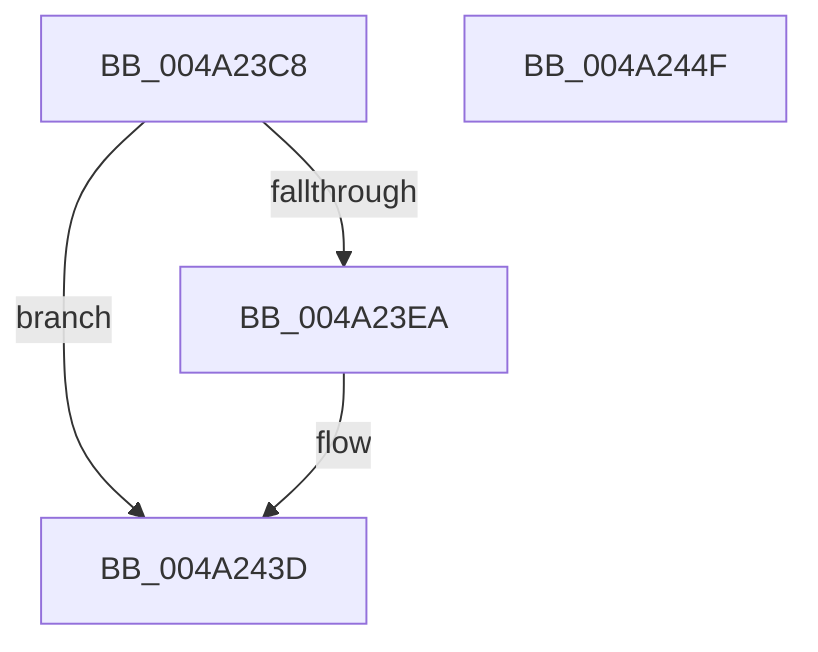

# PpmEventIdleStateChange

- RVA: `0x004A23C8`–`0x004A2450` (길이 `136` bytes)
- VA: `0x00000001404A23C8`
- 실행 섹션: `.text`
- PDB 이름 있음: `예`; PDB Function 태그: `아니요`
- unwind 정보 RVA: `0x00065FB8`
- 디코드: `28`개 명령, `136/136` bytes 표시
- 미해석 바이트: `0` (있으면 어셈블리에 `.byte`로 보존)

> 이 문서는 커널 이미지의 기계어와 PDB 기호를 분석해 생성했습니다. 4번과 5번은 함수 원형과 자료형을 바이너리 사용 방식에서 추정한 C 해석이며 원본 소스 복구 결과는 아닙니다.

## 1. Dependencies

- 직접 호출 지점: **2**; 고유 호출 대상: **2**
- 직접 호출자로 확인된 함수: **2**
- RIP 상대 이미지 참조: **2**

### Outgoing calls
- `0x004A2438` → [EtwTraceKernelEvent](../23/EtwTraceKernelEvent_function_00235350.md) (function, `0x00235350`)
- `0x004A2445` → [_security_check_cookie](../6A/_security_check_cookie_function_006AC640.md) (function, `0x006AC640`)

### Direct callers
- [PoIdle](../2C/PoIdle_function_002CFB40.md) at `0x002CFD2B`
- [PpmTracePerfIdleRundown](PpmTracePerfIdleRundown_function_004A22D0.md) at `0x004A2396`

### Static image references
- `0x004A23CF` → RVA `0x00E0A740` (`.data`; read)
- `0x004A23DE` → RVA `0x00FC6B10` (`ALMOSTRO`; read)

## 2. Other-region calls and transfers

- 다른 실행 섹션으로 향하는 call: **0**
- 별도 외부 분기/꼬리 이동을 확인하지 못했습니다.

## 3. Assembly (complete function range)

```asm
004A23C8  4C 8B DC                        mov r11, rsp
004A23CB  48 83 EC 68                     sub rsp, 0x68
004A23CF  48 8B 05 6A 83 96 00            mov rax, qword ptr [rip + 0x96836a]
004A23D6  48 33 C4                        xor rax, rsp
004A23D9  48 89 44 24 50                  mov qword ptr [rsp + 0x50], rax
004A23DE  F7 05 28 47 B2 00 00 80 00 00   test dword ptr [rip + 0xb24728], 0x8000
004A23E8  74 53                           je 0x1404a243d
004A23EA  89 4C 24 30                     mov dword ptr [rsp + 0x30], ecx
004A23EE  41 B9 35 12 00 00               mov r9d, 0x1235
004A23F4  89 54 24 34                     mov dword ptr [rsp + 0x34], edx
004A23F8  41 B8 00 80 00 80               mov r8d, 0x80008000
004A23FE  65 48 8B 04 25 20 00 00 00      mov rax, qword ptr gs:[0x20]
004A2407  BA 01 00 00 00                  mov edx, 1
004A240C  C7 44 24 20 02 06 00 00         mov dword ptr [rsp + 0x20], 0x602
004A2414  48 8B 88 C8 00 00 00            mov rcx, qword ptr [rax + 0xc8]
004A241B  49 8D 43 C8                     lea rax, [r11 - 0x38]
004A241F  49 89 43 D8                     mov qword ptr [r11 - 0x28], rax
004A2423  83 64 24 4C 00                  and dword ptr [rsp + 0x4c], 0
004A2428  49 89 4B D0                     mov qword ptr [r11 - 0x30], rcx
004A242C  49 8D 4B D8                     lea rcx, [r11 - 0x28]
004A2430  C7 44 24 48 10 00 00 00         mov dword ptr [rsp + 0x48], 0x10
004A2438  E8 13 2F D9 FF                  call 0x140235350
004A243D  48 8B 4C 24 50                  mov rcx, qword ptr [rsp + 0x50]
004A2442  48 33 CC                        xor rcx, rsp
004A2445  E8 F6 A1 20 00                  call 0x1406ac640
004A244A  48 83 C4 68                     add rsp, 0x68
004A244E  C3                              ret
004A244F  CC                              int3
```

## 4. C-style interpretation (structured pseudocode)

```c
__int64 __fastcall PpmEventIdleStateChange(int a1, int a2)
{
    __int64 result;
    __int64 v_rsp;
    unsigned __int64 v_stack_m18;
    unsigned int v_stack_m1C;
    unsigned int v_stack_m20;
    unsigned int v_stack_m34;
    unsigned int v_stack_m38;
    unsigned int v_stack_m48;

    v_rsp = (v_rsp) - (104);
    result = (*(unsigned __int64 *)(v_rip + 9864042)) ^ (v_rsp);
    v_stack_m18 = result;
    if (((*(unsigned int *)(v_rip + 11683624)) & (0x8000ULL)) != 0) {
        v_stack_m38 = a1;
        a4 = 0x1235ULL;
        v_stack_m34 = a2;
        a3 = 0x80008000ULL;
        result = *(unsigned __int64 *)(gs_base + (0 + 32));
        a2 = 1;
        v_stack_m48 = 0x602ULL;
        a1 = *(unsigned __int64 *)(result + 200);
        result = v_rsp - 56;
        *(unsigned __int64 *)(v_rsp - 40) = result;
        *(unsigned __int64 *)(v_rsp - 48) = a1;
        a1 = v_rsp - 40;
        v_stack_m20 = 16;
        result = EtwTraceKernelEvent(a1, a2, a3, a4);
    }
    a1 = (v_stack_m18) ^ (v_rsp);
    result = _security_check_cookie(a1, a2, a3, a4);
    v_rsp = (v_rsp) + (104);
    return result;
}
```

## 5. (Beta) C Style

```c
int64_t PpmEventIdleStateChange(int32_t Arg1, int32_t Arg2)
{
    int64_t result;
    int64_t local_rsp;
    uint64_t v_stack_m18;
    uint32_t v_stack_m1C;
    uint32_t v_stack_m20;
    uint32_t v_stack_m34;
    uint32_t v_stack_m38;
    uint32_t v_stack_m48;

    local_rsp = (local_rsp) - (104);
    result = (*(uint64_t *)(v_rip + 0x96836A)) ^ (local_rsp);
    v_stack_m18 = result;
    if (((*(uint32_t *)(v_rip + 0xB24728)) & (0x8000ULL)) != 0) {
        v_stack_m38 = Arg1;
        a4 = 0x1235ULL;
        v_stack_m34 = Arg2;
        a3 = 0x80008000ULL;
        result = *(uint64_t *)(gs_base + (0 + 0x20));
        Arg2 = 1;
        v_stack_m48 = 0x602ULL;
        Arg1 = *(uint64_t *)(result + 0xC8);
        result = local_rsp - 56;
        *(uint64_t *)(local_rsp - 0x28) = result;
        *(uint64_t *)(local_rsp - 0x30) = Arg1;
        Arg1 = local_rsp - 40;
        v_stack_m20 = 16;
        result = EtwTraceKernelEvent(Arg1, Arg2, a3, a4);
    }
    Arg1 = (v_stack_m18) ^ (local_rsp);
    result = _security_check_cookie(Arg1, Arg2, a3, a4);
    local_rsp = (local_rsp) + (104);
    return result;
}
```

## 6. Execution-region graph

[열기: 2D/3D 그래프와 함수 탐색 컨트롤 패널](../../../control-panel.html?section=text&rva=0x004A23C8&view=graph)

- 2D 그래프는 위에서 아래로 흐르고, 3D 그래프는 빈 공간을 드래그해 회전합니다. Shift+드래그는 이동, 휠은 확대·축소, 함수 노드 선택은 대상 보고서 이동입니다.

### Static fallback


