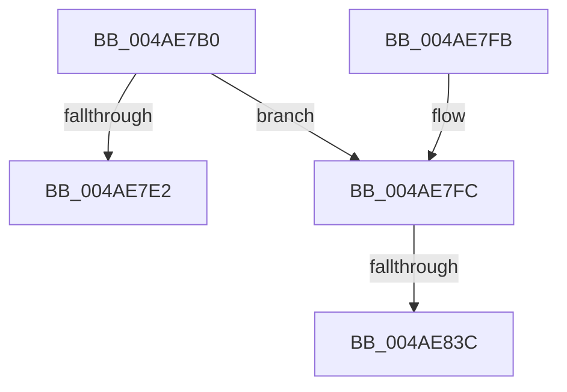

# PpmHeteroDistributeUtility

- RVA: `0x004AE7B0`–`0x004AE841` (길이 `145` bytes)
- VA: `0x00000001404AE7B0`
- 실행 섹션: `.text`
- PDB 이름 있음: `예`; PDB Function 태그: `예`
- unwind 정보 RVA: `0x000B8638`
- 디코드: `43`개 명령, `145/145` bytes 표시
- 미해석 바이트: `0` (있으면 어셈블리에 `.byte`로 보존)

> 이 문서는 커널 이미지의 기계어와 PDB 기호를 분석해 생성했습니다. 4번과 5번은 함수 원형과 자료형을 바이너리 사용 방식에서 추정한 C 해석이며 원본 소스 복구 결과는 아닙니다.

## 1. Dependencies

- 직접 호출 지점: **2**; 고유 호출 대상: **2**
- 직접 호출자로 확인된 함수: **0**
- RIP 상대 이미지 참조: **3**

### Outgoing calls
- `0x004AE7D6` → [Feature_PpmParkEx__private_IsEnabledDeviceUsageNoInline](../4F/Feature_PpmParkEx__private_IsEnabledDeviceUsageNoInline_function_004F135C.md) (function, `0x004F135C`)
- `0x004AE7E2` → [PpmHeteroDistributeUtilityEx](../4E/PpmHeteroDistributeUtilityEx_function_004EFC00.md) (function, `0x004EFC00`)

### Direct callers
- 이 함수 시작 RVA로 연결되는 직접 call은 확인되지 않았습니다. 간접 호출은 완전히 역산할 수 없습니다.

### Static image references
- `0x004AE7FC` → RVA `0x00E08380` (`.data`; read)
- `0x004AE803` → RVA `0x00F0CE0C` (`.data`; read)
- `0x004AE82B` → RVA `0x00F083E0` (`.data`; read)

## 2. Other-region calls and transfers

- 다른 실행 섹션으로 향하는 call: **0**
- call이 아닌 외부 분기/꼬리 이동: **2**
  - `0x004AE836` → [sub_006FAB60](../6F/Unknown_function_006FAB60.md) (`tail-transfer`)
  - `0x004AE83C` → [sub_006FAB60 + 0x400](../6F/Unknown_function_006FAB60.md) (`tail-transfer`)

## 3. Assembly (complete function range)

```asm
004AE7B0  40 55                           push rbp
004AE7B2  53                              push rbx
004AE7B3  56                              push rsi
004AE7B4  57                              push rdi
004AE7B5  41 54                           push r12
004AE7B7  41 55                           push r13
004AE7B9  41 56                           push r14
004AE7BB  41 57                           push r15
004AE7BD  48 8D 6C 24 E1                  lea rbp, [rsp - 0x1f]
004AE7C2  48 81 EC 88 00 00 00            sub rsp, 0x88
004AE7C9  0F 57 C0                        xorps xmm0, xmm0
004AE7CC  33 C0                           xor eax, eax
004AE7CE  0F 11 45 F7                     movups xmmword ptr [rbp - 9], xmm0
004AE7D2  48 89 45 07                     mov qword ptr [rbp + 7], rax
004AE7D6  E8 81 2B 04 00                  call 0x1404f135c
004AE7DB  45 33 FF                        xor r15d, r15d
004AE7DE  85 C0                           test eax, eax
004AE7E0  74 1A                           je 0x1404ae7fc
004AE7E2  E8 19 14 04 00                  call 0x1404efc00
004AE7E7  48 81 C4 88 00 00 00            add rsp, 0x88
004AE7EE  41 5F                           pop r15
004AE7F0  41 5E                           pop r14
004AE7F2  41 5D                           pop r13
004AE7F4  41 5C                           pop r12
004AE7F6  5F                              pop rdi
004AE7F7  5E                              pop rsi
004AE7F8  5B                              pop rbx
004AE7F9  5D                              pop rbp
004AE7FA  C3                              ret
004AE7FB  CC                              int3
004AE7FC  48 8B 0D 7D 9B 95 00            mov rcx, qword ptr [rip + 0x959b7d]
004AE803  48 63 05 02 E6 A5 00            movsxd rax, dword ptr [rip + 0xa5e602]
004AE80A  48 69 C0 E8 01 00 00            imul rax, rax, 0x1e8
004AE811  48 89 4D DF                     mov qword ptr [rbp - 0x21], rcx
004AE815  48 89 45 E7                     mov qword ptr [rbp - 0x19], rax
004AE819  44 38 BC 08 B3 00 00 00         cmp byte ptr [rax + rcx + 0xb3], r15b
004AE821  41 8B C7                        mov eax, r15d
004AE824  41 0F 95 C2                     setne r10b
004AE828  89 45 D7                        mov dword ptr [rbp - 0x29], eax
004AE82B  44 39 3D AE 9B A5 00            cmp dword ptr [rip + 0xa59bae], r15d
004AE832  44 88 55 67                     mov byte ptr [rbp + 0x67], r10b
004AE836  0F 87 24 C3 24 00               ja 0x1406fab60
004AE83C  E9 1F C7 24 00                  jmp 0x1406faf60
```

## 4. C-style interpretation (structured pseudocode)

```c
__int64 __fastcall PpmHeteroDistributeUtility(void)
{
    __int64 result;
    __int64 v_r10;
    __int64 v_r15;
    __int64 v_rsp;
    unsigned __int64 v_stack_m58;
    unsigned __int64 v_stack_m5F;
    unsigned __int64 v_stack_m68;
    unsigned __int64 v_stack_m78;
    unsigned __int64 v_stack_m80;
    unsigned int v_stack_m88;
    unsigned __int8 v_stack_p8;

    v_rsp = (v_rsp) - (136);
    result = 0;
    v_stack_m68 = v_xmm0;
    v_stack_m58 = 0;
    result = Feature_PpmParkEx__private_IsEnabledDeviceUsageNoInline(a1, a2, a3, a4);
    v_r15 = 0;
    if ((unsigned int)(result) == 0) goto loc_004AE7FC;
    result = PpmHeteroDistributeUtilityEx(a1, a2, a3, a4);
    v_rsp = (v_rsp) + (136);
    return result;
loc_004AE7FC:
    result = ((int)(*(unsigned int *)(v_rip + 10872322))) * ((int)(*(unsigned int *)(v_rip + 10872322)));
    v_stack_m80 = *(unsigned __int64 *)(v_rip + 9804669);
    v_stack_m78 = result;
    v_r10 = ((*(unsigned __int8 *)(result + *(unsigned __int64 *)(v_rip + 9804669) * 1 + 179)) != 0) ? 1 : 0;
    v_stack_m88 = 0;
    v_stack_p8 = (unsigned __int8)(v_r10);
}
```

## 5. (Beta) C Style

```c
void PpmHeteroDistributeUtility(void)
{
    int64_t result;
    int64_t local_r10;
    int64_t local_r15;
    int64_t local_rsp;
    uint64_t v_stack_m58;
    uint64_t v_stack_m5F;
    uint64_t v_stack_m68;
    uint64_t v_stack_m78;
    uint64_t v_stack_m80;
    uint32_t v_stack_m88;
    uint8_t v_stack_p8;

    local_rsp = (local_rsp) - (136);
    result = 0;
    v_stack_m68 = v_xmm0;
    v_stack_m58 = 0;
    result = Feature_PpmParkEx__private_IsEnabledDeviceUsageNoInline(a1, a2, a3, a4);
    local_r15 = 0;
    if ((uint32_t)(result) == 0) goto loc_004AE7FC;
    result = PpmHeteroDistributeUtilityEx(a1, a2, a3, a4);
    local_rsp = (local_rsp) + (136);
    return result;
loc_004AE7FC:
    result = ((int32_t)(*(uint32_t *)(v_rip + 0xA5E602))) * ((int32_t)(*(uint32_t *)(v_rip + 0xA5E602)));
    v_stack_m80 = *(uint64_t *)(v_rip + 0x959B7D);
    v_stack_m78 = result;
    local_r10 = ((*(uint8_t *)(result + *(uint64_t *)(v_rip + 0x959B7D) * 1 + 0xB3)) != 0) ? 1 : 0;
    v_stack_m88 = 0;
    v_stack_p8 = (uint8_t)(local_r10);
}
```

## 6. Execution-region graph

[열기: 2D/3D 그래프와 함수 탐색 컨트롤 패널](../../../control-panel.html?section=text&rva=0x004AE7B0&view=graph)

- 2D 그래프는 위에서 아래로 흐르고, 3D 그래프는 빈 공간을 드래그해 회전합니다. Shift+드래그는 이동, 휠은 확대·축소, 함수 노드 선택은 대상 보고서 이동입니다.

### Static fallback


