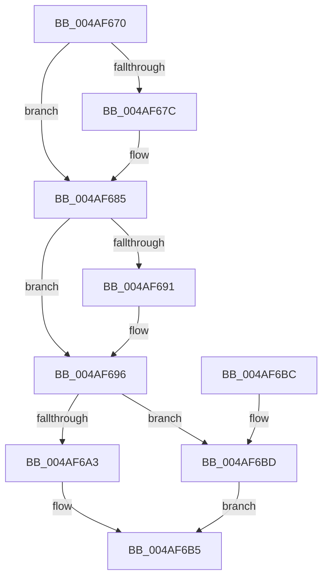

# PpmIdleDefaultExecute

- RVA: `0x004AF670`–`0x004AF6C2` (길이 `82` bytes)
- VA: `0x00000001404AF670`
- 실행 섹션: `.text`
- PDB 이름 있음: `예`; PDB Function 태그: `아니요`
- unwind 정보 RVA: `0x0009FDFC`
- 디코드: `26`개 명령, `82/82` bytes 표시
- 미해석 바이트: `0` (있으면 어셈블리에 `.byte`로 보존)

> 이 문서는 커널 이미지의 기계어와 PDB 기호를 분석해 생성했습니다. 4번과 5번은 함수 원형과 자료형을 바이너리 사용 방식에서 추정한 C 해석이며 원본 소스 복구 결과는 아닙니다.

## 1. Dependencies

- 직접 호출 지점: **2**; 고유 호출 대상: **2**
- 직접 호출자로 확인된 함수: **0**
- RIP 상대 이미지 참조: **0**

### Outgoing calls
- `0x004AF691` → [KeExecuteVerw](../6C/KeExecuteVerw_function_006C66C0.md) (function, `0x006C66C0`)
- `0x004AF696` → [HalProcessorIdle](../6A/HalProcessorIdle_function_006AC7C0.md) (function, `0x006AC7C0`)

### Direct callers
- 이 함수 시작 RVA로 연결되는 직접 call은 확인되지 않았습니다. 간접 호출은 완전히 역산할 수 없습니다.

### Static image references
- 디코드된 RIP-relative 메모리 참조가 없습니다.

## 2. Other-region calls and transfers

- 다른 실행 섹션으로 향하는 call: **0**
- 별도 외부 분기/꼬리 이동을 확인하지 못했습니다.

## 3. Assembly (complete function range)

```asm
004AF670  48 83 EC 28                     sub rsp, 0x28
004AF674  66 83 7C 24 50 00               cmp word ptr [rsp + 0x50], 0
004AF67A  74 09                           je 0x1404af685
004AF67C  33 C0                           xor eax, eax
004AF67E  33 D2                           xor edx, edx
004AF680  8D 48 48                        lea ecx, [rax + 0x48]
004AF683  0F 30                           wrmsr
004AF685  8B 44 24 50                     mov eax, dword ptr [rsp + 0x50]
004AF689  C1 E8 10                        shr eax, 0x10
004AF68C  66 85 C0                        test ax, ax
004AF68F  74 05                           je 0x1404af696
004AF691  E8 2A 70 21 00                  call 0x1406c66c0
004AF696  E8 25 D1 1F 00                  call 0x1406ac7c0
004AF69B  66 83 7C 24 50 00               cmp word ptr [rsp + 0x50], 0
004AF6A1  74 1A                           je 0x1404af6bd
004AF6A3  0F B7 54 24 50                  movzx edx, word ptr [rsp + 0x50]
004AF6A8  B9 48 00 00 00                  mov ecx, 0x48
004AF6AD  8B C2                           mov eax, edx
004AF6AF  48 C1 EA 20                     shr rdx, 0x20
004AF6B3  0F 30                           wrmsr
004AF6B5  33 C0                           xor eax, eax
004AF6B7  48 83 C4 28                     add rsp, 0x28
004AF6BB  C3                              ret
004AF6BC  CC                              int3
004AF6BD  0F AE E8                        lfence
004AF6C0  EB F3                           jmp 0x1404af6b5
```

## 4. C-style interpretation (structured pseudocode)

```c
__int64 __fastcall PpmIdleDefaultExecute(__int64 a1, int a2, __int64 a3, __int64 a4, unsigned __int16 a5)
{
    __int64 result;
    __int64 v_rsp;

    v_rsp = (v_rsp) - (40);
    if (a5 != 0) {
        result = 0;
        a2 = 0;
        a1 = result + 72;
    }
    result = (unsigned int)(((unsigned int)(a5)) >> (16));
    if ((unsigned __int16)(result) != 0) {
        result = KeExecuteVerw(a1, a2, a3, a4);
    }
    result = HalProcessorIdle(a1, a2, a3, a4);
    if (a5 == 0) goto loc_004AF6BD;
    a2 = (a5) >> (32);
loc_004AF6B5:
    result = 0;
    v_rsp = (v_rsp) + (40);
    return result;
loc_004AF6BD:
    goto loc_004AF6B5;
}
```

## 5. (Beta) C Style

```c
int64_t PpmIdleDefaultExecute(int64_t Arg1, int32_t Arg2, int64_t Arg3, int64_t Arg4, uint16_t Arg5)
{
    int64_t result;
    int64_t local_rsp;

    local_rsp = (local_rsp) - (40);
    if (Arg5 != 0) {
        result = 0;
        Arg2 = 0;
        Arg1 = result + 72;
    }
    result = (uint32_t)(((uint32_t)(Arg5)) >> (16));
    if ((uint16_t)(result) != 0) {
        result = KeExecuteVerw(Arg1, Arg2, Arg3, Arg4);
    }
    result = HalProcessorIdle(Arg1, Arg2, Arg3, Arg4);
    if (Arg5 == 0) goto loc_004AF6BD;
    Arg2 = (Arg5) >> (32);
loc_004AF6B5:
    result = 0;
    local_rsp = (local_rsp) + (40);
    return result;
loc_004AF6BD:
    goto loc_004AF6B5;
}
```

## 6. Execution-region graph

[열기: 2D/3D 그래프와 함수 탐색 컨트롤 패널](../../../control-panel.html?section=text&rva=0x004AF670&view=graph)

- 2D 그래프는 위에서 아래로 흐르고, 3D 그래프는 빈 공간을 드래그해 회전합니다. Shift+드래그는 이동, 휠은 확대·축소, 함수 노드 선택은 대상 보고서 이동입니다.

### Static fallback


