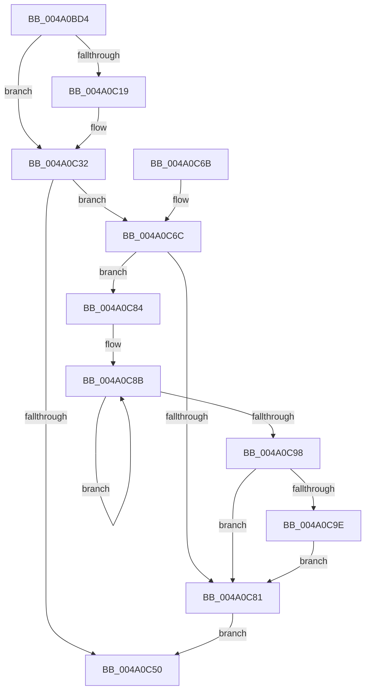

# PpmIdleSnapConcurrencyIdleTime

- RVA: `0x004A0BD4`–`0x004A0CA5` (길이 `209` bytes)
- VA: `0x00000001404A0BD4`
- 실행 섹션: `.text`
- PDB 이름 있음: `예`; PDB Function 태그: `아니요`
- unwind 정보 RVA: `0x000B587C`
- 디코드: `58`개 명령, `209/209` bytes 표시
- 미해석 바이트: `0` (있으면 어셈블리에 `.byte`로 보존)

> 이 문서는 커널 이미지의 기계어와 PDB 기호를 분석해 생성했습니다. 4번과 5번은 함수 원형과 자료형을 바이너리 사용 방식에서 추정한 C 해석이며 원본 소스 복구 결과는 아닙니다.

## 1. Dependencies

- 직접 호출 지점: **5**; 고유 호출 대상: **5**
- 직접 호출자로 확인된 함수: **2**
- RIP 상대 이미지 참조: **0**

### Outgoing calls
- `0x004A0BF8` → [KeQueryPerformanceCounter](../37/KeQueryPerformanceCounter_function_0037E7E0.md) (function, `0x0037E7E0`)
- `0x004A0C00` → [KeDisableInterrupts](../21/KeDisableInterrupts_function_00217BE0.md) (function, `0x00217BE0`)
- `0x004A0C0B` → [KeAcquireSpinLockAtDpcLevel](../20/KeAcquireSpinLockAtDpcLevel_function_00208430.md) (function, `0x00208430`)
- `0x004A0C46` → [KxReleaseSpinLock](../20/KxReleaseSpinLock_function_00206670.md) (function, `0x00206670`)
- `0x004A0C9E` → [KiRemoveSystemWorkPriorityKick](../26/KiRemoveSystemWorkPriorityKick_function_002631D0.md) (function, `0x002631D0`)

### Direct callers
- [PopAccumulateNonDripsIdleCpuTime](PopAccumulateNonDripsIdleCpuTime_function_004A09B0.md) at `0x004A0A33`
- [PopAccumulateNonActivatedCpuTime](PopAccumulateNonActivatedCpuTime_function_004A0AA4.md) at `0x004A0AFE`

### Static image references
- 디코드된 RIP-relative 메모리 참조가 없습니다.

## 2. Other-region calls and transfers

- 다른 실행 섹션으로 향하는 call: **0**
- 별도 외부 분기/꼬리 이동을 확인하지 못했습니다.

## 3. Assembly (complete function range)

```asm
004A0BD4  48 8B C4                        mov rax, rsp
004A0BD7  48 89 58 08                     mov qword ptr [rax + 8], rbx
004A0BDB  48 89 68 10                     mov qword ptr [rax + 0x10], rbp
004A0BDF  48 89 70 18                     mov qword ptr [rax + 0x18], rsi
004A0BE3  48 89 78 20                     mov qword ptr [rax + 0x20], rdi
004A0BE7  41 56                           push r14
004A0BE9  48 83 EC 20                     sub rsp, 0x20
004A0BED  48 8B D9                        mov rbx, rcx
004A0BF0  49 8B F0                        mov rsi, r8
004A0BF3  33 C9                           xor ecx, ecx
004A0BF5  4C 8B F2                        mov r14, rdx
004A0BF8  E8 E3 DB ED FF                  call 0x14037e7e0
004A0BFD  48 8B F8                        mov rdi, rax
004A0C00  E8 DB 6F D7 FF                  call 0x140217be0
004A0C05  48 8B CB                        mov rcx, rbx
004A0C08  40 8A E8                        mov bpl, al
004A0C0B  E8 20 78 D6 FF                  call 0x140208430
004A0C10  48 8B 43 10                     mov rax, qword ptr [rbx + 0x10]
004A0C14  48 3B F8                        cmp rdi, rax
004A0C17  76 19                           jbe 0x1404a0c32
004A0C19  48 8B D7                        mov rdx, rdi
004A0C1C  48 89 7B 10                     mov qword ptr [rbx + 0x10], rdi
004A0C20  48 2B D0                        sub rdx, rax
004A0C23  8B 43 0C                        mov eax, dword ptr [rbx + 0xc]
004A0C26  48 01 53 18                     add qword ptr [rbx + 0x18], rdx
004A0C2A  48 01 94 C3 48 01 00 00         add qword ptr [rbx + rax*8 + 0x148], rdx
004A0C32  48 8B 43 18                     mov rax, qword ptr [rbx + 0x18]
004A0C36  48 8B CB                        mov rcx, rbx
004A0C39  49 89 06                        mov qword ptr [r14], rax
004A0C3C  48 8B 83 48 01 00 00            mov rax, qword ptr [rbx + 0x148]
004A0C43  48 89 06                        mov qword ptr [rsi], rax
004A0C46  E8 25 5A D6 FF                  call 0x140206670
004A0C4B  40 84 ED                        test bpl, bpl
004A0C4E  75 1C                           jne 0x1404a0c6c
004A0C50  48 8B 5C 24 30                  mov rbx, qword ptr [rsp + 0x30]
004A0C55  48 8B 6C 24 38                  mov rbp, qword ptr [rsp + 0x38]
004A0C5A  48 8B 74 24 40                  mov rsi, qword ptr [rsp + 0x40]
004A0C5F  48 8B 7C 24 48                  mov rdi, qword ptr [rsp + 0x48]
004A0C64  48 83 C4 20                     add rsp, 0x20
004A0C68  41 5E                           pop r14
004A0C6A  C3                              ret
004A0C6B  CC                              int3
004A0C6C  65 48 8B 0C 25 20 00 00 00      mov rcx, qword ptr gs:[0x20]
004A0C75  4C 8B 81 B8 8E 00 00            mov r8, qword ptr [rcx + 0x8eb8]
004A0C7C  4D 85 C0                        test r8, r8
004A0C7F  75 03                           jne 0x1404a0c84
004A0C81  FB                              sti
004A0C82  EB CC                           jmp 0x1404a0c50
004A0C84  41 0F 0D 08                     prefetchw byte ptr [r8]
004A0C88  41 8B 00                        mov eax, dword ptr [r8]
004A0C8B  8B D0                           mov edx, eax
004A0C8D  0F BA F2 15                     btr edx, 0x15
004A0C91  F0 41 0F B1 10                  lock cmpxchg dword ptr [r8], edx
004A0C96  75 F3                           jne 0x1404a0c8b
004A0C98  0F BA E0 15                     bt eax, 0x15
004A0C9C  73 E3                           jae 0x1404a0c81
004A0C9E  E8 2D 25 DC FF                  call 0x1402631d0
004A0CA3  EB DC                           jmp 0x1404a0c81
```

## 4. C-style interpretation (structured pseudocode)

```c
__int64 __fastcall PpmIdleSnapConcurrencyIdleTime(__int64 a1, __int64 a2, __int64 a3)
{
    __int64 result;
    __int64 v_rsp;
    unsigned __int64 v_stack_p10;
    unsigned __int64 v_stack_p18;
    unsigned __int64 v_stack_p20;
    unsigned __int64 v_stack_p8;

    *(unsigned __int64 *)(v_rsp + 8) = v_rbx;
    *(unsigned __int64 *)(v_rsp + 16) = v_rbp;
    *(unsigned __int64 *)(v_rsp + 24) = v_rsi;
    *(unsigned __int64 *)(v_rsp + 32) = v_rdi;
    v_rsp = (v_rsp) - (32);
    a1 = 0;
    result = KeQueryPerformanceCounter(a1, a2, a3, a4);
    result = KeDisableInterrupts(a1, a2, a3, a4);
    result = KeAcquireSpinLockAtDpcLevel(0, a2, a3, a4);
    result = *(unsigned __int64 *)(a1 + 16);
    if (result >= = (*(unsigned __int64 *)(a1 + 16))) {
        a2 = result;
        *(unsigned __int64 *)(a1 + 16) = result;
        a2 = (a2) - (*(unsigned __int64 *)(a1 + 16));
        result = *(unsigned int *)(a1 + 12);
    }
    *(unsigned __int64 *)(a2) = *(unsigned __int64 *)(a1 + 24);
    *(unsigned __int64 *)(a3) = *(unsigned __int64 *)(a1 + 328);
    result = KxReleaseSpinLock(0, a2, a3, a4);
    if ((unsigned __int8)((unsigned __int8)(result)) != 0) goto loc_004A0C6C;
loc_004A0C50:
    v_rsp = (v_rsp) + (32);
    return result;
loc_004A0C6C:
    if (*(unsigned __int64 *)(*(unsigned __int64 *)(gs_base + (0 + 32)) + 36536) != 0) goto loc_004A0C84;
loc_004A0C81:
    goto loc_004A0C50;
loc_004A0C84:
loc_004A0C8B:
    if (*(unsigned __int64 *)(*(unsigned __int64 *)(gs_base + (0 + 32)) + 36536) != 0) goto loc_004A0C8B;
    if (condition_is_above_or_equal) goto loc_004A0C81;
    result = KiRemoveSystemWorkPriorityKick(*(unsigned __int64 *)(gs_base + (0 + 32)), (unsigned int)((unsigned int)((unsigned int)(*(unsigned int *)(*(unsigned __int64 *)(*(unsigned __int64 *)(gs_base + (0 + 32)) + 36536))))), *(unsigned __int64 *)(*(unsigned __int64 *)(gs_base + (0 + 32)) + 36536), a4);
    goto loc_004A0C81;
}
```

## 5. (Beta) C Style

```c
int64_t PpmIdleSnapConcurrencyIdleTime(void *Arg1, void *Arg2, void *Arg3)
{
    uint8_t *arg1 = (uint8_t *)Arg1;
    uint8_t *arg2 = (uint8_t *)Arg2;
    uint8_t *arg3 = (uint8_t *)Arg3;

    int64_t result;
    int64_t local_rsp;
    uint64_t v_stack_p10;
    uint64_t v_stack_p18;
    uint64_t v_stack_p20;
    uint64_t v_stack_p8;

    *(uint64_t *)(local_rsp + 0x8) = local_rbx;
    *(uint64_t *)(local_rsp + 0x10) = local_rbp;
    *(uint64_t *)(local_rsp + 0x18) = local_rsi;
    *(uint64_t *)(local_rsp + 0x20) = local_rdi;
    local_rsp = (local_rsp) - (32);
    Arg1 = 0;
    result = KeQueryPerformanceCounter(Arg1, Arg2, Arg3, a4);
    result = KeDisableInterrupts(Arg1, Arg2, Arg3, a4);
    result = KeAcquireSpinLockAtDpcLevel(0, Arg2, Arg3, a4);
    result = *(uint64_t *)(arg1 + 0x10);
    if (result >= = (*(uint64_t *)(arg1 + 0x10))) {
        Arg2 = result;
        *(uint64_t *)(arg1 + 0x10) = result;
        Arg2 = (Arg2) - (*(uint64_t *)(arg1 + 0x10));
        result = *(uint32_t *)(arg1 + 0xC);
    }
    *(uint64_t *)(arg2) = *(uint64_t *)(arg1 + 0x18);
    *(uint64_t *)(arg3) = *(uint64_t *)(arg1 + 0x148);
    result = KxReleaseSpinLock(0, Arg2, Arg3, a4);
    if ((uint8_t)((uint8_t)(result)) != 0) goto loc_004A0C6C;
loc_004A0C50:
    local_rsp = (local_rsp) + (32);
    return result;
loc_004A0C6C:
    if (*(uint64_t *)(*(uint64_t *)(gs_base + (0 + 0x20)) + 0x8EB8) != 0) goto loc_004A0C84;
loc_004A0C81:
    goto loc_004A0C50;
loc_004A0C84:
loc_004A0C8B:
    if (*(uint64_t *)(*(uint64_t *)(gs_base + (0 + 0x20)) + 0x8EB8) != 0) goto loc_004A0C8B;
    if (condition_is_above_or_equal) goto loc_004A0C81;
    result = KiRemoveSystemWorkPriorityKick(*(uint64_t *)(gs_base + (0 + 0x20)), (uint32_t)((uint32_t)((uint32_t)(*(uint32_t *)(*(uint64_t *)(*(uint64_t *)(gs_base + (0 + 0x20)) + 0x8EB8))))), *(uint64_t *)(*(uint64_t *)(gs_base + (0 + 0x20)) + 0x8EB8), a4);
    goto loc_004A0C81;
}
```

### 관측된 메모리 오프셋

구조체 형식이 확인되지 않은 접근은 인자 기준의 오프셋으로만 기록했습니다.

| 기준 인자 | 오프셋 표현 | 폭 (bit) | 접근 |
|---|---:|---:|---|
| `Arg1` | `+ 0xC` | `32` | `R` |
| `Arg1` | `+ 0x10` | `64` | `R` |
| `Arg1` | `+ 0x10` | `64` | `W` |
| `Arg1` | `+ 0x18` | `64` | `R` |
| `Arg1` | `+ 0x18` | `64` | `R/W` |
| `Arg1` | `+ 0x148` | `64` | `R` |
| `Arg1` | `+ 0x148 + rax*8` | `64` | `R/W` |
| `Arg2` | `+ 0x0` | `64` | `W` |
| `Arg3` | `+ 0x0` | `64` | `W` |

## 6. Execution-region graph

[열기: 2D/3D 그래프와 함수 탐색 컨트롤 패널](../../../control-panel.html?section=text&rva=0x004A0BD4&view=graph)

- 2D 그래프는 위에서 아래로 흐르고, 3D 그래프는 빈 공간을 드래그해 회전합니다. Shift+드래그는 이동, 휠은 확대·축소, 함수 노드 선택은 대상 보고서 이동입니다.

### Static fallback


