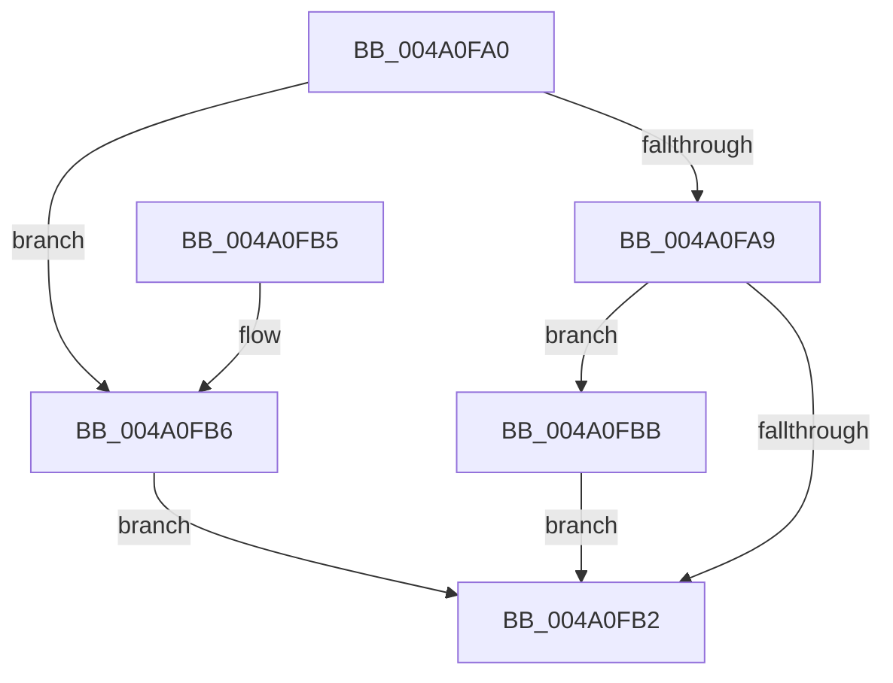

# PpmInfoApplyMinMaxConstraint

- RVA: `0x004A0FA0`–`0x004A0FC8` (길이 `40` bytes)
- VA: `0x00000001404A0FA0`
- 실행 섹션: `.text`
- PDB 이름 있음: `예`; PDB Function 태그: `아니요`
- unwind 정보 RVA: `0x000DB714`
- 디코드: `15`개 명령, `40/40` bytes 표시
- 미해석 바이트: `0` (있으면 어셈블리에 `.byte`로 보존)

> 이 문서는 커널 이미지의 기계어와 PDB 기호를 분석해 생성했습니다. 4번과 5번은 함수 원형과 자료형을 바이너리 사용 방식에서 추정한 C 해석이며 원본 소스 복구 결과는 아닙니다.

## 1. Dependencies

- 직접 호출 지점: **0**; 고유 호출 대상: **0**
- 직접 호출자로 확인된 함수: **1**
- RIP 상대 이미지 참조: **0**

### Outgoing calls
- 직접 디코드된 call 명령이 없습니다.

### Direct callers
- [PpmInfoWriteData](../../page/A4/PpmInfoWriteData_function_00A4335C.md) at `0x00A433AE`
- [PpmInfoWriteData](../../page/A4/PpmInfoWriteData_function_00A4335C.md) at `0x00A433E3`
- [PpmInfoWriteData](../../page/A4/PpmInfoWriteData_function_00A4335C.md) at `0x00A4340E`

### Static image references
- 디코드된 RIP-relative 메모리 참조가 없습니다.

## 2. Other-region calls and transfers

- 다른 실행 섹션으로 향하는 call: **0**
- 별도 외부 분기/꼬리 이동을 확인하지 못했습니다.

## 3. Assembly (complete function range)

```asm
004A0FA0  44 8B 42 10                     mov r8d, dword ptr [rdx + 0x10]
004A0FA4  41 3B C8                        cmp ecx, r8d
004A0FA7  72 0D                           jb 0x1404a0fb6
004A0FA9  44 8B 4A 14                     mov r9d, dword ptr [rdx + 0x14]
004A0FAD  41 3B C9                        cmp ecx, r9d
004A0FB0  77 09                           ja 0x1404a0fbb
004A0FB2  8B C1                           mov eax, ecx
004A0FB4  C3                              ret
004A0FB5  CC                              int3
004A0FB6  41 8B C8                        mov ecx, r8d
004A0FB9  EB F7                           jmp 0x1404a0fb2
004A0FBB  F6 42 25 10                     test byte ptr [rdx + 0x25], 0x10
004A0FBF  41 8B C8                        mov ecx, r8d
004A0FC2  41 0F 44 C9                     cmove ecx, r9d
004A0FC6  EB EA                           jmp 0x1404a0fb2
```

## 4. C-style interpretation (structured pseudocode)

```c
__int64 __fastcall PpmInfoApplyMinMaxConstraint(int a1, __int64 a2)
{
    if (a1 < ((unsigned int)((unsigned int)(*(unsigned int *)(a2 + 16))))) goto loc_004A0FB6;
    if (a1 > ((unsigned int)((unsigned int)(*(unsigned int *)(a2 + 20))))) goto loc_004A0FBB;
loc_004A0FB2:
    return (unsigned int)(a1);
loc_004A0FB6:
    goto loc_004A0FB2;
loc_004A0FBB:
    a1 = (unsigned int)((unsigned int)((unsigned int)(*(unsigned int *)(a2 + 16))));
    if (((*(unsigned __int8 *)(a2 + 37)) & (16)) == 0) { a1 = (unsigned int)((unsigned int)(*(unsigned int *)(a2 + 20))); }
    goto loc_004A0FB2;
}
```

## 5. (Beta) C Style

```c
int64_t PpmInfoApplyMinMaxConstraint(int32_t Arg1, void *Arg2)
{
    uint8_t *arg2 = (uint8_t *)Arg2;

    if (Arg1 < ((uint32_t)((uint32_t)(*(uint32_t *)(arg2 + 0x10))))) goto loc_004A0FB6;
    if (Arg1 > ((uint32_t)((uint32_t)(*(uint32_t *)(arg2 + 0x14))))) goto loc_004A0FBB;
loc_004A0FB2:
    return (uint32_t)(Arg1);
loc_004A0FB6:
    goto loc_004A0FB2;
loc_004A0FBB:
    Arg1 = (uint32_t)((uint32_t)((uint32_t)(*(uint32_t *)(arg2 + 0x10))));
    if (((*(uint8_t *)(arg2 + 0x25)) & (16)) == 0) { Arg1 = (uint32_t)((uint32_t)(*(uint32_t *)(arg2 + 0x14))); }
    goto loc_004A0FB2;
}
```

### 관측된 메모리 오프셋

구조체 형식이 확인되지 않은 접근은 인자 기준의 오프셋으로만 기록했습니다.

| 기준 인자 | 오프셋 표현 | 폭 (bit) | 접근 |
|---|---:|---:|---|
| `Arg2` | `+ 0x10` | `32` | `R` |
| `Arg2` | `+ 0x14` | `32` | `R` |
| `Arg2` | `+ 0x25` | `8` | `R` |

## 6. Execution-region graph

[열기: 2D/3D 그래프와 함수 탐색 컨트롤 패널](../../../control-panel.html?section=text&rva=0x004A0FA0&view=graph)

- 2D 그래프는 위에서 아래로 흐르고, 3D 그래프는 빈 공간을 드래그해 회전합니다. Shift+드래그는 이동, 휠은 확대·축소, 함수 노드 선택은 대상 보고서 이동입니다.

### Static fallback


