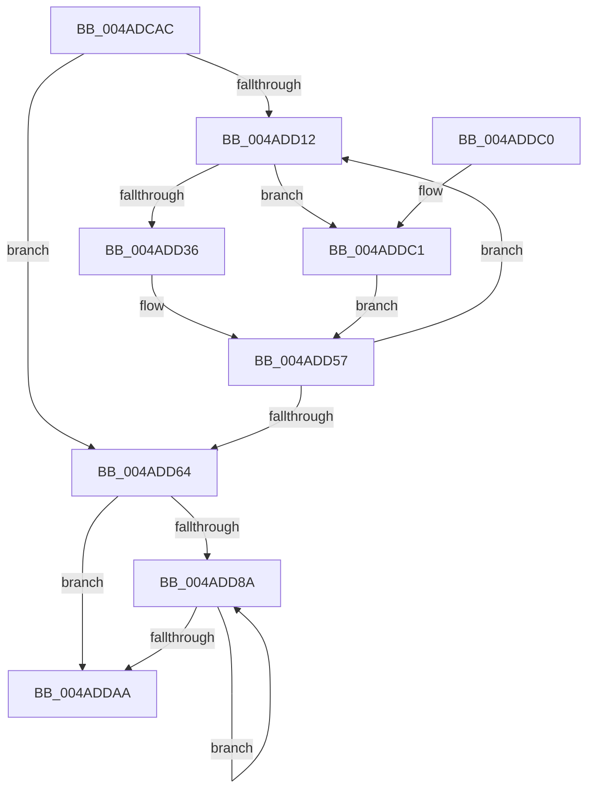

# PpmParkComputeDiff

- RVA: `0x004ADCAC`–`0x004ADE03` (길이 `343` bytes)
- VA: `0x00000001404ADCAC`
- 실행 섹션: `.text`
- PDB 이름 있음: `예`; PDB Function 태그: `아니요`
- unwind 정보 RVA: `0x0009D648`
- 디코드: `71`개 명령, `343/343` bytes 표시
- 미해석 바이트: `0` (있으면 어셈블리에 `.byte`로 보존)

> 이 문서는 커널 이미지의 기계어와 PDB 기호를 분석해 생성했습니다. 4번과 5번은 함수 원형과 자료형을 바이너리 사용 방식에서 추정한 C 해석이며 원본 소스 복구 결과는 아닙니다.

## 1. Dependencies

- 직접 호출 지점: **9**; 고유 호출 대상: **6**
- 직접 호출자로 확인된 함수: **2**
- RIP 상대 이미지 참조: **13**

### Outgoing calls
- `0x004ADCE5` → [memset](../6C/memset_function_006C6C40.md) (function, `0x006C6C40`)
- `0x004ADD01` → [memset](../6C/memset_function_006C6C40.md) (function, `0x006C6C40`)
- `0x004ADD22` → [Feature_PpmParkEx__private_IsEnabledDeviceUsageNoInline](../4F/Feature_PpmParkEx__private_IsEnabledDeviceUsageNoInline_function_004F135C.md) (function, `0x004F135C`)
- `0x004ADD3E` → [KeAddGroupAffinityEx](../25/KeAddGroupAffinityEx_function_0025B6C0.md) (function, `0x0025B6C0`)
- `0x004ADD52` → [KeAddGroupAffinityEx](../25/KeAddGroupAffinityEx_function_0025B6C0.md) (function, `0x0025B6C0`)
- `0x004ADD81` → [KiXorAffinityEx](../2D/KiXorAffinityEx_function_002D62D0.md) (function, `0x002D62D0`)
- `0x004ADD9A` → [PpmParkEvaluateRestriction](PpmParkEvaluateRestriction_function_004ADE0C.md) (function, `0x004ADE0C`)
- `0x004ADDD7` → [KiOrAffinityEx](../39/KiOrAffinityEx_function_0039A84C.md) (function, `0x0039A84C`)
- `0x004ADDF9` → [KiOrAffinityEx](../39/KiOrAffinityEx_function_0039A84C.md) (function, `0x0039A84C`)

### Direct callers
- [PpmParkCalculateCoreParkingMaskEx](../5D/PpmParkCalculateCoreParkingMaskEx_function_005DFBE0.md) at `0x005E056A`
- [sub_006F6620](../6F/Unknown_function_006F6620.md) at `0x006F6C0C`

### Static image references
- `0x004ADCC6` → RVA `0x00E0BED0` (`.data`; write)
- `0x004ADCD4` → RVA `0x00E0BED8` (`.data`; read)
- `0x004ADCED` → RVA `0x00E0BCB0` (`.data`; write)
- `0x004ADCFA` → RVA `0x00E0BCB8` (`.data`; read)
- `0x004ADD06` → RVA `0x00F083E0` (`.data`; read)
- `0x004ADD1B` → RVA `0x00F083D8` (`.data`; read)
- `0x004ADD27` → RVA `0x00E0BED0` (`.data`; read)
- `0x004ADD47` → RVA `0x00E0BCB0` (`.data`; read)
- `0x004ADD64` → RVA `0x00E0B982` (`.data`; read)
- `0x004ADD6C` → RVA `0x00E0B980` (`.data`; read)
- `0x004ADD7A` → RVA `0x00E0C0F0` (`.data`; read)
- `0x004ADDC1` → RVA `0x00E0BED2` (`.data`; read)
- `0x004ADDDC` → RVA `0x00E0BCB2` (`.data`; read)

## 2. Other-region calls and transfers

- 다른 실행 섹션으로 향하는 call: **0**
- 별도 외부 분기/꼬리 이동을 확인하지 못했습니다.

## 3. Assembly (complete function range)

```asm
004ADCAC  48 89 5C 24 08                  mov qword ptr [rsp + 8], rbx
004ADCB1  48 89 74 24 10                  mov qword ptr [rsp + 0x10], rsi
004ADCB6  48 89 7C 24 18                  mov qword ptr [rsp + 0x18], rdi
004ADCBB  41 56                           push r14
004ADCBD  48 83 EC 20                     sub rsp, 0x20
004ADCC1  BF 00 01 00 00                  mov edi, 0x100
004ADCC6  48 C7 05 FF E1 95 00 01 00 20 00  mov qword ptr [rip + 0x95e1ff], 0x200001
004ADCD1  44 8B C7                        mov r8d, edi
004ADCD4  48 8D 0D FD E1 95 00            lea rcx, [rip + 0x95e1fd]
004ADCDB  33 D2                           xor edx, edx
004ADCDD  41 BE 01 00 00 00               mov r14d, 1
004ADCE3  33 DB                           xor ebx, ebx
004ADCE5  E8 56 8F 21 00                  call 0x1406c6c40
004ADCEA  44 8B C7                        mov r8d, edi
004ADCED  48 C7 05 B8 DF 95 00 01 00 20 00  mov qword ptr [rip + 0x95dfb8], 0x200001
004ADCF8  33 D2                           xor edx, edx
004ADCFA  48 8D 0D B7 DF 95 00            lea rcx, [rip + 0x95dfb7]
004ADD01  E8 3A 8F 21 00                  call 0x1406c6c40
004ADD06  8B 3D D4 A6 A5 00               mov edi, dword ptr [rip + 0xa5a6d4]
004ADD0C  8B F3                           mov esi, ebx
004ADD0E  85 FF                           test edi, edi
004ADD10  74 52                           je 0x1404add64
004ADD12  8B C6                           mov eax, esi
004ADD14  48 69 F8 10 05 00 00            imul rdi, rax, 0x510
004ADD1B  48 03 3D B6 A6 A5 00            add rdi, qword ptr [rip + 0xa5a6b6]
004ADD22  E8 35 36 04 00                  call 0x1404f135c
004ADD27  48 8D 0D A2 E1 95 00            lea rcx, [rip + 0x95e1a2]
004ADD2E  85 C0                           test eax, eax
004ADD30  0F 85 8B 00 00 00               jne 0x1404addc1
004ADD36  4C 8B 47 18                     mov r8, qword ptr [rdi + 0x18]
004ADD3A  0F B7 57 04                     movzx edx, word ptr [rdi + 4]
004ADD3E  E8 7D D9 DA FF                  call 0x14025b6c0
004ADD43  4C 8B 47 28                     mov r8, qword ptr [rdi + 0x28]
004ADD47  48 8D 0D 62 DF 95 00            lea rcx, [rip + 0x95df62]
004ADD4E  0F B7 57 04                     movzx edx, word ptr [rdi + 4]
004ADD52  E8 69 D9 DA FF                  call 0x14025b6c0
004ADD57  8B 3D 83 A6 A5 00               mov edi, dword ptr [rip + 0xa5a683]
004ADD5D  41 03 F6                        add esi, r14d
004ADD60  3B F7                           cmp esi, edi
004ADD62  72 AE                           jb 0x1404add12
004ADD64  44 0F B7 0D 16 DC 95 00         movzx r9d, word ptr [rip + 0x95dc16]
004ADD6C  4C 8D 05 0D DC 95 00            lea r8, [rip + 0x95dc0d]
004ADD73  48 8D 15 56 E1 95 00            lea rdx, [rip + 0x95e156]
004ADD7A  48 8D 0D 6F E3 95 00            lea rcx, [rip + 0x95e36f]
004ADD81  E8 4A 85 E2 FF                  call 0x1402d62d0
004ADD86  85 FF                           test edi, edi
004ADD88  74 20                           je 0x1404addaa
004ADD8A  8B C3                           mov eax, ebx
004ADD8C  48 69 C8 10 05 00 00            imul rcx, rax, 0x510
004ADD93  48 03 0D 3E A6 A5 00            add rcx, qword ptr [rip + 0xa5a63e]
004ADD9A  E8 6D 00 00 00                  call 0x1404ade0c
004ADD9F  41 03 DE                        add ebx, r14d
004ADDA2  3B 1D 38 A6 A5 00               cmp ebx, dword ptr [rip + 0xa5a638]
004ADDA8  72 E0                           jb 0x1404add8a
004ADDAA  48 8B 5C 24 30                  mov rbx, qword ptr [rsp + 0x30]
004ADDAF  48 8B 74 24 38                  mov rsi, qword ptr [rsp + 0x38]
004ADDB4  48 8B 7C 24 40                  mov rdi, qword ptr [rsp + 0x40]
004ADDB9  48 83 C4 20                     add rsp, 0x20
004ADDBD  41 5E                           pop r14
004ADDBF  C3                              ret
004ADDC0  CC                              int3
004ADDC1  44 0F B7 0D 09 E1 95 00         movzx r9d, word ptr [rip + 0x95e109]
004ADDC9  48 8D 97 38 01 00 00            lea rdx, [rdi + 0x138]
004ADDD0  4C 8D 05 F9 E0 95 00            lea r8, [rip + 0x95e0f9]
004ADDD7  E8 70 CA EE FF                  call 0x14039a84c
004ADDDC  44 0F B7 0D CE DE 95 00         movzx r9d, word ptr [rip + 0x95dece]
004ADDE4  48 8D 97 48 03 00 00            lea rdx, [rdi + 0x348]
004ADDEB  48 8D 0D BE DE 95 00            lea rcx, [rip + 0x95debe]
004ADDF2  4C 8D 05 B7 DE 95 00            lea r8, [rip + 0x95deb7]
004ADDF9  E8 4E CA EE FF                  call 0x14039a84c
004ADDFE  E9 54 FF FF FF                  jmp 0x1404add57
```

## 4. C-style interpretation (structured pseudocode)

```c
__int64 __fastcall PpmParkComputeDiff(__int64 a1, int a2)
{
    __int64 result;
    __int64 v_rbx;
    __int64 v_rdi;
    __int64 v_rsi;
    __int64 v_rsp;
    unsigned __int64 v_stack_p10;
    unsigned __int64 v_stack_p18;
    unsigned __int64 v_stack_p8;

    v_stack_p8 = v_rbx;
    v_stack_p10 = v_rsi;
    v_stack_p18 = v_rdi;
    v_rsp = (v_rsp) - (32);
    *(unsigned __int64 *)(v_rip + 9822719) = 0x200001ULL;
    a2 = 0;
    v_rbx = 0;
    result = memset(v_rip + 9822717, a2, 256, a4);
    *(unsigned __int64 *)(v_rip + 9822136) = 0x200001ULL;
    a2 = 0;
    result = memset(v_rip + 9822135, a2, 256, a4);
    if ((unsigned int)((unsigned int)(*(unsigned int *)(v_rip + 10856148))) == 0) goto loc_004ADD64;
loc_004ADD12:
    v_rdi = ((unsigned int)(*(unsigned int *)(v_rip + 10856148))) * (0);
    v_rdi = (v_rdi) + (*(unsigned __int64 *)(v_rip + 10856118));
    result = Feature_PpmParkEx__private_IsEnabledDeviceUsageNoInline(v_rip + 9822135, a2, 256, a4);
    if ((unsigned int)(result) != 0) goto loc_004ADDC1;
    result = KeAddGroupAffinityEx(v_rip + 9822626, *(unsigned __int16 *)(v_rdi + 4), *(unsigned __int64 *)(v_rdi + 24), a4);
    result = KeAddGroupAffinityEx(v_rip + 9822050, *(unsigned __int16 *)(v_rdi + 4), *(unsigned __int64 *)(v_rdi + 40), a4);
loc_004ADD57:
    v_rsi = (unsigned int)((0) + (1));
    if (((unsigned int)(v_rsi)) < ((unsigned int)((unsigned int)(*(unsigned int *)(v_rip + 10856067))))) goto loc_004ADD12;
loc_004ADD64:
    result = KiXorAffinityEx(v_rip + 9823087, v_rip + 9822550, v_rip + 9821197, *(unsigned __int16 *)(v_rip + 9821206));
    if ((unsigned int)((unsigned int)(*(unsigned int *)(v_rip + 10856067))) == 0) goto loc_004ADDAA;
loc_004ADD8A:
    a1 = (v_rip + 9823087) * (0);
    a1 = (a1) + (*(unsigned __int64 *)(v_rip + 10855998));
    result = PpmParkEvaluateRestriction(a1, v_rip + 9822550, v_rip + 9821197, *(unsigned __int16 *)(v_rip + 9821206));
    v_rbx = (unsigned int)((v_rbx) + (1));
    if (((unsigned int)(v_rbx)) < (*(unsigned int *)(v_rip + 10855992))) goto loc_004ADD8A;
loc_004ADDAA:
    v_rsp = (v_rsp) + (32);
    return result;
loc_004ADDC1:
    result = KiOrAffinityEx(a1, v_stack_p18 + 312, v_rip + 9822457, *(unsigned __int16 *)(v_rip + 9822473));
    result = KiOrAffinityEx(v_rip + 9821886, v_stack_p18 + 840, v_rip + 9821879, *(unsigned __int16 *)(v_rip + 9821902));
    goto loc_004ADD57;
}
```

## 5. (Beta) C Style

```c
int64_t PpmParkComputeDiff(int64_t Arg1, int32_t Arg2)
{
    int64_t result;
    int64_t local_rbx;
    int64_t local_rdi;
    int64_t local_rsi;
    int64_t local_rsp;
    uint64_t v_stack_p10;
    uint64_t v_stack_p18;
    uint64_t v_stack_p8;

    v_stack_p8 = local_rbx;
    v_stack_p10 = local_rsi;
    v_stack_p18 = local_rdi;
    local_rsp = (local_rsp) - (32);
    *(uint64_t *)(v_rip + 0x95E1FF) = 0x200001ULL;
    Arg2 = 0;
    local_rbx = 0;
    result = memset(v_rip + 9822717, Arg2, 256, a4);
    *(uint64_t *)(v_rip + 0x95DFB8) = 0x200001ULL;
    Arg2 = 0;
    result = memset(v_rip + 9822135, Arg2, 256, a4);
    if ((uint32_t)((uint32_t)(*(uint32_t *)(v_rip + 0xA5A6D4))) == 0) goto loc_004ADD64;
loc_004ADD12:
    local_rdi = ((uint32_t)(*(uint32_t *)(v_rip + 0xA5A6D4))) * (0);
    local_rdi = (local_rdi) + (*(uint64_t *)(v_rip + 0xA5A6B6));
    result = Feature_PpmParkEx__private_IsEnabledDeviceUsageNoInline(v_rip + 9822135, Arg2, 256, a4);
    if ((uint32_t)(result) != 0) goto loc_004ADDC1;
    result = KeAddGroupAffinityEx(v_rip + 9822626, *(uint16_t *)(local_rdi + 0x4), *(uint64_t *)(local_rdi + 0x18), a4);
    result = KeAddGroupAffinityEx(v_rip + 9822050, *(uint16_t *)(local_rdi + 0x4), *(uint64_t *)(local_rdi + 0x28), a4);
loc_004ADD57:
    local_rsi = (uint32_t)((0) + (1));
    if (((uint32_t)(local_rsi)) < ((uint32_t)((uint32_t)(*(uint32_t *)(v_rip + 0xA5A683))))) goto loc_004ADD12;
loc_004ADD64:
    result = KiXorAffinityEx(v_rip + 9823087, v_rip + 9822550, v_rip + 9821197, *(uint16_t *)(v_rip + 0x95DC16));
    if ((uint32_t)((uint32_t)(*(uint32_t *)(v_rip + 0xA5A683))) == 0) goto loc_004ADDAA;
loc_004ADD8A:
    Arg1 = (v_rip + 9823087) * (0);
    Arg1 = (Arg1) + (*(uint64_t *)(v_rip + 0xA5A63E));
    result = PpmParkEvaluateRestriction(Arg1, v_rip + 9822550, v_rip + 9821197, *(uint16_t *)(v_rip + 0x95DC16));
    local_rbx = (uint32_t)((local_rbx) + (1));
    if (((uint32_t)(local_rbx)) < (*(uint32_t *)(v_rip + 0xA5A638))) goto loc_004ADD8A;
loc_004ADDAA:
    local_rsp = (local_rsp) + (32);
    return result;
loc_004ADDC1:
    result = KiOrAffinityEx(Arg1, v_stack_p18 + 312, v_rip + 9822457, *(uint16_t *)(v_rip + 0x95E109));
    result = KiOrAffinityEx(v_rip + 9821886, v_stack_p18 + 840, v_rip + 9821879, *(uint16_t *)(v_rip + 0x95DECE));
    goto loc_004ADD57;
}
```

## 6. Execution-region graph

[열기: 2D/3D 그래프와 함수 탐색 컨트롤 패널](../../../control-panel.html?section=text&rva=0x004ADCAC&view=graph)

- 2D 그래프는 위에서 아래로 흐르고, 3D 그래프는 빈 공간을 드래그해 회전합니다. Shift+드래그는 이동, 휠은 확대·축소, 함수 노드 선택은 대상 보고서 이동입니다.

### Static fallback


