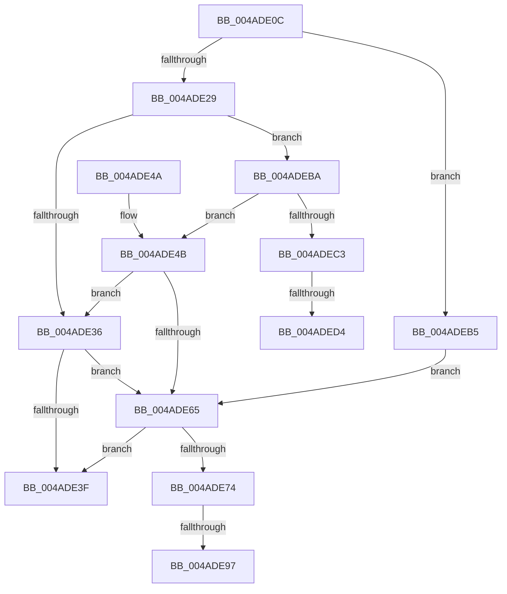

# PpmParkEvaluateRestriction

- RVA: `0x004ADE0C`–`0x004ADEE5` (길이 `217` bytes)
- VA: `0x00000001404ADE0C`
- 실행 섹션: `.text`
- PDB 이름 있음: `예`; PDB Function 태그: `예`
- unwind 정보 RVA: `0x000B84F0`
- 디코드: `53`개 명령, `217/217` bytes 표시
- 미해석 바이트: `0` (있으면 어셈블리에 `.byte`로 보존)

> 이 문서는 커널 이미지의 기계어와 PDB 기호를 분석해 생성했습니다. 4번과 5번은 함수 원형과 자료형을 바이너리 사용 방식에서 추정한 C 해석이며 원본 소스 복구 결과는 아닙니다.

## 1. Dependencies

- 직접 호출 지점: **5**; 고유 호출 대상: **4**
- 직접 호출자로 확인된 함수: **1**
- RIP 상대 이미지 참조: **1**

### Outgoing calls
- `0x004ADE56` → [KiAndAffinityExNoResult](../2C/KiAndAffinityExNoResult_function_002CF84C.md) (function, `0x002CF84C`)
- `0x004ADE6A` → [PpmEventParkNodeRestriction](../5D/PpmEventParkNodeRestriction_function_005DB0E8.md) (function, `0x005DB0E8`)
- `0x004ADE74` → [Feature_PpmParkEx__private_IsEnabledDeviceUsageNoInline](../4F/Feature_PpmParkEx__private_IsEnabledDeviceUsageNoInline_function_004F135C.md) (function, `0x004F135C`)
- `0x004ADEAA` → [KeUpdateProcessorRestrictionsEx](../5B/KeUpdateProcessorRestrictionsEx_function_005B64E8.md) (function, `0x005B64E8`)
- `0x004ADEBA` → [Feature_PpmParkEx__private_IsEnabledDeviceUsageNoInline](../4F/Feature_PpmParkEx__private_IsEnabledDeviceUsageNoInline_function_004F135C.md) (function, `0x004F135C`)

### Direct callers
- [PpmParkComputeDiff](PpmParkComputeDiff_function_004ADCAC.md) at `0x004ADD9A`

### Static image references
- `0x004ADE4F` → RVA `0x00E0B980` (`.data`; read)

## 2. Other-region calls and transfers

- 다른 실행 섹션으로 향하는 call: **0**
- call이 아닌 외부 분기/꼬리 이동: **4**
  - `0x004ADE91` → [sub_006FAB12 + 0x11](../6F/Unknown_function_006FAB12.md) (`tail-transfer`)
  - `0x004ADEB0` → [sub_006FAB12 + 0x29](../6F/Unknown_function_006FAB12.md) (`tail-transfer`)
  - `0x004ADECE` → [sub_006FAB12](../6F/Unknown_function_006FAB12.md) (`tail-transfer`)
  - `0x004ADEE0` → [sub_006FAB12 + 0x2](../6F/Unknown_function_006FAB12.md) (`tail-transfer`)

## 3. Assembly (complete function range)

```asm
004ADE0C  48 89 5C 24 10                  mov qword ptr [rsp + 0x10], rbx
004ADE11  57                              push rdi
004ADE12  48 83 EC 30                     sub rsp, 0x30
004ADE16  40 32 FF                        xor dil, dil
004ADE19  48 8B D9                        mov rbx, rcx
004ADE1C  40 38 B9 D4 04 00 00            cmp byte ptr [rcx + 0x4d4], dil
004ADE23  0F 85 8C 00 00 00               jne 0x1404adeb5
004ADE29  83 B9 D0 04 00 00 03            cmp dword ptr [rcx + 0x4d0], 3
004ADE30  0F 84 84 00 00 00               je 0x1404adeba
004ADE36  80 BB E6 04 00 00 00            cmp byte ptr [rbx + 0x4e6], 0
004ADE3D  75 26                           jne 0x1404ade65
004ADE3F  48 8B 5C 24 48                  mov rbx, qword ptr [rsp + 0x48]
004ADE44  48 83 C4 30                     add rsp, 0x30
004ADE48  5F                              pop rdi
004ADE49  C3                              ret
004ADE4A  CC                              int3
004ADE4B  48 8D 4B 30                     lea rcx, [rbx + 0x30]
004ADE4F  48 8D 15 2A DB 95 00            lea rdx, [rip + 0x95db2a]
004ADE56  E8 F1 19 E2 FF                  call 0x1402cf84c
004ADE5B  85 C0                           test eax, eax
004ADE5D  40 0F 95 C7                     setne dil
004ADE61  85 C0                           test eax, eax
004ADE63  74 D1                           je 0x1404ade36
004ADE65  48 8B D3                        mov rdx, rbx
004ADE68  33 C9                           xor ecx, ecx
004ADE6A  E8 79 D2 12 00                  call 0x1405db0e8
004ADE6F  40 84 FF                        test dil, dil
004ADE72  74 CB                           je 0x1404ade3f
004ADE74  E8 E3 34 04 00                  call 0x1404f135c
004ADE79  4C 8B 83 E8 04 00 00            mov r8, qword ptr [rbx + 0x4e8]
004ADE80  4C 8D 93 D6 04 00 00            lea r10, [rbx + 0x4d6]
004ADE87  44 0F B7 9B E4 04 00 00         movzx r11d, word ptr [rbx + 0x4e4]
004ADE8F  85 C0                           test eax, eax
004ADE91  0F 84 8C CC 24 00               je 0x1406fab23
004ADE97  0F B7 4B 06                     movzx ecx, word ptr [rbx + 6]
004ADE9B  48 8D 53 30                     lea rdx, [rbx + 0x30]
004ADE9F  4D 8B C8                        mov r9, r8
004ADEA2  4C 89 54 24 20                  mov qword ptr [rsp + 0x20], r10
004ADEA7  45 8B C3                        mov r8d, r11d
004ADEAA  E8 39 86 10 00                  call 0x1405b64e8
004ADEAF  90                              nop
004ADEB0  E9 86 CC 24 00                  jmp 0x1406fab3b
004ADEB5  40 B7 01                        mov dil, 1
004ADEB8  EB AB                           jmp 0x1404ade65
004ADEBA  E8 9D 34 04 00                  call 0x1404f135c
004ADEBF  85 C0                           test eax, eax
004ADEC1  75 88                           jne 0x1404ade4b
004ADEC3  0F B7 43 04                     movzx eax, word ptr [rbx + 4]
004ADEC7  66 3B 05 B2 DA 95 00            cmp ax, word ptr [rip + 0x95dab2]
004ADECE  0F 83 3E CC 24 00               jae 0x1406fab12
004ADED4  48 8D 15 A5 DA 95 00            lea rdx, [rip + 0x95daa5]
004ADEDB  48 8B 4C C2 08                  mov rcx, qword ptr [rdx + rax*8 + 8]
004ADEE0  E9 2F CC 24 00                  jmp 0x1406fab14
```

## 4. C-style interpretation (structured pseudocode)

```c
__int64 __fastcall PpmParkEvaluateRestriction(__int64 a1)
{
    __int64 result;
    __int64 v_rdi;
    __int64 v_rsp;
    unsigned __int64 v_stack_p10;
    unsigned __int64 v_stack_p20;

    v_stack_p10 = v_rbx;
    v_rsp = (v_rsp) - (48);
    v_rdi = 0;
    if ((*(unsigned __int8 *)(a1 + 1236)) != 0) goto loc_004ADEB5;
    if ((*(unsigned int *)(a1 + 1232)) == 3) goto loc_004ADEBA;
loc_004ADE36:
    if ((*(unsigned __int8 *)(a1 + 1254)) != 0) goto loc_004ADE65;
loc_004ADE3F:
    v_rsp = (v_rsp) + (48);
    return result;
loc_004ADE4B:
    result = KiAndAffinityExNoResult(v_stack_p10 + 48, v_rip + 9820970, a3, a4);
    v_rdi = ((unsigned int)(result) != 0) ? 1 : 0;
    if ((unsigned int)(result) == 0) goto loc_004ADE36;
loc_004ADE65:
    a1 = 0;
    result = PpmEventParkNodeRestriction(a1, v_stack_p10, a3, a4);
    if ((unsigned __int8)(v_rdi) == 0) goto loc_004ADE3F;
    result = Feature_PpmParkEx__private_IsEnabledDeviceUsageNoInline(a1, v_stack_p10, a3, a4);
    v_stack_p20 = v_stack_p10 + 1238;
    result = KeUpdateProcessorRestrictionsEx(*(unsigned __int16 *)(v_stack_p10 + 6), v_stack_p10 + 48, (unsigned int)((unsigned int)(*(unsigned __int16 *)(v_stack_p10 + 1252))), *(unsigned __int64 *)(v_stack_p10 + 1256));
loc_004ADEB5:
    goto loc_004ADE65;
loc_004ADEBA:
    result = Feature_PpmParkEx__private_IsEnabledDeviceUsageNoInline(*(unsigned __int16 *)(v_stack_p10 + 6), v_stack_p10 + 48, (unsigned int)((unsigned int)(*(unsigned __int16 *)(v_stack_p10 + 1252))), *(unsigned __int64 *)(v_stack_p10 + 1256));
    if ((unsigned int)(result) != 0) goto loc_004ADE4B;
}
```

## 5. (Beta) C Style

```c
int64_t PpmParkEvaluateRestriction(void *Arg1)
{
    uint8_t *arg1 = (uint8_t *)Arg1;

    int64_t result;
    int64_t local_rdi;
    int64_t local_rsp;
    uint64_t v_stack_p10;
    uint64_t v_stack_p20;

    v_stack_p10 = local_rbx;
    local_rsp = (local_rsp) - (48);
    local_rdi = 0;
    if ((*(uint8_t *)(arg1 + 0x4D4)) != 0) goto loc_004ADEB5;
    if ((*(uint32_t *)(arg1 + 0x4D0)) == 3) goto loc_004ADEBA;
loc_004ADE36:
    if ((*(uint8_t *)(arg1 + 0x4E6)) != 0) goto loc_004ADE65;
loc_004ADE3F:
    local_rsp = (local_rsp) + (48);
    return result;
loc_004ADE4B:
    result = KiAndAffinityExNoResult(v_stack_p10 + 48, v_rip + 9820970, a3, a4);
    local_rdi = ((uint32_t)(result) != 0) ? 1 : 0;
    if ((uint32_t)(result) == 0) goto loc_004ADE36;
loc_004ADE65:
    Arg1 = 0;
    result = PpmEventParkNodeRestriction(Arg1, v_stack_p10, a3, a4);
    if ((uint8_t)(local_rdi) == 0) goto loc_004ADE3F;
    result = Feature_PpmParkEx__private_IsEnabledDeviceUsageNoInline(Arg1, v_stack_p10, a3, a4);
    v_stack_p20 = v_stack_p10 + 1238;
    result = KeUpdateProcessorRestrictionsEx(*(uint16_t *)(v_stack_p10 + 0x6), v_stack_p10 + 48, (uint32_t)((uint32_t)(*(uint16_t *)(v_stack_p10 + 0x4E4))), *(uint64_t *)(v_stack_p10 + 0x4E8));
loc_004ADEB5:
    goto loc_004ADE65;
loc_004ADEBA:
    result = Feature_PpmParkEx__private_IsEnabledDeviceUsageNoInline(*(uint16_t *)(v_stack_p10 + 0x6), v_stack_p10 + 48, (uint32_t)((uint32_t)(*(uint16_t *)(v_stack_p10 + 0x4E4))), *(uint64_t *)(v_stack_p10 + 0x4E8));
    if ((uint32_t)(result) != 0) goto loc_004ADE4B;
}
```

### 관측된 메모리 오프셋

구조체 형식이 확인되지 않은 접근은 인자 기준의 오프셋으로만 기록했습니다.

| 기준 인자 | 오프셋 표현 | 폭 (bit) | 접근 |
|---|---:|---:|---|
| `Arg1` | `+ 0x4` | `16` | `R` |
| `Arg1` | `+ 0x6` | `16` | `R` |
| `Arg1` | `+ 0x30` | `64` | `R` |
| `Arg1` | `+ 0x4D0` | `32` | `R` |
| `Arg1` | `+ 0x4D4` | `8` | `R` |
| `Arg1` | `+ 0x4D6` | `64` | `R` |
| `Arg1` | `+ 0x4E4` | `16` | `R` |
| `Arg1` | `+ 0x4E6` | `8` | `R` |
| `Arg1` | `+ 0x4E8` | `64` | `R` |

## 6. Execution-region graph

[열기: 2D/3D 그래프와 함수 탐색 컨트롤 패널](../../../control-panel.html?section=text&rva=0x004ADE0C&view=graph)

- 2D 그래프는 위에서 아래로 흐르고, 3D 그래프는 빈 공간을 드래그해 회전합니다. Shift+드래그는 이동, 휠은 확대·축소, 함수 노드 선택은 대상 보고서 이동입니다.

### Static fallback


