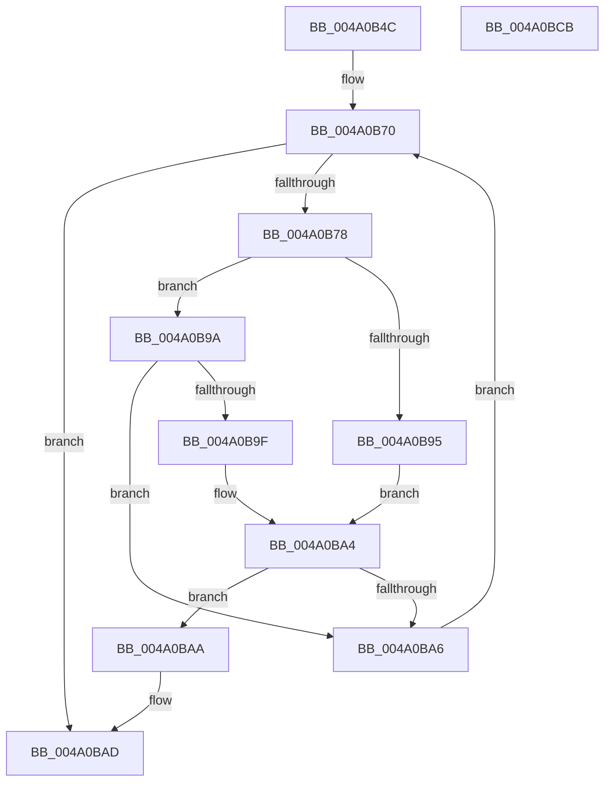

# PpmParkGetParkNode

- RVA: `0x004A0B4C`–`0x004A0BCC` (길이 `128` bytes)
- VA: `0x00000001404A0B4C`
- 실행 섹션: `.text`
- PDB 이름 있음: `예`; PDB Function 태그: `아니요`
- unwind 정보 RVA: `0x0005E6B4`
- 디코드: `38`개 명령, `128/128` bytes 표시
- 미해석 바이트: `0` (있으면 어셈블리에 `.byte`로 보존)

> 이 문서는 커널 이미지의 기계어와 PDB 기호를 분석해 생성했습니다. 4번과 5번은 함수 원형과 자료형을 바이너리 사용 방식에서 추정한 C 해석이며 원본 소스 복구 결과는 아닙니다.

## 1. Dependencies

- 직접 호출 지점: **1**; 고유 호출 대상: **1**
- 직접 호출자로 확인된 함수: **4**
- RIP 상대 이미지 참조: **2**

### Outgoing calls
- `0x004A0B88` → [Feature_PpmParkEx__private_IsEnabledDeviceUsageNoInline](../4F/Feature_PpmParkEx__private_IsEnabledDeviceUsageNoInline_function_004F135C.md) (function, `0x004F135C`)

### Direct callers
- [PopAccumulateNonDripsIdleCpuTime](PopAccumulateNonDripsIdleCpuTime_function_004A09B0.md) at `0x004A0A13`
- [PopAccumulateNonActivatedCpuTime](PopAccumulateNonActivatedCpuTime_function_004A0AA4.md) at `0x004A0ADE`
- [PpmIdleGetConcurrencyStats](../../page/A7/PpmIdleGetConcurrencyStats_function_00A798E4.md) at `0x00A79935`
- [PpmIdleGetPackageIdleIntervalStats](../../page/A7/PpmIdleGetPackageIdleIntervalStats_function_00A7EE4C.md) at `0x00A7EE86`

### Static image references
- `0x004A0B70` → RVA `0x00F083E0` (`.data`; read)
- `0x004A0B81` → RVA `0x00F083D8` (`.data`; read)

## 2. Other-region calls and transfers

- 다른 실행 섹션으로 향하는 call: **0**
- 별도 외부 분기/꼬리 이동을 확인하지 못했습니다.

## 3. Assembly (complete function range)

```asm
004A0B4C  48 8B C4                        mov rax, rsp
004A0B4F  48 89 58 08                     mov qword ptr [rax + 8], rbx
004A0B53  48 89 68 10                     mov qword ptr [rax + 0x10], rbp
004A0B57  48 89 70 18                     mov qword ptr [rax + 0x18], rsi
004A0B5B  48 89 78 20                     mov qword ptr [rax + 0x20], rdi
004A0B5F  41 56                           push r14
004A0B61  48 83 EC 20                     sub rsp, 0x20
004A0B65  33 DB                           xor ebx, ebx
004A0B67  44 0F B7 F2                     movzx r14d, dx
004A0B6B  8B F3                           mov esi, ebx
004A0B6D  0F B7 E9                        movzx ebp, cx
004A0B70  3B 35 6A 78 A6 00               cmp esi, dword ptr [rip + 0xa6786a]
004A0B76  73 35                           jae 0x1404a0bad
004A0B78  8B C6                           mov eax, esi
004A0B7A  48 69 F8 10 05 00 00            imul rdi, rax, 0x510
004A0B81  48 03 3D 50 78 A6 00            add rdi, qword ptr [rip + 0xa67850]
004A0B88  E8 CF 07 05 00                  call 0x1404f135c
004A0B8D  0F B7 4F 06                     movzx ecx, word ptr [rdi + 6]
004A0B91  85 C0                           test eax, eax
004A0B93  74 05                           je 0x1404a0b9a
004A0B95  66 3B CD                        cmp cx, bp
004A0B98  EB 0A                           jmp 0x1404a0ba4
004A0B9A  66 3B CD                        cmp cx, bp
004A0B9D  75 07                           jne 0x1404a0ba6
004A0B9F  66 44 39 77 08                  cmp word ptr [rdi + 8], r14w
004A0BA4  74 04                           je 0x1404a0baa
004A0BA6  FF C6                           inc esi
004A0BA8  EB C6                           jmp 0x1404a0b70
004A0BAA  48 8B DF                        mov rbx, rdi
004A0BAD  48 8B 6C 24 38                  mov rbp, qword ptr [rsp + 0x38]
004A0BB2  48 8B C3                        mov rax, rbx
004A0BB5  48 8B 5C 24 30                  mov rbx, qword ptr [rsp + 0x30]
004A0BBA  48 8B 74 24 40                  mov rsi, qword ptr [rsp + 0x40]
004A0BBF  48 8B 7C 24 48                  mov rdi, qword ptr [rsp + 0x48]
004A0BC4  48 83 C4 20                     add rsp, 0x20
004A0BC8  41 5E                           pop r14
004A0BCA  C3                              ret
004A0BCB  CC                              int3
```

## 4. C-style interpretation (structured pseudocode)

```c
__int64 __fastcall PpmParkGetParkNode(unsigned __int16 a1, unsigned __int16 a2)
{
    __int64 result;
    __int64 v_rbx;
    __int64 v_rdi;
    __int64 v_rsi;
    __int64 v_rsp;
    unsigned __int64 v_stack_p10;
    unsigned __int64 v_stack_p18;
    unsigned __int64 v_stack_p20;
    unsigned __int64 v_stack_p8;

    *(unsigned __int64 *)(v_rsp + 8) = v_rbx;
    *(unsigned __int64 *)(v_rsp + 16) = v_rbp;
    *(unsigned __int64 *)(v_rsp + 24) = v_rsi;
    *(unsigned __int64 *)(v_rsp + 32) = v_rdi;
    v_rsp = (v_rsp) - (32);
    v_rbx = 0;
loc_004A0B70:
    if (0 >= (*(unsigned int *)(v_rip + 10909802))) goto loc_004A0BAD;
    v_rdi = (v_rdi) * (0);
    v_rdi = (v_rdi) + (*(unsigned __int64 *)(v_rip + 10909776));
    result = Feature_PpmParkEx__private_IsEnabledDeviceUsageNoInline(a1, a2, a3, a4);
    if ((unsigned int)(result) == 0) goto loc_004A0B9A;
    goto loc_004A0BA4;
loc_004A0B9A:
    if (((unsigned __int16)(*(unsigned __int16 *)(v_rdi + 6))) != a1) goto loc_004A0BA6;
loc_004A0BA4:
    if ((*(unsigned __int16 *)(v_rdi + 8)) == a2) goto loc_004A0BAA;
loc_004A0BA6:
    v_rsi = (unsigned int)((0) + 1);
    goto loc_004A0B70;
loc_004A0BAA:
loc_004A0BAD:
    v_rsp = (v_rsp) + (32);
    return v_rdi;
}
```

## 5. (Beta) C Style

```c
int64_t PpmParkGetParkNode(uint16_t Arg1, uint16_t Arg2)
{
    int64_t result;
    int64_t local_rbx;
    int64_t local_rdi;
    int64_t local_rsi;
    int64_t local_rsp;
    uint64_t v_stack_p10;
    uint64_t v_stack_p18;
    uint64_t v_stack_p20;
    uint64_t v_stack_p8;

    *(uint64_t *)(local_rsp + 0x8) = local_rbx;
    *(uint64_t *)(local_rsp + 0x10) = local_rbp;
    *(uint64_t *)(local_rsp + 0x18) = local_rsi;
    *(uint64_t *)(local_rsp + 0x20) = local_rdi;
    local_rsp = (local_rsp) - (32);
    local_rbx = 0;
loc_004A0B70:
    if (0 >= (*(uint32_t *)(v_rip + 0xA6786A))) goto loc_004A0BAD;
    local_rdi = (local_rdi) * (0);
    local_rdi = (local_rdi) + (*(uint64_t *)(v_rip + 0xA67850));
    result = Feature_PpmParkEx__private_IsEnabledDeviceUsageNoInline(Arg1, Arg2, a3, a4);
    if ((uint32_t)(result) == 0) goto loc_004A0B9A;
    goto loc_004A0BA4;
loc_004A0B9A:
    if (((uint16_t)(*(uint16_t *)(local_rdi + 0x6))) != Arg1) goto loc_004A0BA6;
loc_004A0BA4:
    if ((*(uint16_t *)(local_rdi + 0x8)) == Arg2) goto loc_004A0BAA;
loc_004A0BA6:
    local_rsi = (uint32_t)((0) + 1);
    goto loc_004A0B70;
loc_004A0BAA:
loc_004A0BAD:
    local_rsp = (local_rsp) + (32);
    return local_rdi;
}
```

## 6. Execution-region graph

[열기: 2D/3D 그래프와 함수 탐색 컨트롤 패널](../../../control-panel.html?section=text&rva=0x004A0B4C&view=graph)

- 2D 그래프는 위에서 아래로 흐르고, 3D 그래프는 빈 공간을 드래그해 회전합니다. Shift+드래그는 이동, 휠은 확대·축소, 함수 노드 선택은 대상 보고서 이동입니다.

### Static fallback


