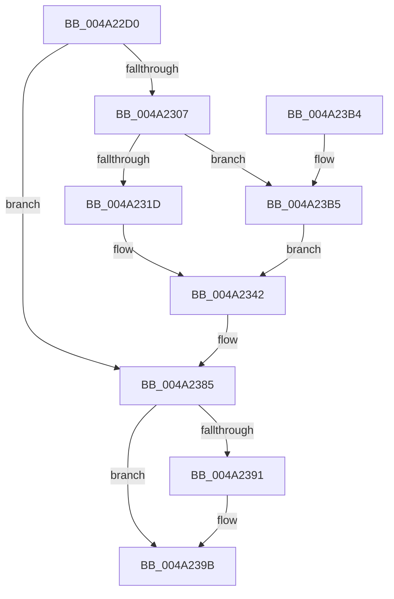

# PpmTracePerfIdleRundown

- RVA: `0x004A22D0`–`0x004A23C0` (길이 `240` bytes)
- VA: `0x00000001404A22D0`
- 실행 섹션: `.text`
- PDB 이름 있음: `예`; PDB Function 태그: `아니요`
- unwind 정보 RVA: `0x000B5E54`
- 디코드: `63`개 명령, `240/240` bytes 표시
- 미해석 바이트: `0` (있으면 어셈블리에 `.byte`로 보존)

> 이 문서는 커널 이미지의 기계어와 PDB 기호를 분석해 생성했습니다. 4번과 5번은 함수 원형과 자료형을 바이너리 사용 방식에서 추정한 C 해석이며 원본 소스 복구 결과는 아닙니다.

## 1. Dependencies

- 직접 호출 지점: **3**; 고유 호출 대상: **3**
- 직접 호출자로 확인된 함수: **0**
- RIP 상대 이미지 참조: **1**

### Outgoing calls
- `0x004A2380` → [EtwTraceKernelEvent](../23/EtwTraceKernelEvent_function_00235350.md) (function, `0x00235350`)
- `0x004A2396` → [PpmEventIdleStateChange](PpmEventIdleStateChange_function_004A23C8.md) (function, `0x004A23C8`)
- `0x004A23A4` → [_security_check_cookie](../6A/_security_check_cookie_function_006AC640.md) (function, `0x006AC640`)

### Direct callers
- 이 함수 시작 RVA로 연결되는 직접 call은 확인되지 않았습니다. 간접 호출은 완전히 역산할 수 없습니다.

### Static image references
- `0x004A22DD` → RVA `0x00E0A740` (`.data`; read)

## 2. Other-region calls and transfers

- 다른 실행 섹션으로 향하는 call: **0**
- 별도 외부 분기/꼬리 이동을 확인하지 못했습니다.

## 3. Assembly (complete function range)

```asm
004A22D0  48 89 5C 24 10                  mov qword ptr [rsp + 0x10], rbx
004A22D5  55                              push rbp
004A22D6  48 8B EC                        mov rbp, rsp
004A22D9  48 83 EC 60                     sub rsp, 0x60
004A22DD  48 8B 05 5C 84 96 00            mov rax, qword ptr [rip + 0x96845c]
004A22E4  48 33 C4                        xor rax, rsp
004A22E7  48 89 45 F8                     mov qword ptr [rbp - 8], rax
004A22EB  4C 8B 81 B0 89 00 00            mov r8, qword ptr [rcx + 0x89b0]
004A22F2  33 C0                           xor eax, eax
004A22F4  48 89 45 E0                     mov qword ptr [rbp - 0x20], rax
004A22F8  0F 57 C0                        xorps xmm0, xmm0
004A22FB  48 8B D9                        mov rbx, rcx
004A22FE  0F 11 45 D0                     movups xmmword ptr [rbp - 0x30], xmm0
004A2302  4D 85 C0                        test r8, r8
004A2305  74 7E                           je 0x1404a2385
004A2307  21 45 D4                        and dword ptr [rbp - 0x2c], eax
004A230A  21 45 DC                        and dword ptr [rbp - 0x24], eax
004A230D  48 8B 91 B8 89 00 00            mov rdx, qword ptr [rcx + 0x89b8]
004A2314  48 85 D2                        test rdx, rdx
004A2317  0F 84 98 00 00 00               je 0x1404a23b5
004A231D  8B 4A 50                        mov ecx, dword ptr [rdx + 0x50]
004A2320  41 8B 80 10 02 00 00            mov eax, dword ptr [r8 + 0x210]
004A2327  3B C8                           cmp ecx, eax
004A2329  8B 52 54                        mov edx, dword ptr [rdx + 0x54]
004A232C  0F 43 C8                        cmovae ecx, eax
004A232F  89 55 D4                        mov dword ptr [rbp - 0x2c], edx
004A2332  41 3B 88 C8 01 00 00            cmp ecx, dword ptr [r8 + 0x1c8]
004A2339  1B C0                           sbb eax, eax
004A233B  F7 D8                           neg eax
004A233D  FF C0                           inc eax
004A233F  89 45 D0                        mov dword ptr [rbp - 0x30], eax
004A2342  48 8B 83 C8 00 00 00            mov rax, qword ptr [rbx + 0xc8]
004A2349  48 8D 4D E8                     lea rcx, [rbp - 0x18]
004A234D  83 65 F4 00                     and dword ptr [rbp - 0xc], 0
004A2351  41 B9 33 12 00 00               mov r9d, 0x1233
004A2357  48 89 45 E0                     mov qword ptr [rbp - 0x20], rax
004A235B  41 B8 00 80 00 80               mov r8d, 0x80008000
004A2361  48 8D 45 D0                     lea rax, [rbp - 0x30]
004A2365  89 55 D8                        mov dword ptr [rbp - 0x28], edx
004A2368  BA 01 00 00 00                  mov edx, 1
004A236D  48 89 45 E8                     mov qword ptr [rbp - 0x18], rax
004A2371  C7 45 F0 18 00 00 00            mov dword ptr [rbp - 0x10], 0x18
004A2378  C7 44 24 20 02 18 50 00         mov dword ptr [rsp + 0x20], 0x501802
004A2380  E8 CB 2F D9 FF                  call 0x140235350
004A2385  48 8B 8B 40 88 00 00            mov rcx, qword ptr [rbx + 0x8840]
004A238C  48 85 C9                        test rcx, rcx
004A238F  74 0A                           je 0x1404a239b
004A2391  8B 49 18                        mov ecx, dword ptr [rcx + 0x18]
004A2394  8B D1                           mov edx, ecx
004A2396  E8 2D 00 00 00                  call 0x1404a23c8
004A239B  33 C0                           xor eax, eax
004A239D  48 8B 4D F8                     mov rcx, qword ptr [rbp - 8]
004A23A1  48 33 CC                        xor rcx, rsp
004A23A4  E8 97 A2 20 00                  call 0x1406ac640
004A23A9  48 8B 5C 24 78                  mov rbx, qword ptr [rsp + 0x78]
004A23AE  48 83 C4 60                     add rsp, 0x60
004A23B2  5D                              pop rbp
004A23B3  C3                              ret
004A23B4  CC                              int3
004A23B5  8B 51 44                        mov edx, dword ptr [rcx + 0x44]
004A23B8  21 45 D0                        and dword ptr [rbp - 0x30], eax
004A23BB  89 55 D4                        mov dword ptr [rbp - 0x2c], edx
004A23BE  EB 82                           jmp 0x1404a2342
```

## 4. C-style interpretation (structured pseudocode)

```c
__int64 __fastcall PpmTracePerfIdleRundown(__int64 a1)
{
    __int64 result;
    __int64 v_rsp;
    unsigned __int64 v_stack_m10;
    unsigned int v_stack_m14;
    unsigned int v_stack_m18;
    unsigned __int64 v_stack_m20;
    unsigned __int64 v_stack_m28;
    unsigned int v_stack_m2C;
    unsigned int v_stack_m30;
    unsigned int v_stack_m34;
    unsigned __int64 v_stack_m38;
    unsigned int v_stack_m48;
    unsigned __int64 v_stack_p10;

    v_stack_p10 = v_rbx;
    v_rsp = (v_rsp) - (96);
    result = (*(unsigned __int64 *)(v_rip + 9864284)) ^ (v_rsp);
    v_stack_m10 = result;
    result = 0;
    v_stack_m28 = 0;
    v_stack_m38 = v_xmm0;
    if (*(unsigned __int64 *)(a1 + 35248) == 0) goto loc_004A2385;
    if (*(unsigned __int64 *)(a1 + 35256) == 0) goto loc_004A23B5;
    a1 = (unsigned int)(*(unsigned int *)(*(unsigned __int64 *)(a1 + 35256) + 80));
    if (((unsigned int)((unsigned int)(*(unsigned int *)(*(unsigned __int64 *)(a1 + 35256) + 80)))) >= ((unsigned int)((unsigned int)(*(unsigned int *)(*(unsigned __int64 *)(a1 + 35248) + 528))))) { a1 = (unsigned int)((unsigned int)(*(unsigned int *)(*(unsigned __int64 *)(a1 + 35248) + 528))); }
    v_stack_m34 = (unsigned int)((unsigned int)(*(unsigned int *)(*(unsigned __int64 *)(a1 + 35256) + 84)));
    result = (unsigned int)(-((unsigned int)(*(unsigned int *)(*(unsigned __int64 *)(a1 + 35248) + 528))));
    result = (unsigned int)((result) + 1);
    v_stack_m38 = (unsigned int)(result);
loc_004A2342:
    v_stack_m28 = *(unsigned __int64 *)(a1 + 200);
    v_stack_m30 = (unsigned int)((unsigned int)(*(unsigned int *)(*(unsigned __int64 *)(a1 + 35256) + 84)));
    v_stack_m20 = v_stack_m38;
    v_stack_m18 = 24;
    v_stack_m48 = 0x501802ULL;
    result = EtwTraceKernelEvent(v_stack_m20, 1, (unsigned int)(0x80008000ULL), (unsigned int)(0x1233ULL));
loc_004A2385:
    if (*(unsigned __int64 *)(a1 + 34880) != 0) {
        a1 = *(unsigned int *)(*(unsigned __int64 *)(a1 + 34880) + 24);
        a2 = (unsigned int)(a1);
        result = PpmEventIdleStateChange(a1, a2, (unsigned int)(0x80008000ULL), (unsigned int)(0x1233ULL));
    }
    result = 0;
    a1 = (v_stack_m10) ^ (v_rsp);
    result = _security_check_cookie(a1, a2, (unsigned int)(0x80008000ULL), (unsigned int)(0x1233ULL));
    v_rsp = (v_rsp) + (96);
    return result;
loc_004A23B5:
    v_stack_m34 = (unsigned int)((unsigned int)(*(unsigned int *)(a1 + 68)));
    goto loc_004A2342;
}
```

## 5. (Beta) C Style

```c
int64_t PpmTracePerfIdleRundown(void *Arg1)
{
    uint8_t *arg1 = (uint8_t *)Arg1;

    int64_t result;
    int64_t local_rsp;
    uint64_t v_stack_m10;
    uint32_t v_stack_m14;
    uint32_t v_stack_m18;
    uint64_t v_stack_m20;
    uint64_t v_stack_m28;
    uint32_t v_stack_m2C;
    uint32_t v_stack_m30;
    uint32_t v_stack_m34;
    uint64_t v_stack_m38;
    uint32_t v_stack_m48;
    uint64_t v_stack_p10;

    v_stack_p10 = local_rbx;
    local_rsp = (local_rsp) - (96);
    result = (*(uint64_t *)(v_rip + 0x96845C)) ^ (local_rsp);
    v_stack_m10 = result;
    result = 0;
    v_stack_m28 = 0;
    v_stack_m38 = v_xmm0;
    if (*(uint64_t *)(arg1 + 0x89B0) == 0) goto loc_004A2385;
    if (*(uint64_t *)(arg1 + 0x89B8) == 0) goto loc_004A23B5;
    Arg1 = (uint32_t)(*(uint32_t *)(*(uint64_t *)(arg1 + 0x89B8) + 0x50));
    if (((uint32_t)((uint32_t)(*(uint32_t *)(*(uint64_t *)(arg1 + 0x89B8) + 0x50)))) >= ((uint32_t)((uint32_t)(*(uint32_t *)(*(uint64_t *)(arg1 + 0x89B0) + 0x210))))) { Arg1 = (uint32_t)((uint32_t)(*(uint32_t *)(*(uint64_t *)(arg1 + 0x89B0) + 0x210))); }
    v_stack_m34 = (uint32_t)((uint32_t)(*(uint32_t *)(*(uint64_t *)(arg1 + 0x89B8) + 0x54)));
    result = (uint32_t)(-((uint32_t)(*(uint32_t *)(*(uint64_t *)(arg1 + 0x89B0) + 0x210))));
    result = (uint32_t)((result) + 1);
    v_stack_m38 = (uint32_t)(result);
loc_004A2342:
    v_stack_m28 = *(uint64_t *)(arg1 + 0xC8);
    v_stack_m30 = (uint32_t)((uint32_t)(*(uint32_t *)(*(uint64_t *)(arg1 + 0x89B8) + 0x54)));
    v_stack_m20 = v_stack_m38;
    v_stack_m18 = 24;
    v_stack_m48 = 0x501802ULL;
    result = EtwTraceKernelEvent(v_stack_m20, 1, (uint32_t)(0x80008000ULL), (uint32_t)(0x1233ULL));
loc_004A2385:
    if (*(uint64_t *)(arg1 + 0x8840) != 0) {
        Arg1 = *(uint32_t *)(*(uint64_t *)(arg1 + 0x8840) + 0x18);
        a2 = (uint32_t)(Arg1);
        result = PpmEventIdleStateChange(Arg1, a2, (uint32_t)(0x80008000ULL), (uint32_t)(0x1233ULL));
    }
    result = 0;
    Arg1 = (v_stack_m10) ^ (local_rsp);
    result = _security_check_cookie(Arg1, a2, (uint32_t)(0x80008000ULL), (uint32_t)(0x1233ULL));
    local_rsp = (local_rsp) + (96);
    return result;
loc_004A23B5:
    v_stack_m34 = (uint32_t)((uint32_t)(*(uint32_t *)(arg1 + 0x44)));
    goto loc_004A2342;
}
```

### 관측된 메모리 오프셋

구조체 형식이 확인되지 않은 접근은 인자 기준의 오프셋으로만 기록했습니다.

| 기준 인자 | 오프셋 표현 | 폭 (bit) | 접근 |
|---|---:|---:|---|
| `Arg1` | `+ 0x44` | `32` | `R` |
| `Arg1` | `+ 0xC8` | `64` | `R` |
| `Arg1` | `+ 0x8840` | `64` | `R` |
| `Arg1` | `+ 0x89B0` | `64` | `R` |
| `Arg1` | `+ 0x89B8` | `64` | `R` |

## 6. Execution-region graph

[열기: 2D/3D 그래프와 함수 탐색 컨트롤 패널](../../../control-panel.html?section=text&rva=0x004A22D0&view=graph)

- 2D 그래프는 위에서 아래로 흐르고, 3D 그래프는 빈 공간을 드래그해 회전합니다. Shift+드래그는 이동, 휠은 확대·축소, 함수 노드 선택은 대상 보고서 이동입니다.

### Static fallback


