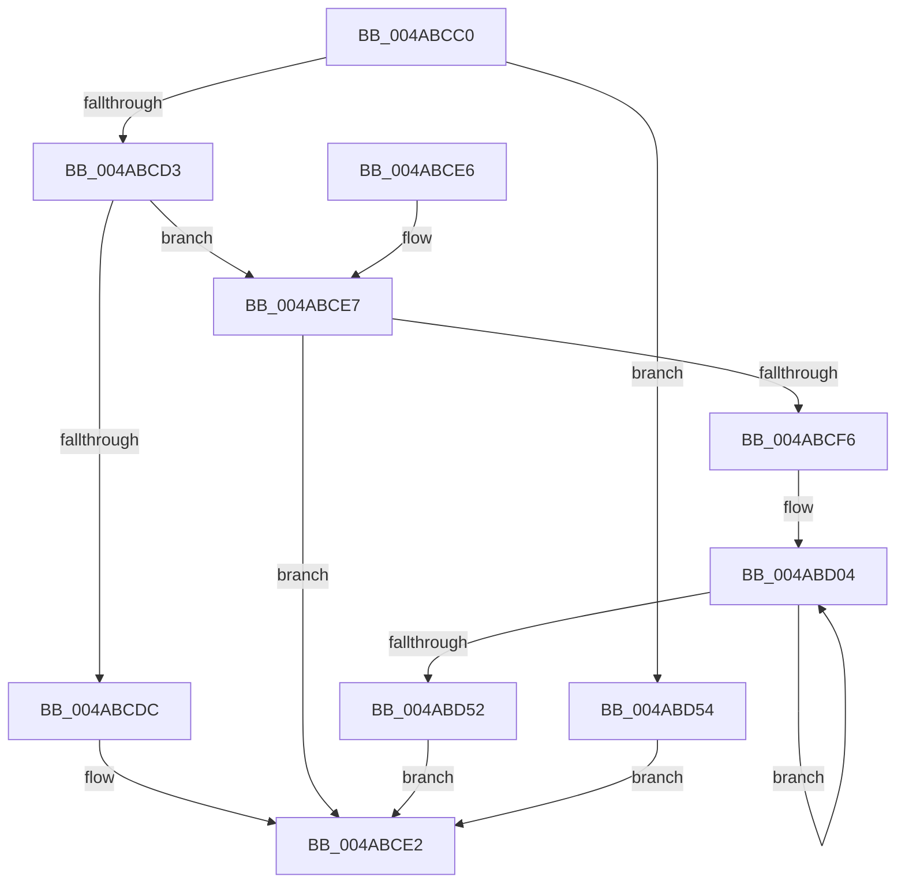

# PpmUpdateIdleStatesInplace

- RVA: `0x004ABCC0`–`0x004ABD5C` (길이 `156` bytes)
- VA: `0x00000001404ABCC0`
- 실행 섹션: `.text`
- PDB 이름 있음: `예`; PDB Function 태그: `아니요`
- unwind 정보 RVA: `0x000DB714`
- 디코드: `41`개 명령, `156/156` bytes 표시
- 미해석 바이트: `0` (있으면 어셈블리에 `.byte`로 보존)

> 이 문서는 커널 이미지의 기계어와 PDB 기호를 분석해 생성했습니다. 4번과 5번은 함수 원형과 자료형을 바이너리 사용 방식에서 추정한 C 해석이며 원본 소스 복구 결과는 아닙니다.

## 1. Dependencies

- 직접 호출 지점: **0**; 고유 호출 대상: **0**
- 직접 호출자로 확인된 함수: **0**
- RIP 상대 이미지 참조: **0**

### Outgoing calls
- 직접 디코드된 call 명령이 없습니다.

### Direct callers
- 이 함수 시작 RVA로 연결되는 직접 call은 확인되지 않았습니다. 간접 호출은 완전히 역산할 수 없습니다.

### Static image references
- 디코드된 RIP-relative 메모리 참조가 없습니다.

## 2. Other-region calls and transfers

- 다른 실행 섹션으로 향하는 call: **0**
- 별도 외부 분기/꼬리 이동을 확인하지 못했습니다.

## 3. Assembly (complete function range)

```asm
004ABCC0  4C 8B 89 40 88 00 00            mov r9, qword ptr [rcx + 0x8840]
004ABCC7  45 33 C0                        xor r8d, r8d
004ABCCA  4D 85 C9                        test r9, r9
004ABCCD  0F 84 81 00 00 00               je 0x1404abd54
004ABCD3  8B 4A 60                        mov ecx, dword ptr [rdx + 0x60]
004ABCD6  41 3B 49 28                     cmp ecx, dword ptr [r9 + 0x28]
004ABCDA  74 0B                           je 0x1404abce7
004ABCDC  41 B8 0D 00 00 C0               mov r8d, 0xc000000d
004ABCE2  41 8B C0                        mov eax, r8d
004ABCE5  C3                              ret
004ABCE6  CC                              int3
004ABCE7  48 8B 42 08                     mov rax, qword ptr [rdx + 8]
004ABCEB  49 89 81 98 02 00 00            mov qword ptr [r9 + 0x298], rax
004ABCF2  85 C9                           test ecx, ecx
004ABCF4  74 EC                           je 0x1404abce2
004ABCF6  49 81 C1 38 05 00 00            add r9, 0x538
004ABCFD  4C 8B D1                        mov r10, rcx
004ABD00  48 83 C2 68                     add rdx, 0x68
004ABD04  8B 02                           mov eax, dword ptr [rdx]
004ABD06  C1 E8 1E                        shr eax, 0x1e
004ABD09  24 01                           and al, 1
004ABD0B  41 88 41 3F                     mov byte ptr [r9 + 0x3f], al
004ABD0F  8B 42 04                        mov eax, dword ptr [rdx + 4]
004ABD12  41 89 01                        mov dword ptr [r9], eax
004ABD15  4D 8D 89 58 01 00 00            lea r9, [r9 + 0x158]
004ABD1C  8B 42 0C                        mov eax, dword ptr [rdx + 0xc]
004ABD1F  41 89 81 B0 FE FF FF            mov dword ptr [r9 - 0x150], eax
004ABD26  8B 42 08                        mov eax, dword ptr [rdx + 8]
004ABD29  41 89 81 AC FE FF FF            mov dword ptr [r9 - 0x154], eax
004ABD30  8B 0A                           mov ecx, dword ptr [rdx]
004ABD32  C1 E9 1F                        shr ecx, 0x1f
004ABD35  41 88 89 E1 FE FF FF            mov byte ptr [r9 - 0x11f], cl
004ABD3C  8B 0A                           mov ecx, dword ptr [rdx]
004ABD3E  48 8D 52 20                     lea rdx, [rdx + 0x20]
004ABD42  C1 E9 1F                        shr ecx, 0x1f
004ABD45  41 89 89 B4 FE FF FF            mov dword ptr [r9 - 0x14c], ecx
004ABD4C  49 83 EA 01                     sub r10, 1
004ABD50  75 B2                           jne 0x1404abd04
004ABD52  EB 8E                           jmp 0x1404abce2
004ABD54  41 B8 BB 00 00 C0               mov r8d, 0xc00000bb
004ABD5A  EB 86                           jmp 0x1404abce2
```

## 4. C-style interpretation (structured pseudocode)

```c
__int64 __fastcall PpmUpdateIdleStatesInplace(__int64 a1, __int64 a2, int a3)
{
    __int64 result;
    __int64 v_r10;

    a3 = 0;
    if (*(unsigned __int64 *)(a1 + 34880) == 0) goto loc_004ABD54;
    if (((unsigned int)((unsigned int)(*(unsigned int *)(a2 + 96)))) == (*(unsigned int *)(*(unsigned __int64 *)(a1 + 34880) + 40))) goto loc_004ABCE7;
loc_004ABCE2:
    return (unsigned int)((unsigned int)((unsigned int)(0xC000000DULL)));
loc_004ABCE7:
    *(unsigned __int64 *)(*(unsigned __int64 *)(a1 + 34880) + 664) = *(unsigned __int64 *)(a2 + 8);
    if ((unsigned int)((unsigned int)(*(unsigned int *)(a2 + 96))) == 0) goto loc_004ABCE2;
    a4 = (*(unsigned __int64 *)(a1 + 34880)) + (0x538ULL);
    a2 = (a2) + (104);
loc_004ABD04:
    result = (unsigned int)(((unsigned int)(*(unsigned int *)(a2))) >> (30));
    result = (unsigned __int8)((result) & (1));
    *(unsigned __int8 *)(a4 + 63) = (unsigned __int8)(result);
    *(unsigned int *)(a4) = (unsigned int)((unsigned int)(*(unsigned int *)(a2 + 4)));
    *(unsigned int *)(a4 + 344 - 336) = (unsigned int)((unsigned int)(*(unsigned int *)(a2 + 12)));
    *(unsigned int *)(a4 + 344 - 340) = (unsigned int)((unsigned int)(*(unsigned int *)(a2 + 8)));
    a1 = (unsigned int)(((unsigned int)(*(unsigned int *)(a2))) >> (31));
    *(unsigned __int8 *)(a4 + 344 - 287) = (unsigned __int8)(a1);
    a1 = (unsigned int)(((unsigned int)(*(unsigned int *)(a2))) >> (31));
    *(unsigned int *)(a4 + 344 - 332) = (unsigned int)(a1);
    v_r10 = ((unsigned int)(*(unsigned int *)(a2 + 96))) - (1);
    if (condition_is_not_equal) goto loc_004ABD04;
    goto loc_004ABCE2;
loc_004ABD54:
    goto loc_004ABCE2;
}
```

## 5. (Beta) C Style

```c
int64_t PpmUpdateIdleStatesInplace(void *Arg1, void *Arg2, int32_t Arg3)
{
    uint8_t *arg1 = (uint8_t *)Arg1;
    uint8_t *arg2 = (uint8_t *)Arg2;

    int64_t result;
    int64_t local_r10;

    Arg3 = 0;
    if (*(uint64_t *)(arg1 + 0x8840) == 0) goto loc_004ABD54;
    if (((uint32_t)((uint32_t)(*(uint32_t *)(arg2 + 0x60)))) == (*(uint32_t *)(*(uint64_t *)(arg1 + 0x8840) + 0x28))) goto loc_004ABCE7;
loc_004ABCE2:
    return (uint32_t)((uint32_t)((uint32_t)(0xC000000DULL)));
loc_004ABCE7:
    *(uint64_t *)(*(uint64_t *)(arg1 + 0x8840) + 0x298) = *(uint64_t *)(arg2 + 0x8);
    if ((uint32_t)((uint32_t)(*(uint32_t *)(arg2 + 0x60))) == 0) goto loc_004ABCE2;
    a4 = (*(uint64_t *)(arg1 + 0x8840)) + (0x538ULL);
    Arg2 = (Arg2) + (104);
loc_004ABD04:
    result = (uint32_t)(((uint32_t)(*(uint32_t *)(arg2))) >> (30));
    result = (uint8_t)((result) & (1));
    *(uint8_t *)(a4 + 0x3F) = (uint8_t)(result);
    *(uint32_t *)(a4) = (uint32_t)((uint32_t)(*(uint32_t *)(arg2 + 0x4)));
    *(uint32_t *)(a4 + 0x158 - 0x150) = (uint32_t)((uint32_t)(*(uint32_t *)(arg2 + 0xC)));
    *(uint32_t *)(a4 + 0x158 - 0x154) = (uint32_t)((uint32_t)(*(uint32_t *)(arg2 + 0x8)));
    Arg1 = (uint32_t)(((uint32_t)(*(uint32_t *)(arg2))) >> (31));
    *(uint8_t *)(a4 + 0x158 - 0x11F) = (uint8_t)(Arg1);
    Arg1 = (uint32_t)(((uint32_t)(*(uint32_t *)(arg2))) >> (31));
    *(uint32_t *)(a4 + 0x158 - 0x14C) = (uint32_t)(Arg1);
    local_r10 = ((uint32_t)(*(uint32_t *)(arg2 + 0x60))) - (1);
    if (condition_is_not_equal) goto loc_004ABD04;
    goto loc_004ABCE2;
loc_004ABD54:
    goto loc_004ABCE2;
}
```

### 관측된 메모리 오프셋

구조체 형식이 확인되지 않은 접근은 인자 기준의 오프셋으로만 기록했습니다.

| 기준 인자 | 오프셋 표현 | 폭 (bit) | 접근 |
|---|---:|---:|---|
| `Arg1` | `+ 0x8840` | `64` | `R` |
| `Arg2` | `+ 0x0` | `32` | `R` |
| `Arg2` | `+ 0x4` | `32` | `R` |
| `Arg2` | `+ 0x8` | `32` | `R` |
| `Arg2` | `+ 0x8` | `64` | `R` |
| `Arg2` | `+ 0xC` | `32` | `R` |
| `Arg2` | `+ 0x20` | `64` | `R` |
| `Arg2` | `+ 0x60` | `32` | `R` |

## 6. Execution-region graph

[열기: 2D/3D 그래프와 함수 탐색 컨트롤 패널](../../../control-panel.html?section=text&rva=0x004ABCC0&view=graph)

- 2D 그래프는 위에서 아래로 흐르고, 3D 그래프는 빈 공간을 드래그해 회전합니다. Shift+드래그는 이동, 휠은 확대·축소, 함수 노드 선택은 대상 보고서 이동입니다.

### Static fallback


