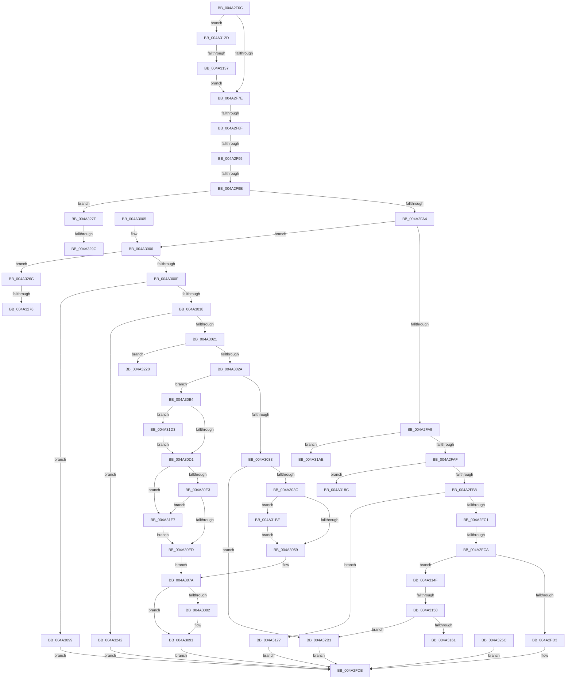

# PsDispatchIumService

- RVA: `0x004A2F0C`–`0x004A32CC` (길이 `960` bytes)
- VA: `0x00000001404A2F0C`
- 실행 섹션: `.text`
- PDB 이름 있음: `예`; PDB Function 태그: `예`
- unwind 정보 RVA: `0x000B6150`
- 디코드: `207`개 명령, `960/960` bytes 표시
- 미해석 바이트: `0` (있으면 어셈블리에 `.byte`로 보존)

> 이 문서는 커널 이미지의 기계어와 PDB 기호를 분석해 생성했습니다. 4번과 5번은 함수 원형과 자료형을 바이너리 사용 방식에서 추정한 C 해석이며 원본 소스 복구 결과는 아닙니다.

## 1. Dependencies

- 직접 호출 지점: **17**; 고유 호출 대상: **14**
- 직접 호출자로 확인된 함수: **1**
- RIP 상대 이미지 참조: **1**

### Outgoing calls
- `0x004A2FD6` → [PspIumResolveVirtualFault](../../page/9F/PspIumResolveVirtualFault_function_009FF5E4.md) (function, `0x009FF5E4`)
- `0x004A2FE6` → [_security_check_cookie](../6A/_security_check_cookie_function_006AC640.md) (function, `0x006AC640`)
- `0x004A3075` → [MmFreeVirtualMemory](../../page/87/MmFreeVirtualMemory_function_0087FED0.md) (function, `0x0087FED0`)
- `0x004A308C` → [KiUnstackDetachProcess](../21/KiUnstackDetachProcess_function_00217D30.md) (function, `0x00217D30`)
- `0x004A30AA` → [KeLeaveCriticalRegion](../25/KeLeaveCriticalRegion_function_0025D8B0.md) (function, `0x0025D8B0`)
- `0x004A3123` → [MmAllocateVirtualMemory](../../page/9A/MmAllocateVirtualMemory_function_009A1A40.md) (function, `0x009A1A40`)
- `0x004A3145` → [PspTerminateThreadByPointer](../../page/90/PspTerminateThreadByPointer_function_00905E80.md) (function, `0x00905E80`)
- `0x004A316C` → [DbgkForwardException](../../page/8A/DbgkForwardException_function_008A2D60.md) (function, `0x008A2D60`)
- `0x004A3182` → [PspIumFreePhysicalPages](../3E/PspIumFreePhysicalPages_function_003E7874.md) (function, `0x003E7874`)
- `0x004A31A3` → [PspIumAllocatePhysicalPages](../5E/PspIumAllocatePhysicalPages_function_005E4574.md) (function, `0x005E4574`)
- `0x004A31B4` → [KeAlertThreadByThreadIdEx](../39/KeAlertThreadByThreadIdEx_function_003984BC.md) (function, `0x003984BC`)
- `0x004A31C9` → [KiStackAttachProcess](../21/KiStackAttachProcess_function_00216820.md) (function, `0x00216820`)
- `0x004A31DD` → [KiStackAttachProcess](../21/KiStackAttachProcess_function_00216820.md) (function, `0x00216820`)
- `0x004A3237` → [MmGetSectionStrongImageReference](../../page/70/MmGetSectionStrongImageReference_function_00701DF0.md) (function, `0x00701DF0`)
- `0x004A324E` → [memcpy](../6C/memcpy_function_006C6840.md) (function, `0x006C6840`)
- `0x004A32A6` → [KiStackAttachProcess](../21/KiStackAttachProcess_function_00216820.md) (function, `0x00216820`)
- `0x004A32C2` → [PspTerminateThreadByPointer](../../page/90/PspTerminateThreadByPointer_function_00905E80.md) (function, `0x00905E80`)

### Direct callers
- [sub_002360DC](../23/Unknown_function_002360DC.md) at `0x002361C0`

### Static image references
- `0x004A2F24` → RVA `0x00E0A740` (`.data`; read)

## 2. Other-region calls and transfers

- 다른 실행 섹션으로 향하는 call: **7**
  - `0x004A2FD6` → [PspIumResolveVirtualFault](../../page/9F/PspIumResolveVirtualFault_function_009FF5E4.md) (`.text` → `PAGE`)
  - `0x004A3075` → [MmFreeVirtualMemory](../../page/87/MmFreeVirtualMemory_function_0087FED0.md) (`.text` → `PAGE`)
  - `0x004A3123` → [MmAllocateVirtualMemory](../../page/9A/MmAllocateVirtualMemory_function_009A1A40.md) (`.text` → `PAGE`)
  - `0x004A3145` → [PspTerminateThreadByPointer](../../page/90/PspTerminateThreadByPointer_function_00905E80.md) (`.text` → `PAGE`)
  - `0x004A316C` → [DbgkForwardException](../../page/8A/DbgkForwardException_function_008A2D60.md) (`.text` → `PAGE`)
  - `0x004A3237` → [MmGetSectionStrongImageReference](../../page/70/MmGetSectionStrongImageReference_function_00701DF0.md) (`.text` → `PAGE`)
  - `0x004A32C2` → [PspTerminateThreadByPointer](../../page/90/PspTerminateThreadByPointer_function_00905E80.md) (`.text` → `PAGE`)
- call이 아닌 외부 분기/꼬리 이동: **14**
  - `0x004A2F89` → [sub_006F88AE + 0x3B4](../6F/Unknown_function_006F88AE.md) (`tail-transfer`)
  - `0x004A2F8F` → [sub_006F88AE + 0x337](../6F/Unknown_function_006F88AE.md) (`tail-transfer`)
  - `0x004A2F98` → [sub_006F88AE + 0x152](../6F/Unknown_function_006F88AE.md) (`tail-transfer`)
  - `0x004A2FC4` → [sub_006F88AE + 0x49](../6F/Unknown_function_006F88AE.md) (`tail-transfer`)
  - `0x004A3131` → [sub_006F88AE](../6F/Unknown_function_006F88AE.md) (`tail-transfer`)
  - `0x004A3152` → [sub_006F88AE + 0x3B](../6F/Unknown_function_006F88AE.md) (`tail-transfer`)
  - `0x004A3172` → [sub_006F88AE + 0x1E](../6F/Unknown_function_006F88AE.md) (`tail-transfer`)
  - `0x004A31A9` → [sub_006F88AE + 0x7B8](../6F/Unknown_function_006F88AE.md) (`tail-transfer`)
  - `0x004A31BA` → [sub_006F88AE + 0x1E](../6F/Unknown_function_006F88AE.md) (`tail-transfer`)
  - `0x004A323D` → [sub_006F88AE + 0x7B8](../6F/Unknown_function_006F88AE.md) (`tail-transfer`)
  - `0x004A3270` → [sub_006F88AE + 0xFC](../6F/Unknown_function_006F88AE.md) (`tail-transfer`)
  - `0x004A327A` → [sub_006F88AE + 0xFC](../6F/Unknown_function_006F88AE.md) (`tail-transfer`)
  - `0x004A3296` → [sub_006F88AE + 0x10F](../6F/Unknown_function_006F88AE.md) (`tail-transfer`)
  - `0x004A32AC` → [sub_006F88AE + 0x10F](../6F/Unknown_function_006F88AE.md) (`tail-transfer`)

## 3. Assembly (complete function range)

```asm
004A2F0C  4C 8B DC                        mov r11, rsp
004A2F0F  49 89 5B 10                     mov qword ptr [r11 + 0x10], rbx
004A2F13  49 89 73 18                     mov qword ptr [r11 + 0x18], rsi
004A2F17  49 89 7B 20                     mov qword ptr [r11 + 0x20], rdi
004A2F1B  41 56                           push r14
004A2F1D  48 81 EC 50 02 00 00            sub rsp, 0x250
004A2F24  48 8B 05 15 78 96 00            mov rax, qword ptr [rip + 0x967815]
004A2F2B  48 33 C4                        xor rax, rsp
004A2F2E  48 89 84 24 40 02 00 00         mov qword ptr [rsp + 0x240], rax
004A2F36  48 8B F9                        mov rdi, rcx
004A2F39  48 89 4C 24 68                  mov qword ptr [rsp + 0x68], rcx
004A2F3E  0F 57 C0                        xorps xmm0, xmm0
004A2F41  0F 11 84 24 98 00 00 00         movups xmmword ptr [rsp + 0x98], xmm0
004A2F49  0F 11 84 24 A8 00 00 00         movups xmmword ptr [rsp + 0xa8], xmm0
004A2F51  0F 11 84 24 B8 00 00 00         movups xmmword ptr [rsp + 0xb8], xmm0
004A2F59  0F 11 44 24 70                  movups xmmword ptr [rsp + 0x70], xmm0
004A2F5E  0F 57 C9                        xorps xmm1, xmm1
004A2F61  33 C0                           xor eax, eax
004A2F63  0F 11 8C 24 80 00 00 00         movups xmmword ptr [rsp + 0x80], xmm1
004A2F6B  49 89 83 38 FE FF FF            mov qword ptr [r11 - 0x1c8], rax
004A2F72  33 F6                           xor esi, esi
004A2F74  80 79 01 05                     cmp byte ptr [rcx + 1], 5
004A2F78  0F 84 AF 01 00 00               je 0x1404a312d
004A2F7E  48 83 CB FF                     or rbx, 0xffffffffffffffff
004A2F82  0F B7 4F 02                     movzx ecx, word ptr [rdi + 2]
004A2F86  83 F9 1B                        cmp ecx, 0x1b
004A2F89  0F 87 D3 5C 25 00               ja 0x1406f8c62
004A2F8F  0F 84 50 5C 25 00               je 0x1406f8be5
004A2F95  83 F9 0E                        cmp ecx, 0xe
004A2F98  0F 87 62 5A 25 00               ja 0x1406f8a00
004A2F9E  0F 84 DB 02 00 00               je 0x1404a327f
004A2FA4  83 F9 07                        cmp ecx, 7
004A2FA7  77 5D                           ja 0x1404a3006
004A2FA9  0F 84 FF 01 00 00               je 0x1404a31ae
004A2FAF  83 E9 01                        sub ecx, 1
004A2FB2  0F 84 D4 01 00 00               je 0x1404a318c
004A2FB8  83 E9 01                        sub ecx, 1
004A2FBB  0F 84 B6 01 00 00               je 0x1404a3177
004A2FC1  83 E9 01                        sub ecx, 1
004A2FC4  0F 84 2D 59 25 00               je 0x1406f88f7
004A2FCA  83 E9 01                        sub ecx, 1
004A2FCD  0F 85 7C 01 00 00               jne 0x1404a314f
004A2FD3  48 8B CF                        mov rcx, rdi
004A2FD6  E8 09 C6 55 00                  call 0x1409ff5e4
004A2FDB  48 8B 8C 24 40 02 00 00         mov rcx, qword ptr [rsp + 0x240]
004A2FE3  48 33 CC                        xor rcx, rsp
004A2FE6  E8 55 96 20 00                  call 0x1406ac640
004A2FEB  4C 8D 9C 24 50 02 00 00         lea r11, [rsp + 0x250]
004A2FF3  49 8B 5B 18                     mov rbx, qword ptr [r11 + 0x18]
004A2FF7  49 8B 73 20                     mov rsi, qword ptr [r11 + 0x20]
004A2FFB  49 8B 7B 28                     mov rdi, qword ptr [r11 + 0x28]
004A2FFF  49 8B E3                        mov rsp, r11
004A3002  41 5E                           pop r14
004A3004  C3                              ret
004A3005  CC                              int3
004A3006  83 E9 08                        sub ecx, 8
004A3009  0F 84 5D 02 00 00               je 0x1404a326c
004A300F  83 E9 01                        sub ecx, 1
004A3012  0F 84 81 00 00 00               je 0x1404a3099
004A3018  83 E9 01                        sub ecx, 1
004A301B  0F 84 21 02 00 00               je 0x1404a3242
004A3021  83 E9 01                        sub ecx, 1
004A3024  0F 84 FE 01 00 00               je 0x1404a3228
004A302A  83 E9 01                        sub ecx, 1
004A302D  0F 84 81 00 00 00               je 0x1404a30b4
004A3033  83 F9 01                        cmp ecx, 1
004A3036  0F 85 75 02 00 00               jne 0x1404a32b1
004A303C  65 48 8B 04 25 88 01 00 00      mov rax, qword ptr gs:[0x188]
004A3045  4C 8B B0 B8 00 00 00            mov r14, qword ptr [rax + 0xb8]
004A304C  48 8B 4F 08                     mov rcx, qword ptr [rdi + 8]
004A3050  4C 3B F1                        cmp r14, rcx
004A3053  0F 85 66 01 00 00               jne 0x1404a31bf
004A3059  4C 8D 47 20                     lea r8, [rdi + 0x20]
004A305D  48 8D 57 18                     lea rdx, [rdi + 0x18]
004A3061  C7 44 24 28 00 00 00 10         mov dword ptr [rsp + 0x28], 0x10000000
004A3069  40 88 74 24 20                  mov byte ptr [rsp + 0x20], sil
004A306E  44 8B 4F 28                     mov r9d, dword ptr [rdi + 0x28]
004A3072  48 8B CB                        mov rcx, rbx
004A3075  E8 56 CE 3D 00                  call 0x14087fed0
004A307A  8B D8                           mov ebx, eax
004A307C  4C 3B 77 08                     cmp r14, qword ptr [rdi + 8]
004A3080  74 0F                           je 0x1404a3091
004A3082  33 D2                           xor edx, edx
004A3084  48 8D 8C 24 98 00 00 00         lea rcx, [rsp + 0x98]
004A308C  E8 9F 4C D7 FF                  call 0x140217d30
004A3091  89 5F 08                        mov dword ptr [rdi + 8], ebx
004A3094  E9 42 FF FF FF                  jmp 0x1404a2fdb
004A3099  65 48 8B 04 25 88 01 00 00      mov rax, qword ptr gs:[0x188]
004A30A2  66 01 98 E4 01 00 00            add word ptr [rax + 0x1e4], bx
004A30A9  90                              nop
004A30AA  E8 01 A8 DB FF                  call 0x14025d8b0
004A30AF  E9 27 FF FF FF                  jmp 0x1404a2fdb
004A30B4  65 48 8B 04 25 88 01 00 00      mov rax, qword ptr gs:[0x188]
004A30BD  4C 8B B0 B8 00 00 00            mov r14, qword ptr [rax + 0xb8]
004A30C4  48 8B 4F 08                     mov rcx, qword ptr [rdi + 8]
004A30C8  4C 3B F1                        cmp r14, rcx
004A30CB  0F 85 02 01 00 00               jne 0x1404a31d3
004A30D1  8B CE                           mov ecx, esi
004A30D3  4C 8B CE                        mov r9, rsi
004A30D6  48 8B 47 30                     mov rax, qword ptr [rdi + 0x30]
004A30DA  48 85 C0                        test rax, rax
004A30DD  0F 85 04 01 00 00               jne 0x1404a31e7
004A30E3  48 39 77 38                     cmp qword ptr [rdi + 0x38], rsi
004A30E7  0F 85 FA 00 00 00               jne 0x1404a31e7
004A30ED  4C 8D 47 20                     lea r8, [rdi + 0x20]
004A30F1  48 8D 57 18                     lea rdx, [rdi + 0x18]
004A30F5  48 89 74 24 50                  mov qword ptr [rsp + 0x50], rsi
004A30FA  89 74 24 48                     mov dword ptr [rsp + 0x48], esi
004A30FE  C7 44 24 40 00 00 00 10         mov dword ptr [rsp + 0x40], 0x10000000
004A3106  40 88 74 24 38                  mov byte ptr [rsp + 0x38], sil
004A310B  89 4C 24 30                     mov dword ptr [rsp + 0x30], ecx
004A310F  4C 89 4C 24 28                  mov qword ptr [rsp + 0x28], r9
004A3114  C7 44 24 20 04 00 00 00         mov dword ptr [rsp + 0x20], 4
004A311C  44 8B 4F 28                     mov r9d, dword ptr [rdi + 0x28]
004A3120  48 8B CB                        mov rcx, rbx
004A3123  E8 18 E9 4F 00                  call 0x1409a1a40
004A3128  E9 4D FF FF FF                  jmp 0x1404a307a
004A312D  48 39 71 08                     cmp qword ptr [rcx + 8], rsi
004A3131  0F 85 77 57 25 00               jne 0x1406f88ae
004A3137  65 48 8B 0C 25 88 01 00 00      mov rcx, qword ptr gs:[0x188]
004A3140  41 B0 01                        mov r8b, 1
004A3143  33 D2                           xor edx, edx
004A3145  E8 36 2D 46 00                  call 0x140905e80
004A314A  E9 2F FE FF FF                  jmp 0x1404a2f7e
004A314F  83 E9 01                        sub ecx, 1
004A3152  0F 84 91 57 25 00               je 0x1406f88e9
004A3158  83 F9 01                        cmp ecx, 1
004A315B  0F 85 50 01 00 00               jne 0x1404a32b1
004A3161  44 8A 47 18                     mov r8b, byte ptr [rdi + 0x18]
004A3165  8A 57 10                        mov dl, byte ptr [rdi + 0x10]
004A3168  48 8B 4F 08                     mov rcx, qword ptr [rdi + 8]
004A316C  E8 EF FB 3F 00                  call 0x1408a2d60
004A3171  90                              nop
004A3172  E9 55 57 25 00                  jmp 0x1406f88cc
004A3177  4C 8B 47 08                     mov r8, qword ptr [rdi + 8]
004A317B  8B 57 18                        mov edx, dword ptr [rdi + 0x18]
004A317E  48 8B 4F 10                     mov rcx, qword ptr [rdi + 0x10]
004A3182  E8 ED 46 F4 FF                  call 0x1403e7874
004A3187  E9 4F FE FF FF                  jmp 0x1404a2fdb
004A318C  4C 8D 47 18                     lea r8, [rdi + 0x18]
004A3190  4C 89 44 24 20                  mov qword ptr [rsp + 0x20], r8
004A3195  4C 8D 4F 10                     lea r9, [rdi + 0x10]
004A3199  45 8B 00                        mov r8d, dword ptr [r8]
004A319C  48 8B 57 10                     mov rdx, qword ptr [rdi + 0x10]
004A31A0  8B 4F 08                        mov ecx, dword ptr [rdi + 8]
004A31A3  E8 CC 13 14 00                  call 0x1405e4574
004A31A8  90                              nop
004A31A9  E9 B8 5E 25 00                  jmp 0x1406f9066
004A31AE  48 8B 4F 08                     mov rcx, qword ptr [rdi + 8]
004A31B2  33 D2                           xor edx, edx
004A31B4  E8 03 53 EF FF                  call 0x1403984bc
004A31B9  90                              nop
004A31BA  E9 0D 57 25 00                  jmp 0x1406f88cc
004A31BF  4C 8D 84 24 98 00 00 00         lea r8, [rsp + 0x98]
004A31C7  33 D2                           xor edx, edx
004A31C9  E8 52 36 D7 FF                  call 0x140216820
004A31CE  E9 86 FE FF FF                  jmp 0x1404a3059
004A31D3  4C 8D 84 24 98 00 00 00         lea r8, [rsp + 0x98]
004A31DB  33 D2                           xor edx, edx
004A31DD  E8 3E 36 D7 FF                  call 0x140216820
004A31E2  E9 EA FE FF FF                  jmp 0x1404a30d1
004A31E7  48 C7 44 24 70 01 00 00 00      mov qword ptr [rsp + 0x70], 1
004A31F0  48 8D 8C 24 80 00 00 00         lea rcx, [rsp + 0x80]
004A31F8  48 89 4C 24 78                  mov qword ptr [rsp + 0x78], rcx
004A31FD  48 89 B4 24 88 00 00 00         mov qword ptr [rsp + 0x88], rsi
004A3205  48 89 84 24 80 00 00 00         mov qword ptr [rsp + 0x80], rax
004A320D  48 8B 47 38                     mov rax, qword ptr [rdi + 0x38]
004A3211  48 89 84 24 90 00 00 00         mov qword ptr [rsp + 0x90], rax
004A3219  B9 01 00 00 00                  mov ecx, 1
004A321E  4C 8D 4C 24 70                  lea r9, [rsp + 0x70]
004A3223  E9 C5 FE FF FF                  jmp 0x1404a30ed
004A3228  4C 8D 4F 10                     lea r9, [rdi + 0x10]
004A322C  4C 8B 47 10                     mov r8, qword ptr [rdi + 0x10]
004A3230  8A 57 18                        mov dl, byte ptr [rdi + 0x18]
004A3233  48 8B 4F 08                     mov rcx, qword ptr [rdi + 8]
004A3237  E8 B4 EB 25 00                  call 0x140701df0
004A323C  90                              nop
004A323D  E9 24 5E 25 00                  jmp 0x1406f9066
004A3242  44 8B 47 18                     mov r8d, dword ptr [rdi + 0x18]
004A3246  48 8B 57 10                     mov rdx, qword ptr [rdi + 0x10]
004A324A  48 8B 4F 08                     mov rcx, qword ptr [rdi + 8]
004A324E  E8 ED 35 22 00                  call 0x1406c6840
004A3253  48 89 77 08                     mov qword ptr [rdi + 8], rsi
004A3257  E9 7F FD FF FF                  jmp 0x1404a2fdb
004A325C  8B C8                           mov ecx, eax
004A325E  48 8B 44 24 68                  mov rax, qword ptr [rsp + 0x68]
004A3263  48 89 48 08                     mov qword ptr [rax + 8], rcx
004A3267  E9 6F FD FF FF                  jmp 0x1404a2fdb
004A326C  48 39 77 10                     cmp qword ptr [rdi + 0x10], rsi
004A3270  0F 84 34 57 25 00               je 0x1406f89aa
004A3276  48 8D 77 18                     lea rsi, [rdi + 0x18]
004A327A  E9 2B 57 25 00                  jmp 0x1406f89aa
004A327F  65 48 8B 04 25 88 01 00 00      mov rax, qword ptr gs:[0x188]
004A3288  48 8B 98 B8 00 00 00            mov rbx, qword ptr [rax + 0xb8]
004A328F  48 8B 4F 08                     mov rcx, qword ptr [rdi + 8]
004A3293  48 3B D9                        cmp rbx, rcx
004A3296  0F 84 21 57 25 00               je 0x1406f89bd
004A329C  4C 8D 84 24 98 00 00 00         lea r8, [rsp + 0x98]
004A32A4  33 D2                           xor edx, edx
004A32A6  E8 75 35 D7 FF                  call 0x140216820
004A32AB  90                              nop
004A32AC  E9 0C 57 25 00                  jmp 0x1406f89bd
004A32B1  65 48 8B 0C 25 88 01 00 00      mov rcx, qword ptr gs:[0x188]
004A32BA  41 B0 01                        mov r8b, 1
004A32BD  BA 05 00 00 C0                  mov edx, 0xc0000005
004A32C2  E8 B9 2B 46 00                  call 0x140905e80
004A32C7  E9 0F FD FF FF                  jmp 0x1404a2fdb
```

## 4. C-style interpretation (structured pseudocode)

```c
__int64 __fastcall PsDispatchIumService(__int64 a1)
{
    __int64 result;
    __int64 v_rbx;
    __int64 v_rsi;
    __int64 v_rsp;
    unsigned __int64 v_stack_m18;
    unsigned __int64 v_stack_m1A0;
    unsigned __int64 v_stack_m1B0;
    unsigned __int64 v_stack_m1B8;
    unsigned __int64 v_stack_m1C0;
    unsigned __int64 v_stack_m1C8;
    unsigned __int64 v_stack_m1D0;
    unsigned __int64 v_stack_m1D8;
    unsigned __int64 v_stack_m1E0;
    unsigned __int64 v_stack_m1E8;
    unsigned __int64 v_stack_m1F0;
    unsigned __int64 v_stack_m200;
    unsigned int v_stack_m208;
    unsigned int v_stack_m210;
    unsigned __int8 v_stack_m218;
    unsigned int v_stack_m220;
    unsigned int v_stack_m228;
    unsigned __int8 v_stack_m230;
    unsigned __int64 v_stack_m8;

    *(unsigned __int64 *)(v_rsp + 16) = v_rbx;
    *(unsigned __int64 *)(v_rsp + 24) = v_rsi;
    *(unsigned __int64 *)(v_rsp + 32) = v_rdi;
    v_rsp = (v_rsp) - (592);
    result = (*(unsigned __int64 *)(v_rip + 9861141)) ^ (v_rsp);
    v_stack_m18 = result;
    v_stack_m1F0 = a1;
    v_stack_m1C0 = v_xmm0;
    v_stack_m1B0 = v_xmm0;
    v_stack_m1A0 = v_xmm0;
    v_stack_m1E8 = v_xmm0;
    result = 0;
    v_stack_m1D8 = v_xmm1;
    *(unsigned __int64 *)(v_rsp - 456) = 0;
    v_rsi = 0;
    if ((*(unsigned __int8 *)(a1 + 1)) == 5) goto loc_004A312D;
loc_004A2F7E:
    v_rbx = (v_rbx) | (-1);
    if (((unsigned int)(*(unsigned __int16 *)(a1 + 2))) == 14) goto loc_004A327F;
    if (((unsigned int)(*(unsigned __int16 *)(a1 + 2))) > 7) goto loc_004A3006;
    if (((unsigned int)(*(unsigned __int16 *)(a1 + 2))) == 7) goto loc_004A31AE;
    a1 = (unsigned int)((*(unsigned __int16 *)(a1 + 2)) - (1));
    if (condition_is_equal) goto loc_004A318C;
    a1 = (unsigned int)((a1) - (1));
    if (condition_is_equal) goto loc_004A3177;
    a1 = (unsigned int)((a1) - (1));
    a1 = (unsigned int)((a1) - (1));
    if (condition_is_not_equal) goto loc_004A314F;
    result = PspIumResolveVirtualFault(a1, a2, a3, a4);
loc_004A2FDB:
    a1 = (v_stack_m18) ^ (v_rsp);
    result = _security_check_cookie(a1, a2, a3, a4);
    return result;
loc_004A3006:
    a1 = (unsigned int)((a1) - (8));
    if (condition_is_equal) goto loc_004A326C;
    a1 = (unsigned int)((a1) - (1));
    if (condition_is_equal) goto loc_004A3099;
    a1 = (unsigned int)((a1) - (1));
    if (condition_is_equal) goto loc_004A3242;
    a1 = (unsigned int)((a1) - (1));
    if (condition_is_equal) goto loc_004A3228;
    a1 = (unsigned int)((a1) - (1));
    if (condition_is_equal) goto loc_004A30B4;
    if (((unsigned int)(a1)) != 1) goto loc_004A32B1;
    if ((*(unsigned __int64 *)(*(unsigned __int64 *)(gs_base + (0 + 392)) + 184)) != (*(unsigned __int64 *)(*(unsigned __int64 *)(v_stack_m8 + 40) + 8))) goto loc_004A31BF;
loc_004A3059:
    v_stack_m228 = 0x10000000ULL;
    v_stack_m230 = (unsigned __int8)(*(unsigned __int64 *)(v_stack_m8 + 32));
    result = MmFreeVirtualMemory(*(unsigned __int64 *)(v_stack_m8 + 24), *(unsigned __int64 *)(v_stack_m8 + 40) + 24, *(unsigned __int64 *)(v_stack_m8 + 40) + 32, (unsigned int)(*(unsigned int *)(*(unsigned __int64 *)(v_stack_m8 + 40) + 40)));
loc_004A307A:
    if ((*(unsigned __int64 *)(*(unsigned __int64 *)(gs_base + (0 + 392)) + 184)) != (*(unsigned __int64 *)(*(unsigned __int64 *)(v_stack_m8 + 40) + 8))) {
        a2 = 0;
        a1 = v_stack_m1B8;
        result = KiUnstackDetachProcess(a1, a2, *(unsigned __int64 *)(v_stack_m8 + 40) + 32, (unsigned int)(*(unsigned int *)(*(unsigned __int64 *)(v_stack_m8 + 40) + 40)));
    }
    *(unsigned int *)(*(unsigned __int64 *)(v_stack_m8 + 40) + 8) = (unsigned int)((unsigned int)((unsigned int)(result)));
    goto loc_004A2FDB;
loc_004A3099:
    result = KeLeaveCriticalRegion(a1, a2, *(unsigned __int64 *)(v_stack_m8 + 40) + 32, (unsigned int)(*(unsigned int *)(*(unsigned __int64 *)(v_stack_m8 + 40) + 40)));
    goto loc_004A2FDB;
loc_004A30B4:
    if ((*(unsigned __int64 *)(*(unsigned __int64 *)(gs_base + (0 + 392)) + 184)) != (*(unsigned __int64 *)(*(unsigned __int64 *)(v_stack_m8 + 40) + 8))) goto loc_004A31D3;
loc_004A30D1:
    if (*(unsigned __int64 *)(*(unsigned __int64 *)(v_stack_m8 + 40) + 48) != 0) goto loc_004A31E7;
    if ((*(unsigned __int64 *)(*(unsigned __int64 *)(v_stack_m8 + 40) + 56)) != (*(unsigned __int64 *)(v_stack_m8 + 32))) goto loc_004A31E7;
loc_004A30ED:
    v_stack_m200 = *(unsigned __int64 *)(v_stack_m8 + 32);
    v_stack_m208 = (unsigned int)(*(unsigned __int64 *)(v_stack_m8 + 32));
    v_stack_m210 = 0x10000000ULL;
    v_stack_m218 = (unsigned __int8)(*(unsigned __int64 *)(v_stack_m8 + 32));
    v_stack_m220 = (unsigned int)((unsigned int)((unsigned int)(*(unsigned __int64 *)(v_stack_m8 + 32))));
    v_stack_m228 = *(unsigned __int64 *)(v_stack_m8 + 32);
    v_stack_m230 = 4;
    result = MmAllocateVirtualMemory((unsigned int)((unsigned int)(result)), *(unsigned __int64 *)(v_stack_m8 + 40) + 24, *(unsigned __int64 *)(v_stack_m8 + 40) + 32, (unsigned int)(*(unsigned int *)(*(unsigned __int64 *)(v_stack_m8 + 40) + 40)));
    goto loc_004A307A;
loc_004A312D:
    a2 = 0;
    result = PspTerminateThreadByPointer(*(unsigned __int64 *)(gs_base + (0 + 392)), a2, 1, (unsigned int)(*(unsigned int *)(*(unsigned __int64 *)(v_stack_m8 + 40) + 40)));
    goto loc_004A2F7E;
loc_004A314F:
    a1 = (unsigned int)((*(unsigned __int64 *)(gs_base + (0 + 392))) - (1));
    if (((unsigned int)(a1)) != 1) goto loc_004A32B1;
    result = DbgkForwardException(*(unsigned __int64 *)(*(unsigned __int64 *)(v_stack_m8 + 40) + 8), *(unsigned __int8 *)(*(unsigned __int64 *)(v_stack_m8 + 40) + 16), *(unsigned __int8 *)(*(unsigned __int64 *)(v_stack_m8 + 40) + 24), (unsigned int)(*(unsigned int *)(*(unsigned __int64 *)(v_stack_m8 + 40) + 40)));
loc_004A3177:
    result = PspIumFreePhysicalPages(*(unsigned __int64 *)(*(unsigned __int64 *)(v_stack_m8 + 40) + 16), (unsigned int)(*(unsigned int *)(*(unsigned __int64 *)(v_stack_m8 + 40) + 24)), *(unsigned __int64 *)(*(unsigned __int64 *)(v_stack_m8 + 40) + 8), (unsigned int)(*(unsigned int *)(*(unsigned __int64 *)(v_stack_m8 + 40) + 40)));
    goto loc_004A2FDB;
loc_004A318C:
    v_stack_m230 = *(unsigned __int64 *)(v_stack_m8 + 40) + 24;
    result = PspIumAllocatePhysicalPages((unsigned int)(*(unsigned int *)(*(unsigned __int64 *)(v_stack_m8 + 40) + 8)), *(unsigned __int64 *)(*(unsigned __int64 *)(v_stack_m8 + 40) + 16), (unsigned int)(*(unsigned int *)(*(unsigned __int64 *)(v_stack_m8 + 40) + 24)), *(unsigned __int64 *)(v_stack_m8 + 40) + 16);
loc_004A31AE:
    a2 = 0;
    result = KeAlertThreadByThreadIdEx(*(unsigned __int64 *)(*(unsigned __int64 *)(v_stack_m8 + 40) + 8), a2, (unsigned int)(*(unsigned int *)(*(unsigned __int64 *)(v_stack_m8 + 40) + 24)), *(unsigned __int64 *)(v_stack_m8 + 40) + 16);
loc_004A31BF:
    a2 = 0;
    result = KiStackAttachProcess(*(unsigned __int64 *)(*(unsigned __int64 *)(v_stack_m8 + 40) + 8), a2, v_stack_m1B8, *(unsigned __int64 *)(v_stack_m8 + 40) + 16);
    goto loc_004A3059;
loc_004A31D3:
    a2 = 0;
    result = KiStackAttachProcess(*(unsigned __int64 *)(*(unsigned __int64 *)(v_stack_m8 + 40) + 8), a2, v_stack_m1B8, *(unsigned __int64 *)(v_stack_m8 + 40) + 16);
    goto loc_004A30D1;
loc_004A31E7:
    v_stack_m1E0 = 1;
    v_stack_m1D8 = v_stack_m1D0;
    v_stack_m1C8 = *(unsigned __int64 *)(v_stack_m8 + 32);
    v_stack_m1D0 = result;
    v_stack_m1C0 = *(unsigned __int64 *)(*(unsigned __int64 *)(v_stack_m8 + 40) + 56);
    goto loc_004A30ED;
loc_004A3228:
    result = MmGetSectionStrongImageReference(*(unsigned __int64 *)(*(unsigned __int64 *)(v_stack_m8 + 40) + 8), *(unsigned __int8 *)(*(unsigned __int64 *)(v_stack_m8 + 40) + 24), *(unsigned __int64 *)(*(unsigned __int64 *)(v_stack_m8 + 40) + 16), *(unsigned __int64 *)(v_stack_m8 + 40) + 16);
loc_004A3242:
    result = memcpy(*(unsigned __int64 *)(*(unsigned __int64 *)(v_stack_m8 + 40) + 8), *(unsigned __int64 *)(*(unsigned __int64 *)(v_stack_m8 + 40) + 16), (unsigned int)(*(unsigned int *)(*(unsigned __int64 *)(v_stack_m8 + 40) + 24)), *(unsigned __int64 *)(v_stack_m8 + 40) + 16);
    *(unsigned __int64 *)(*(unsigned __int64 *)(v_stack_m8 + 40) + 8) = *(unsigned __int64 *)(v_stack_m8 + 32);
    goto loc_004A2FDB;
loc_004A326C:
loc_004A327F:
    a2 = 0;
    result = KiStackAttachProcess(*(unsigned __int64 *)(*(unsigned __int64 *)(v_stack_m8 + 40) + 8), a2, v_stack_m1B8, *(unsigned __int64 *)(v_stack_m8 + 40) + 16);
loc_004A32B1:
    result = PspTerminateThreadByPointer(*(unsigned __int64 *)(gs_base + (0 + 392)), (unsigned int)(0xC0000005ULL), 1, *(unsigned __int64 *)(v_stack_m8 + 40) + 16);
    goto loc_004A2FDB;
}
```

## 5. (Beta) C Style

```c
int64_t PsDispatchIumService(void *Arg1)
{
    uint8_t *arg1 = (uint8_t *)Arg1;

    int64_t result;
    int64_t local_rbx;
    int64_t local_rsi;
    int64_t local_rsp;
    uint64_t v_stack_m18;
    uint64_t v_stack_m1A0;
    uint64_t v_stack_m1B0;
    uint64_t v_stack_m1B8;
    uint64_t v_stack_m1C0;
    uint64_t v_stack_m1C8;
    uint64_t v_stack_m1D0;
    uint64_t v_stack_m1D8;
    uint64_t v_stack_m1E0;
    uint64_t v_stack_m1E8;
    uint64_t v_stack_m1F0;
    uint64_t v_stack_m200;
    uint32_t v_stack_m208;
    uint32_t v_stack_m210;
    uint8_t v_stack_m218;
    uint32_t v_stack_m220;
    uint32_t v_stack_m228;
    uint8_t v_stack_m230;
    uint64_t v_stack_m8;

    *(uint64_t *)(local_rsp + 0x10) = local_rbx;
    *(uint64_t *)(local_rsp + 0x18) = local_rsi;
    *(uint64_t *)(local_rsp + 0x20) = local_rdi;
    local_rsp = (local_rsp) - (592);
    result = (*(uint64_t *)(v_rip + 0x967815)) ^ (local_rsp);
    v_stack_m18 = result;
    v_stack_m1F0 = Arg1;
    v_stack_m1C0 = v_xmm0;
    v_stack_m1B0 = v_xmm0;
    v_stack_m1A0 = v_xmm0;
    v_stack_m1E8 = v_xmm0;
    result = 0;
    v_stack_m1D8 = v_xmm1;
    *(uint64_t *)(local_rsp - 0x1C8) = 0;
    local_rsi = 0;
    if ((*(uint8_t *)(arg1 + 0x1)) == 5) goto loc_004A312D;
loc_004A2F7E:
    local_rbx = (local_rbx) | (-1);
    if (((uint32_t)(*(uint16_t *)(arg1 + 0x2))) == 14) goto loc_004A327F;
    if (((uint32_t)(*(uint16_t *)(arg1 + 0x2))) > 7) goto loc_004A3006;
    if (((uint32_t)(*(uint16_t *)(arg1 + 0x2))) == 7) goto loc_004A31AE;
    Arg1 = (uint32_t)((*(uint16_t *)(arg1 + 0x2)) - (1));
    if (condition_is_equal) goto loc_004A318C;
    Arg1 = (uint32_t)((Arg1) - (1));
    if (condition_is_equal) goto loc_004A3177;
    Arg1 = (uint32_t)((Arg1) - (1));
    Arg1 = (uint32_t)((Arg1) - (1));
    if (condition_is_not_equal) goto loc_004A314F;
    result = PspIumResolveVirtualFault(Arg1, a2, a3, a4);
loc_004A2FDB:
    Arg1 = (v_stack_m18) ^ (local_rsp);
    result = _security_check_cookie(Arg1, a2, a3, a4);
    return result;
loc_004A3006:
    Arg1 = (uint32_t)((Arg1) - (8));
    if (condition_is_equal) goto loc_004A326C;
    Arg1 = (uint32_t)((Arg1) - (1));
    if (condition_is_equal) goto loc_004A3099;
    Arg1 = (uint32_t)((Arg1) - (1));
    if (condition_is_equal) goto loc_004A3242;
    Arg1 = (uint32_t)((Arg1) - (1));
    if (condition_is_equal) goto loc_004A3228;
    Arg1 = (uint32_t)((Arg1) - (1));
    if (condition_is_equal) goto loc_004A30B4;
    if (((uint32_t)(Arg1)) != 1) goto loc_004A32B1;
    if ((*(uint64_t *)(*(uint64_t *)(gs_base + (0 + 0x188)) + 0xB8)) != (*(uint64_t *)(*(uint64_t *)(v_stack_m8 + 0x28) + 0x8))) goto loc_004A31BF;
loc_004A3059:
    v_stack_m228 = 0x10000000ULL;
    v_stack_m230 = (uint8_t)(*(uint64_t *)(v_stack_m8 + 0x20));
    result = MmFreeVirtualMemory(*(uint64_t *)(v_stack_m8 + 0x18), *(uint64_t *)(v_stack_m8 + 0x28) + 24, *(uint64_t *)(v_stack_m8 + 0x28) + 32, (uint32_t)(*(uint32_t *)(*(uint64_t *)(v_stack_m8 + 0x28) + 0x28)));
loc_004A307A:
    if ((*(uint64_t *)(*(uint64_t *)(gs_base + (0 + 0x188)) + 0xB8)) != (*(uint64_t *)(*(uint64_t *)(v_stack_m8 + 0x28) + 0x8))) {
        a2 = 0;
        Arg1 = v_stack_m1B8;
        result = KiUnstackDetachProcess(Arg1, a2, *(uint64_t *)(v_stack_m8 + 0x28) + 32, (uint32_t)(*(uint32_t *)(*(uint64_t *)(v_stack_m8 + 0x28) + 0x28)));
    }
    *(uint32_t *)(*(uint64_t *)(v_stack_m8 + 0x28) + 0x8) = (uint32_t)((uint32_t)((uint32_t)(result)));
    goto loc_004A2FDB;
loc_004A3099:
    result = KeLeaveCriticalRegion(Arg1, a2, *(uint64_t *)(v_stack_m8 + 0x28) + 32, (uint32_t)(*(uint32_t *)(*(uint64_t *)(v_stack_m8 + 0x28) + 0x28)));
    goto loc_004A2FDB;
loc_004A30B4:
    if ((*(uint64_t *)(*(uint64_t *)(gs_base + (0 + 0x188)) + 0xB8)) != (*(uint64_t *)(*(uint64_t *)(v_stack_m8 + 0x28) + 0x8))) goto loc_004A31D3;
loc_004A30D1:
    if (*(uint64_t *)(*(uint64_t *)(v_stack_m8 + 0x28) + 0x30) != 0) goto loc_004A31E7;
    if ((*(uint64_t *)(*(uint64_t *)(v_stack_m8 + 0x28) + 0x38)) != (*(uint64_t *)(v_stack_m8 + 0x20))) goto loc_004A31E7;
loc_004A30ED:
    v_stack_m200 = *(uint64_t *)(v_stack_m8 + 0x20);
    v_stack_m208 = (uint32_t)(*(uint64_t *)(v_stack_m8 + 0x20));
    v_stack_m210 = 0x10000000ULL;
    v_stack_m218 = (uint8_t)(*(uint64_t *)(v_stack_m8 + 0x20));
    v_stack_m220 = (uint32_t)((uint32_t)((uint32_t)(*(uint64_t *)(v_stack_m8 + 0x20))));
    v_stack_m228 = *(uint64_t *)(v_stack_m8 + 0x20);
    v_stack_m230 = 4;
    result = MmAllocateVirtualMemory((uint32_t)((uint32_t)(result)), *(uint64_t *)(v_stack_m8 + 0x28) + 24, *(uint64_t *)(v_stack_m8 + 0x28) + 32, (uint32_t)(*(uint32_t *)(*(uint64_t *)(v_stack_m8 + 0x28) + 0x28)));
    goto loc_004A307A;
loc_004A312D:
    a2 = 0;
    result = PspTerminateThreadByPointer(*(uint64_t *)(gs_base + (0 + 0x188)), a2, 1, (uint32_t)(*(uint32_t *)(*(uint64_t *)(v_stack_m8 + 0x28) + 0x28)));
    goto loc_004A2F7E;
loc_004A314F:
    Arg1 = (uint32_t)((*(uint64_t *)(gs_base + (0 + 0x188))) - (1));
    if (((uint32_t)(Arg1)) != 1) goto loc_004A32B1;
    result = DbgkForwardException(*(uint64_t *)(*(uint64_t *)(v_stack_m8 + 0x28) + 0x8), *(uint8_t *)(*(uint64_t *)(v_stack_m8 + 0x28) + 0x10), *(uint8_t *)(*(uint64_t *)(v_stack_m8 + 0x28) + 0x18), (uint32_t)(*(uint32_t *)(*(uint64_t *)(v_stack_m8 + 0x28) + 0x28)));
loc_004A3177:
    result = PspIumFreePhysicalPages(*(uint64_t *)(*(uint64_t *)(v_stack_m8 + 0x28) + 0x10), (uint32_t)(*(uint32_t *)(*(uint64_t *)(v_stack_m8 + 0x28) + 0x18)), *(uint64_t *)(*(uint64_t *)(v_stack_m8 + 0x28) + 0x8), (uint32_t)(*(uint32_t *)(*(uint64_t *)(v_stack_m8 + 0x28) + 0x28)));
    goto loc_004A2FDB;
loc_004A318C:
    v_stack_m230 = *(uint64_t *)(v_stack_m8 + 0x28) + 24;
    result = PspIumAllocatePhysicalPages((uint32_t)(*(uint32_t *)(*(uint64_t *)(v_stack_m8 + 0x28) + 0x8)), *(uint64_t *)(*(uint64_t *)(v_stack_m8 + 0x28) + 0x10), (uint32_t)(*(uint32_t *)(*(uint64_t *)(v_stack_m8 + 0x28) + 0x18)), *(uint64_t *)(v_stack_m8 + 0x28) + 16);
loc_004A31AE:
    a2 = 0;
    result = KeAlertThreadByThreadIdEx(*(uint64_t *)(*(uint64_t *)(v_stack_m8 + 0x28) + 0x8), a2, (uint32_t)(*(uint32_t *)(*(uint64_t *)(v_stack_m8 + 0x28) + 0x18)), *(uint64_t *)(v_stack_m8 + 0x28) + 16);
loc_004A31BF:
    a2 = 0;
    result = KiStackAttachProcess(*(uint64_t *)(*(uint64_t *)(v_stack_m8 + 0x28) + 0x8), a2, v_stack_m1B8, *(uint64_t *)(v_stack_m8 + 0x28) + 16);
    goto loc_004A3059;
loc_004A31D3:
    a2 = 0;
    result = KiStackAttachProcess(*(uint64_t *)(*(uint64_t *)(v_stack_m8 + 0x28) + 0x8), a2, v_stack_m1B8, *(uint64_t *)(v_stack_m8 + 0x28) + 16);
    goto loc_004A30D1;
loc_004A31E7:
    v_stack_m1E0 = 1;
    v_stack_m1D8 = v_stack_m1D0;
    v_stack_m1C8 = *(uint64_t *)(v_stack_m8 + 0x20);
    v_stack_m1D0 = result;
    v_stack_m1C0 = *(uint64_t *)(*(uint64_t *)(v_stack_m8 + 0x28) + 0x38);
    goto loc_004A30ED;
loc_004A3228:
    result = MmGetSectionStrongImageReference(*(uint64_t *)(*(uint64_t *)(v_stack_m8 + 0x28) + 0x8), *(uint8_t *)(*(uint64_t *)(v_stack_m8 + 0x28) + 0x18), *(uint64_t *)(*(uint64_t *)(v_stack_m8 + 0x28) + 0x10), *(uint64_t *)(v_stack_m8 + 0x28) + 16);
loc_004A3242:
    result = memcpy(*(uint64_t *)(*(uint64_t *)(v_stack_m8 + 0x28) + 0x8), *(uint64_t *)(*(uint64_t *)(v_stack_m8 + 0x28) + 0x10), (uint32_t)(*(uint32_t *)(*(uint64_t *)(v_stack_m8 + 0x28) + 0x18)), *(uint64_t *)(v_stack_m8 + 0x28) + 16);
    *(uint64_t *)(*(uint64_t *)(v_stack_m8 + 0x28) + 0x8) = *(uint64_t *)(v_stack_m8 + 0x20);
    goto loc_004A2FDB;
loc_004A326C:
loc_004A327F:
    a2 = 0;
    result = KiStackAttachProcess(*(uint64_t *)(*(uint64_t *)(v_stack_m8 + 0x28) + 0x8), a2, v_stack_m1B8, *(uint64_t *)(v_stack_m8 + 0x28) + 16);
loc_004A32B1:
    result = PspTerminateThreadByPointer(*(uint64_t *)(gs_base + (0 + 0x188)), (uint32_t)(0xC0000005ULL), 1, *(uint64_t *)(v_stack_m8 + 0x28) + 16);
    goto loc_004A2FDB;
}
```

### 관측된 메모리 오프셋

구조체 형식이 확인되지 않은 접근은 인자 기준의 오프셋으로만 기록했습니다.

| 기준 인자 | 오프셋 표현 | 폭 (bit) | 접근 |
|---|---:|---:|---|
| `Arg1` | `+ 0x0` | `32` | `R` |
| `Arg1` | `+ 0x1` | `8` | `R` |
| `Arg1` | `+ 0x2` | `16` | `R` |
| `Arg1` | `+ 0x8` | `32` | `R` |
| `Arg1` | `+ 0x8` | `32` | `W` |
| `Arg1` | `+ 0x8` | `64` | `R` |
| `Arg1` | `+ 0x8` | `64` | `W` |
| `Arg1` | `+ 0x10` | `8` | `R` |
| `Arg1` | `+ 0x10` | `64` | `R` |
| `Arg1` | `+ 0x18` | `8` | `R` |
| `Arg1` | `+ 0x18` | `32` | `R` |
| `Arg1` | `+ 0x18` | `64` | `R` |
| `Arg1` | `+ 0x20` | `64` | `R` |
| `Arg1` | `+ 0x28` | `32` | `R` |
| `Arg1` | `+ 0x30` | `64` | `R` |
| `Arg1` | `+ 0x38` | `64` | `R` |

## 6. Execution-region graph

[열기: 2D/3D 그래프와 함수 탐색 컨트롤 패널](../../../control-panel.html?section=text&rva=0x004A2F0C&view=graph)

- 2D 그래프는 위에서 아래로 흐르고, 3D 그래프는 빈 공간을 드래그해 회전합니다. Shift+드래그는 이동, 휠은 확대·축소, 함수 노드 선택은 대상 보고서 이동입니다.

### Static fallback


