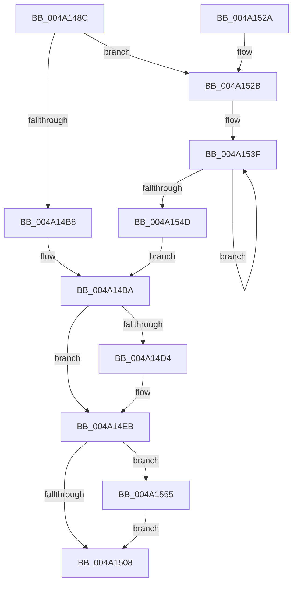

# PsIoRateControlOverQuotaNotify

- RVA: `0x004A148C`–`0x004A155E` (길이 `210` bytes)
- VA: `0x00000001404A148C`
- 실행 섹션: `.text`
- PDB 이름 있음: `예`; PDB Function 태그: `아니요`
- unwind 정보 RVA: `0x000B5B38`
- 디코드: `53`개 명령, `210/210` bytes 표시
- 미해석 바이트: `0` (있으면 어셈블리에 `.byte`로 보존)

> 이 문서는 커널 이미지의 기계어와 PDB 기호를 분석해 생성했습니다. 4번과 5번은 함수 원형과 자료형을 바이너리 사용 방식에서 추정한 C 해석이며 원본 소스 복구 결과는 아닙니다.

## 1. Dependencies

- 직접 호출 지점: **2**; 고유 호출 대상: **2**
- 직접 호출자로 확인된 함수: **1**
- RIP 상대 이미지 참조: **0**

### Outgoing calls
- `0x004A14C4` → [ExAcquireSpinLockExclusive](../24/ExAcquireSpinLockExclusive_function_00248690.md) (function, `0x00248690`)
- `0x004A150B` → [ExReleaseSpinLockExclusive](../2C/ExReleaseSpinLockExclusive_function_002C0EF0.md) (function, `0x002C0EF0`)

### Direct callers
- [IoNotifyQuotaState](IoNotifyQuotaState_function_004A13C0.md) at `0x004A142C`

### Static image references
- 디코드된 RIP-relative 메모리 참조가 없습니다.

## 2. Other-region calls and transfers

- 다른 실행 섹션으로 향하는 call: **0**
- 별도 외부 분기/꼬리 이동을 확인하지 못했습니다.

## 3. Assembly (complete function range)

```asm
004A148C  48 89 5C 24 08                  mov qword ptr [rsp + 8], rbx
004A1491  48 89 74 24 10                  mov qword ptr [rsp + 0x10], rsi
004A1496  48 89 7C 24 18                  mov qword ptr [rsp + 0x18], rdi
004A149B  41 54                           push r12
004A149D  41 56                           push r14
004A149F  41 57                           push r15
004A14A1  48 83 EC 20                     sub rsp, 0x20
004A14A5  83 7C 24 60 00                  cmp dword ptr [rsp + 0x60], 0
004A14AA  45 8B F1                        mov r14d, r9d
004A14AD  45 8B F8                        mov r15d, r8d
004A14B0  44 8B E2                        mov r12d, edx
004A14B3  48 8B D9                        mov rbx, rcx
004A14B6  75 73                           jne 0x1404a152b
004A14B8  33 FF                           xor edi, edi
004A14BA  48 8D B3 98 06 00 00            lea rsi, [rbx + 0x698]
004A14C1  48 8B CE                        mov rcx, rsi
004A14C4  E8 C7 71 DA FF                  call 0x140248690
004A14C9  8A D0                           mov dl, al
004A14CB  44 3B B3 C4 06 00 00            cmp r14d, dword ptr [rbx + 0x6c4]
004A14D2  74 17                           je 0x1404a14eb
004A14D4  48 8B 8B B0 06 00 00            mov rcx, qword ptr [rbx + 0x6b0]
004A14DB  48 03 C9                        add rcx, rcx
004A14DE  FF 83 B8 06 00 00               inc dword ptr [rbx + 0x6b8]
004A14E4  48 89 8B B0 06 00 00            mov qword ptr [rbx + 0x6b0], rcx
004A14EB  33 C0                           xor eax, eax
004A14ED  44 89 BB C0 06 00 00            mov dword ptr [rbx + 0x6c0], r15d
004A14F4  45 85 E4                        test r12d, r12d
004A14F7  0F 95 C0                        setne al
004A14FA  48 09 83 B0 06 00 00            or qword ptr [rbx + 0x6b0], rax
004A1501  83 7C 24 60 00                  cmp dword ptr [rsp + 0x60], 0
004A1506  75 4D                           jne 0x1404a1555
004A1508  48 8B CE                        mov rcx, rsi
004A150B  E8 E0 F9 E1 FF                  call 0x1402c0ef0
004A1510  48 8B 5C 24 40                  mov rbx, qword ptr [rsp + 0x40]
004A1515  48 8B 74 24 48                  mov rsi, qword ptr [rsp + 0x48]
004A151A  48 8B 7C 24 50                  mov rdi, qword ptr [rsp + 0x50]
004A151F  48 83 C4 20                     add rsp, 0x20
004A1523  41 5F                           pop r15
004A1525  41 5E                           pop r14
004A1527  41 5C                           pop r12
004A1529  C3                              ret
004A152A  CC                              int3
004A152B  48 BA B0 03 00 00 80 F7 FF FF   movabs rdx, 0xfffff780000003b0
004A1535  49 B8 08 00 00 00 80 F7 FF FF   movabs r8, 0xfffff78000000008
004A153F  48 8B 0A                        mov rcx, qword ptr [rdx]
004A1542  49 8B 38                        mov rdi, qword ptr [r8]
004A1545  48 8B 02                        mov rax, qword ptr [rdx]
004A1548  48 3B C8                        cmp rcx, rax
004A154B  75 F2                           jne 0x1404a153f
004A154D  48 2B F9                        sub rdi, rcx
004A1550  E9 65 FF FF FF                  jmp 0x1404a14ba
004A1555  48 89 BB C8 06 00 00            mov qword ptr [rbx + 0x6c8], rdi
004A155C  EB AA                           jmp 0x1404a1508
```

## 4. C-style interpretation (structured pseudocode)

```c
__int64 __fastcall PsIoRateControlOverQuotaNotify(__int64 a1, int a2, int a3, int a4, unsigned int a5)
{
    __int64 result;
    __int64 v_rdi;
    __int64 v_rsp;
    unsigned __int64 v_stack_p10;
    unsigned __int64 v_stack_p18;
    unsigned __int64 v_stack_p8;

    v_stack_p8 = v_rbx;
    v_stack_p10 = v_rsi;
    v_stack_p18 = v_rdi;
    v_rsp = (v_rsp) - (32);
    if (a5 != 0) goto loc_004A152B;
    v_rdi = 0;
loc_004A14BA:
    result = ExAcquireSpinLockExclusive(a1 + 1688, a2, a3, a4);
    if (((unsigned int)((unsigned int)(a4))) != (*(unsigned int *)(a1 + 1732))) {
        a1 = *(unsigned __int64 *)(a1 + 1712);
        a1 = (a1) + (a1);
        *(unsigned __int64 *)(a1 + 1712) = a1;
    }
    result = 0;
    *(unsigned int *)(a1 + 1728) = (unsigned int)((unsigned int)(a3));
    result = ((unsigned int)((unsigned int)(a2)) != 0) ? 1 : 0;
    if (a5 != 0) goto loc_004A1555;
loc_004A1508:
    result = ExReleaseSpinLockExclusive(a1 + 1688, (unsigned __int8)(result), a3, a4);
    v_rsp = (v_rsp) + (32);
    return result;
loc_004A152B:
loc_004A153F:
    if ((*(unsigned __int64 *)((unsigned __int8)(result))) != (*(unsigned __int64 *)((unsigned __int8)(result)))) goto loc_004A153F;
    v_rdi = (*(unsigned __int64 *)(a3)) - (*(unsigned __int64 *)((unsigned __int8)(result)));
    goto loc_004A14BA;
loc_004A1555:
    *(unsigned __int64 *)(v_stack_p8 + 1736) = v_rdi;
    goto loc_004A1508;
}
```

## 5. (Beta) C Style

```c
int64_t PsIoRateControlOverQuotaNotify(void *Arg1, int32_t Arg2, int32_t Arg3, int32_t Arg4, uint32_t Arg5)
{
    uint8_t *arg1 = (uint8_t *)Arg1;

    int64_t result;
    int64_t local_rdi;
    int64_t local_rsp;
    uint64_t v_stack_p10;
    uint64_t v_stack_p18;
    uint64_t v_stack_p8;

    v_stack_p8 = local_rbx;
    v_stack_p10 = local_rsi;
    v_stack_p18 = local_rdi;
    local_rsp = (local_rsp) - (32);
    if (Arg5 != 0) goto loc_004A152B;
    local_rdi = 0;
loc_004A14BA:
    result = ExAcquireSpinLockExclusive(Arg1 + 1688, Arg2, Arg3, Arg4);
    if (((uint32_t)((uint32_t)(Arg4))) != (*(uint32_t *)(arg1 + 0x6C4))) {
        Arg1 = *(uint64_t *)(arg1 + 0x6B0);
        Arg1 = (Arg1) + (Arg1);
        *(void **)(arg1 + 0x6B0) = Arg1;
    }
    result = 0;
    *(uint32_t *)(arg1 + 0x6C0) = (uint32_t)((uint32_t)(Arg3));
    result = ((uint32_t)((uint32_t)(Arg2)) != 0) ? 1 : 0;
    if (Arg5 != 0) goto loc_004A1555;
loc_004A1508:
    result = ExReleaseSpinLockExclusive(Arg1 + 1688, (uint8_t)(result), Arg3, Arg4);
    local_rsp = (local_rsp) + (32);
    return result;
loc_004A152B:
loc_004A153F:
    if ((*(uint64_t *)((uint8_t)(result))) != (*(uint64_t *)((uint8_t)(result)))) goto loc_004A153F;
    local_rdi = (*(uint64_t *)(Arg3)) - (*(uint64_t *)((uint8_t)(result)));
    goto loc_004A14BA;
loc_004A1555:
    *(uint64_t *)(v_stack_p8 + 0x6C8) = local_rdi;
    goto loc_004A1508;
}
```

### 관측된 메모리 오프셋

구조체 형식이 확인되지 않은 접근은 인자 기준의 오프셋으로만 기록했습니다.

| 기준 인자 | 오프셋 표현 | 폭 (bit) | 접근 |
|---|---:|---:|---|
| `Arg1` | `+ 0x698` | `64` | `R` |
| `Arg1` | `+ 0x6B0` | `64` | `R` |
| `Arg1` | `+ 0x6B0` | `64` | `R/W` |
| `Arg1` | `+ 0x6B0` | `64` | `W` |
| `Arg1` | `+ 0x6B8` | `32` | `R/W` |
| `Arg1` | `+ 0x6C0` | `32` | `W` |
| `Arg1` | `+ 0x6C4` | `32` | `R` |
| `Arg1` | `+ 0x6C8` | `64` | `W` |

## 6. Execution-region graph

[열기: 2D/3D 그래프와 함수 탐색 컨트롤 패널](../../../control-panel.html?section=text&rva=0x004A148C&view=graph)

- 2D 그래프는 위에서 아래로 흐르고, 3D 그래프는 빈 공간을 드래그해 회전합니다. Shift+드래그는 이동, 휠은 확대·축소, 함수 노드 선택은 대상 보고서 이동입니다.

### Static fallback


