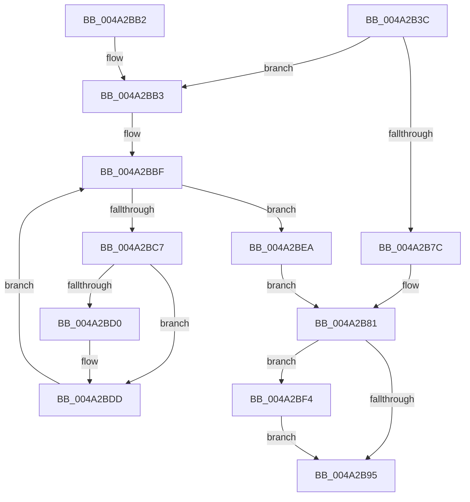

# PsMultiResumeProcess

- RVA: `0x004A2B3C`–`0x004A2C09` (길이 `205` bytes)
- VA: `0x00000001404A2B3C`
- 실행 섹션: `.text`
- PDB 이름 있음: `예`; PDB Function 태그: `아니요`
- unwind 정보 RVA: `0x000A1354`
- 디코드: `55`개 명령, `205/205` bytes 표시
- 미해석 바이트: `0` (있으면 어셈블리에 `.byte`로 보존)

> 이 문서는 커널 이미지의 기계어와 PDB 기호를 분석해 생성했습니다. 4번과 5번은 함수 원형과 자료형을 바이너리 사용 방식에서 추정한 C 해석이며 원본 소스 복구 결과는 아닙니다.

## 1. Dependencies

- 직접 호출 지점: **7**; 고유 호출 대상: **6**
- 직접 호출자로 확인된 함수: **2**
- RIP 상대 이미지 참조: **0**

### Outgoing calls
- `0x004A2B73` → [ExAcquireRundownProtection](../21/ExAcquireRundownProtection_function_00216620.md) (function, `0x00216620`)
- `0x004A2B84` → [KiLeaveCriticalRegionUnsafe](../25/KiLeaveCriticalRegionUnsafe_function_0025F010.md) (function, `0x0025F010`)
- `0x004A2BB8` → [PsGetNextProcessThread](../../page/8C/PsGetNextProcessThread_function_008C9CF0.md) (function, `0x008C9CF0`)
- `0x004A2BD8` → [KeResumeThread](../20/KeResumeThread_function_00202858.md) (function, `0x00202858`)
- `0x004A2BE3` → [PsGetNextProcessThread](../../page/8C/PsGetNextProcessThread_function_008C9CF0.md) (function, `0x008C9CF0`)
- `0x004A2BED` → [ExReleaseRundownProtection](../34/ExReleaseRundownProtection_function_00349E80.md) (function, `0x00349E80`)
- `0x004A2C02` → [EtwTiLogSuspendResumeProcess](../../page/A7/EtwTiLogSuspendResumeProcess_function_00A7956C.md) (function, `0x00A7956C`)

### Direct callers
- [NtResumeProcess](../../page/70/NtResumeProcess_function_007009C0.md) at `0x00700A13`
- [PsResumeProcess](../../page/AA/PsResumeProcess_function_00AA2950.md) at `0x00AA2954`

### Static image references
- 디코드된 RIP-relative 메모리 참조가 없습니다.

## 2. Other-region calls and transfers

- 다른 실행 섹션으로 향하는 call: **3**
  - `0x004A2BB8` → [PsGetNextProcessThread](../../page/8C/PsGetNextProcessThread_function_008C9CF0.md) (`.text` → `PAGE`)
  - `0x004A2BE3` → [PsGetNextProcessThread](../../page/8C/PsGetNextProcessThread_function_008C9CF0.md) (`.text` → `PAGE`)
  - `0x004A2C02` → [EtwTiLogSuspendResumeProcess](../../page/A7/EtwTiLogSuspendResumeProcess_function_00A7956C.md) (`.text` → `PAGE`)
- 별도 외부 분기/꼬리 이동을 확인하지 못했습니다.

## 3. Assembly (complete function range)

```asm
004A2B3C  48 8B C4                        mov rax, rsp
004A2B3F  48 89 58 08                     mov qword ptr [rax + 8], rbx
004A2B43  48 89 68 10                     mov qword ptr [rax + 0x10], rbp
004A2B47  48 89 70 18                     mov qword ptr [rax + 0x18], rsi
004A2B4B  48 89 78 20                     mov qword ptr [rax + 0x20], rdi
004A2B4F  41 56                           push r14
004A2B51  48 83 EC 20                     sub rsp, 0x20
004A2B55  65 48 8B 2C 25 88 01 00 00      mov rbp, qword ptr gs:[0x188]
004A2B5E  4C 8D B1 E8 01 00 00            lea r14, [rcx + 0x1e8]
004A2B65  48 8B F1                        mov rsi, rcx
004A2B68  49 8B CE                        mov rcx, r14
004A2B6B  66 FF 8D E4 01 00 00            dec word ptr [rbp + 0x1e4]
004A2B72  90                              nop
004A2B73  E8 A8 3A D7 FF                  call 0x140216620
004A2B78  3C 01                           cmp al, 1
004A2B7A  74 37                           je 0x1404a2bb3
004A2B7C  BB 0A 01 00 C0                  mov ebx, 0xc000010a
004A2B81  48 8B CD                        mov rcx, rbp
004A2B84  E8 87 C4 DB FF                  call 0x14025f010
004A2B89  F7 86 FC 05 00 00 00 00 08 00   test dword ptr [rsi + 0x5fc], 0x80000
004A2B93  75 5F                           jne 0x1404a2bf4
004A2B95  48 8B 6C 24 38                  mov rbp, qword ptr [rsp + 0x38]
004A2B9A  8B C3                           mov eax, ebx
004A2B9C  48 8B 5C 24 30                  mov rbx, qword ptr [rsp + 0x30]
004A2BA1  48 8B 74 24 40                  mov rsi, qword ptr [rsp + 0x40]
004A2BA6  48 8B 7C 24 48                  mov rdi, qword ptr [rsp + 0x48]
004A2BAB  48 83 C4 20                     add rsp, 0x20
004A2BAF  41 5E                           pop r14
004A2BB1  C3                              ret
004A2BB2  CC                              int3
004A2BB3  33 D2                           xor edx, edx
004A2BB5  48 8B CE                        mov rcx, rsi
004A2BB8  E8 33 71 42 00                  call 0x1408c9cf0
004A2BBD  33 DB                           xor ebx, ebx
004A2BBF  48 8B F8                        mov rdi, rax
004A2BC2  48 85 C0                        test rax, rax
004A2BC5  74 23                           je 0x1404a2bea
004A2BC7  F7 40 74 00 00 20 00            test dword ptr [rax + 0x74], 0x200000
004A2BCE  75 0D                           jne 0x1404a2bdd
004A2BD0  BA 01 00 00 00                  mov edx, 1
004A2BD5  48 8B C8                        mov rcx, rax
004A2BD8  E8 7B FC D5 FF                  call 0x140202858
004A2BDD  48 8B D7                        mov rdx, rdi
004A2BE0  48 8B CE                        mov rcx, rsi
004A2BE3  E8 08 71 42 00                  call 0x1408c9cf0
004A2BE8  EB D5                           jmp 0x1404a2bbf
004A2BEA  49 8B CE                        mov rcx, r14
004A2BED  E8 8E 72 EA FF                  call 0x140349e80
004A2BF2  EB 8D                           jmp 0x1404a2b81
004A2BF4  41 B9 01 00 00 00               mov r9d, 1
004A2BFA  4C 8B C6                        mov r8, rsi
004A2BFD  48 8B D5                        mov rdx, rbp
004A2C00  8B CB                           mov ecx, ebx
004A2C02  E8 65 69 5D 00                  call 0x140a7956c
004A2C07  EB 8C                           jmp 0x1404a2b95
```

## 4. C-style interpretation (structured pseudocode)

```c
__int64 __fastcall PsMultiResumeProcess(__int64 a1, int a2)
{
    __int64 result;
    __int64 v_rbx;
    __int64 v_rsp;
    unsigned __int64 v_stack_p10;
    unsigned __int64 v_stack_p18;
    unsigned __int64 v_stack_p20;
    unsigned __int64 v_stack_p8;

    *(unsigned __int64 *)(v_rsp + 8) = v_rbx;
    *(unsigned __int64 *)(v_rsp + 16) = v_rbp;
    *(unsigned __int64 *)(v_rsp + 24) = v_rsi;
    *(unsigned __int64 *)(v_rsp + 32) = v_rdi;
    v_rsp = (v_rsp) - (32);
    result = ExAcquireRundownProtection(a1 + 488, a2, a3, a4);
    if (((unsigned __int8)(result)) == 1) goto loc_004A2BB3;
loc_004A2B81:
    result = KiLeaveCriticalRegionUnsafe(*(unsigned __int64 *)(gs_base + (0 + 392)), a2, a3, a4);
    if (((*(unsigned int *)(a1 + 1532)) & (0x80000ULL)) != 0) goto loc_004A2BF4;
loc_004A2B95:
    v_rsp = (v_rsp) + (32);
    return (unsigned int)((unsigned int)((unsigned int)(0xC000010AULL)));
loc_004A2BB3:
    a2 = 0;
    result = PsGetNextProcessThread(v_stack_p18, a2, a3, a4);
    v_rbx = 0;
loc_004A2BBF:
    if (result == 0) goto loc_004A2BEA;
    if (((*(unsigned int *)(result + 116)) & (0x200000ULL)) == 0) {
        a2 = 1;
        a1 = result;
        result = KeResumeThread(a1, a2, a3, a4);
    }
    result = PsGetNextProcessThread(v_stack_p18, result, a3, a4);
    goto loc_004A2BBF;
loc_004A2BEA:
    result = ExReleaseRundownProtection(a1 + 488, result, a3, a4);
    goto loc_004A2B81;
loc_004A2BF4:
    result = EtwTiLogSuspendResumeProcess(0, v_stack_p10, v_stack_p18, 1);
    goto loc_004A2B95;
}
```

## 5. (Beta) C Style

```c
int64_t PsMultiResumeProcess(void *Arg1, int32_t Arg2)
{
    uint8_t *arg1 = (uint8_t *)Arg1;

    int64_t result;
    int64_t local_rbx;
    int64_t local_rsp;
    uint64_t v_stack_p10;
    uint64_t v_stack_p18;
    uint64_t v_stack_p20;
    uint64_t v_stack_p8;

    *(uint64_t *)(local_rsp + 0x8) = local_rbx;
    *(uint64_t *)(local_rsp + 0x10) = local_rbp;
    *(uint64_t *)(local_rsp + 0x18) = local_rsi;
    *(uint64_t *)(local_rsp + 0x20) = local_rdi;
    local_rsp = (local_rsp) - (32);
    result = ExAcquireRundownProtection(Arg1 + 488, Arg2, a3, a4);
    if (((uint8_t)(result)) == 1) goto loc_004A2BB3;
loc_004A2B81:
    result = KiLeaveCriticalRegionUnsafe(*(uint64_t *)(gs_base + (0 + 0x188)), Arg2, a3, a4);
    if (((*(uint32_t *)(arg1 + 0x5FC)) & (0x80000ULL)) != 0) goto loc_004A2BF4;
loc_004A2B95:
    local_rsp = (local_rsp) + (32);
    return (uint32_t)((uint32_t)((uint32_t)(0xC000010AULL)));
loc_004A2BB3:
    Arg2 = 0;
    result = PsGetNextProcessThread(v_stack_p18, Arg2, a3, a4);
    local_rbx = 0;
loc_004A2BBF:
    if (result == 0) goto loc_004A2BEA;
    if (((*(uint32_t *)(result + 0x74)) & (0x200000ULL)) == 0) {
        Arg2 = 1;
        Arg1 = result;
        result = KeResumeThread(Arg1, Arg2, a3, a4);
    }
    result = PsGetNextProcessThread(v_stack_p18, result, a3, a4);
    goto loc_004A2BBF;
loc_004A2BEA:
    result = ExReleaseRundownProtection(Arg1 + 488, result, a3, a4);
    goto loc_004A2B81;
loc_004A2BF4:
    result = EtwTiLogSuspendResumeProcess(0, v_stack_p10, v_stack_p18, 1);
    goto loc_004A2B95;
}
```

### 관측된 메모리 오프셋

구조체 형식이 확인되지 않은 접근은 인자 기준의 오프셋으로만 기록했습니다.

| 기준 인자 | 오프셋 표현 | 폭 (bit) | 접근 |
|---|---:|---:|---|
| `Arg1` | `+ 0x1E8` | `64` | `R` |
| `Arg1` | `+ 0x5FC` | `32` | `R` |

## 6. Execution-region graph

[열기: 2D/3D 그래프와 함수 탐색 컨트롤 패널](../../../control-panel.html?section=text&rva=0x004A2B3C&view=graph)

- 2D 그래프는 위에서 아래로 흐르고, 3D 그래프는 빈 공간을 드래그해 회전합니다. Shift+드래그는 이동, 휠은 확대·축소, 함수 노드 선택은 대상 보고서 이동입니다.

### Static fallback


