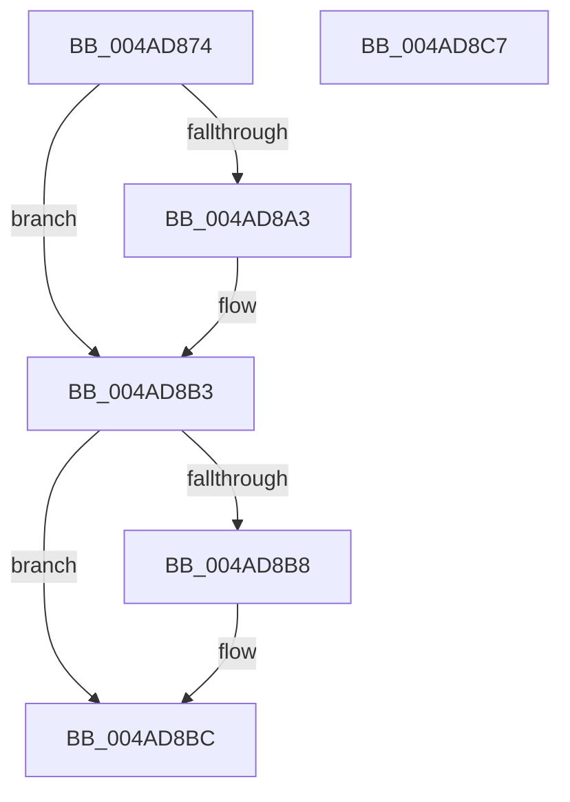

# PspLockProcessSharedUnsafe

- RVA: `0x004AD874`–`0x004AD8C8` (길이 `84` bytes)
- VA: `0x00000001404AD874`
- 실행 섹션: `.text`
- PDB 이름 있음: `예`; PDB Function 태그: `아니요`
- unwind 정보 RVA: `0x00068D5C`
- 디코드: `26`개 명령, `84/84` bytes 표시
- 미해석 바이트: `0` (있으면 어셈블리에 `.byte`로 보존)

> 이 문서는 커널 이미지의 기계어와 PDB 기호를 분석해 생성했습니다. 4번과 5번은 함수 원형과 자료형을 바이너리 사용 방식에서 추정한 C 해석이며 원본 소스 복구 결과는 아닙니다.

## 1. Dependencies

- 직접 호출 지점: **2**; 고유 호출 대상: **2**
- 직접 호출자로 확인된 함수: **1**
- RIP 상대 이미지 참조: **0**

### Outgoing calls
- `0x004AD88D` → [KeAbPreAcquire](../21/KeAbPreAcquire_function_00210230.md) (function, `0x00210230`)
- `0x004AD8AE` → [ExfAcquirePushLockSharedEx](../21/ExfAcquirePushLockSharedEx_function_0021044C.md) (function, `0x0021044C`)

### Direct callers
- [NtSetInformationProcess](../../page/AE/NtSetInformationProcess_function_00AE5370.md) at `0x00AE658C`

### Static image references
- 디코드된 RIP-relative 메모리 참조가 없습니다.

## 2. Other-region calls and transfers

- 다른 실행 섹션으로 향하는 call: **0**
- 별도 외부 분기/꼬리 이동을 확인하지 못했습니다.

## 3. Assembly (complete function range)

```asm
004AD874  48 89 5C 24 10                  mov qword ptr [rsp + 0x10], rbx
004AD879  57                              push rdi
004AD87A  48 83 EC 20                     sub rsp, 0x20
004AD87E  48 8D B9 C8 01 00 00            lea rdi, [rcx + 0x1c8]
004AD885  45 33 C0                        xor r8d, r8d
004AD888  48 8B CF                        mov rcx, rdi
004AD88B  33 D2                           xor edx, edx
004AD88D  E8 9E 29 D6 FF                  call 0x140210230
004AD892  48 8B D8                        mov rbx, rax
004AD895  B9 11 00 00 00                  mov ecx, 0x11
004AD89A  33 C0                           xor eax, eax
004AD89C  F0 48 0F B1 0F                  lock cmpxchg qword ptr [rdi], rcx
004AD8A1  74 10                           je 0x1404ad8b3
004AD8A3  4C 8B CF                        mov r9, rdi
004AD8A6  4C 8B C3                        mov r8, rbx
004AD8A9  33 D2                           xor edx, edx
004AD8AB  48 8B CF                        mov rcx, rdi
004AD8AE  E8 99 2B D6 FF                  call 0x14021044c
004AD8B3  48 85 DB                        test rbx, rbx
004AD8B6  74 04                           je 0x1404ad8bc
004AD8B8  C6 43 0A 01                     mov byte ptr [rbx + 0xa], 1
004AD8BC  48 8B 5C 24 38                  mov rbx, qword ptr [rsp + 0x38]
004AD8C1  48 83 C4 20                     add rsp, 0x20
004AD8C5  5F                              pop rdi
004AD8C6  C3                              ret
004AD8C7  CC                              int3
```

## 4. C-style interpretation (structured pseudocode)

```c
__int64 __fastcall PspLockProcessSharedUnsafe(__int64 a1, int a2, int a3)
{
    __int64 result;
    __int64 v_rsp;
    unsigned __int64 v_stack_p10;

    v_stack_p10 = v_rbx;
    v_rsp = (v_rsp) - (32);
    a3 = 0;
    a2 = 0;
    result = KeAbPreAcquire(a1 + 456, a2, a3, a4);
    result = 0;
    if (!(condition_is_equal)) {
        a4 = a1 + 456;
        a3 = 0;
        a2 = 0;
        a1 = a1 + 456;
        result = ExfAcquirePushLockSharedEx(a1, a2, a3, a4);
    }
    if (result != 0) {
        *(unsigned __int8 *)(result + 10) = 1;
    }
    v_rsp = (v_rsp) + (32);
    return result;
}
```

## 5. (Beta) C Style

```c
int64_t PspLockProcessSharedUnsafe(void *Arg1, int32_t Arg2, int32_t Arg3)
{
    uint8_t *arg1 = (uint8_t *)Arg1;

    int64_t result;
    int64_t local_rsp;
    uint64_t v_stack_p10;

    v_stack_p10 = local_rbx;
    local_rsp = (local_rsp) - (32);
    Arg3 = 0;
    Arg2 = 0;
    result = KeAbPreAcquire(Arg1 + 456, Arg2, Arg3, a4);
    result = 0;
    if (!(condition_is_equal)) {
        a4 = Arg1 + 456;
        Arg3 = 0;
        Arg2 = 0;
        Arg1 = Arg1 + 456;
        result = ExfAcquirePushLockSharedEx(Arg1, Arg2, Arg3, a4);
    }
    if (result != 0) {
        *(uint8_t *)(result + 0xA) = 1;
    }
    local_rsp = (local_rsp) + (32);
    return result;
}
```

### 관측된 메모리 오프셋

구조체 형식이 확인되지 않은 접근은 인자 기준의 오프셋으로만 기록했습니다.

| 기준 인자 | 오프셋 표현 | 폭 (bit) | 접근 |
|---|---:|---:|---|
| `Arg1` | `+ 0x0` | `64` | `R` |
| `Arg1` | `+ 0x1C8` | `64` | `R` |

## 6. Execution-region graph

[열기: 2D/3D 그래프와 함수 탐색 컨트롤 패널](../../../control-panel.html?section=text&rva=0x004AD874&view=graph)

- 2D 그래프는 위에서 아래로 흐르고, 3D 그래프는 빈 공간을 드래그해 회전합니다. Shift+드래그는 이동, 휠은 확대·축소, 함수 노드 선택은 대상 보고서 이동입니다.

### Static fallback


