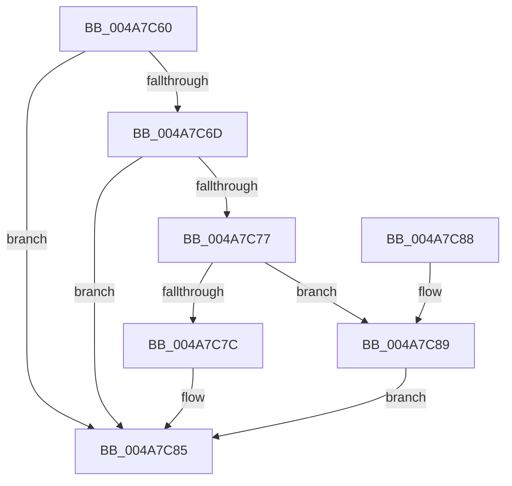

# PspSetProcessCacheIsolationCallback

- RVA: `0x004A7C60`–`0x004A7C94` (길이 `52` bytes)
- VA: `0x00000001404A7C60`
- 실행 섹션: `.text`
- PDB 이름 있음: `예`; PDB Function 태그: `아니요`
- unwind 정보 RVA: `0x000DB714`
- 디코드: `14`개 명령, `52/52` bytes 표시
- 미해석 바이트: `0` (있으면 어셈블리에 `.byte`로 보존)

> 이 문서는 커널 이미지의 기계어와 PDB 기호를 분석해 생성했습니다. 4번과 5번은 함수 원형과 자료형을 바이너리 사용 방식에서 추정한 C 해석이며 원본 소스 복구 결과는 아닙니다.

## 1. Dependencies

- 직접 호출 지점: **0**; 고유 호출 대상: **0**
- 직접 호출자로 확인된 함수: **0**
- RIP 상대 이미지 참조: **0**

### Outgoing calls
- 직접 디코드된 call 명령이 없습니다.

### Direct callers
- 이 함수 시작 RVA로 연결되는 직접 call은 확인되지 않았습니다. 간접 호출은 완전히 역산할 수 없습니다.

### Static image references
- 디코드된 RIP-relative 메모리 참조가 없습니다.

## 2. Other-region calls and transfers

- 다른 실행 섹션으로 향하는 call: **0**
- 별도 외부 분기/꼬리 이동을 확인하지 못했습니다.

## 3. Assembly (complete function range)

```asm
004A7C60  8B 81 F4 01 00 00               mov eax, dword ptr [rcx + 0x1f4]
004A7C66  A9 08 00 00 40                  test eax, 0x40000008
004A7C6B  75 18                           jne 0x1404a7c85
004A7C6D  8B 81 F0 01 00 00               mov eax, dword ptr [rcx + 0x1f0]
004A7C73  A8 01                           test al, 1
004A7C75  75 0E                           jne 0x1404a7c85
004A7C77  80 3A 00                        cmp byte ptr [rdx], 0
004A7C7A  74 0D                           je 0x1404a7c89
004A7C7C  F0 0F BA A9 88 00 00 00 06      lock bts dword ptr [rcx + 0x88], 6
004A7C85  33 C0                           xor eax, eax
004A7C87  C3                              ret
004A7C88  CC                              int3
004A7C89  F0 0F BA B1 88 00 00 00 06      lock btr dword ptr [rcx + 0x88], 6
004A7C92  EB F1                           jmp 0x1404a7c85
```

## 4. C-style interpretation (structured pseudocode)

```c
__int64 __fastcall PspSetProcessCacheIsolationCallback(__int64 a1, __int64 a2)
{
    __int64 result;

    if ((((unsigned int)((unsigned int)(*(unsigned int *)(a1 + 500)))) & (0x40000008ULL)) != 0) goto loc_004A7C85;
    if ((((unsigned __int8)((unsigned int)(*(unsigned int *)(a1 + 496)))) & (1)) != 0) goto loc_004A7C85;
    if ((*(unsigned __int8 *)(a2)) == 0) goto loc_004A7C89;
loc_004A7C85:
    result = 0;
    return result;
loc_004A7C89:
    goto loc_004A7C85;
}
```

## 5. (Beta) C Style

```c
int64_t PspSetProcessCacheIsolationCallback(void *Arg1, void *Arg2)
{
    uint8_t *arg1 = (uint8_t *)Arg1;
    uint8_t *arg2 = (uint8_t *)Arg2;

    int64_t result;

    if ((((uint32_t)((uint32_t)(*(uint32_t *)(arg1 + 0x1F4)))) & (0x40000008ULL)) != 0) goto loc_004A7C85;
    if ((((uint8_t)((uint32_t)(*(uint32_t *)(arg1 + 0x1F0)))) & (1)) != 0) goto loc_004A7C85;
    if ((*(uint8_t *)(arg2)) == 0) goto loc_004A7C89;
loc_004A7C85:
    result = 0;
    return result;
loc_004A7C89:
    goto loc_004A7C85;
}
```

### 관측된 메모리 오프셋

구조체 형식이 확인되지 않은 접근은 인자 기준의 오프셋으로만 기록했습니다.

| 기준 인자 | 오프셋 표현 | 폭 (bit) | 접근 |
|---|---:|---:|---|
| `Arg1` | `+ 0x88` | `32` | `R/W` |
| `Arg1` | `+ 0x1F0` | `32` | `R` |
| `Arg1` | `+ 0x1F4` | `32` | `R` |
| `Arg2` | `+ 0x0` | `8` | `R` |

## 6. Execution-region graph

[열기: 2D/3D 그래프와 함수 탐색 컨트롤 패널](../../../control-panel.html?section=text&rva=0x004A7C60&view=graph)

- 2D 그래프는 위에서 아래로 흐르고, 3D 그래프는 빈 공간을 드래그해 회전합니다. Shift+드래그는 이동, 휠은 확대·축소, 함수 노드 선택은 대상 보고서 이동입니다.

### Static fallback


