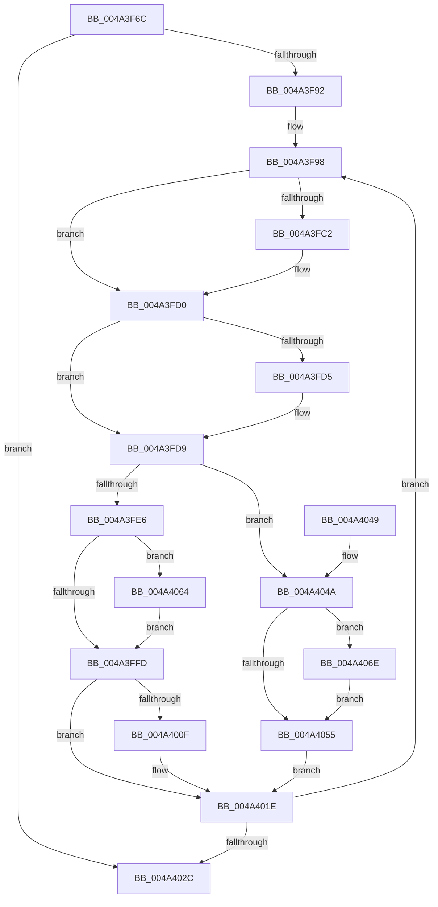

# PspStorageEmptyArrayNonReadonly

- RVA: `0x004A3F6C`–`0x004A4078` (길이 `268` bytes)
- VA: `0x00000001404A3F6C`
- 실행 섹션: `.text`
- PDB 이름 있음: `예`; PDB Function 태그: `아니요`
- unwind 정보 RVA: `0x000B650C`
- 디코드: `75`개 명령, `268/268` bytes 표시
- 미해석 바이트: `0` (있으면 어셈블리에 `.byte`로 보존)

> 이 문서는 커널 이미지의 기계어와 PDB 기호를 분석해 생성했습니다. 4번과 5번은 함수 원형과 자료형을 바이너리 사용 방식에서 추정한 C 해석이며 원본 소스 복구 결과는 아닙니다.

## 1. Dependencies

- 직접 호출 지점: **9**; 고유 호출 대상: **6**
- 직접 호출자로 확인된 함수: **1**
- RIP 상대 이미지 참조: **0**

### Outgoing calls
- `0x004A3FB2` → [KeAbPreAcquire](../21/KeAbPreAcquire_function_00210230.md) (function, `0x00210230`)
- `0x004A3FCB` → [ExfAcquirePushLockExclusiveEx](../20/ExfAcquirePushLockExclusiveEx_function_0020FC90.md) (function, `0x0020FC90`)
- `0x004A4000` → [KeAbPostRelease](../2E/KeAbPostRelease_function_002E1600.md) (function, `0x002E1600`)
- `0x004A4005` → [KeLeaveCriticalRegion](../25/KeLeaveCriticalRegion_function_0025D8B0.md) (function, `0x0025D8B0`)
- `0x004A4017` → [ObfDereferenceObjectWithTag](../2F/ObfDereferenceObjectWithTag_function_002F78E0.md) (function, `0x002F78E0`)
- `0x004A4058` → [KeAbPostRelease](../2E/KeAbPostRelease_function_002E1600.md) (function, `0x002E1600`)
- `0x004A405D` → [KeLeaveCriticalRegion](../25/KeLeaveCriticalRegion_function_0025D8B0.md) (function, `0x0025D8B0`)
- `0x004A4067` → [ExfTryToWakePushLock](../26/ExfTryToWakePushLock_function_00265DD0.md) (function, `0x00265DD0`)
- `0x004A4071` → [ExfTryToWakePushLock](../26/ExfTryToWakePushLock_function_00265DD0.md) (function, `0x00265DD0`)

### Direct callers
- [PspCompleteHardDereferenceSiloDeferred](../../page/AB/PspCompleteHardDereferenceSiloDeferred_function_00ABDB10.md) at `0x00ABDB31`
- [PspCompleteHardDereferenceSiloDeferred](../../page/AB/PspCompleteHardDereferenceSiloDeferred_function_00ABDB10.md) at `0x00ABDB47`

### Static image references
- 디코드된 RIP-relative 메모리 참조가 없습니다.

## 2. Other-region calls and transfers

- 다른 실행 섹션으로 향하는 call: **0**
- 별도 외부 분기/꼬리 이동을 확인하지 못했습니다.

## 3. Assembly (complete function range)

```asm
004A3F6C  48 8B C4                        mov rax, rsp
004A3F6F  48 89 58 08                     mov qword ptr [rax + 8], rbx
004A3F73  48 89 68 10                     mov qword ptr [rax + 0x10], rbp
004A3F77  48 89 70 18                     mov qword ptr [rax + 0x18], rsi
004A3F7B  48 89 78 20                     mov qword ptr [rax + 0x20], rdi
004A3F7F  41 57                           push r15
004A3F81  48 83 EC 20                     sub rsp, 0x20
004A3F85  33 F6                           xor esi, esi
004A3F87  48 8B D9                        mov rbx, rcx
004A3F8A  85 D2                           test edx, edx
004A3F8C  0F 84 9A 00 00 00               je 0x1404a402c
004A3F92  8B EA                           mov ebp, edx
004A3F94  49 83 CF FF                     or r15, 0xffffffffffffffff
004A3F98  65 48 8B 04 25 88 01 00 00      mov rax, qword ptr gs:[0x188]
004A3FA1  45 33 C0                        xor r8d, r8d
004A3FA4  33 D2                           xor edx, edx
004A3FA6  48 8B CB                        mov rcx, rbx
004A3FA9  66 44 01 B8 E4 01 00 00         add word ptr [rax + 0x1e4], r15w
004A3FB1  90                              nop
004A3FB2  E8 79 C2 D6 FF                  call 0x140210230
004A3FB7  F0 48 0F BA 2B 00               lock bts qword ptr [rbx], 0
004A3FBD  48 8B F8                        mov rdi, rax
004A3FC0  73 0E                           jae 0x1404a3fd0
004A3FC2  4C 8B C3                        mov r8, rbx
004A3FC5  48 8B D0                        mov rdx, rax
004A3FC8  48 8B CB                        mov rcx, rbx
004A3FCB  E8 C0 BC D6 FF                  call 0x14020fc90
004A3FD0  48 85 FF                        test rdi, rdi
004A3FD3  74 04                           je 0x1404a3fd9
004A3FD5  C6 47 0A 01                     mov byte ptr [rdi + 0xa], 1
004A3FD9  48 8B 7B 08                     mov rdi, qword ptr [rbx + 8]
004A3FDD  49 8B C7                        mov rax, r15
004A3FE0  40 F6 C7 01                     test dil, 1
004A3FE4  75 64                           jne 0x1404a404a
004A3FE6  48 C7 43 08 01 00 00 00         mov qword ptr [rbx + 8], 1
004A3FEE  48 83 E7 FE                     and rdi, 0xfffffffffffffffe
004A3FF2  F0 48 0F C1 03                  lock xadd qword ptr [rbx], rax
004A3FF7  24 06                           and al, 6
004A3FF9  3C 02                           cmp al, 2
004A3FFB  74 67                           je 0x1404a4064
004A3FFD  48 8B CB                        mov rcx, rbx
004A4000  E8 FB D5 E3 FF                  call 0x1402e1600
004A4005  E8 A6 98 DB FF                  call 0x14025d8b0
004A400A  48 85 FF                        test rdi, rdi
004A400D  74 0F                           je 0x1404a401e
004A400F  BA 44 66 6C 74                  mov edx, 0x746c6644
004A4014  48 8B CF                        mov rcx, rdi
004A4017  E8 C4 38 E5 FF                  call 0x1402f78e0
004A401C  FF C6                           inc esi
004A401E  48 83 C3 10                     add rbx, 0x10
004A4022  48 83 ED 01                     sub rbp, 1
004A4026  0F 85 6C FF FF FF               jne 0x1404a3f98
004A402C  48 8B 5C 24 30                  mov rbx, qword ptr [rsp + 0x30]
004A4031  8B C6                           mov eax, esi
004A4033  48 8B 74 24 40                  mov rsi, qword ptr [rsp + 0x40]
004A4038  48 8B 6C 24 38                  mov rbp, qword ptr [rsp + 0x38]
004A403D  48 8B 7C 24 48                  mov rdi, qword ptr [rsp + 0x48]
004A4042  48 83 C4 20                     add rsp, 0x20
004A4046  41 5F                           pop r15
004A4048  C3                              ret
004A4049  CC                              int3
004A404A  F0 48 0F C1 03                  lock xadd qword ptr [rbx], rax
004A404F  24 06                           and al, 6
004A4051  3C 02                           cmp al, 2
004A4053  74 19                           je 0x1404a406e
004A4055  48 8B CB                        mov rcx, rbx
004A4058  E8 A3 D5 E3 FF                  call 0x1402e1600
004A405D  E8 4E 98 DB FF                  call 0x14025d8b0
004A4062  EB BA                           jmp 0x1404a401e
004A4064  48 8B CB                        mov rcx, rbx
004A4067  E8 64 1D DC FF                  call 0x140265dd0
004A406C  EB 8F                           jmp 0x1404a3ffd
004A406E  48 8B CB                        mov rcx, rbx
004A4071  E8 5A 1D DC FF                  call 0x140265dd0
004A4076  EB DD                           jmp 0x1404a4055
```

## 4. C-style interpretation (structured pseudocode)

```c
__int64 __fastcall PspStorageEmptyArrayNonReadonly(__int64 a1, int a2, int a3)
{
    __int64 result;
    __int64 v_r15;
    __int64 v_rbp;
    __int64 v_rbx;
    __int64 v_rdi;
    __int64 v_rsi;
    __int64 v_rsp;
    unsigned __int64 v_stack_p10;
    unsigned __int64 v_stack_p18;
    unsigned __int64 v_stack_p20;
    unsigned __int64 v_stack_p8;

    *(unsigned __int64 *)(v_rsp + 8) = v_rbx;
    *(unsigned __int64 *)(v_rsp + 16) = v_rbp;
    *(unsigned __int64 *)(v_rsp + 24) = v_rsi;
    *(unsigned __int64 *)(v_rsp + 32) = v_rdi;
    v_rsp = (v_rsp) - (32);
    v_rsi = 0;
    if (a2 == 0) goto loc_004A402C;
    v_r15 = (v_r15) | (-1);
loc_004A3F98:
    a3 = 0;
    a2 = 0;
    result = KeAbPreAcquire(a1, a2, a3, a4);
    if (!(condition_is_above_or_equal)) {
        a3 = a1;
        a2 = result;
        a1 = a1;
        result = ExfAcquirePushLockExclusiveEx(a1, a2, a3, a4);
    }
    if (result != 0) {
        *(unsigned __int8 *)(result + 10) = 1;
    }
    if ((((unsigned __int8)(*(unsigned __int64 *)(a1 + 8))) & (1)) != 0) goto loc_004A404A;
    *(unsigned __int64 *)(a1 + 8) = 1;
    v_rdi = (*(unsigned __int64 *)(a1 + 8)) & (-2);
    result = (unsigned __int8)((v_r15) & (6));
    if (((unsigned __int8)(result)) == 2) goto loc_004A4064;
loc_004A3FFD:
    result = KeAbPostRelease(a1, a2, a3, a4);
    result = KeLeaveCriticalRegion(a1, a2, a3, a4);
    if (v_rdi != 0) {
        a2 = 0x746C6644ULL;
        a1 = v_rdi;
        result = ObfDereferenceObjectWithTag(a1, a2, a3, a4);
        v_rsi = (unsigned int)((v_rsi) + 1);
    }
    v_rbx = (a1) + (16);
    v_rbp = ((unsigned int)(a2)) - (1);
    if (condition_is_not_equal) goto loc_004A3F98;
loc_004A402C:
    v_rsp = (v_rsp) + (32);
    return (unsigned int)((unsigned int)(v_rsi));
loc_004A404A:
    result = (unsigned __int8)(((unsigned int)((unsigned int)(v_rsi))) & (6));
    if (((unsigned __int8)(result)) == 2) goto loc_004A406E;
loc_004A4055:
    result = KeAbPostRelease(v_stack_p8, a2, a3, a4);
    result = KeLeaveCriticalRegion(v_stack_p8, a2, a3, a4);
    goto loc_004A401E;
loc_004A4064:
    result = ExfTryToWakePushLock(v_stack_p8, a2, a3, a4);
    goto loc_004A3FFD;
loc_004A406E:
    result = ExfTryToWakePushLock(v_stack_p8, a2, a3, a4);
    goto loc_004A4055;
}
```

## 5. (Beta) C Style

```c
int64_t PspStorageEmptyArrayNonReadonly(void *Arg1, int32_t Arg2, int32_t Arg3)
{
    uint8_t *arg1 = (uint8_t *)Arg1;

    int64_t result;
    int64_t local_r15;
    int64_t local_rbp;
    int64_t local_rbx;
    int64_t local_rdi;
    int64_t local_rsi;
    int64_t local_rsp;
    uint64_t v_stack_p10;
    uint64_t v_stack_p18;
    uint64_t v_stack_p20;
    uint64_t v_stack_p8;

    *(uint64_t *)(local_rsp + 0x8) = local_rbx;
    *(uint64_t *)(local_rsp + 0x10) = local_rbp;
    *(uint64_t *)(local_rsp + 0x18) = local_rsi;
    *(uint64_t *)(local_rsp + 0x20) = local_rdi;
    local_rsp = (local_rsp) - (32);
    local_rsi = 0;
    if (Arg2 == 0) goto loc_004A402C;
    local_r15 = (local_r15) | (-1);
loc_004A3F98:
    Arg3 = 0;
    Arg2 = 0;
    result = KeAbPreAcquire(Arg1, Arg2, Arg3, a4);
    if (!(condition_is_above_or_equal)) {
        Arg3 = Arg1;
        Arg2 = result;
        Arg1 = Arg1;
        result = ExfAcquirePushLockExclusiveEx(Arg1, Arg2, Arg3, a4);
    }
    if (result != 0) {
        *(uint8_t *)(result + 0xA) = 1;
    }
    if ((((uint8_t)(*(uint64_t *)(arg1 + 0x8))) & (1)) != 0) goto loc_004A404A;
    *(uint64_t *)(arg1 + 0x8) = 1;
    local_rdi = (*(uint64_t *)(arg1 + 0x8)) & (-2);
    result = (uint8_t)((local_r15) & (6));
    if (((uint8_t)(result)) == 2) goto loc_004A4064;
loc_004A3FFD:
    result = KeAbPostRelease(Arg1, Arg2, Arg3, a4);
    result = KeLeaveCriticalRegion(Arg1, Arg2, Arg3, a4);
    if (local_rdi != 0) {
        Arg2 = 0x746C6644ULL;
        Arg1 = local_rdi;
        result = ObfDereferenceObjectWithTag(Arg1, Arg2, Arg3, a4);
        local_rsi = (uint32_t)((local_rsi) + 1);
    }
    local_rbx = (Arg1) + (16);
    local_rbp = ((uint32_t)(Arg2)) - (1);
    if (condition_is_not_equal) goto loc_004A3F98;
loc_004A402C:
    local_rsp = (local_rsp) + (32);
    return (uint32_t)((uint32_t)(local_rsi));
loc_004A404A:
    result = (uint8_t)(((uint32_t)((uint32_t)(local_rsi))) & (6));
    if (((uint8_t)(result)) == 2) goto loc_004A406E;
loc_004A4055:
    result = KeAbPostRelease(v_stack_p8, Arg2, Arg3, a4);
    result = KeLeaveCriticalRegion(v_stack_p8, Arg2, Arg3, a4);
    goto loc_004A401E;
loc_004A4064:
    result = ExfTryToWakePushLock(v_stack_p8, Arg2, Arg3, a4);
    goto loc_004A3FFD;
loc_004A406E:
    result = ExfTryToWakePushLock(v_stack_p8, Arg2, Arg3, a4);
    goto loc_004A4055;
}
```

### 관측된 메모리 오프셋

구조체 형식이 확인되지 않은 접근은 인자 기준의 오프셋으로만 기록했습니다.

| 기준 인자 | 오프셋 표현 | 폭 (bit) | 접근 |
|---|---:|---:|---|
| `Arg1` | `+ 0x0` | `64` | `R/W` |
| `Arg1` | `+ 0x8` | `64` | `R` |
| `Arg1` | `+ 0x8` | `64` | `W` |

## 6. Execution-region graph

[열기: 2D/3D 그래프와 함수 탐색 컨트롤 패널](../../../control-panel.html?section=text&rva=0x004A3F6C&view=graph)

- 2D 그래프는 위에서 아래로 흐르고, 3D 그래프는 빈 공간을 드래그해 회전합니다. Shift+드래그는 이동, 휠은 확대·축소, 함수 노드 선택은 대상 보고서 이동입니다.

### Static fallback


