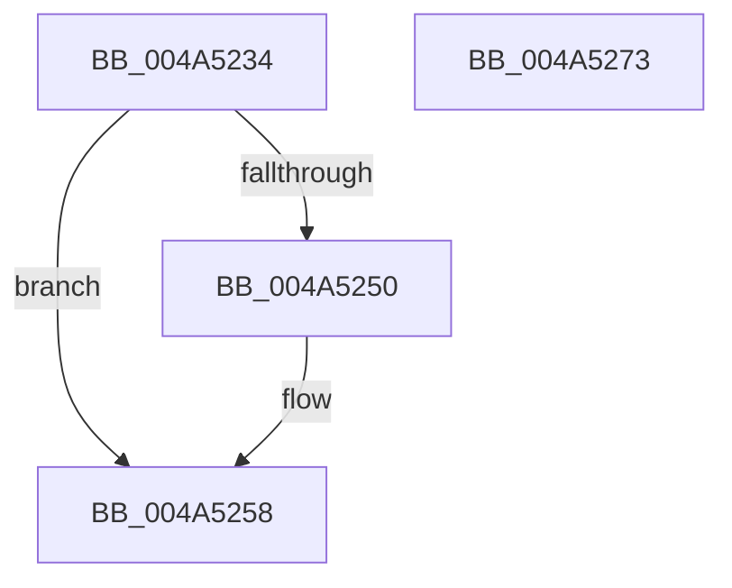

# PspUnlockQuotaListShared

- RVA: `0x004A5234`–`0x004A5274` (길이 `64` bytes)
- VA: `0x00000001404A5234`
- 실행 섹션: `.text`
- PDB 이름 있음: `예`; PDB Function 태그: `아니요`
- unwind 정보 RVA: `0x0005CAAC`
- 디코드: `20`개 명령, `64/64` bytes 표시
- 미해석 바이트: `0` (있으면 어셈블리에 `.byte`로 보존)

> 이 문서는 커널 이미지의 기계어와 PDB 기호를 분석해 생성했습니다. 4번과 5번은 함수 원형과 자료형을 바이너리 사용 방식에서 추정한 C 해석이며 원본 소스 복구 결과는 아닙니다.

## 1. Dependencies

- 직접 호출 지점: **3**; 고유 호출 대상: **3**
- 직접 호출자로 확인된 함수: **2**
- RIP 상대 이미지 참조: **0**

### Outgoing calls
- `0x004A5253` → [ExfReleasePushLockShared](../26/ExfReleasePushLockShared_function_00263440.md) (function, `0x00263440`)
- `0x004A525B` → [KeAbPostRelease](../2E/KeAbPostRelease_function_002E1600.md) (function, `0x002E1600`)
- `0x004A5263` → [KiLeaveCriticalRegionUnsafe](../25/KiLeaveCriticalRegionUnsafe_function_0025F010.md) (function, `0x0025F010`)

### Direct callers
- [PspAssignProcessQuotaBlock](../../page/AE/PspAssignProcessQuotaBlock_function_00AE3124.md) at `0x00AE323C`
- [PspAssignProcessQuotaBlock](../../page/AE/PspAssignProcessQuotaBlock_function_00AE3124.md) at `0x00AE3253`
- [PspLookupProcessQuotaBlock](../../page/AE/PspLookupProcessQuotaBlock_function_00AE336C.md) at `0x00AE34C1`

### Static image references
- 디코드된 RIP-relative 메모리 참조가 없습니다.

## 2. Other-region calls and transfers

- 다른 실행 섹션으로 향하는 call: **0**
- 별도 외부 분기/꼬리 이동을 확인하지 못했습니다.

## 3. Assembly (complete function range)

```asm
004A5234  48 89 5C 24 08                  mov qword ptr [rsp + 8], rbx
004A5239  57                              push rdi
004A523A  48 83 EC 20                     sub rsp, 0x20
004A523E  48 8B F9                        mov rdi, rcx
004A5241  48 8B DA                        mov rbx, rdx
004A5244  33 C9                           xor ecx, ecx
004A5246  8D 41 11                        lea eax, [rcx + 0x11]
004A5249  F0 48 0F B1 0A                  lock cmpxchg qword ptr [rdx], rcx
004A524E  74 08                           je 0x1404a5258
004A5250  48 8B CA                        mov rcx, rdx
004A5253  E8 E8 E1 DB FF                  call 0x140263440
004A5258  48 8B CB                        mov rcx, rbx
004A525B  E8 A0 C3 E3 FF                  call 0x1402e1600
004A5260  48 8B CF                        mov rcx, rdi
004A5263  E8 A8 9D DB FF                  call 0x14025f010
004A5268  48 8B 5C 24 30                  mov rbx, qword ptr [rsp + 0x30]
004A526D  48 83 C4 20                     add rsp, 0x20
004A5271  5F                              pop rdi
004A5272  C3                              ret
004A5273  CC                              int3
```

## 4. C-style interpretation (structured pseudocode)

```c
__int64 __fastcall PspUnlockQuotaListShared(__int64 a1, __int64 a2)
{
    __int64 result;
    __int64 v_rsp;
    unsigned __int64 v_stack_p8;

    v_stack_p8 = v_rbx;
    v_rsp = (v_rsp) - (32);
    a1 = 0;
    result = a1 + 17;
    if (!(condition_is_equal)) {
        a1 = a2;
        result = ExfReleasePushLockShared(a1, a2, a3, a4);
    }
    result = KeAbPostRelease(a2, a2, a3, a4);
    result = KiLeaveCriticalRegionUnsafe(a1, a2, a3, a4);
    v_rsp = (v_rsp) + (32);
    return result;
}
```

## 5. (Beta) C Style

```c
int64_t PspUnlockQuotaListShared(int64_t Arg1, void *Arg2)
{
    uint8_t *arg2 = (uint8_t *)Arg2;

    int64_t result;
    int64_t local_rsp;
    uint64_t v_stack_p8;

    v_stack_p8 = local_rbx;
    local_rsp = (local_rsp) - (32);
    Arg1 = 0;
    result = Arg1 + 17;
    if (!(condition_is_equal)) {
        Arg1 = Arg2;
        result = ExfReleasePushLockShared(Arg1, Arg2, a3, a4);
    }
    result = KeAbPostRelease(Arg2, Arg2, a3, a4);
    result = KiLeaveCriticalRegionUnsafe(Arg1, Arg2, a3, a4);
    local_rsp = (local_rsp) + (32);
    return result;
}
```

### 관측된 메모리 오프셋

구조체 형식이 확인되지 않은 접근은 인자 기준의 오프셋으로만 기록했습니다.

| 기준 인자 | 오프셋 표현 | 폭 (bit) | 접근 |
|---|---:|---:|---|
| `Arg2` | `+ 0x0` | `64` | `R` |

## 6. Execution-region graph

[열기: 2D/3D 그래프와 함수 탐색 컨트롤 패널](../../../control-panel.html?section=text&rva=0x004A5234&view=graph)

- 2D 그래프는 위에서 아래로 흐르고, 3D 그래프는 빈 공간을 드래그해 회전합니다. Shift+드래그는 이동, 휠은 확대·축소, 함수 노드 선택은 대상 보고서 이동입니다.

### Static fallback


