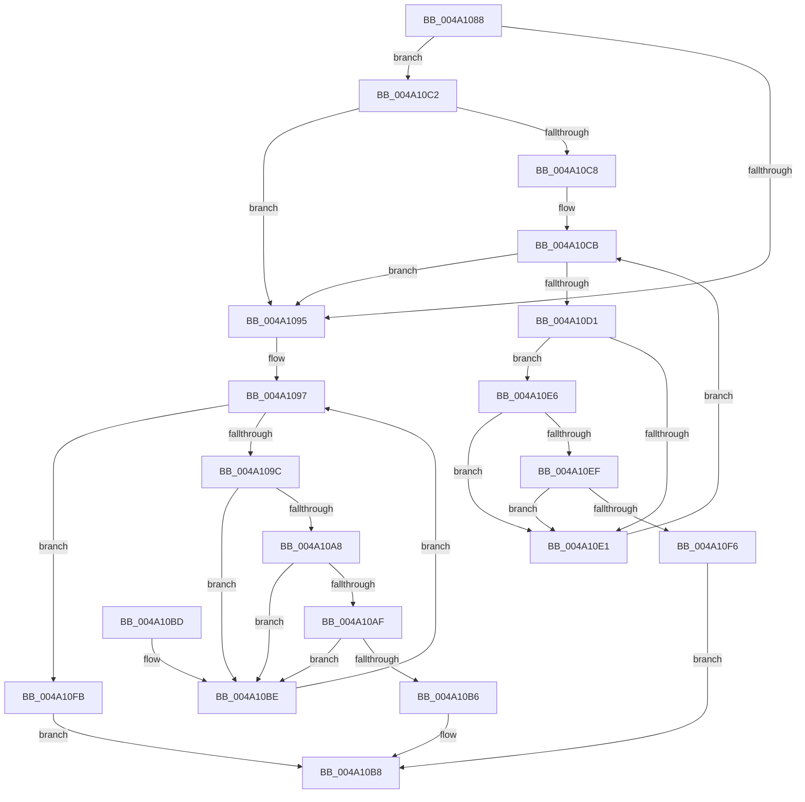

# PspWow64PickBestNtdll

- RVA: `0x004A1088`–`0x004A10FF` (길이 `119` bytes)
- VA: `0x00000001404A1088`
- 실행 섹션: `.text`
- PDB 이름 있음: `예`; PDB Function 태그: `아니요`
- unwind 정보 RVA: `0x000B5934`
- 디코드: `44`개 명령, `119/119` bytes 표시
- 미해석 바이트: `0` (있으면 어셈블리에 `.byte`로 보존)

> 이 문서는 커널 이미지의 기계어와 PDB 기호를 분석해 생성했습니다. 4번과 5번은 함수 원형과 자료형을 바이너리 사용 방식에서 추정한 C 해석이며 원본 소스 복구 결과는 아닙니다.

## 1. Dependencies

- 직접 호출 지점: **2**; 고유 호출 대상: **1**
- 직접 호출자로 확인된 함수: **1**
- RIP 상대 이미지 참조: **0**

### Outgoing calls
- `0x004A109E` → [PsQuerySystemDllInfo](../../page/8D/PsQuerySystemDllInfo_function_008D20F8.md) (function, `0x008D20F8`)
- `0x004A10D4` → [PsQuerySystemDllInfo](../../page/8D/PsQuerySystemDllInfo_function_008D20F8.md) (function, `0x008D20F8`)

### Direct callers
- [PspAllocateProcess](../../page/A1/PspAllocateProcess_function_00A13B3C.md) at `0x00A14B3D`

### Static image references
- 디코드된 RIP-relative 메모리 참조가 없습니다.

## 2. Other-region calls and transfers

- 다른 실행 섹션으로 향하는 call: **2**
  - `0x004A109E` → [PsQuerySystemDllInfo](../../page/8D/PsQuerySystemDllInfo_function_008D20F8.md) (`.text` → `PAGE`)
  - `0x004A10D4` → [PsQuerySystemDllInfo](../../page/8D/PsQuerySystemDllInfo_function_008D20F8.md) (`.text` → `PAGE`)
- 별도 외부 분기/꼬리 이동을 확인하지 못했습니다.

## 3. Assembly (complete function range)

```asm
004A1088  48 83 EC 28                     sub rsp, 0x28
004A108C  44 0F B7 CA                     movzx r9d, dx
004A1090  48 85 C9                        test rcx, rcx
004A1093  75 2D                           jne 0x1404a10c2
004A1095  33 D2                           xor edx, edx
004A1097  83 FA 06                        cmp edx, 6
004A109A  7D 5F                           jge 0x1404a10fb
004A109C  8B CA                           mov ecx, edx
004A109E  E8 55 10 43 00                  call 0x1408d20f8
004A10A3  48 85 C0                        test rax, rax
004A10A6  74 16                           je 0x1404a10be
004A10A8  8B 08                           mov ecx, dword ptr [rax]
004A10AA  F6 C1 08                        test cl, 8
004A10AD  74 0F                           je 0x1404a10be
004A10AF  66 44 39 48 02                  cmp word ptr [rax + 2], r9w
004A10B4  75 08                           jne 0x1404a10be
004A10B6  8B C2                           mov eax, edx
004A10B8  48 83 C4 28                     add rsp, 0x28
004A10BC  C3                              ret
004A10BD  CC                              int3
004A10BE  FF C2                           inc edx
004A10C0  EB D5                           jmp 0x1404a1097
004A10C2  80 79 11 00                     cmp byte ptr [rcx + 0x11], 0
004A10C6  7D CD                           jge 0x1404a1095
004A10C8  45 33 C0                        xor r8d, r8d
004A10CB  41 83 F8 06                     cmp r8d, 6
004A10CF  7D C4                           jge 0x1404a1095
004A10D1  41 8B C8                        mov ecx, r8d
004A10D4  E8 1F 10 43 00                  call 0x1408d20f8
004A10D9  48 8B D0                        mov rdx, rax
004A10DC  48 85 C0                        test rax, rax
004A10DF  75 05                           jne 0x1404a10e6
004A10E1  41 FF C0                        inc r8d
004A10E4  EB E5                           jmp 0x1404a10cb
004A10E6  8B 00                           mov eax, dword ptr [rax]
004A10E8  83 E0 0C                        and eax, 0xc
004A10EB  3C 0C                           cmp al, 0xc
004A10ED  75 F2                           jne 0x1404a10e1
004A10EF  66 44 39 4A 02                  cmp word ptr [rdx + 2], r9w
004A10F4  75 EB                           jne 0x1404a10e1
004A10F6  41 8B C0                        mov eax, r8d
004A10F9  EB BD                           jmp 0x1404a10b8
004A10FB  33 C0                           xor eax, eax
004A10FD  EB B9                           jmp 0x1404a10b8
```

## 4. C-style interpretation (structured pseudocode)

```c
__int64 __fastcall PspWow64PickBestNtdll(__int64 a1, int a2, int a3)
{
    __int64 result;
    __int64 v_rsp;

    v_rsp = (v_rsp) - (40);
    if (a1 != 0) goto loc_004A10C2;
loc_004A1095:
    a2 = 0;
loc_004A1097:
    if (0 >= 6) goto loc_004A10FB;
    result = PsQuerySystemDllInfo(0, a2, a3, (unsigned __int16)(a2));
    if (result == 0) goto loc_004A10BE;
    if ((((unsigned __int8)((unsigned int)(*(unsigned int *)(result)))) & (8)) == 0) goto loc_004A10BE;
    if ((*(unsigned __int16 *)(result + 2)) != ((unsigned __int16)((unsigned __int16)(a2)))) goto loc_004A10BE;
loc_004A10B8:
    v_rsp = (v_rsp) + (40);
    return 0;
loc_004A10BE:
    a2 = (unsigned int)((a2) + 1);
    goto loc_004A1097;
loc_004A10C2:
    if ((*(unsigned __int8 *)((unsigned int)(*(unsigned int *)(result)) + 17)) >= 0) goto loc_004A1095;
    a3 = 0;
loc_004A10CB:
    if (0 >= 6) goto loc_004A1095;
    result = PsQuerySystemDllInfo(0, a2, a3, (unsigned __int16)(a2));
    if (result != 0) goto loc_004A10E6;
loc_004A10E1:
    a3 = (unsigned int)((a3) + 1);
    goto loc_004A10CB;
loc_004A10E6:
    result = (unsigned int)(((unsigned int)(*(unsigned int *)(result))) & (12));
    if (((unsigned __int8)(result)) != 12) goto loc_004A10E1;
    if ((*(unsigned __int16 *)(result + 2)) != ((unsigned __int16)((unsigned __int16)(a2)))) goto loc_004A10E1;
    goto loc_004A10B8;
loc_004A10FB:
    result = 0;
    goto loc_004A10B8;
}
```

## 5. (Beta) C Style

```c
int64_t PspWow64PickBestNtdll(int64_t Arg1, int32_t Arg2, int32_t Arg3)
{
    int64_t result;
    int64_t local_rsp;

    local_rsp = (local_rsp) - (40);
    if (Arg1 != 0) goto loc_004A10C2;
loc_004A1095:
    Arg2 = 0;
loc_004A1097:
    if (0 >= 6) goto loc_004A10FB;
    result = PsQuerySystemDllInfo(0, Arg2, Arg3, (uint16_t)(Arg2));
    if (result == 0) goto loc_004A10BE;
    if ((((uint8_t)((uint32_t)(*(uint32_t *)(result)))) & (8)) == 0) goto loc_004A10BE;
    if ((*(uint16_t *)(result + 0x2)) != ((uint16_t)((uint16_t)(Arg2)))) goto loc_004A10BE;
loc_004A10B8:
    local_rsp = (local_rsp) + (40);
    return 0;
loc_004A10BE:
    Arg2 = (uint32_t)((Arg2) + 1);
    goto loc_004A1097;
loc_004A10C2:
    if ((*(uint8_t *)((uint32_t)(*(uint32_t *)(result)) + 0x11)) >= 0) goto loc_004A1095;
    Arg3 = 0;
loc_004A10CB:
    if (0 >= 6) goto loc_004A1095;
    result = PsQuerySystemDllInfo(0, Arg2, Arg3, (uint16_t)(Arg2));
    if (result != 0) goto loc_004A10E6;
loc_004A10E1:
    Arg3 = (uint32_t)((Arg3) + 1);
    goto loc_004A10CB;
loc_004A10E6:
    result = (uint32_t)(((uint32_t)(*(uint32_t *)(result))) & (12));
    if (((uint8_t)(result)) != 12) goto loc_004A10E1;
    if ((*(uint16_t *)(result + 0x2)) != ((uint16_t)((uint16_t)(Arg2)))) goto loc_004A10E1;
    goto loc_004A10B8;
loc_004A10FB:
    result = 0;
    goto loc_004A10B8;
}
```

## 6. Execution-region graph

[열기: 2D/3D 그래프와 함수 탐색 컨트롤 패널](../../../control-panel.html?section=text&rva=0x004A1088&view=graph)

- 2D 그래프는 위에서 아래로 흐르고, 3D 그래프는 빈 공간을 드래그해 회전합니다. Shift+드래그는 이동, 휠은 확대·축소, 함수 노드 선택은 대상 보고서 이동입니다.

### Static fallback


