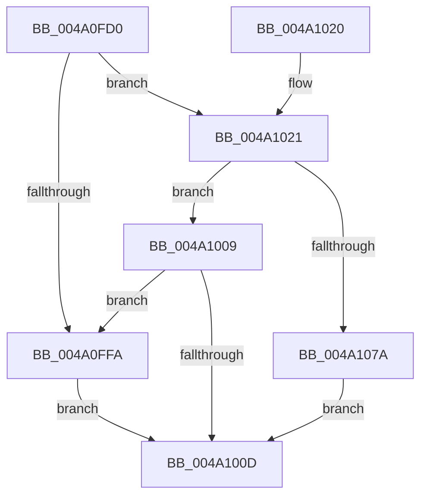

# RtlCheckPortableOperatingSystem

- RVA: `0x004A0FD0`–`0x004A1081` (길이 `177` bytes)
- VA: `0x00000001404A0FD0`
- 실행 섹션: `.text`
- PDB 이름 있음: `예`; PDB Function 태그: `아니요`
- unwind 정보 RVA: `0x000B58C4`
- 디코드: `45`개 명령, `177/177` bytes 표시
- 미해석 바이트: `0` (있으면 어셈블리에 `.byte`로 보존)

> 이 문서는 커널 이미지의 기계어와 PDB 기호를 분석해 생성했습니다. 4번과 5번은 함수 원형과 자료형을 바이너리 사용 방식에서 추정한 C 해석이며 원본 소스 복구 결과는 아닙니다.

## 1. Dependencies

- 직접 호출 지점: **3**; 고유 호출 대상: **3**
- 직접 호출자로 확인된 함수: **0**
- RIP 상대 이미지 참조: **2**

### Outgoing calls
- `0x004A0FF1` → [RtlCheckRegistryKey](../../page/8C/RtlCheckRegistryKey_function_008C9010.md) (function, `0x008C9010`)
- `0x004A102C` → [memset](../6C/memset_function_006C6C40.md) (function, `0x006C6C40`)
- `0x004A106C` → [RtlQueryRegistryValuesEx](../../page/8C/RtlQueryRegistryValuesEx_function_008C8FF0.md) (function, `0x008C8FF0`)

### Direct callers
- 이 함수 시작 RVA로 연결되는 직접 call은 확인되지 않았습니다. 간접 호출은 완전히 역산할 수 없습니다.

### Static image references
- `0x004A0FE1` → RVA `0x006CC7E0` (` ?? ::FNODOBFM::`string'`; read)
- `0x004A1036` → RVA `0x006CC7B0` (` ?? ::FNODOBFM::`string'`; read)

## 2. Other-region calls and transfers

- 다른 실행 섹션으로 향하는 call: **2**
  - `0x004A0FF1` → [RtlCheckRegistryKey](../../page/8C/RtlCheckRegistryKey_function_008C9010.md) (`.text` → `PAGE`)
  - `0x004A106C` → [RtlQueryRegistryValuesEx](../../page/8C/RtlQueryRegistryValuesEx_function_008C8FF0.md) (`.text` → `PAGE`)
- 별도 외부 분기/꼬리 이동을 확인하지 못했습니다.

## 3. Assembly (complete function range)

```asm
004A0FD0  48 8B C4                        mov rax, rsp
004A0FD3  48 89 58 08                     mov qword ptr [rax + 8], rbx
004A0FD7  57                              push rdi
004A0FD8  48 81 EC A0 00 00 00            sub rsp, 0xa0
004A0FDF  33 DB                           xor ebx, ebx
004A0FE1  48 8D 15 F8 B7 22 00            lea rdx, [rip + 0x22b7f8]
004A0FE8  21 58 10                        and dword ptr [rax + 0x10], ebx
004A0FEB  48 8B F9                        mov rdi, rcx
004A0FEE  8D 4B 02                        lea ecx, [rbx + 2]
004A0FF1  E8 1A 80 42 00                  call 0x1408c9010
004A0FF6  85 C0                           test eax, eax
004A0FF8  78 27                           js 0x1404a1021
004A0FFA  83 BC 24 B8 00 00 00 00         cmp dword ptr [rsp + 0xb8], 0
004A1002  0F 95 C1                        setne cl
004A1005  88 0F                           mov byte ptr [rdi], cl
004A1007  EB 04                           jmp 0x1404a100d
004A1009  85 C0                           test eax, eax
004A100B  79 ED                           jns 0x1404a0ffa
004A100D  8B C3                           mov eax, ebx
004A100F  48 8B 9C 24 B0 00 00 00         mov rbx, qword ptr [rsp + 0xb0]
004A1017  48 81 C4 A0 00 00 00            add rsp, 0xa0
004A101E  5F                              pop rdi
004A101F  C3                              ret
004A1020  CC                              int3
004A1021  33 D2                           xor edx, edx
004A1023  48 8D 4C 24 30                  lea rcx, [rsp + 0x30]
004A1028  44 8D 42 70                     lea r8d, [rdx + 0x70]
004A102C  E8 0F 5C 22 00                  call 0x1406c6c40
004A1031  48 21 5C 24 20                  and qword ptr [rsp + 0x20], rbx
004A1036  48 8D 05 73 B7 22 00            lea rax, [rip + 0x22b773]
004A103D  33 D2                           xor edx, edx
004A103F  48 89 44 24 40                  mov qword ptr [rsp + 0x40], rax
004A1044  48 8D 84 24 B8 00 00 00         lea rax, [rsp + 0xb8]
004A104C  C7 44 24 38 24 01 00 00         mov dword ptr [rsp + 0x38], 0x124
004A1054  45 33 C9                        xor r9d, r9d
004A1057  48 89 44 24 48                  mov qword ptr [rsp + 0x48], rax
004A105C  4C 8D 44 24 30                  lea r8, [rsp + 0x30]
004A1061  C7 44 24 50 00 00 00 04         mov dword ptr [rsp + 0x50], 0x4000000
004A1069  8D 4A 02                        lea ecx, [rdx + 2]
004A106C  E8 7F 7F 42 00                  call 0x1408c8ff0
004A1071  8B D8                           mov ebx, eax
004A1073  3D 34 00 00 C0                  cmp eax, 0xc0000034
004A1078  75 8F                           jne 0x1404a1009
004A107A  BB 25 02 00 C0                  mov ebx, 0xc0000225
004A107F  EB 8C                           jmp 0x1404a100d
```

## 4. C-style interpretation (structured pseudocode)

```c
__int64 __fastcall RtlCheckPortableOperatingSystem(__int64 a1, __int64 a2, __int64 a3, int a4)
{
    __int64 result;
    __int64 v_rbx;
    __int64 v_rsp;
    unsigned int v_stack_p10;
    unsigned __int64 v_stack_p20;
    unsigned __int64 v_stack_p30;
    unsigned int v_stack_p38;
    unsigned __int64 v_stack_p40;
    unsigned __int64 v_stack_p48;
    unsigned int v_stack_p50;
    unsigned __int64 v_stack_p8;
    unsigned __int64 v_stack_pB8;

    *(unsigned __int64 *)(v_rsp + 8) = v_rbx;
    v_rsp = (v_rsp) - (160);
    v_rbx = 0;
    result = RtlCheckRegistryKey(v_rbx + 2, v_rip + 2275320, a3, a4);
    if (sign_flag) goto loc_004A1021;
loc_004A0FFA:
    a1 = (v_stack_p10 != 0) ? 1 : 0;
    *(unsigned __int8 *)(a1) = (unsigned __int8)(a1);
    goto loc_004A100D;
loc_004A1009:
    if (!sign_flag) goto loc_004A0FFA;
loc_004A100D:
    v_rsp = (v_rsp) + (160);
    return 0;
loc_004A1021:
    a2 = 0;
    result = memset(v_stack_p30, a2, a2 + 112, a4);
    a2 = 0;
    v_stack_p40 = v_rip + 2275187;
    v_stack_p38 = 292;
    a4 = 0;
    v_stack_p48 = v_stack_pB8;
    v_stack_p50 = 0x4000000ULL;
    result = RtlQueryRegistryValuesEx(a2 + 2, a2, v_stack_p30, a4);
    if (((unsigned int)(result)) != 0xC0000034ULL) goto loc_004A1009;
    goto loc_004A100D;
}
```

## 5. (Beta) C Style

```c
int64_t RtlCheckPortableOperatingSystem(void *Arg1, int64_t Arg2, int64_t Arg3, int32_t Arg4)
{
    uint8_t *arg1 = (uint8_t *)Arg1;

    int64_t result;
    int64_t local_rbx;
    int64_t local_rsp;
    uint32_t v_stack_p10;
    uint64_t v_stack_p20;
    uint64_t v_stack_p30;
    uint32_t v_stack_p38;
    uint64_t v_stack_p40;
    uint64_t v_stack_p48;
    uint32_t v_stack_p50;
    uint64_t v_stack_p8;
    uint64_t v_stack_pB8;

    *(uint64_t *)(local_rsp + 0x8) = local_rbx;
    local_rsp = (local_rsp) - (160);
    local_rbx = 0;
    result = RtlCheckRegistryKey(local_rbx + 2, v_rip + 2275320, Arg3, Arg4);
    if (sign_flag) goto loc_004A1021;
loc_004A0FFA:
    Arg1 = (v_stack_p10 != 0) ? 1 : 0;
    *(uint8_t *)(arg1) = (uint8_t)(Arg1);
    goto loc_004A100D;
loc_004A1009:
    if (!sign_flag) goto loc_004A0FFA;
loc_004A100D:
    local_rsp = (local_rsp) + (160);
    return 0;
loc_004A1021:
    Arg2 = 0;
    result = memset(v_stack_p30, Arg2, Arg2 + 112, Arg4);
    Arg2 = 0;
    v_stack_p40 = v_rip + 2275187;
    v_stack_p38 = 292;
    Arg4 = 0;
    v_stack_p48 = v_stack_pB8;
    v_stack_p50 = 0x4000000ULL;
    result = RtlQueryRegistryValuesEx(Arg2 + 2, Arg2, v_stack_p30, Arg4);
    if (((uint32_t)(result)) != 0xC0000034ULL) goto loc_004A1009;
    goto loc_004A100D;
}
```

### 관측된 메모리 오프셋

구조체 형식이 확인되지 않은 접근은 인자 기준의 오프셋으로만 기록했습니다.

| 기준 인자 | 오프셋 표현 | 폭 (bit) | 접근 |
|---|---:|---:|---|
| `Arg1` | `+ 0x0` | `8` | `W` |

## 6. Execution-region graph

[열기: 2D/3D 그래프와 함수 탐색 컨트롤 패널](../../../control-panel.html?section=text&rva=0x004A0FD0&view=graph)

- 2D 그래프는 위에서 아래로 흐르고, 3D 그래프는 빈 공간을 드래그해 회전합니다. Shift+드래그는 이동, 휠은 확대·축소, 함수 노드 선택은 대상 보고서 이동입니다.

### Static fallback


