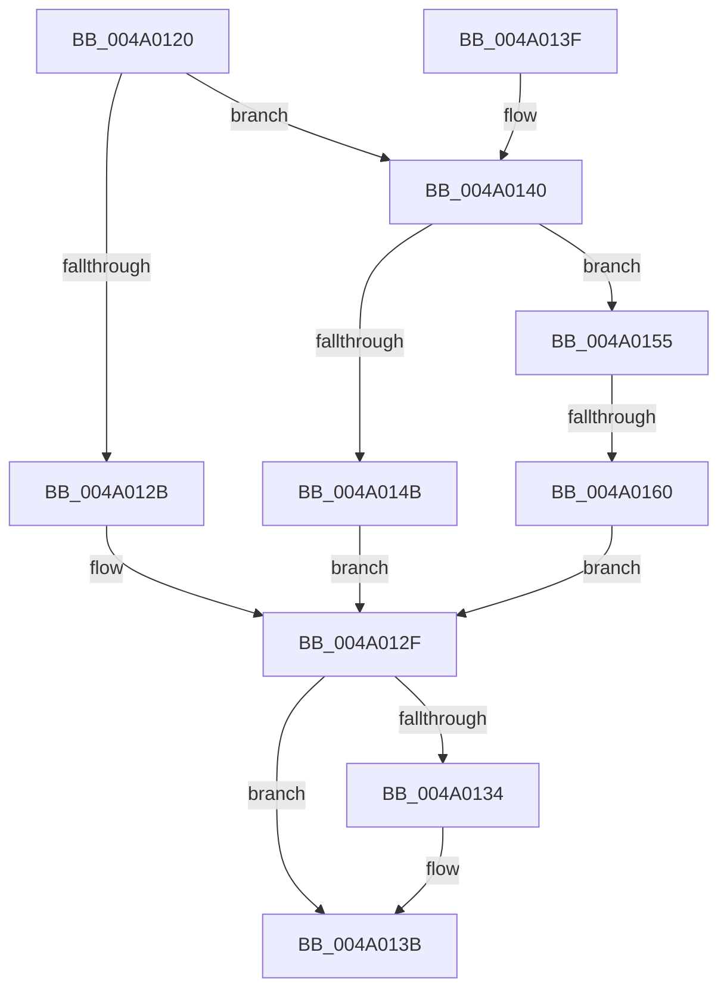

# RtlCmDecodeMemIoResource

- RVA: `0x004A0120`–`0x004A016A` (길이 `74` bytes)
- VA: `0x00000001404A0120`
- 실행 섹션: `.text`
- PDB 이름 있음: `예`; PDB Function 태그: `예`
- unwind 정보 RVA: `0x000DB714`
- 디코드: `24`개 명령, `74/74` bytes 표시
- 미해석 바이트: `0` (있으면 어셈블리에 `.byte`로 보존)

> 이 문서는 커널 이미지의 기계어와 PDB 기호를 분석해 생성했습니다. 4번과 5번은 함수 원형과 자료형을 바이너리 사용 방식에서 추정한 C 해석이며 원본 소스 복구 결과는 아닙니다.

## 1. Dependencies

- 직접 호출 지점: **0**; 고유 호출 대상: **0**
- 직접 호출자로 확인된 함수: **6**
- RIP 상대 이미지 참조: **0**

### Outgoing calls
- 직접 디코드된 call 명령이 없습니다.

### Direct callers
- [HalpDmaGetReservedRegionsForDeviceResources](../55/HalpDmaGetReservedRegionsForDeviceResources_function_00552018.md) at `0x00552192`
- [IopGenericUnpackResource](../../page/72/IopGenericUnpackResource_function_0072EF20.md) at `0x0072EF29`
- [PnprAddMemoryResources](../../page/73/PnprAddMemoryResources_function_007390C4.md) at `0x007391F2`
- [PnpCmResourcesToIoResources](../../page/73/PnpCmResourcesToIoResources_function_0073D584.md) at `0x0073D7B4`
- [PnpIsRangeWithin](../../page/AA/PnpIsRangeWithin_function_00AA6B00.md) at `0x00AA6B51`
- [PnpIsRangeWithin](../../page/AA/PnpIsRangeWithin_function_00AA6B00.md) at `0x00AA6B6A`
- [PnpFilterResourceRequirementsList](../../page/AD/PnpFilterResourceRequirementsList_function_00AD0D7C.md) at `0x00AD1067`

### Static image references
- 디코드된 RIP-relative 메모리 참조가 없습니다.

## 2. Other-region calls and transfers

- 다른 실행 섹션으로 향하는 call: **0**
- call이 아닌 외부 분기/꼬리 이동: **1**
  - `0x004A015A` → `0x006F8666` (`tail-transfer`)

## 3. Assembly (complete function range)

```asm
004A0120  8A 01                           mov al, byte ptr [rcx]
004A0122  45 33 C0                        xor r8d, r8d
004A0125  FE C8                           dec al
004A0127  A8 FD                           test al, 0xfd
004A0129  75 15                           jne 0x1404a0140
004A012B  44 8B 41 0C                     mov r8d, dword ptr [rcx + 0xc]
004A012F  48 85 D2                        test rdx, rdx
004A0132  74 07                           je 0x1404a013b
004A0134  48 8B 49 04                     mov rcx, qword ptr [rcx + 4]
004A0138  48 89 0A                        mov qword ptr [rdx], rcx
004A013B  49 8B C0                        mov rax, r8
004A013E  C3                              ret
004A013F  CC                              int3
004A0140  0F B7 41 02                     movzx eax, word ptr [rcx + 2]
004A0144  66 0F BA E0 09                  bt ax, 9
004A0149  73 0A                           jae 0x1404a0155
004A014B  44 8B 41 0C                     mov r8d, dword ptr [rcx + 0xc]
004A014F  49 C1 E0 08                     shl r8, 8
004A0153  EB DA                           jmp 0x1404a012f
004A0155  66 0F BA E0 0A                  bt ax, 0xa
004A015A  0F 83 06 85 25 00               jae 0x1406f8666
004A0160  44 8B 41 0C                     mov r8d, dword ptr [rcx + 0xc]
004A0164  49 C1 E0 10                     shl r8, 0x10
004A0168  EB C5                           jmp 0x1404a012f
```

## 4. C-style interpretation (structured pseudocode)

```c
__int64 __fastcall RtlCmDecodeMemIoResource(__int64 a1, __int64 a2, int a3)
{
    __int64 result;

    a3 = 0;
    result = (unsigned __int8)((*(unsigned __int8 *)(a1)) - 1);
    if ((((unsigned __int8)(result)) & (253)) != 0) goto loc_004A0140;
loc_004A012F:
    if (a2 != 0) {
        a1 = *(unsigned __int64 *)(a1 + 4);
        *(unsigned __int64 *)(a2) = a1;
    }
    return (unsigned int)(*(unsigned int *)(a1 + 12));
loc_004A0140:
    if (condition_is_above_or_equal) goto loc_004A0155;
    a3 = ((unsigned int)(*(unsigned int *)(a1 + 12))) << (8);
    goto loc_004A012F;
loc_004A0155:
    a3 = ((unsigned int)(*(unsigned int *)(a1 + 12))) << (16);
    goto loc_004A012F;
}
```

## 5. (Beta) C Style

```c
int64_t RtlCmDecodeMemIoResource(void *Arg1, int64_t Arg2, int32_t Arg3)
{
    uint8_t *arg1 = (uint8_t *)Arg1;

    int64_t result;

    Arg3 = 0;
    result = (uint8_t)((*(uint8_t *)(arg1)) - 1);
    if ((((uint8_t)(result)) & (253)) != 0) goto loc_004A0140;
loc_004A012F:
    if (Arg2 != 0) {
        Arg1 = *(uint64_t *)(arg1 + 0x4);
        *(void **)(Arg2) = Arg1;
    }
    return (uint32_t)(*(uint32_t *)(arg1 + 0xC));
loc_004A0140:
    if (condition_is_above_or_equal) goto loc_004A0155;
    Arg3 = ((uint32_t)(*(uint32_t *)(arg1 + 0xC))) << (8);
    goto loc_004A012F;
loc_004A0155:
    Arg3 = ((uint32_t)(*(uint32_t *)(arg1 + 0xC))) << (16);
    goto loc_004A012F;
}
```

### 관측된 메모리 오프셋

구조체 형식이 확인되지 않은 접근은 인자 기준의 오프셋으로만 기록했습니다.

| 기준 인자 | 오프셋 표현 | 폭 (bit) | 접근 |
|---|---:|---:|---|
| `Arg1` | `+ 0x0` | `8` | `R` |
| `Arg1` | `+ 0x2` | `16` | `R` |
| `Arg1` | `+ 0x4` | `64` | `R` |
| `Arg1` | `+ 0xC` | `32` | `R` |

## 6. Execution-region graph

[열기: 2D/3D 그래프와 함수 탐색 컨트롤 패널](../../../control-panel.html?section=text&rva=0x004A0120&view=graph)

- 2D 그래프는 위에서 아래로 흐르고, 3D 그래프는 빈 공간을 드래그해 회전합니다. Shift+드래그는 이동, 휠은 확대·축소, 함수 노드 선택은 대상 보고서 이동입니다.

### Static fallback


