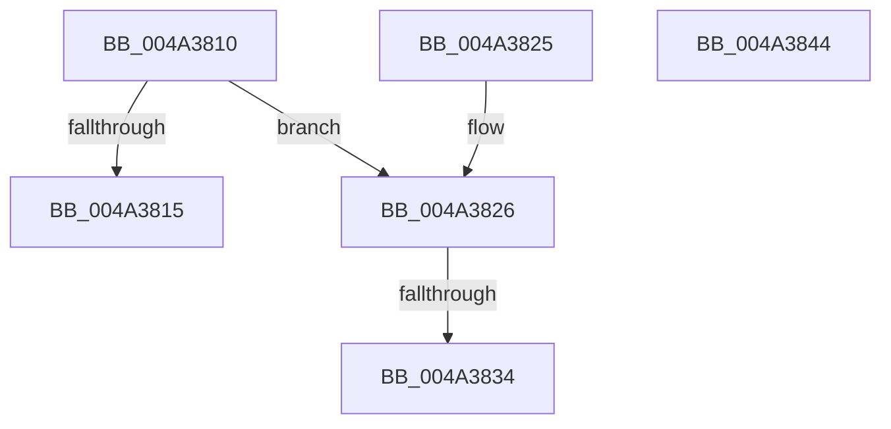

# RtlCompressWorkSpaceSizeXpressHuff

- RVA: `0x004A3810`–`0x004A3845` (길이 `53` bytes)
- VA: `0x00000001404A3810`
- 실행 섹션: `.text`
- PDB 이름 있음: `예`; PDB Function 태그: `예`
- unwind 정보 RVA: `0x000DB714`
- 디코드: `15`개 명령, `53/53` bytes 표시
- 미해석 바이트: `0` (있으면 어셈블리에 `.byte`로 보존)

> 이 문서는 커널 이미지의 기계어와 PDB 기호를 분석해 생성했습니다. 4번과 5번은 함수 원형과 자료형을 바이너리 사용 방식에서 추정한 C 해석이며 원본 소스 복구 결과는 아닙니다.

## 1. Dependencies

- 직접 호출 지점: **0**; 고유 호출 대상: **0**
- 직접 호출자로 확인된 함수: **0**
- RIP 상대 이미지 참조: **0**

### Outgoing calls
- 직접 디코드된 call 명령이 없습니다.

### Direct callers
- 이 함수 시작 RVA로 연결되는 직접 call은 확인되지 않았습니다. 간접 호출은 완전히 역산할 수 없습니다.

### Static image references
- 디코드된 RIP-relative 메모리 참조가 없습니다.

## 2. Other-region calls and transfers

- 다른 실행 섹션으로 향하는 call: **0**
- call이 아닌 외부 분기/꼬리 이동: **1**
  - `0x004A382E` → `0x006F9118` (`tail-transfer`)

## 3. Assembly (complete function range)

```asm
004A3810  66 85 C9                        test cx, cx
004A3813  75 11                           jne 0x1404a3826
004A3815  C7 02 5F 8A 02 00               mov dword ptr [rdx], 0x28a5f
004A381B  33 C0                           xor eax, eax
004A381D  41 C7 00 29 14 00 00            mov dword ptr [r8], 0x1429
004A3824  C3                              ret
004A3825  CC                              int3
004A3826  B8 00 01 00 00                  mov eax, 0x100
004A382B  66 3B C8                        cmp cx, ax
004A382E  0F 85 E4 58 25 00               jne 0x1406f9118
004A3834  C7 02 3F 9B 15 00               mov dword ptr [rdx], 0x159b3f
004A383A  33 C0                           xor eax, eax
004A383C  41 C7 00 29 14 00 00            mov dword ptr [r8], 0x1429
004A3843  C3                              ret
004A3844  CC                              int3
```

## 4. C-style interpretation (structured pseudocode)

```c
__int64 __fastcall RtlCompressWorkSpaceSizeXpressHuff(unsigned __int16 a1, __int64 a2, __int64 a3)
{
    __int64 result;

    if (a1 != 0) goto loc_004A3826;
    *(unsigned int *)(a2) = 0x28A5FULL;
    result = 0;
    *(unsigned int *)(a3) = 0x1429ULL;
    return result;
loc_004A3826:
    *(unsigned int *)(a2) = 0x159B3FULL;
    result = 0;
    *(unsigned int *)(a3) = 0x1429ULL;
    return result;
}
```

## 5. (Beta) C Style

```c
int64_t RtlCompressWorkSpaceSizeXpressHuff(uint16_t Arg1, void *Arg2, void *Arg3)
{
    uint8_t *arg2 = (uint8_t *)Arg2;
    uint8_t *arg3 = (uint8_t *)Arg3;

    int64_t result;

    if (Arg1 != 0) goto loc_004A3826;
    *(uint32_t *)(arg2) = 0x28A5FULL;
    result = 0;
    *(uint32_t *)(arg3) = 0x1429ULL;
    return result;
loc_004A3826:
    *(uint32_t *)(arg2) = 0x159B3FULL;
    result = 0;
    *(uint32_t *)(arg3) = 0x1429ULL;
    return result;
}
```

### 관측된 메모리 오프셋

구조체 형식이 확인되지 않은 접근은 인자 기준의 오프셋으로만 기록했습니다.

| 기준 인자 | 오프셋 표현 | 폭 (bit) | 접근 |
|---|---:|---:|---|
| `Arg2` | `+ 0x0` | `32` | `W` |
| `Arg3` | `+ 0x0` | `32` | `W` |

## 6. Execution-region graph

[열기: 2D/3D 그래프와 함수 탐색 컨트롤 패널](../../../control-panel.html?section=text&rva=0x004A3810&view=graph)

- 2D 그래프는 위에서 아래로 흐르고, 3D 그래프는 빈 공간을 드래그해 회전합니다. Shift+드래그는 이동, 휠은 확대·축소, 함수 노드 선택은 대상 보고서 이동입니다.

### Static fallback


