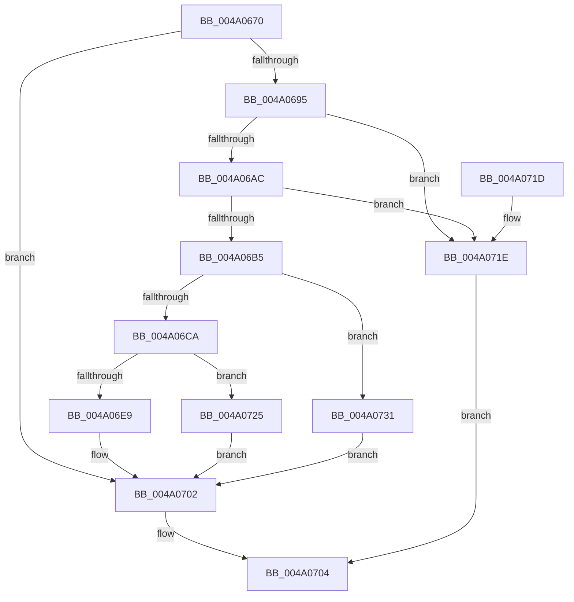

# RtlCreateAtomTableEx

- RVA: `0x004A0670`–`0x004A0738` (길이 `200` bytes)
- VA: `0x00000001404A0670`
- 실행 섹션: `.text`
- PDB 이름 있음: `예`; PDB Function 태그: `아니요`
- unwind 정보 RVA: `0x000B580C`
- 디코드: `61`개 명령, `200/200` bytes 표시
- 미해석 바이트: `0` (있으면 어셈블리에 `.byte`로 보존)

> 이 문서는 커널 이미지의 기계어와 PDB 기호를 분석해 생성했습니다. 4번과 5번은 함수 원형과 자료형을 바이너리 사용 방식에서 추정한 C 해석이며 원본 소스 복구 결과는 아닙니다.

## 1. Dependencies

- 직접 호출 지점: **5**; 고유 호출 대상: **5**
- 직접 호출자로 확인된 함수: **1**
- RIP 상대 이미지 참조: **0**

### Outgoing calls
- `0x004A06BD` → [RtlpAllocateAtom](../../page/99/RtlpAllocateAtom_function_0099E2B4.md) (function, `0x0099E2B4`)
- `0x004A06D2` → [memset](../6C/memset_function_006C6C40.md) (function, `0x006C6C40`)
- `0x004A06DD` → [RtlpInitializeHandleTableForAtomTable](../../page/94/RtlpInitializeHandleTableForAtomTable_function_0094C398.md) (function, `0x0094C398`)
- `0x004A06E9` → [RtlpInitializeLockAtomTable](../../page/AA/RtlpInitializeLockAtomTable_function_00AAE83C.md) (function, `0x00AAE83C`)
- `0x004A072A` → [RtlpFreeAtom](../../page/8B/RtlpFreeAtom_function_008BD87C.md) (function, `0x008BD87C`)

### Direct callers
- [RtlCreateAtomTable](../../page/A9/RtlCreateAtomTable_function_00A96760.md) at `0x00A96769`

### Static image references
- 디코드된 RIP-relative 메모리 참조가 없습니다.

## 2. Other-region calls and transfers

- 다른 실행 섹션으로 향하는 call: **4**
  - `0x004A06BD` → [RtlpAllocateAtom](../../page/99/RtlpAllocateAtom_function_0099E2B4.md) (`.text` → `PAGE`)
  - `0x004A06DD` → [RtlpInitializeHandleTableForAtomTable](../../page/94/RtlpInitializeHandleTableForAtomTable_function_0094C398.md) (`.text` → `PAGE`)
  - `0x004A06E9` → [RtlpInitializeLockAtomTable](../../page/AA/RtlpInitializeLockAtomTable_function_00AAE83C.md) (`.text` → `PAGE`)
  - `0x004A072A` → [RtlpFreeAtom](../../page/8B/RtlpFreeAtom_function_008BD87C.md) (`.text` → `PAGE`)
- 별도 외부 분기/꼬리 이동을 확인하지 못했습니다.

## 3. Assembly (complete function range)

```asm
004A0670  48 89 5C 24 08                  mov qword ptr [rsp + 8], rbx
004A0675  48 89 6C 24 10                  mov qword ptr [rsp + 0x10], rbp
004A067A  48 89 74 24 20                  mov qword ptr [rsp + 0x20], rsi
004A067F  57                              push rdi
004A0680  41 56                           push r14
004A0682  41 57                           push r15
004A0684  48 83 EC 20                     sub rsp, 0x20
004A0688  33 DB                           xor ebx, ebx
004A068A  4D 8B F0                        mov r14, r8
004A068D  44 8B FA                        mov r15d, edx
004A0690  49 39 18                        cmp qword ptr [r8], rbx
004A0693  75 6D                           jne 0x1404a0702
004A0695  83 F9 01                        cmp ecx, 1
004A0698  8D 6B 25                        lea ebp, [rbx + 0x25]
004A069B  0F 47 E9                        cmova ebp, ecx
004A069E  8D 4B 30                        lea ecx, [rbx + 0x30]
004A06A1  8D 45 FF                        lea eax, [rbp - 1]
004A06A4  48 F7 E1                        mul rcx
004A06A7  48 85 D2                        test rdx, rdx
004A06AA  75 72                           jne 0x1404a071e
004A06AC  48 8D 70 28                     lea rsi, [rax + 0x28]
004A06B0  48 3B F0                        cmp rsi, rax
004A06B3  72 69                           jb 0x1404a071e
004A06B5  BA 41 74 6D 54                  mov edx, 0x546d7441
004A06BA  48 8B CE                        mov rcx, rsi
004A06BD  E8 F2 DB 4F 00                  call 0x14099e2b4
004A06C2  48 8B F8                        mov rdi, rax
004A06C5  48 85 C0                        test rax, rax
004A06C8  74 67                           je 0x1404a0731
004A06CA  4C 8B C6                        mov r8, rsi
004A06CD  33 D2                           xor edx, edx
004A06CF  48 8B C8                        mov rcx, rax
004A06D2  E8 69 65 22 00                  call 0x1406c6c40
004A06D7  48 8B CF                        mov rcx, rdi
004A06DA  89 6F 1C                        mov dword ptr [rdi + 0x1c], ebp
004A06DD  E8 B6 BC 4A 00                  call 0x14094c398
004A06E2  48 8B CF                        mov rcx, rdi
004A06E5  84 C0                           test al, al
004A06E7  74 3C                           je 0x1404a0725
004A06E9  E8 4E E1 60 00                  call 0x140aae83c
004A06EE  C7 07 41 74 6F 6D               mov dword ptr [rdi], 0x6d6f7441
004A06F4  C7 47 04 01 00 00 00            mov dword ptr [rdi + 4], 1
004A06FB  44 89 7F 18                     mov dword ptr [rdi + 0x18], r15d
004A06FF  49 89 3E                        mov qword ptr [r14], rdi
004A0702  8B C3                           mov eax, ebx
004A0704  48 8B 5C 24 40                  mov rbx, qword ptr [rsp + 0x40]
004A0709  48 8B 6C 24 48                  mov rbp, qword ptr [rsp + 0x48]
004A070E  48 8B 74 24 58                  mov rsi, qword ptr [rsp + 0x58]
004A0713  48 83 C4 20                     add rsp, 0x20
004A0717  41 5F                           pop r15
004A0719  41 5E                           pop r14
004A071B  5F                              pop rdi
004A071C  C3                              ret
004A071D  CC                              int3
004A071E  B8 95 00 00 C0                  mov eax, 0xc0000095
004A0723  EB DF                           jmp 0x1404a0704
004A0725  BB 17 00 00 C0                  mov ebx, 0xc0000017
004A072A  E8 4D D1 41 00                  call 0x1408bd87c
004A072F  EB D1                           jmp 0x1404a0702
004A0731  BB 17 00 00 C0                  mov ebx, 0xc0000017
004A0736  EB CA                           jmp 0x1404a0702
```

## 4. C-style interpretation (structured pseudocode)

```c
__int64 __fastcall RtlCreateAtomTableEx(int a1, __int64 a2, __int64 a3)
{
    __int64 result;
    __int64 v_rbp;
    __int64 v_rbx;
    __int64 v_rsp;
    unsigned __int64 v_stack_p10;
    unsigned __int64 v_stack_p20;
    unsigned __int64 v_stack_p8;

    v_stack_p8 = v_rbx;
    v_stack_p10 = v_rbp;
    v_stack_p20 = v_rsi;
    v_rsp = (v_rsp) - (32);
    v_rbx = 0;
    if ((*(unsigned __int64 *)(a3)) != 0) goto loc_004A0702;
    v_rbp = v_rbx + 37;
    if (a1 > 1) { v_rbp = a1; }
    if (a2 != 0) goto loc_004A071E;
    if ((v_rbp - 1 + 40) < (v_rbp - 1)) goto loc_004A071E;
    result = RtlpAllocateAtom(v_rbp - 1 + 40, (unsigned int)(0x546D7441ULL), a3, a4);
    if (result == 0) goto loc_004A0731;
    a2 = 0;
    result = memset(result, a2, v_rbp - 1 + 40, a4);
    *(unsigned int *)(result + 28) = (unsigned int)(v_rbp);
    result = RtlpInitializeHandleTableForAtomTable(result, a2, v_rbp - 1 + 40, a4);
    if ((unsigned __int8)(result) == 0) goto loc_004A0725;
    result = RtlpInitializeLockAtomTable(result, a2, v_rbp - 1 + 40, a4);
    *(unsigned int *)(result) = 0x6D6F7441ULL;
    *(unsigned int *)(result + 4) = 1;
    *(unsigned int *)(result + 24) = (unsigned int)((unsigned int)((unsigned int)(a2)));
    *(unsigned __int64 *)(a3) = result;
loc_004A0702:
loc_004A0704:
    v_rsp = (v_rsp) + (32);
    return 0;
loc_004A071E:
    goto loc_004A0704;
loc_004A0725:
    result = RtlpFreeAtom(result, a2, v_rbp - 1 + 40, a4);
    goto loc_004A0702;
loc_004A0731:
    goto loc_004A0702;
}
```

## 5. (Beta) C Style

```c
int64_t RtlCreateAtomTableEx(int32_t Arg1, int64_t Arg2, void *Arg3)
{
    uint8_t *arg3 = (uint8_t *)Arg3;

    int64_t result;
    int64_t local_rbp;
    int64_t local_rbx;
    int64_t local_rsp;
    uint64_t v_stack_p10;
    uint64_t v_stack_p20;
    uint64_t v_stack_p8;

    v_stack_p8 = local_rbx;
    v_stack_p10 = local_rbp;
    v_stack_p20 = local_rsi;
    local_rsp = (local_rsp) - (32);
    local_rbx = 0;
    if ((*(uint64_t *)(arg3)) != 0) goto loc_004A0702;
    local_rbp = local_rbx + 37;
    if (Arg1 > 1) { local_rbp = Arg1; }
    if (Arg2 != 0) goto loc_004A071E;
    if ((local_rbp - 1 + 40) < (local_rbp - 1)) goto loc_004A071E;
    result = RtlpAllocateAtom(local_rbp - 1 + 40, (uint32_t)(0x546D7441ULL), Arg3, a4);
    if (result == 0) goto loc_004A0731;
    Arg2 = 0;
    result = memset(result, Arg2, local_rbp - 1 + 40, a4);
    *(uint32_t *)(result + 0x1C) = (uint32_t)(local_rbp);
    result = RtlpInitializeHandleTableForAtomTable(result, Arg2, local_rbp - 1 + 40, a4);
    if ((uint8_t)(result) == 0) goto loc_004A0725;
    result = RtlpInitializeLockAtomTable(result, Arg2, local_rbp - 1 + 40, a4);
    *(uint32_t *)(result) = 0x6D6F7441ULL;
    *(uint32_t *)(result + 0x4) = 1;
    *(uint32_t *)(result + 0x18) = (uint32_t)((uint32_t)((uint32_t)(Arg2)));
    *(uint64_t *)(arg3) = result;
loc_004A0702:
loc_004A0704:
    local_rsp = (local_rsp) + (32);
    return 0;
loc_004A071E:
    goto loc_004A0704;
loc_004A0725:
    result = RtlpFreeAtom(result, Arg2, local_rbp - 1 + 40, a4);
    goto loc_004A0702;
loc_004A0731:
    goto loc_004A0702;
}
```

### 관측된 메모리 오프셋

구조체 형식이 확인되지 않은 접근은 인자 기준의 오프셋으로만 기록했습니다.

| 기준 인자 | 오프셋 표현 | 폭 (bit) | 접근 |
|---|---:|---:|---|
| `Arg3` | `+ 0x0` | `64` | `R` |
| `Arg3` | `+ 0x0` | `64` | `W` |

## 6. Execution-region graph

[열기: 2D/3D 그래프와 함수 탐색 컨트롤 패널](../../../control-panel.html?section=text&rva=0x004A0670&view=graph)

- 2D 그래프는 위에서 아래로 흐르고, 3D 그래프는 빈 공간을 드래그해 회전합니다. Shift+드래그는 이동, 휠은 확대·축소, 함수 노드 선택은 대상 보고서 이동입니다.

### Static fallback


