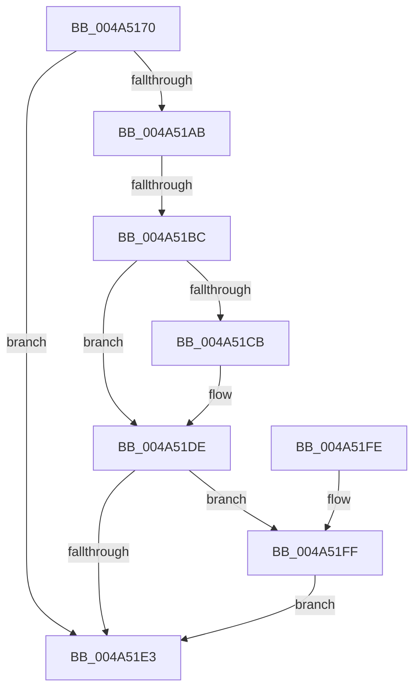

# RtlExtractBitMapEx

- RVA: `0x004A5170`–`0x004A522E` (길이 `190` bytes)
- VA: `0x00000001404A5170`
- 실행 섹션: `.text`
- PDB 이름 있음: `예`; PDB Function 태그: `예`
- unwind 정보 RVA: `0x000B6854`
- 디코드: `57`개 명령, `190/190` bytes 표시
- 미해석 바이트: `0` (있으면 어셈블리에 `.byte`로 보존)

> 이 문서는 커널 이미지의 기계어와 PDB 기호를 분석해 생성했습니다. 4번과 5번은 함수 원형과 자료형을 바이너리 사용 방식에서 추정한 C 해석이며 원본 소스 복구 결과는 아닙니다.

## 1. Dependencies

- 직접 호출 지점: **1**; 고유 호출 대상: **1**
- 직접 호출자로 확인된 함수: **1**
- RIP 상대 이미지 참조: **0**

### Outgoing calls
- `0x004A51D9` → [memcpy](../6C/memcpy_function_006C6840.md) (function, `0x006C6840`)

### Direct callers
- [RtlShiftLeftBitMapEx](../5E/RtlShiftLeftBitMapEx_function_005E65F0.md) at `0x005E6639`

### Static image references
- 디코드된 RIP-relative 메모리 참조가 없습니다.

## 2. Other-region calls and transfers

- 다른 실행 섹션으로 향하는 call: **0**
- call이 아닌 외부 분기/꼬리 이동: **1**
  - `0x004A51B6` → [sub_006F953A](../6F/Unknown_function_006F953A.md) (`tail-transfer`)

## 3. Assembly (complete function range)

```asm
004A5170  48 8B C4                        mov rax, rsp
004A5173  48 89 58 08                     mov qword ptr [rax + 8], rbx
004A5177  48 89 70 10                     mov qword ptr [rax + 0x10], rsi
004A517B  48 89 78 18                     mov qword ptr [rax + 0x18], rdi
004A517F  4C 89 70 20                     mov qword ptr [rax + 0x20], r14
004A5183  41 57                           push r15
004A5185  48 83 EC 20                     sub rsp, 0x20
004A5189  48 8B 1A                        mov rbx, qword ptr [rdx]
004A518C  4C 8B F2                        mov r14, rdx
004A518F  48 8B 01                        mov rax, qword ptr [rcx]
004A5192  4C 8B F9                        mov r15, rcx
004A5195  49 2B C0                        sub rax, r8
004A5198  4C 3B C8                        cmp r9, rax
004A519B  4C 0F 47 C8                     cmova r9, rax
004A519F  4C 3B CB                        cmp r9, rbx
004A51A2  49 0F 46 D9                     cmovbe rbx, r9
004A51A6  48 85 DB                        test rbx, rbx
004A51A9  74 38                           je 0x1404a51e3
004A51AB  49 8B F0                        mov rsi, r8
004A51AE  48 C1 EE 03                     shr rsi, 3
004A51B2  41 F6 C0 07                     test r8b, 7
004A51B6  0F 85 7E 43 25 00               jne 0x1406f953a
004A51BC  48 8B FB                        mov rdi, rbx
004A51BF  83 E3 07                        and ebx, 7
004A51C2  48 C1 EF 03                     shr rdi, 3
004A51C6  48 85 FF                        test rdi, rdi
004A51C9  74 13                           je 0x1404a51de
004A51CB  48 8B 51 08                     mov rdx, qword ptr [rcx + 8]
004A51CF  4C 8B C7                        mov r8, rdi
004A51D2  49 8B 4E 08                     mov rcx, qword ptr [r14 + 8]
004A51D6  48 03 D6                        add rdx, rsi
004A51D9  E8 62 16 22 00                  call 0x1406c6840
004A51DE  48 85 DB                        test rbx, rbx
004A51E1  75 1C                           jne 0x1404a51ff
004A51E3  48 8B 5C 24 30                  mov rbx, qword ptr [rsp + 0x30]
004A51E8  48 8B 74 24 38                  mov rsi, qword ptr [rsp + 0x38]
004A51ED  48 8B 7C 24 40                  mov rdi, qword ptr [rsp + 0x40]
004A51F2  4C 8B 74 24 48                  mov r14, qword ptr [rsp + 0x48]
004A51F7  48 83 C4 20                     add rsp, 0x20
004A51FB  41 5F                           pop r15
004A51FD  C3                              ret
004A51FE  CC                              int3
004A51FF  49 8B 47 08                     mov rax, qword ptr [r15 + 8]
004A5203  48 8D 14 3E                     lea rdx, [rsi + rdi]
004A5207  4D 8B 4E 08                     mov r9, qword ptr [r14 + 8]
004A520B  48 8B CB                        mov rcx, rbx
004A520E  44 8A 04 02                     mov r8b, byte ptr [rdx + rax]
004A5212  BA 01 00 00 00                  mov edx, 1
004A5217  D2 E2                           shl dl, cl
004A5219  FE CA                           dec dl
004A521B  8A C2                           mov al, dl
004A521D  41 22 D0                        and dl, r8b
004A5220  F6 D0                           not al
004A5222  42 22 04 0F                     and al, byte ptr [rdi + r9]
004A5226  0A C2                           or al, dl
004A5228  42 88 04 0F                     mov byte ptr [rdi + r9], al
004A522C  EB B5                           jmp 0x1404a51e3
```

## 4. C-style interpretation (structured pseudocode)

```c
__int64 __fastcall RtlExtractBitMapEx(__int64 a1, __int64 a2, __int64 a3, __int64 a4)
{
    __int64 result;
    __int64 v_rbx;
    __int64 v_rdi;
    __int64 v_rsi;
    __int64 v_rsp;
    unsigned __int64 v_stack_p10;
    unsigned __int64 v_stack_p18;
    unsigned __int64 v_stack_p20;
    unsigned __int64 v_stack_p8;

    *(unsigned __int64 *)(v_rsp + 8) = v_rbx;
    *(unsigned __int64 *)(v_rsp + 16) = v_rsi;
    *(unsigned __int64 *)(v_rsp + 24) = v_rdi;
    *(unsigned __int64 *)(v_rsp + 32) = v_r14;
    v_rsp = (v_rsp) - (32);
    result = (*(unsigned __int64 *)(a1)) - (a3);
    if (a4 > result) { a4 = result; }
    v_rbx = *(unsigned __int64 *)(a2);
    if (a4 <= (*(unsigned __int64 *)(a2))) { v_rbx = a4; }
    if (v_rbx == 0) goto loc_004A51E3;
    v_rsi = (a3) >> (3);
    v_rbx = (unsigned int)((v_rbx) & (7));
    v_rdi = (v_rbx) >> (3);
    if (v_rdi != 0) {
        a2 = *(unsigned __int64 *)(a1 + 8);
        a3 = v_rdi;
        a1 = *(unsigned __int64 *)(a2 + 8);
        a2 = (a2) + (v_rsi);
        result = memcpy(a1, a2, a3, a4);
    }
    if (v_rbx != 0) goto loc_004A51FF;
loc_004A51E3:
    v_rsp = (v_rsp) + (32);
    return result;
loc_004A51FF:
    a2 = (unsigned __int8)((1) << ((unsigned __int8)(v_stack_p8)));
    a2 = (unsigned __int8)((a2) - 1);
    a2 = (unsigned __int8)((a2) & ((unsigned __int8)(*(unsigned __int8 *)(v_stack_p10 + v_stack_p18 * 1 + *(unsigned __int64 *)(a1 + 8) * 1))));
    result = (unsigned __int8)(~((unsigned __int8)(a2)));
    result = (unsigned __int8)((result) & (*(unsigned __int8 *)(v_stack_p18 + *(unsigned __int64 *)(v_stack_p20 + 8) * 1)));
    result = (unsigned __int8)((result) | ((unsigned __int8)(a2)));
    *(unsigned __int8 *)(v_stack_p18 + *(unsigned __int64 *)(v_stack_p20 + 8) * 1) = (unsigned __int8)(result);
    goto loc_004A51E3;
}
```

## 5. (Beta) C Style

```c
int64_t RtlExtractBitMapEx(void *Arg1, void *Arg2, int64_t Arg3, int64_t Arg4)
{
    uint8_t *arg1 = (uint8_t *)Arg1;
    uint8_t *arg2 = (uint8_t *)Arg2;

    int64_t result;
    int64_t local_rbx;
    int64_t local_rdi;
    int64_t local_rsi;
    int64_t local_rsp;
    uint64_t v_stack_p10;
    uint64_t v_stack_p18;
    uint64_t v_stack_p20;
    uint64_t v_stack_p8;

    *(uint64_t *)(local_rsp + 0x8) = local_rbx;
    *(uint64_t *)(local_rsp + 0x10) = local_rsi;
    *(uint64_t *)(local_rsp + 0x18) = local_rdi;
    *(uint64_t *)(local_rsp + 0x20) = local_r14;
    local_rsp = (local_rsp) - (32);
    result = (*(uint64_t *)(arg1)) - (Arg3);
    if (Arg4 > result) { Arg4 = result; }
    local_rbx = *(uint64_t *)(arg2);
    if (Arg4 <= (*(uint64_t *)(arg2))) { local_rbx = Arg4; }
    if (local_rbx == 0) goto loc_004A51E3;
    local_rsi = (Arg3) >> (3);
    local_rbx = (uint32_t)((local_rbx) & (7));
    local_rdi = (local_rbx) >> (3);
    if (local_rdi != 0) {
        Arg2 = *(uint64_t *)(arg1 + 0x8);
        Arg3 = local_rdi;
        Arg1 = *(uint64_t *)(arg2 + 0x8);
        Arg2 = (Arg2) + (local_rsi);
        result = memcpy(Arg1, Arg2, Arg3, Arg4);
    }
    if (local_rbx != 0) goto loc_004A51FF;
loc_004A51E3:
    local_rsp = (local_rsp) + (32);
    return result;
loc_004A51FF:
    Arg2 = (uint8_t)((1) << ((uint8_t)(v_stack_p8)));
    Arg2 = (uint8_t)((Arg2) - 1);
    Arg2 = (uint8_t)((Arg2) & ((uint8_t)(*(uint8_t *)(v_stack_p10 + v_stack_p18 * 1 + *(uint64_t *)(arg1 + 0x8) * 1))));
    result = (uint8_t)(~((uint8_t)(Arg2)));
    result = (uint8_t)((result) & (*(uint8_t *)(v_stack_p18 + *(uint64_t *)(v_stack_p20 + 0x8) * 1)));
    result = (uint8_t)((result) | ((uint8_t)(Arg2)));
    *(uint8_t *)(v_stack_p18 + *(uint64_t *)(v_stack_p20 + 0x8) * 1) = (uint8_t)(result);
    goto loc_004A51E3;
}
```

### 관측된 메모리 오프셋

구조체 형식이 확인되지 않은 접근은 인자 기준의 오프셋으로만 기록했습니다.

| 기준 인자 | 오프셋 표현 | 폭 (bit) | 접근 |
|---|---:|---:|---|
| `Arg1` | `+ 0x0` | `64` | `R` |
| `Arg1` | `+ 0x8` | `64` | `R` |
| `Arg2` | `+ 0x0` | `64` | `R` |
| `Arg2` | `+ 0x8` | `64` | `R` |

## 6. Execution-region graph

[열기: 2D/3D 그래프와 함수 탐색 컨트롤 패널](../../../control-panel.html?section=text&rva=0x004A5170&view=graph)

- 2D 그래프는 위에서 아래로 흐르고, 3D 그래프는 빈 공간을 드래그해 회전합니다. Shift+드래그는 이동, 휠은 확대·축소, 함수 노드 선택은 대상 보고서 이동입니다.

### Static fallback


