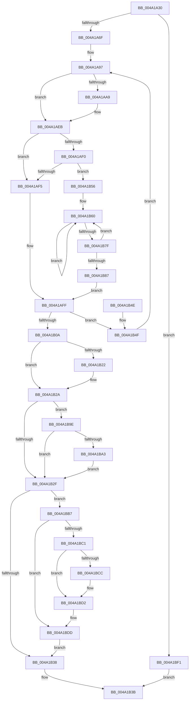

# RtlGetMultiTimePrecise

- RVA: `0x004A1A30`–`0x004A1BF9` (길이 `457` bytes)
- VA: `0x00000001404A1A30`
- 실행 섹션: `.text`
- PDB 이름 있음: `예`; PDB Function 태그: `아니요`
- unwind 정보 RVA: `0x000B5CA8`
- 디코드: `124`개 명령, `457/457` bytes 표시
- 미해석 바이트: `0` (있으면 어셈블리에 `.byte`로 보존)

> 이 문서는 커널 이미지의 기계어와 PDB 기호를 분석해 생성했습니다. 4번과 5번은 함수 원형과 자료형을 바이너리 사용 방식에서 추정한 C 해석이며 원본 소스 복구 결과는 아닙니다.

## 1. Dependencies

- 직접 호출 지점: **4**; 고유 호출 대상: **3**
- 직접 호출자로 확인된 함수: **5**
- RIP 상대 이미지 참조: **0**

### Outgoing calls
- `0x004A1A6F` → [HvlGetSharedPageVa](HvlGetSharedPageVa_function_004A1C00.md) (function, `0x004A1C00`)
- `0x004A1A9A` → [RtlBeginReadTickLock](../39/RtlBeginReadTickLock_function_0039D2A0.md) (function, `0x0039D2A0`)
- `0x004A1AF7` → [KeQueryPerformanceCounter](../37/KeQueryPerformanceCounter_function_0037E7E0.md) (function, `0x0037E7E0`)
- `0x004A1B6E` → [KeQueryPerformanceCounter](../37/KeQueryPerformanceCounter_function_0037E7E0.md) (function, `0x0037E7E0`)

### Direct callers
- [EtwpGetTimeStampAndQpcDelta](EtwpGetTimeStampAndQpcDelta_function_004A1978.md) at `0x004A19BB`
- [RtlConvertHostPerfCounterToPerfCounter](../5E/RtlConvertHostPerfCounterToPerfCounter_function_005E55A0.md) at `0x005E55E1`
- [EtwpInitializeTimeStamp](../../page/A8/EtwpInitializeTimeStamp_function_00A8F750.md) at `0x00A8F7DE`
- [EtwpFixBootSystemTime](../../init/C4/EtwpFixBootSystemTime_function_00C4DAF8.md) at `0x00C4DB4D`
- [EtwpInitializeBootTimeStamps](../../init/C4/EtwpInitializeBootTimeStamps_function_00C4E23C.md) at `0x00C4E29C`

### Static image references
- 디코드된 RIP-relative 메모리 참조가 없습니다.

## 2. Other-region calls and transfers

- 다른 실행 섹션으로 향하는 call: **0**
- 별도 외부 분기/꼬리 이동을 확인하지 못했습니다.

## 3. Assembly (complete function range)

```asm
004A1A30  4C 89 44 24 18                  mov qword ptr [rsp + 0x18], r8
004A1A35  48 89 4C 24 08                  mov qword ptr [rsp + 8], rcx
004A1A3A  53                              push rbx
004A1A3B  55                              push rbp
004A1A3C  56                              push rsi
004A1A3D  57                              push rdi
004A1A3E  41 54                           push r12
004A1A40  41 55                           push r13
004A1A42  41 56                           push r14
004A1A44  41 57                           push r15
004A1A46  48 83 EC 58                     sub rsp, 0x58
004A1A4A  33 DB                           xor ebx, ebx
004A1A4C  8B EA                           mov ebp, edx
004A1A4E  48 89 5C 24 28                  mov qword ptr [rsp + 0x28], rbx
004A1A53  8B F3                           mov esi, ebx
004A1A55  48 89 5C 24 38                  mov qword ptr [rsp + 0x38], rbx
004A1A5A  44 8A EB                        mov r13b, bl
004A1A5D  48 89 5C 24 20                  mov qword ptr [rsp + 0x20], rbx
004A1A62  48 89 5C 24 30                  mov qword ptr [rsp + 0x30], rbx
004A1A67  85 D2                           test edx, edx
004A1A69  0F 84 82 01 00 00               je 0x1404a1bf1
004A1A6F  E8 8C 01 00 00                  call 0x1404a1c00
004A1A74  44 8B FD                        mov r15d, ebp
004A1A77  44 8B E5                        mov r12d, ebp
004A1A7A  41 83 E7 04                     and r15d, 4
004A1A7E  4C 8B F0                        mov r14, rax
004A1A81  44 89 BC 24 A8 00 00 00         mov dword ptr [rsp + 0xa8], r15d
004A1A89  41 83 E4 02                     and r12d, 2
004A1A8D  48 BF 40 03 00 00 80 F7 FF FF   movabs rdi, 0xfffff78000000340
004A1A97  48 8B CF                        mov rcx, rdi
004A1A9A  E8 01 B8 EF FF                  call 0x14039d2a0
004A1A9F  48 89 44 24 40                  mov qword ptr [rsp + 0x40], rax
004A1AA4  45 85 FF                        test r15d, r15d
004A1AA7  74 42                           je 0x1404a1aeb
004A1AA9  48 B8 48 03 00 00 80 F7 FF FF   movabs rax, 0xfffff78000000348
004A1AB3  48 8B 00                        mov rax, qword ptr [rax]
004A1AB6  48 89 44 24 28                  mov qword ptr [rsp + 0x28], rax
004A1ABB  48 B8 58 03 00 00 80 F7 FF FF   movabs rax, 0xfffff78000000358
004A1AC5  48 8B 00                        mov rax, qword ptr [rax]
004A1AC8  48 89 44 24 30                  mov qword ptr [rsp + 0x30], rax
004A1ACD  A0 68 03 00 00 80 F7 FF FF      movabs al, byte ptr [0xfffff78000000368]
004A1AD6  44 8A E8                        mov r13b, al
004A1AD9  48 B8 14 00 00 00 80 F7 FF FF   movabs rax, 0xfffff78000000014
004A1AE3  48 8B 00                        mov rax, qword ptr [rax]
004A1AE6  48 89 44 24 38                  mov qword ptr [rsp + 0x38], rax
004A1AEB  45 85 E4                        test r12d, r12d
004A1AEE  74 05                           je 0x1404a1af5
004A1AF0  4D 85 F6                        test r14, r14
004A1AF3  75 61                           jne 0x1404a1b56
004A1AF5  33 C9                           xor ecx, ecx
004A1AF7  E8 E4 CC ED FF                  call 0x14037e7e0
004A1AFC  48 8B D0                        mov rdx, rax
004A1AFF  90                              nop
004A1B00  48 8B 07                        mov rax, qword ptr [rdi]
004A1B03  48 3B 44 24 40                  cmp rax, qword ptr [rsp + 0x40]
004A1B08  75 45                           jne 0x1404a1b4f
004A1B0A  4C 8B B4 24 A0 00 00 00         mov r14, qword ptr [rsp + 0xa0]
004A1B12  8B FB                           mov edi, ebx
004A1B14  4C 8B BC 24 B0 00 00 00         mov r15, qword ptr [rsp + 0xb0]
004A1B1C  40 F6 C5 01                     test bpl, 1
004A1B20  74 08                           je 0x1404a1b2a
004A1B22  49 89 16                        mov qword ptr [r14], rdx
004A1B25  BF 01 00 00 00                  mov edi, 1
004A1B2A  45 85 E4                        test r12d, r12d
004A1B2D  75 6F                           jne 0x1404a1b9e
004A1B2F  39 9C 24 A8 00 00 00            cmp dword ptr [rsp + 0xa8], ebx
004A1B36  75 7F                           jne 0x1404a1bb7
004A1B38  41 89 3F                        mov dword ptr [r15], edi
004A1B3B  33 C0                           xor eax, eax
004A1B3D  48 83 C4 58                     add rsp, 0x58
004A1B41  41 5F                           pop r15
004A1B43  41 5E                           pop r14
004A1B45  41 5D                           pop r13
004A1B47  41 5C                           pop r12
004A1B49  5F                              pop rdi
004A1B4A  5E                              pop rsi
004A1B4B  5D                              pop rbp
004A1B4C  5B                              pop rbx
004A1B4D  C3                              ret
004A1B4E  CC                              int3
004A1B4F  F3 90                           pause
004A1B51  E9 41 FF FF FF                  jmp 0x1404a1a97
004A1B56  48 BF B8 03 00 00 80 F7 FF FF   movabs rdi, 0xfffff780000003b8
004A1B60  49 8B 76 18                     mov rsi, qword ptr [r14 + 0x18]
004A1B64  33 C9                           xor ecx, ecx
004A1B66  4C 8B 3F                        mov r15, qword ptr [rdi]
004A1B69  4C 89 7C 24 20                  mov qword ptr [rsp + 0x20], r15
004A1B6E  E8 6D CC ED FF                  call 0x14037e7e0
004A1B73  48 8B D0                        mov rdx, rax
004A1B76  49 8B 46 18                     mov rax, qword ptr [r14 + 0x18]
004A1B7A  48 3B F0                        cmp rsi, rax
004A1B7D  75 E1                           jne 0x1404a1b60
004A1B7F  48 8B 07                        mov rax, qword ptr [rdi]
004A1B82  4C 3B F8                        cmp r15, rax
004A1B85  75 D9                           jne 0x1404a1b60
004A1B87  44 8B BC 24 A8 00 00 00         mov r15d, dword ptr [rsp + 0xa8]
004A1B8F  48 BF 40 03 00 00 80 F7 FF FF   movabs rdi, 0xfffff78000000340
004A1B99  E9 61 FF FF FF                  jmp 0x1404a1aff
004A1B9E  48 85 F6                        test rsi, rsi
004A1BA1  74 8C                           je 0x1404a1b2f
004A1BA3  48 2B 74 24 20                  sub rsi, qword ptr [rsp + 0x20]
004A1BA8  48 03 F2                        add rsi, rdx
004A1BAB  49 89 76 08                     mov qword ptr [r14 + 8], rsi
004A1BAF  83 CF 02                        or edi, 2
004A1BB2  E9 78 FF FF FF                  jmp 0x1404a1b2f
004A1BB7  48 8B 44 24 28                  mov rax, qword ptr [rsp + 0x28]
004A1BBC  48 3B D0                        cmp rdx, rax
004A1BBF  76 1C                           jbe 0x1404a1bdd
004A1BC1  48 2B D0                        sub rdx, rax
004A1BC4  48 FF CA                        dec rdx
004A1BC7  45 84 ED                        test r13b, r13b
004A1BCA  74 06                           je 0x1404a1bd2
004A1BCC  41 8A CD                        mov cl, r13b
004A1BCF  48 D3 E2                        shl rdx, cl
004A1BD2  48 8B 44 24 30                  mov rax, qword ptr [rsp + 0x30]
004A1BD7  48 F7 E2                        mul rdx
004A1BDA  48 8B DA                        mov rbx, rdx
004A1BDD  48 8B 44 24 38                  mov rax, qword ptr [rsp + 0x38]
004A1BE2  48 03 C3                        add rax, rbx
004A1BE5  49 89 46 10                     mov qword ptr [r14 + 0x10], rax
004A1BE9  83 CF 04                        or edi, 4
004A1BEC  E9 47 FF FF FF                  jmp 0x1404a1b38
004A1BF1  41 89 18                        mov dword ptr [r8], ebx
004A1BF4  E9 42 FF FF FF                  jmp 0x1404a1b3b
```

## 4. C-style interpretation (structured pseudocode)

```c
__int64 __fastcall RtlGetMultiTimePrecise(__int64 a1, int a2, __int64 a3)
{
    __int64 result;
    __int64 v_r12;
    __int64 v_r13;
    __int64 v_r15;
    __int64 v_rbx;
    __int64 v_rdi;
    __int64 v_rsi;
    __int64 v_rsp;
    unsigned __int64 v_stack_m58;
    unsigned __int64 v_stack_m60;
    unsigned __int64 v_stack_m68;
    unsigned __int64 v_stack_m70;
    unsigned __int64 v_stack_m78;
    unsigned int v_stack_p10;
    unsigned __int64 v_stack_p18;
    unsigned __int64 v_stack_p20;
    unsigned __int64 v_stack_p28;
    unsigned __int64 v_stack_p30;
    unsigned __int64 v_stack_p38;
    unsigned __int64 v_stack_p8;
    unsigned int v_stack_pA8;

    v_stack_p18 = a3;
    v_stack_p8 = a1;
    v_rsp = (v_rsp) - (88);
    v_rbx = 0;
    v_stack_m70 = 0;
    v_stack_m60 = 0;
    v_stack_m78 = 0;
    v_stack_m68 = 0;
    if (a2 == 0) goto loc_004A1BF1;
    result = HvlGetSharedPageVa(a1, a2, a3, a4);
    v_r15 = (unsigned int)(((unsigned int)((unsigned int)((unsigned int)(a2)))) & (4));
    v_stack_p10 = (unsigned int)(v_r15);
    v_r12 = (unsigned int)(((unsigned int)((unsigned int)((unsigned int)(a2)))) & (2));
loc_004A1A97:
    result = RtlBeginReadTickLock(v_rdi, a2, a3, a4);
    v_stack_m58 = result;
    v_r13 = 0;
    if ((unsigned int)(v_r15) != 0) {
        result = *(unsigned __int64 *)(result);
        v_stack_m70 = result;
        result = *(unsigned __int64 *)(result);
        v_stack_m68 = result;
        v_r13 = (unsigned __int8)(result);
        result = *(unsigned __int64 *)(result);
        v_stack_m60 = result;
    }
    if ((unsigned int)(v_r12) == 0) goto loc_004A1AF5;
    if (result != 0) goto loc_004A1B56;
loc_004A1AF5:
    a1 = 0;
    result = KeQueryPerformanceCounter(a1, a2, a3, a4);
loc_004A1AFF:
    if ((*(unsigned __int64 *)(v_rdi)) != v_stack_m58) goto loc_004A1B4F;
    v_rdi = 0;
    if ((((unsigned __int8)((unsigned int)(a2))) & (1)) != 0) {
        *(unsigned __int64 *)(v_stack_p8) = result;
        v_rdi = 1;
    }
    if ((unsigned int)(v_r12) != 0) goto loc_004A1B9E;
loc_004A1B2F:
    if (v_stack_p10 != 0) goto loc_004A1BB7;
loc_004A1B38:
    *(unsigned int *)(v_stack_p18) = (unsigned int)(v_rdi);
loc_004A1B3B:
    result = 0;
    v_rsp = (v_rsp) + (88);
    return result;
loc_004A1B4F:
    goto loc_004A1A97;
loc_004A1B56:
loc_004A1B60:
    a1 = 0;
    v_stack_p20 = *(unsigned __int64 *)(v_rdi);
    result = KeQueryPerformanceCounter(a1, result, a3, a4);
    if ((*(unsigned __int64 *)(v_stack_p8 + 24)) != (*(unsigned __int64 *)(v_stack_p8 + 24))) goto loc_004A1B60;
    if ((*(unsigned __int64 *)(v_rdi)) != (*(unsigned __int64 *)(v_rdi))) goto loc_004A1B60;
    goto loc_004A1AFF;
loc_004A1B9E:
    if (*(unsigned __int64 *)(v_stack_p8 + 24) == 0) goto loc_004A1B2F;
    v_rsi = (*(unsigned __int64 *)(v_stack_p8 + 24)) - (v_stack_p20);
    v_rsi = (v_rsi) + (result);
    *(unsigned __int64 *)(v_stack_p8 + 8) = v_rsi;
    v_rdi = (unsigned int)((v_rdi) | (2));
    goto loc_004A1B2F;
loc_004A1BB7:
    if (result <= v_stack_p28) goto loc_004A1BDD;
    a2 = (result) - (v_stack_p28);
    a2 = (a2) - 1;
    if ((unsigned __int8)(v_r13) != 0) {
        a1 = (unsigned __int8)(v_r13);
        a2 = (a2) << ((unsigned __int8)(a1));
    }
loc_004A1BDD:
    result = (v_stack_p38) + (a2);
    *(unsigned __int64 *)(v_stack_p8 + 16) = result;
    v_rdi = (unsigned int)((v_rdi) | (4));
    goto loc_004A1B38;
loc_004A1BF1:
    *(unsigned int *)(a3) = a2;
    goto loc_004A1B3B;
}
```

## 5. (Beta) C Style

```c
int64_t RtlGetMultiTimePrecise(int64_t Arg1, int32_t Arg2, void *Arg3)
{
    uint8_t *arg3 = (uint8_t *)Arg3;

    int64_t result;
    int64_t local_r12;
    int64_t local_r13;
    int64_t local_r15;
    int64_t local_rbx;
    int64_t local_rdi;
    int64_t local_rsi;
    int64_t local_rsp;
    uint64_t v_stack_m58;
    uint64_t v_stack_m60;
    uint64_t v_stack_m68;
    uint64_t v_stack_m70;
    uint64_t v_stack_m78;
    uint32_t v_stack_p10;
    uint64_t v_stack_p18;
    uint64_t v_stack_p20;
    uint64_t v_stack_p28;
    uint64_t v_stack_p30;
    uint64_t v_stack_p38;
    uint64_t v_stack_p8;
    uint32_t v_stack_pA8;

    v_stack_p18 = Arg3;
    v_stack_p8 = Arg1;
    local_rsp = (local_rsp) - (88);
    local_rbx = 0;
    v_stack_m70 = 0;
    v_stack_m60 = 0;
    v_stack_m78 = 0;
    v_stack_m68 = 0;
    if (Arg2 == 0) goto loc_004A1BF1;
    result = HvlGetSharedPageVa(Arg1, Arg2, Arg3, a4);
    local_r15 = (uint32_t)(((uint32_t)((uint32_t)((uint32_t)(Arg2)))) & (4));
    v_stack_p10 = (uint32_t)(local_r15);
    local_r12 = (uint32_t)(((uint32_t)((uint32_t)((uint32_t)(Arg2)))) & (2));
loc_004A1A97:
    result = RtlBeginReadTickLock(local_rdi, Arg2, Arg3, a4);
    v_stack_m58 = result;
    local_r13 = 0;
    if ((uint32_t)(local_r15) != 0) {
        result = *(uint64_t *)(result);
        v_stack_m70 = result;
        result = *(uint64_t *)(result);
        v_stack_m68 = result;
        local_r13 = (uint8_t)(result);
        result = *(uint64_t *)(result);
        v_stack_m60 = result;
    }
    if ((uint32_t)(local_r12) == 0) goto loc_004A1AF5;
    if (result != 0) goto loc_004A1B56;
loc_004A1AF5:
    Arg1 = 0;
    result = KeQueryPerformanceCounter(Arg1, Arg2, Arg3, a4);
loc_004A1AFF:
    if ((*(uint64_t *)(local_rdi)) != v_stack_m58) goto loc_004A1B4F;
    local_rdi = 0;
    if ((((uint8_t)((uint32_t)(Arg2))) & (1)) != 0) {
        *(uint64_t *)(v_stack_p8) = result;
        local_rdi = 1;
    }
    if ((uint32_t)(local_r12) != 0) goto loc_004A1B9E;
loc_004A1B2F:
    if (v_stack_p10 != 0) goto loc_004A1BB7;
loc_004A1B38:
    *(uint32_t *)(v_stack_p18) = (uint32_t)(local_rdi);
loc_004A1B3B:
    result = 0;
    local_rsp = (local_rsp) + (88);
    return result;
loc_004A1B4F:
    goto loc_004A1A97;
loc_004A1B56:
loc_004A1B60:
    Arg1 = 0;
    v_stack_p20 = *(uint64_t *)(local_rdi);
    result = KeQueryPerformanceCounter(Arg1, result, Arg3, a4);
    if ((*(uint64_t *)(v_stack_p8 + 0x18)) != (*(uint64_t *)(v_stack_p8 + 0x18))) goto loc_004A1B60;
    if ((*(uint64_t *)(local_rdi)) != (*(uint64_t *)(local_rdi))) goto loc_004A1B60;
    goto loc_004A1AFF;
loc_004A1B9E:
    if (*(uint64_t *)(v_stack_p8 + 0x18) == 0) goto loc_004A1B2F;
    local_rsi = (*(uint64_t *)(v_stack_p8 + 0x18)) - (v_stack_p20);
    local_rsi = (local_rsi) + (result);
    *(uint64_t *)(v_stack_p8 + 0x8) = local_rsi;
    local_rdi = (uint32_t)((local_rdi) | (2));
    goto loc_004A1B2F;
loc_004A1BB7:
    if (result <= v_stack_p28) goto loc_004A1BDD;
    Arg2 = (result) - (v_stack_p28);
    Arg2 = (Arg2) - 1;
    if ((uint8_t)(local_r13) != 0) {
        Arg1 = (uint8_t)(local_r13);
        Arg2 = (Arg2) << ((uint8_t)(Arg1));
    }
loc_004A1BDD:
    result = (v_stack_p38) + (Arg2);
    *(uint64_t *)(v_stack_p8 + 0x10) = result;
    local_rdi = (uint32_t)((local_rdi) | (4));
    goto loc_004A1B38;
loc_004A1BF1:
    *(uint32_t *)(arg3) = Arg2;
    goto loc_004A1B3B;
}
```

### 관측된 메모리 오프셋

구조체 형식이 확인되지 않은 접근은 인자 기준의 오프셋으로만 기록했습니다.

| 기준 인자 | 오프셋 표현 | 폭 (bit) | 접근 |
|---|---:|---:|---|
| `Arg3` | `+ 0x0` | `32` | `W` |

## 6. Execution-region graph

[열기: 2D/3D 그래프와 함수 탐색 컨트롤 패널](../../../control-panel.html?section=text&rva=0x004A1A30&view=graph)

- 2D 그래프는 위에서 아래로 흐르고, 3D 그래프는 빈 공간을 드래그해 회전합니다. Shift+드래그는 이동, 휠은 확대·축소, 함수 노드 선택은 대상 보고서 이동입니다.

### Static fallback


