# RtlGetThreadLangIdByIndex

- RVA: `0x004A5FE0`–`0x004A612D` (길이 `333` bytes)
- VA: `0x00000001404A5FE0`
- 실행 섹션: `.text`
- PDB 이름 있음: `예`; PDB Function 태그: `아니요`
- unwind 정보 RVA: `0x000B6C38`
- 디코드: `91`개 명령, `333/333` bytes 표시
- 미해석 바이트: `0` (있으면 어셈블리에 `.byte`로 보존)

> 이 문서는 커널 이미지의 기계어와 PDB 기호를 분석해 생성했습니다. 4번과 5번은 함수 원형과 자료형을 바이너리 사용 방식에서 추정한 C 해석이며 원본 소스 복구 결과는 아닙니다.

## 1. Dependencies

- 직접 호출 지점: **2**; 고유 호출 대상: **1**
- 직접 호출자로 확인된 함수: **0**
- RIP 상대 이미지 참조: **0**

### Outgoing calls
- `0x004A6071` → [ExRaiseDatatypeMisalignment](../../page/89/ExRaiseDatatypeMisalignment_function_00899FD0.md) (function, `0x00899FD0`)
- `0x004A60B0` → [ExRaiseDatatypeMisalignment](../../page/89/ExRaiseDatatypeMisalignment_function_00899FD0.md) (function, `0x00899FD0`)

### Direct callers
- 이 함수 시작 RVA로 연결되는 직접 call은 확인되지 않았습니다. 간접 호출은 완전히 역산할 수 없습니다.

### Static image references
- 디코드된 RIP-relative 메모리 참조가 없습니다.

## 2. Other-region calls and transfers

- 다른 실행 섹션으로 향하는 call: **2**
  - `0x004A6071` → [ExRaiseDatatypeMisalignment](../../page/89/ExRaiseDatatypeMisalignment_function_00899FD0.md) (`.text` → `PAGE`)
  - `0x004A60B0` → [ExRaiseDatatypeMisalignment](../../page/89/ExRaiseDatatypeMisalignment_function_00899FD0.md) (`.text` → `PAGE`)
- 별도 외부 분기/꼬리 이동을 확인하지 못했습니다.

## 3. Assembly (complete function range)

```asm
004A5FE0  48 8B C4                        mov rax, rsp
004A5FE3  48 89 58 08                     mov qword ptr [rax + 8], rbx
004A5FE7  57                              push rdi
004A5FE8  48 83 EC 40                     sub rsp, 0x40
004A5FEC  4D 8B D9                        mov r11, r9
004A5FEF  49 8B D8                        mov rbx, r8
004A5FF2  44 8B CA                        mov r9d, edx
004A5FF5  45 33 D2                        xor r10d, r10d
004A5FF8  44 89 50 DC                     mov dword ptr [rax - 0x24], r10d
004A5FFC  66 44 89 50 D8                  mov word ptr [rax - 0x28], r10w
004A6001  44 89 50 E0                     mov dword ptr [rax - 0x20], r10d
004A6005  85 C9                           test ecx, ecx
004A6007  0F 85 19 01 00 00               jne 0x1404a6126
004A600D  48 85 DB                        test rbx, rbx
004A6010  0F 84 10 01 00 00               je 0x1404a6126
004A6016  65 48 8B 0C 25 88 01 00 00      mov rcx, qword ptr gs:[0x188]
004A601F  41 8D 52 01                     lea edx, [r10 + 1]
004A6023  F7 41 74 00 04 00 00            test dword ptr [rcx + 0x74], 0x400
004A602A  75 3C                           jne 0x1404a6068
004A602C  38 91 4A 02 00 00               cmp byte ptr [rcx + 0x24a], dl
004A6032  74 34                           je 0x1404a6068
004A6034  48 8B 81 F0 00 00 00            mov rax, qword ptr [rcx + 0xf0]
004A603B  48 8B 80 D0 17 00 00            mov rax, qword ptr [rax + 0x17d0]
004A6042  48 89 44 24 30                  mov qword ptr [rsp + 0x30], rax
004A6047  48 85 C0                        test rax, rax
004A604A  75 21                           jne 0x1404a606d
004A604C  0F B7 44 24 20                  movzx eax, word ptr [rsp + 0x20]
004A6051  89 03                           mov dword ptr [rbx], eax
004A6053  4D 85 DB                        test r11, r11
004A6056  0F 84 95 00 00 00               je 0x1404a60f1
004A605C  8B 44 24 28                     mov eax, dword ptr [rsp + 0x28]
004A6060  41 89 03                        mov dword ptr [r11], eax
004A6063  E9 89 00 00 00                  jmp 0x1404a60f1
004A6068  49 8B C2                        mov rax, r10
004A606B  EB CE                           jmp 0x1404a603b
004A606D  A8 03                           test al, 3
004A606F  74 05                           je 0x1404a6076
004A6071  E8 5A 3F 3F 00                  call 0x140899fd0
004A6076  48 8D 48 40                     lea rcx, [rax + 0x40]
004A607A  48 BF 00 00 FF FF FF 7F 00 00   movabs rdi, 0x7fffffff0000
004A6084  48 3B CF                        cmp rcx, rdi
004A6087  77 05                           ja 0x1404a608e
004A6089  48 3B C8                        cmp rcx, rax
004A608C  73 07                           jae 0x1404a6095
004A608E  8A 07                           mov al, byte ptr [rdi]
004A6090  48 8B 44 24 30                  mov rax, qword ptr [rsp + 0x30]
004A6095  4C 8B 40 18                     mov r8, qword ptr [rax + 0x18]
004A6099  4D 85 C0                        test r8, r8
004A609C  74 AE                           je 0x1404a604c
004A609E  0F B7 40 04                     movzx eax, word ptr [rax + 4]
004A60A2  89 44 24 28                     mov dword ptr [rsp + 0x28], eax
004A60A6  44 3B C8                        cmp r9d, eax
004A60A9  73 A1                           jae 0x1404a604c
004A60AB  44 84 C2                        test dl, r8b
004A60AE  74 05                           je 0x1404a60b5
004A60B0  E8 1B 3F 3F 00                  call 0x140899fd0
004A60B5  4B 8D 0C 49                     lea rcx, [r9 + r9*2]
004A60B9  4D 8D 0C 48                     lea r9, [r8 + rcx*2]
004A60BD  49 8D 41 06                     lea rax, [r9 + 6]
004A60C1  48 3B C7                        cmp rax, rdi
004A60C4  77 05                           ja 0x1404a60cb
004A60C6  49 3B C1                        cmp rax, r9
004A60C9  73 02                           jae 0x1404a60cd
004A60CB  8A 07                           mov al, byte ptr [rdi]
004A60CD  41 8B 01                        mov eax, dword ptr [r9]
004A60D0  41 0F B7 49 04                  movzx ecx, word ptr [r9 + 4]
004A60D5  66 3B D0                        cmp dx, ax
004A60D8  74 0D                           je 0x1404a60e7
004A60DA  C7 44 24 24 E5 00 00 C0         mov dword ptr [rsp + 0x24], 0xc00000e5
004A60E2  E9 65 FF FF FF                  jmp 0x1404a604c
004A60E7  66 89 4C 24 20                  mov word ptr [rsp + 0x20], cx
004A60EC  E9 5B FF FF FF                  jmp 0x1404a604c
004A60F1  EB 07                           jmp 0x1404a60fa
004A60F3  89 44 24 24                     mov dword ptr [rsp + 0x24], eax
004A60F7  45 33 D2                        xor r10d, r10d
004A60FA  8B 44 24 24                     mov eax, dword ptr [rsp + 0x24]
004A60FE  85 C0                           test eax, eax
004A6100  74 10                           je 0x1404a6112
004A6102  8B 44 24 24                     mov eax, dword ptr [rsp + 0x24]
004A6106  48 8B 5C 24 50                  mov rbx, qword ptr [rsp + 0x50]
004A610B  48 83 C4 40                     add rsp, 0x40
004A610F  5F                              pop rdi
004A6110  C3                              ret
004A6111  CC                              int3
004A6112  B9 25 02 00 C0                  mov ecx, 0xc0000225
004A6117  66 44 39 54 24 20               cmp word ptr [rsp + 0x20], r10w
004A611D  0F 44 C1                        cmove eax, ecx
004A6120  89 44 24 24                     mov dword ptr [rsp + 0x24], eax
004A6124  EB DC                           jmp 0x1404a6102
004A6126  B8 0D 00 00 C0                  mov eax, 0xc000000d
004A612B  EB D9                           jmp 0x1404a6106
```

## 4. C-style interpretation (structured pseudocode)

```c
__int64 __fastcall RtlGetThreadLangIdByIndex(int a1, int a2, __int64 a3, __int64 a4)
{
    __int64 result;
    __int64 v_r10;
    __int64 v_rsp;
    unsigned __int64 v_stack_m18;
    unsigned int v_stack_m20;
    unsigned int v_stack_m24;
    unsigned __int16 v_stack_m28;
    unsigned __int16 v_stack_p20;
    unsigned int v_stack_p24;
    unsigned __int64 v_stack_p8;

    *(unsigned __int64 *)(v_rsp + 8) = v_rbx;
    v_rsp = (v_rsp) - (64);
    v_r10 = 0;
    *(unsigned int *)(v_rsp - 36) = 0;
    *(unsigned __int16 *)(v_rsp - 40) = 0;
    *(unsigned int *)(v_rsp - 32) = 0;
    if (a1 != 0) goto loc_004A6126;
    if (a3 == 0) goto loc_004A6126;
    if (((*(unsigned int *)(*(unsigned __int64 *)(gs_base + (0 + 392)) + 116)) & (0x400ULL)) != 0) goto loc_004A6068;
    if ((*(unsigned __int8 *)(*(unsigned __int64 *)(gs_base + (0 + 392)) + 586)) == ((unsigned __int8)(v_r10 + 1))) goto loc_004A6068;
loc_004A603B:
    v_stack_m18 = *(unsigned __int64 *)(*(unsigned __int64 *)(*(unsigned __int64 *)(gs_base + (0 + 392)) + 240) + 6096);
    if (*(unsigned __int64 *)(*(unsigned __int64 *)(*(unsigned __int64 *)(gs_base + (0 + 392)) + 240) + 6096) != 0) goto loc_004A606D;
loc_004A604C:
    *(unsigned int *)(a3) = (unsigned int)(v_stack_m28);
    if (a4 == 0) goto loc_004A60F1;
    *(unsigned int *)(a4) = (unsigned int)((unsigned int)(v_stack_m20));
    goto loc_004A60F1;
loc_004A6068:
    goto loc_004A603B;
loc_004A606D:
    result = 0;
    if (((0) & (3)) != 0) {
        result = ExRaiseDatatypeMisalignment(*(unsigned __int64 *)(gs_base + (0 + 392)), v_r10 + 1, a3, (unsigned int)(a2));
    }
    if ((result + 64) > v_rdi) goto loc_004A608E;
    if ((result + 64) < result) {
        result = *(unsigned __int8 *)(v_rdi);
        result = v_stack_m18;
    }
    if (*(unsigned __int64 *)(result + 24) == 0) goto loc_004A604C;
    v_stack_m20 = (unsigned int)(*(unsigned __int16 *)(result + 4));
    if (((unsigned int)((unsigned int)(a2))) >= ((unsigned int)(*(unsigned __int16 *)(result + 4)))) goto loc_004A604C;
    result = *(unsigned __int16 *)(result + 4);
    if ((((unsigned __int8)(v_r10 + 1)) & ((unsigned __int8)(*(unsigned __int64 *)(result + 24)))) != 0) {
        result = ExRaiseDatatypeMisalignment(result + 64, v_r10 + 1, *(unsigned __int64 *)(result + 24), (unsigned int)(a2));
    }
    if ((*(unsigned __int64 *)(result + 24) + (unsigned int)(a2) + (unsigned int)(a2) * 2 * 2 + 6) > v_rdi) goto loc_004A60CB;
    result = *(unsigned __int64 *)(result + 24) + (unsigned int)(a2) + (unsigned int)(a2) * 2 * 2 + 6;
    if ((*(unsigned __int64 *)(result + 24) + (unsigned int)(a2) + (unsigned int)(a2) * 2 * 2 + 6) < (*(unsigned __int64 *)(result + 24) + (unsigned int)(a2) + (unsigned int)(a2) * 2 * 2)) {
        result = *(unsigned __int8 *)(v_rdi);
    }
    if (((unsigned __int16)(v_r10 + 1)) == ((unsigned __int16)((unsigned int)(*(unsigned int *)(*(unsigned __int64 *)(result + 24) + (unsigned int)(a2) + (unsigned int)(a2) * 2 * 2))))) goto loc_004A60E7;
    v_stack_m24 = 0xC00000E5ULL;
    goto loc_004A604C;
loc_004A60E7:
    v_stack_m28 = (unsigned __int16)(*(unsigned __int16 *)(*(unsigned __int64 *)(result + 24) + (unsigned int)(a2) + (unsigned int)(a2) * 2 * 2 + 4));
    goto loc_004A604C;
loc_004A60F1:
    goto loc_004A60FA;
loc_004A60FA:
    if ((unsigned int)((unsigned int)(v_stack_m24)) == 0) goto loc_004A6112;
loc_004A6102:
loc_004A6106:
    v_rsp = (v_rsp) + (64);
    return (unsigned int)(v_stack_m24);
loc_004A6112:
    result = (unsigned int)(v_stack_m24);
    if (v_stack_p20 == 0) { result = (unsigned int)((unsigned int)(0xC0000225ULL)); }
    v_stack_p24 = (unsigned int)(result);
    goto loc_004A6102;
loc_004A6126:
    goto loc_004A6106;
}
```

## 5. (Beta) C Style

```c
int64_t RtlGetThreadLangIdByIndex(int32_t Arg1, int32_t Arg2, int64_t Arg3, int64_t Arg4)
{
    int64_t result;
    int64_t local_r10;
    int64_t local_rsp;
    uint64_t v_stack_m18;
    uint32_t v_stack_m20;
    uint32_t v_stack_m24;
    uint16_t v_stack_m28;
    uint16_t v_stack_p20;
    uint32_t v_stack_p24;
    uint64_t v_stack_p8;

    *(uint64_t *)(local_rsp + 0x8) = local_rbx;
    local_rsp = (local_rsp) - (64);
    local_r10 = 0;
    *(uint32_t *)(local_rsp - 0x24) = 0;
    *(uint16_t *)(local_rsp - 0x28) = 0;
    *(uint32_t *)(local_rsp - 0x20) = 0;
    if (Arg1 != 0) goto loc_004A6126;
    if (Arg3 == 0) goto loc_004A6126;
    if (((*(uint32_t *)(*(uint64_t *)(gs_base + (0 + 0x188)) + 0x74)) & (0x400ULL)) != 0) goto loc_004A6068;
    if ((*(uint8_t *)(*(uint64_t *)(gs_base + (0 + 0x188)) + 0x24A)) == ((uint8_t)(local_r10 + 1))) goto loc_004A6068;
loc_004A603B:
    v_stack_m18 = *(uint64_t *)(*(uint64_t *)(*(uint64_t *)(gs_base + (0 + 0x188)) + 0xF0) + 0x17D0);
    if (*(uint64_t *)(*(uint64_t *)(*(uint64_t *)(gs_base + (0 + 0x188)) + 0xF0) + 0x17D0) != 0) goto loc_004A606D;
loc_004A604C:
    *(uint32_t *)(Arg3) = (uint32_t)(v_stack_m28);
    if (Arg4 == 0) goto loc_004A60F1;
    *(uint32_t *)(Arg4) = (uint32_t)((uint32_t)(v_stack_m20));
    goto loc_004A60F1;
loc_004A6068:
    goto loc_004A603B;
loc_004A606D:
    result = 0;
    if (((0) & (3)) != 0) {
        result = ExRaiseDatatypeMisalignment(*(uint64_t *)(gs_base + (0 + 0x188)), local_r10 + 1, Arg3, (uint32_t)(Arg2));
    }
    if ((result + 64) > local_rdi) goto loc_004A608E;
    if ((result + 64) < result) {
        result = *(uint8_t *)(local_rdi);
        result = v_stack_m18;
    }
    if (*(uint64_t *)(result + 0x18) == 0) goto loc_004A604C;
    v_stack_m20 = (uint32_t)(*(uint16_t *)(result + 0x4));
    if (((uint32_t)((uint32_t)(Arg2))) >= ((uint32_t)(*(uint16_t *)(result + 0x4)))) goto loc_004A604C;
    result = *(uint16_t *)(result + 0x4);
    if ((((uint8_t)(local_r10 + 1)) & ((uint8_t)(*(uint64_t *)(result + 0x18)))) != 0) {
        result = ExRaiseDatatypeMisalignment(result + 64, local_r10 + 1, *(uint64_t *)(result + 0x18), (uint32_t)(Arg2));
    }
    if ((*(uint64_t *)(result + 0x18) + (uint32_t)(Arg2) + (uint32_t)(Arg2) * 2 * 2 + 6) > local_rdi) goto loc_004A60CB;
    result = *(uint64_t *)(result + 0x18) + (uint32_t)(Arg2) + (uint32_t)(Arg2) * 2 * 2 + 6;
    if ((*(uint64_t *)(result + 0x18) + (uint32_t)(Arg2) + (uint32_t)(Arg2) * 2 * 2 + 6) < (*(uint64_t *)(result + 0x18) + (uint32_t)(Arg2) + (uint32_t)(Arg2) * 2 * 2)) {
        result = *(uint8_t *)(local_rdi);
    }
    if (((uint16_t)(local_r10 + 1)) == ((uint16_t)((uint32_t)(*(uint32_t *)(*(uint64_t *)(result + 0x18) + (uint32_t)(Arg2) + (uint32_t)(Arg2) * 2 * 2))))) goto loc_004A60E7;
    v_stack_m24 = 0xC00000E5ULL;
    goto loc_004A604C;
loc_004A60E7:
    v_stack_m28 = (uint16_t)(*(uint16_t *)(*(uint64_t *)(result + 0x18) + (uint32_t)(Arg2) + (uint32_t)(Arg2) * 2 * 2 + 0x4));
    goto loc_004A604C;
loc_004A60F1:
    goto loc_004A60FA;
loc_004A60FA:
    if ((uint32_t)((uint32_t)(v_stack_m24)) == 0) goto loc_004A6112;
loc_004A6102:
loc_004A6106:
    local_rsp = (local_rsp) + (64);
    return (uint32_t)(v_stack_m24);
loc_004A6112:
    result = (uint32_t)(v_stack_m24);
    if (v_stack_p20 == 0) { result = (uint32_t)((uint32_t)(0xC0000225ULL)); }
    v_stack_p24 = (uint32_t)(result);
    goto loc_004A6102;
loc_004A6126:
    goto loc_004A6106;
}
```

## 6. Execution-region graph

[열기: 2D/3D 그래프와 함수 탐색 컨트롤 패널](../../../control-panel.html?section=text&rva=0x004A5FE0&view=graph)

- 2D 그래프는 위에서 아래로 흐르고, 3D 그래프는 빈 공간을 드래그해 회전합니다. Shift+드래그는 이동, 휠은 확대·축소, 함수 노드 선택은 대상 보고서 이동입니다.

### Static fallback

```mermaid
flowchart TD
  bb_004A5FE0[BB_004A5FE0]
  bb_004A600D[BB_004A600D]
  bb_004A6016[BB_004A6016]
  bb_004A602C[BB_004A602C]
  bb_004A6034[BB_004A6034]
  bb_004A603B[BB_004A603B]
  bb_004A604C[BB_004A604C]
  bb_004A605C[BB_004A605C]
  bb_004A6068[BB_004A6068]
  bb_004A606D[BB_004A606D]
  bb_004A6071[BB_004A6071]
  bb_004A6076[BB_004A6076]
  bb_004A6089[BB_004A6089]
  bb_004A608E[BB_004A608E]
  bb_004A6095[BB_004A6095]
  bb_004A609E[BB_004A609E]
  bb_004A60AB[BB_004A60AB]
  bb_004A60B0[BB_004A60B0]
  bb_004A60B5[BB_004A60B5]
  bb_004A60C6[BB_004A60C6]
  bb_004A60CB[BB_004A60CB]
  bb_004A60CD[BB_004A60CD]
  bb_004A60DA[BB_004A60DA]
  bb_004A60E7[BB_004A60E7]
  bb_004A60F1[BB_004A60F1]
  bb_004A60F3[BB_004A60F3]
  bb_004A60FA[BB_004A60FA]
  bb_004A6102[BB_004A6102]
  bb_004A6106[BB_004A6106]
  bb_004A6111[BB_004A6111]
  bb_004A6112[BB_004A6112]
  bb_004A6126[BB_004A6126]
  bb_004A5FE0 -->|branch| bb_004A6126
  bb_004A5FE0 -->|fallthrough| bb_004A600D
  bb_004A600D -->|branch| bb_004A6126
  bb_004A600D -->|fallthrough| bb_004A6016
  bb_004A6016 -->|branch| bb_004A6068
  bb_004A6016 -->|fallthrough| bb_004A602C
  bb_004A602C -->|branch| bb_004A6068
  bb_004A602C -->|fallthrough| bb_004A6034
  bb_004A6034 -->|flow| bb_004A603B
  bb_004A603B -->|branch| bb_004A606D
  bb_004A603B -->|fallthrough| bb_004A604C
  bb_004A604C -->|branch| bb_004A60F1
  bb_004A604C -->|fallthrough| bb_004A605C
  bb_004A605C -->|branch| bb_004A60F1
  bb_004A6068 -->|branch| bb_004A603B
  bb_004A606D -->|branch| bb_004A6076
  bb_004A606D -->|fallthrough| bb_004A6071
  bb_004A6071 -->|flow| bb_004A6076
  bb_004A6076 -->|branch| bb_004A608E
  bb_004A6076 -->|fallthrough| bb_004A6089
  bb_004A6089 -->|branch| bb_004A6095
  bb_004A6089 -->|fallthrough| bb_004A608E
  bb_004A608E -->|flow| bb_004A6095
  bb_004A6095 -->|branch| bb_004A604C
  bb_004A6095 -->|fallthrough| bb_004A609E
  bb_004A609E -->|branch| bb_004A604C
  bb_004A609E -->|fallthrough| bb_004A60AB
  bb_004A60AB -->|branch| bb_004A60B5
  bb_004A60AB -->|fallthrough| bb_004A60B0
  bb_004A60B0 -->|flow| bb_004A60B5
  bb_004A60B5 -->|branch| bb_004A60CB
  bb_004A60B5 -->|fallthrough| bb_004A60C6
  bb_004A60C6 -->|branch| bb_004A60CD
  bb_004A60C6 -->|fallthrough| bb_004A60CB
  bb_004A60CB -->|flow| bb_004A60CD
  bb_004A60CD -->|branch| bb_004A60E7
  bb_004A60CD -->|fallthrough| bb_004A60DA
  bb_004A60DA -->|branch| bb_004A604C
  bb_004A60E7 -->|branch| bb_004A604C
  bb_004A60F1 -->|branch| bb_004A60FA
  bb_004A60F3 -->|flow| bb_004A60FA
  bb_004A60FA -->|branch| bb_004A6112
  bb_004A60FA -->|fallthrough| bb_004A6102
  bb_004A6102 -->|flow| bb_004A6106
  bb_004A6111 -->|flow| bb_004A6112
  bb_004A6112 -->|branch| bb_004A6102
  bb_004A6126 -->|branch| bb_004A6106
```


