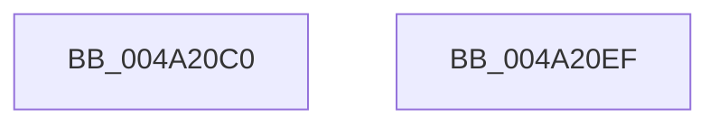

# RtlInitializeGenericTable

- RVA: `0x004A20C0`–`0x004A20F0` (길이 `48` bytes)
- VA: `0x00000001404A20C0`
- 실행 섹션: `.text`
- PDB 이름 있음: `예`; PDB Function 태그: `아니요`
- unwind 정보 RVA: `0x000DB714`
- 디코드: `14`개 명령, `48/48` bytes 표시
- 미해석 바이트: `0` (있으면 어셈블리에 `.byte`로 보존)

> 이 문서는 커널 이미지의 기계어와 PDB 기호를 분석해 생성했습니다. 4번과 5번은 함수 원형과 자료형을 바이너리 사용 방식에서 추정한 C 해석이며 원본 소스 복구 결과는 아닙니다.

## 1. Dependencies

- 직접 호출 지점: **0**; 고유 호출 대상: **0**
- 직접 호출자로 확인된 함수: **0**
- RIP 상대 이미지 참조: **0**

### Outgoing calls
- 직접 디코드된 call 명령이 없습니다.

### Direct callers
- 이 함수 시작 RVA로 연결되는 직접 call은 확인되지 않았습니다. 간접 호출은 완전히 역산할 수 없습니다.

### Static image references
- 디코드된 RIP-relative 메모리 참조가 없습니다.

## 2. Other-region calls and transfers

- 다른 실행 섹션으로 향하는 call: **0**
- 별도 외부 분기/꼬리 이동을 확인하지 못했습니다.

## 3. Assembly (complete function range)

```asm
004A20C0  48 8D 41 08                     lea rax, [rcx + 8]
004A20C4  45 33 D2                        xor r10d, r10d
004A20C7  4C 89 11                        mov qword ptr [rcx], r10
004A20CA  48 89 40 08                     mov qword ptr [rax + 8], rax
004A20CE  48 89 00                        mov qword ptr [rax], rax
004A20D1  48 89 41 18                     mov qword ptr [rcx + 0x18], rax
004A20D5  48 8B 44 24 28                  mov rax, qword ptr [rsp + 0x28]
004A20DA  48 89 41 40                     mov qword ptr [rcx + 0x40], rax
004A20DE  4C 89 51 20                     mov qword ptr [rcx + 0x20], r10
004A20E2  48 89 51 28                     mov qword ptr [rcx + 0x28], rdx
004A20E6  4C 89 41 30                     mov qword ptr [rcx + 0x30], r8
004A20EA  4C 89 49 38                     mov qword ptr [rcx + 0x38], r9
004A20EE  C3                              ret
004A20EF  CC                              int3
```

## 4. C-style interpretation (structured pseudocode)

```c
__int64 __fastcall RtlInitializeGenericTable(__int64 a1, __int64 a2, __int64 a3, __int64 a4, __int64 a5)
{
    __int64 v_r10;

    v_r10 = 0;
    *(unsigned __int64 *)(a1) = 0;
    *(unsigned __int64 *)(a1 + 8 + 8) = a1 + 8;
    *(unsigned __int64 *)(a1 + 8) = a1 + 8;
    *(unsigned __int64 *)(a1 + 24) = a1 + 8;
    *(unsigned __int64 *)(a1 + 64) = a5;
    *(unsigned __int64 *)(a1 + 32) = 0;
    *(unsigned __int64 *)(a1 + 40) = a2;
    *(unsigned __int64 *)(a1 + 48) = a3;
    *(unsigned __int64 *)(a1 + 56) = a4;
    return a5;
}
```

## 5. (Beta) C Style

```c
int64_t RtlInitializeGenericTable(void *GenericTable, int64_t Arg2, int64_t Arg3, int64_t Arg4, int64_t Arg5)
{
    uint8_t *genericTable = (uint8_t *)GenericTable;

    int64_t local_r10;

    local_r10 = 0;
    *(uint64_t *)(genericTable) = 0;
    *(void **)(genericTable + 0x8 + 0x8) = GenericTable + 8;
    *(void **)(genericTable + 0x8) = GenericTable + 8;
    *(void **)(genericTable + 0x18) = GenericTable + 8;
    *(uint64_t *)(genericTable + 0x40) = Arg5;
    *(uint64_t *)(genericTable + 0x20) = 0;
    *(uint64_t *)(genericTable + 0x28) = Arg2;
    *(uint64_t *)(genericTable + 0x30) = Arg3;
    *(uint64_t *)(genericTable + 0x38) = Arg4;
    return Arg5;
}
```

### 관측된 메모리 오프셋

구조체 형식이 확인되지 않은 접근은 인자 기준의 오프셋으로만 기록했습니다.

| 기준 인자 | 오프셋 표현 | 폭 (bit) | 접근 |
|---|---:|---:|---|
| `GenericTable` | `+ 0x0` | `64` | `W` |
| `GenericTable` | `+ 0x8` | `64` | `R` |
| `GenericTable` | `+ 0x8` | `64` | `W` |
| `GenericTable` | `+ 0x18` | `64` | `W` |
| `GenericTable` | `+ 0x20` | `64` | `W` |
| `GenericTable` | `+ 0x28` | `64` | `W` |
| `GenericTable` | `+ 0x30` | `64` | `W` |
| `GenericTable` | `+ 0x38` | `64` | `W` |
| `GenericTable` | `+ 0x40` | `64` | `W` |

## 6. Execution-region graph

[열기: 2D/3D 그래프와 함수 탐색 컨트롤 패널](../../../control-panel.html?section=text&rva=0x004A20C0&view=graph)

- 2D 그래프는 위에서 아래로 흐르고, 3D 그래프는 빈 공간을 드래그해 회전합니다. Shift+드래그는 이동, 휠은 확대·축소, 함수 노드 선택은 대상 보고서 이동입니다.

### Static fallback


