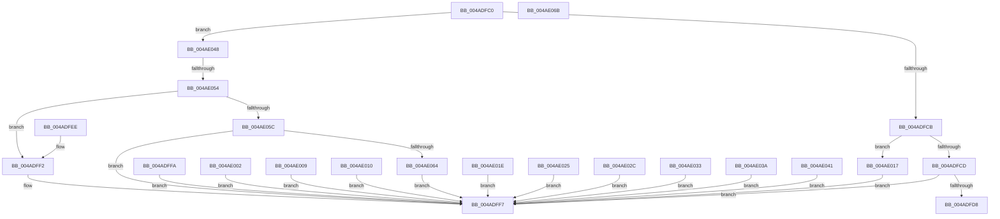

# RtlMapSecurityErrorToNtStatus

- RVA: `0x004ADFC0`–`0x004AE0B4` (길이 `244` bytes)
- VA: `0x00000001404ADFC0`
- 실행 섹션: `.text`
- PDB 이름 있음: `예`; PDB Function 태그: `예`
- unwind 정보 RVA: `0x000DB714`
- 디코드: `83`개 명령, `244/244` bytes 표시
- 미해석 바이트: `2` (있으면 어셈블리에 `.byte`로 보존)

> 이 문서는 커널 이미지의 기계어와 PDB 기호를 분석해 생성했습니다. 4번과 5번은 함수 원형과 자료형을 바이너리 사용 방식에서 추정한 C 해석이며 원본 소스 복구 결과는 아닙니다.

## 1. Dependencies

- 직접 호출 지점: **0**; 고유 호출 대상: **0**
- 직접 호출자로 확인된 함수: **0**
- RIP 상대 이미지 참조: **1**

### Outgoing calls
- 직접 디코드된 call 명령이 없습니다.

### Direct callers
- 이 함수 시작 RVA로 연결되는 직접 call은 확인되지 않았습니다. 간접 호출은 완전히 역산할 수 없습니다.

### Static image references
- `0x004ADFD8` → RVA `0x00000000` (`image boundary/outside`; read)

## 2. Other-region calls and transfers

- 다른 실행 섹션으로 향하는 call: **0**
- call이 아닌 외부 분기/꼬리 이동: **1**
  - `0x004AE04E` → `0x006FAB56` (`tail-transfer`)

## 3. Assembly (complete function range)

```asm
004ADFC0  B8 16 03 09 80                  mov eax, 0x80090316
004ADFC5  8B D1                           mov edx, ecx
004ADFC7  3B C8                           cmp ecx, eax
004ADFC9  7F 7D                           jg 0x1404ae048
004ADFCB  74 4A                           je 0x1404ae017
004ADFCD  8D 81 00 FD F6 7F               lea eax, [rcx + 0x7ff6fd00]
004ADFD3  83 F8 11                        cmp eax, 0x11
004ADFD6  77 1F                           ja 0x1404adff7
004ADFD8  4C 8D 05 21 20 B5 FF            lea r8, [rip - 0x4adfdf]
004ADFDF  48 98                           cdqe
004ADFE1  41 8B 8C 80 6C E0 4A 00         mov ecx, dword ptr [r8 + rax*4 + 0x4ae06c]
004ADFE9  49 03 C8                        add rcx, r8
004ADFEC  FF E1                           jmp rcx
004ADFEE  CC                              int3
004ADFEF  CC                              int3
004ADFF0  CC                              int3
004ADFF1  CC                              int3
004ADFF2  BA BB 00 00 C0                  mov edx, 0xc00000bb
004ADFF7  8B C2                           mov eax, edx
004ADFF9  C3                              ret
004ADFFA  CC                              int3
004ADFFB  BA 9A 00 00 C0                  mov edx, 0xc000009a
004AE000  EB F5                           jmp 0x1404adff7
004AE002  BA 08 00 00 C0                  mov edx, 0xc0000008
004AE007  EB EE                           jmp 0x1404adff7
004AE009  BA BE 00 00 C0                  mov edx, 0xc00000be
004AE00E  EB E7                           jmp 0x1404adff7
004AE010  BA E5 00 00 C0                  mov edx, 0xc00000e5
004AE015  EB E0                           jmp 0x1404adff7
004AE017  BA FE 00 00 C0                  mov edx, 0xc00000fe
004AE01C  EB D9                           jmp 0x1404adff7
004AE01E  BA 61 00 00 C0                  mov edx, 0xc0000061
004AE023  EB D2                           jmp 0x1404adff7
004AE025  BA 0D 01 00 C0                  mov edx, 0xc000010d
004AE02A  EB CB                           jmp 0x1404adff7
004AE02C  BA 6D 00 00 C0                  mov edx, 0xc000006d
004AE031  EB C4                           jmp 0x1404adff7
004AE033  BA 5F 00 00 C0                  mov edx, 0xc000005f
004AE038  EB BD                           jmp 0x1404adff7
004AE03A  BA 22 00 00 C0                  mov edx, 0xc0000022
004AE03F  EB B6                           jmp 0x1404adff7
004AE041  BA 5E 00 00 C0                  mov edx, 0xc000005e
004AE046  EB AF                           jmp 0x1404adff7
004AE048  81 F9 24 03 09 80               cmp ecx, 0x80090324
004AE04E  0F 84 02 CB 24 00               je 0x1406fab56
004AE054  81 F9 31 03 09 80               cmp ecx, 0x80090331
004AE05A  74 96                           je 0x1404adff2
004AE05C  81 F9 5D 03 09 80               cmp ecx, 0x8009035d
004AE062  75 93                           jne 0x1404adff7
004AE064  BA 0D 00 00 C0                  mov edx, 0xc000000d
004AE069  EB 8C                           jmp 0x1404adff7
004AE06B  90                              nop
004AE06C  FB                              sti
004AE06D  DF 4A 00                        fisttp word ptr [rdx]
004AE070  02 E0                           add ah, al
004AE072  4A 00 F2                        add dl, sil
004AE075  DF 4A 00                        fisttp word ptr [rdx]
004AE078  09 E0                           or eax, esp
004AE07A  4A 00 10                        add byte ptr [rax], dl
004AE07D  E0 4A                           loopne 0x1404ae0c9
004AE07F  00 17                           add byte ptr [rdi], dl
004AE081  E0 4A                           loopne 0x1404ae0cd
004AE083  00 1E                           add byte ptr [rsi], bl
004AE085  E0 4A                           loopne 0x1404ae0d1
004AE087  00 17                           add byte ptr [rdi], dl
004AE089  E0 4A                           loopne 0x1404ae0d5
004AE08B  00 64 E0 4A                     add byte ptr [rax + riz*8 + 0x4a], ah
004AE08F  00 64 E0 4A                     add byte ptr [rax + riz*8 + 0x4a], ah
004AE093  00 F2                           add dl, dh
004AE095  DF 4A 00                        fisttp word ptr [rdx]
004AE098  25 E0 4A 00 2C                  and eax, 0x2c004ae0
004AE09D  E0 4A                           loopne 0x1404ae0e9
004AE09F  00 33                           add byte ptr [rbx], dh
004AE0A1  E0 4A                           loopne 0x1404ae0ed
004AE0A3  00 33                           add byte ptr [rbx], dh
004AE0A5  E0 4A                           loopne 0x1404ae0f1
004AE0A7  00 3A                           add byte ptr [rdx], bh
004AE0A9  E0 4A                           loopne 0x1404ae0f5
004AE0AB  00 3A                           add byte ptr [rdx], bh
004AE0AD  E0 4A                           loopne 0x1404ae0f9
004AE0AF  00 41 E0                        add byte ptr [rcx - 0x20], al
004AE0B2  4A                              .byte 0x4a
004AE0B3  00                              .byte 0x00
```

## 4. C-style interpretation (structured pseudocode)

```c
__int64 __fastcall RtlMapSecurityErrorToNtStatus(__int64 a1)
{
    if (((unsigned int)(a1)) > ((unsigned int)((unsigned int)(0x80090316ULL)))) goto loc_004AE048;
    if (((unsigned int)(a1)) == ((unsigned int)((unsigned int)(0x80090316ULL)))) goto loc_004AE017;
    if (((unsigned int)(a1 + 2146893056)) > 17) goto loc_004ADFF7;
    a1 = ((unsigned int)(*(unsigned int *)(v_rip - 4906975 + a1 + 2146893056 * 4 + 4907116))) + (v_rip - 4906975);
loc_004ADFF2:
loc_004ADFF7:
    return (unsigned int)((unsigned int)((unsigned int)(0xC00000BBULL)));
loc_004AE017:
    goto loc_004ADFF7;
loc_004AE048:
    if (((unsigned int)(a1)) == 0x80090331ULL) goto loc_004ADFF2;
    if (((unsigned int)(a1)) != 0x8009035DULL) goto loc_004ADFF7;
    goto loc_004ADFF7;
}
```

## 5. (Beta) C Style

```c
int64_t RtlMapSecurityErrorToNtStatus(int64_t Arg1)
{
    if (((uint32_t)(Arg1)) > ((uint32_t)((uint32_t)(0x80090316ULL)))) goto loc_004AE048;
    if (((uint32_t)(Arg1)) == ((uint32_t)((uint32_t)(0x80090316ULL)))) goto loc_004AE017;
    if (((uint32_t)(Arg1 + 2146893056)) > 17) goto loc_004ADFF7;
    Arg1 = ((uint32_t)(*(uint32_t *)(v_rip - 0x4ADFDF + Arg1 + 0x7FF6FD00 * 4 + 0x4AE06C))) + (v_rip - 4906975);
loc_004ADFF2:
loc_004ADFF7:
    return (uint32_t)((uint32_t)((uint32_t)(0xC00000BBULL)));
loc_004AE017:
    goto loc_004ADFF7;
loc_004AE048:
    if (((uint32_t)(Arg1)) == 0x80090331ULL) goto loc_004ADFF2;
    if (((uint32_t)(Arg1)) != 0x8009035DULL) goto loc_004ADFF7;
    goto loc_004ADFF7;
}
```

## 6. Execution-region graph

[열기: 2D/3D 그래프와 함수 탐색 컨트롤 패널](../../../control-panel.html?section=text&rva=0x004ADFC0&view=graph)

- 2D 그래프는 위에서 아래로 흐르고, 3D 그래프는 빈 공간을 드래그해 회전합니다. Shift+드래그는 이동, 휠은 확대·축소, 함수 노드 선택은 대상 보고서 이동입니다.

### Static fallback


