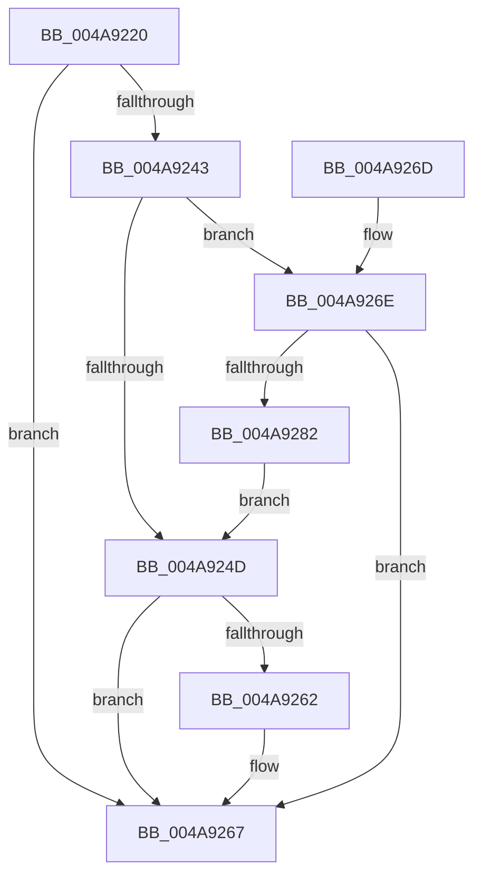

# RtlSetAllBitsEx

- RVA: `0x004A9220`–`0x004A9288` (길이 `104` bytes)
- VA: `0x00000001404A9220`
- 실행 섹션: `.text`
- PDB 이름 있음: `예`; PDB Function 태그: `아니요`
- unwind 정보 RVA: `0x000B7A58`
- 디코드: `34`개 명령, `104/104` bytes 표시
- 미해석 바이트: `0` (있으면 어셈블리에 `.byte`로 보존)

> 이 문서는 커널 이미지의 기계어와 PDB 기호를 분석해 생성했습니다. 4번과 5번은 함수 원형과 자료형을 바이너리 사용 방식에서 추정한 C 해석이며 원본 소스 복구 결과는 아닙니다.

## 1. Dependencies

- 직접 호출 지점: **0**; 고유 호출 대상: **0**
- 직접 호출자로 확인된 함수: **2**
- RIP 상대 이미지 참조: **0**

### Outgoing calls
- 직접 디코드된 call 명령이 없습니다.

### Direct callers
- [IopLiveDumpAllocAndInitResources](../59/IopLiveDumpAllocAndInitResources_function_005993B0.md) at `0x005994E1`
- [MiInitializeUltraSpace](../../init/C6/MiInitializeUltraSpace_function_00C6CDFC.md) at `0x00C6CE5B`

### Static image references
- 디코드된 RIP-relative 메모리 참조가 없습니다.

## 2. Other-region calls and transfers

- 다른 실행 섹션으로 향하는 call: **0**
- 별도 외부 분기/꼬리 이동을 확인하지 못했습니다.

## 3. Assembly (complete function range)

```asm
004A9220  48 89 7C 24 08                  mov qword ptr [rsp + 8], rdi
004A9225  48 8B 39                        mov rdi, qword ptr [rcx]
004A9228  33 D2                           xor edx, edx
004A922A  4C 8B 41 08                     mov r8, qword ptr [rcx + 8]
004A922E  48 8B C7                        mov rax, rdi
004A9231  83 E0 1F                        and eax, 0x1f
004A9234  48 C1 EF 05                     shr rdi, 5
004A9238  48 85 C0                        test rax, rax
004A923B  0F 95 C2                        setne dl
004A923E  48 03 D7                        add rdx, rdi
004A9241  74 24                           je 0x1404a9267
004A9243  41 83 C9 FF                     or r9d, 0xffffffff
004A9247  41 F6 C0 04                     test r8b, 4
004A924B  75 21                           jne 0x1404a926e
004A924D  48 83 C8 FF                     or rax, 0xffffffffffffffff
004A9251  48 8B CA                        mov rcx, rdx
004A9254  48 D1 E9                        shr rcx, 1
004A9257  49 8B F8                        mov rdi, r8
004A925A  F3 48 AB                        rep stosq qword ptr [rdi], rax
004A925D  F6 C2 01                        test dl, 1
004A9260  74 05                           je 0x1404a9267
004A9262  45 89 4C 90 FC                  mov dword ptr [r8 + rdx*4 - 4], r9d
004A9267  48 8B 7C 24 08                  mov rdi, qword ptr [rsp + 8]
004A926C  C3                              ret
004A926D  CC                              int3
004A926E  48 F7 D8                        neg rax
004A9271  45 89 08                        mov dword ptr [r8], r9d
004A9274  48 1B D2                        sbb rdx, rdx
004A9277  48 F7 DA                        neg rdx
004A927A  48 FF CA                        dec rdx
004A927D  48 03 D7                        add rdx, rdi
004A9280  74 E5                           je 0x1404a9267
004A9282  49 83 C0 04                     add r8, 4
004A9286  EB C5                           jmp 0x1404a924d
```

## 4. C-style interpretation (structured pseudocode)

```c
__int64 __fastcall RtlSetAllBitsEx(__int64 a1, int a2, __int64 a3, int a4)
{
    __int64 result;
    __int64 v_rdi;
    unsigned __int64 v_stack_p8;

    v_stack_p8 = v_rdi;
    a2 = 0;
    result = (unsigned int)((*(unsigned __int64 *)(a1)) & (31));
    v_rdi = (*(unsigned __int64 *)(a1)) >> (5);
    a2 = (result != 0) ? 1 : 0;
    a2 = (a2) + (v_rdi);
    if (condition_is_equal) goto loc_004A9267;
    a4 = (unsigned int)((a4) | (0xFFFFFFFFULL));
    if ((((unsigned __int8)(*(unsigned __int64 *)(a1 + 8))) & (4)) != 0) goto loc_004A926E;
loc_004A924D:
    result = (result) | (-1);
    a1 = (a2) >> (1);
    if ((((unsigned __int8)(a2)) & (1)) != 0) {
        *(unsigned int *)(*(unsigned __int64 *)(a1 + 8) + a2 * 4 - 4) = a4;
    }
    return result;
loc_004A926E:
    result = -(result);
    *(unsigned int *)(*(unsigned __int64 *)(a1 + 8)) = a4;
    a2 = -(a2);
    a2 = (a2) - 1;
    a2 = (a2) + (v_stack_p8);
    if (condition_is_equal) goto loc_004A9267;
    a3 = (*(unsigned __int64 *)(a1 + 8)) + (4);
    goto loc_004A924D;
}
```

## 5. (Beta) C Style

```c
int64_t RtlSetAllBitsEx(void *Arg1, int32_t Arg2, int64_t Arg3, int32_t Arg4)
{
    uint8_t *arg1 = (uint8_t *)Arg1;

    int64_t result;
    int64_t local_rdi;
    uint64_t v_stack_p8;

    v_stack_p8 = local_rdi;
    Arg2 = 0;
    result = (uint32_t)((*(uint64_t *)(arg1)) & (31));
    local_rdi = (*(uint64_t *)(arg1)) >> (5);
    Arg2 = (result != 0) ? 1 : 0;
    Arg2 = (Arg2) + (local_rdi);
    if (condition_is_equal) goto loc_004A9267;
    Arg4 = (uint32_t)((Arg4) | (0xFFFFFFFFULL));
    if ((((uint8_t)(*(uint64_t *)(arg1 + 0x8))) & (4)) != 0) goto loc_004A926E;
loc_004A924D:
    result = (result) | (-1);
    Arg1 = (Arg2) >> (1);
    if ((((uint8_t)(Arg2)) & (1)) != 0) {
        *(uint32_t *)(*(uint64_t *)(arg1 + 0x8) + Arg2 * 4 - 0x4) = Arg4;
    }
    return result;
loc_004A926E:
    result = -(result);
    *(uint32_t *)(*(uint64_t *)(arg1 + 0x8)) = Arg4;
    Arg2 = -(Arg2);
    Arg2 = (Arg2) - 1;
    Arg2 = (Arg2) + (v_stack_p8);
    if (condition_is_equal) goto loc_004A9267;
    Arg3 = (*(uint64_t *)(arg1 + 0x8)) + (4);
    goto loc_004A924D;
}
```

### 관측된 메모리 오프셋

구조체 형식이 확인되지 않은 접근은 인자 기준의 오프셋으로만 기록했습니다.

| 기준 인자 | 오프셋 표현 | 폭 (bit) | 접근 |
|---|---:|---:|---|
| `Arg1` | `+ 0x0` | `64` | `R` |
| `Arg1` | `+ 0x8` | `64` | `R` |

## 6. Execution-region graph

[열기: 2D/3D 그래프와 함수 탐색 컨트롤 패널](../../../control-panel.html?section=text&rva=0x004A9220&view=graph)

- 2D 그래프는 위에서 아래로 흐르고, 3D 그래프는 빈 공간을 드래그해 회전합니다. Shift+드래그는 이동, 휠은 확대·축소, 함수 노드 선택은 대상 보고서 이동입니다.

### Static fallback


