# RtlUnicodeStringPrintfEx

- RVA: `0x004A8FD0`–`0x004A9217` (길이 `583` bytes)
- VA: `0x00000001404A8FD0`
- 실행 섹션: `.text`
- PDB 이름 있음: `예`; PDB Function 태그: `예`
- unwind 정보 RVA: `0x000B7A2C`
- 디코드: `153`개 명령, `583/583` bytes 표시
- 미해석 바이트: `0` (있으면 어셈블리에 `.byte`로 보존)

> 이 문서는 커널 이미지의 기계어와 PDB 기호를 분석해 생성했습니다. 4번과 5번은 함수 원형과 자료형을 바이너리 사용 방식에서 추정한 C 해석이며 원본 소스 복구 결과는 아닙니다.

## 1. Dependencies

- 직접 호출 지점: **3**; 고유 호출 대상: **3**
- 직접 호출자로 확인된 함수: **7**
- RIP 상대 이미지 참조: **1**

### Outgoing calls
- `0x004A9042` → [vsnwprintf](../4F/vsnwprintf_function_004FEF30.md) (function, `0x004FEF30`)
- `0x004A91C6` → [RtlUnicodeStringExHandleOtherFlags](../5A/RtlUnicodeStringExHandleOtherFlags_function_005A577C.md) (function, `0x005A577C`)
- `0x004A920D` → [memset](../6C/memset_function_006C6C40.md) (function, `0x006C6C40`)

### Direct callers
- [PiBuildAndOpenDeviceDirectoryPath](../../page/72/PiBuildAndOpenDeviceDirectoryPath_function_00728724.md) at `0x007287D3`
- [PiCreateServiceKeyUnderPath](../../page/72/PiCreateServiceKeyUnderPath_function_00728DEC.md) at `0x00728EE1`
- [PiGetDriverMutableStateDirectory](../../page/72/PiGetDriverMutableStateDirectory_function_00729038.md) at `0x00729118`
- [PiOpenDriverRedirectedStateKey](../../page/96/PiOpenDriverRedirectedStateKey_function_00965D04.md) at `0x00965E01`
- [PiDevCfgBuildIndirectString](../../page/97/PiDevCfgBuildIndirectString_function_0097A890.md) at `0x0097AAA7`
- [PiDevCfgBuildDriverConfigurationId](../../page/AB/PiDevCfgBuildDriverConfigurationId_function_00ABC0D0.md) at `0x00ABC1B5`
- [PiDevCfgBuildDriverConfigurationId](../../page/AB/PiDevCfgBuildDriverConfigurationId_function_00ABC0D0.md) at `0x00ABC1E6`
- [PiDevCfgLogDeviceConfigured](../../page/AD/PiDevCfgLogDeviceConfigured_function_00ADCDD4.md) at `0x00ADD240`
- [PiDevCfgLogDeviceConfigured](../../page/AD/PiDevCfgLogDeviceConfigured_function_00ADCDD4.md) at `0x00ADD286`
- [PiDevCfgLogDeviceConfigured](../../page/AD/PiDevCfgLogDeviceConfigured_function_00ADCDD4.md) at `0x00ADD3CD`
- [PiDevCfgLogDeviceConfigured](../../page/AD/PiDevCfgLogDeviceConfigured_function_00ADCDD4.md) at `0x00ADD413`
- [PiDevCfgLogDeviceConfigured](../../page/AD/PiDevCfgLogDeviceConfigured_function_00ADCDD4.md) at `0x00ADDBB7`

### Static image references
- `0x004A9129` → RVA `0x006C8EC0` (` ?? ::FNODOBFM::`string'`; read)

## 2. Other-region calls and transfers

- 다른 실행 섹션으로 향하는 call: **0**
- call이 아닌 외부 분기/꼬리 이동: **6**
  - `0x004A913F` → [sub_006F9FFA](../6F/Unknown_function_006F9FFA.md) (`tail-transfer`)
  - `0x004A914C` → [sub_006F9FFA](../6F/Unknown_function_006F9FFA.md) (`tail-transfer`)
  - `0x004A9155` → [sub_006F9FFA](../6F/Unknown_function_006F9FFA.md) (`tail-transfer`)
  - `0x004A9163` → [sub_006F9FFA](../6F/Unknown_function_006F9FFA.md) (`tail-transfer`)
  - `0x004A9176` → [sub_006F9FFA](../6F/Unknown_function_006F9FFA.md) (`tail-transfer`)
  - `0x004A917F` → [sub_006F9FFA](../6F/Unknown_function_006F9FFA.md) (`tail-transfer`)

## 3. Assembly (complete function range)

```asm
004A8FD0  4C 89 4C 24 20                  mov qword ptr [rsp + 0x20], r9
004A8FD5  48 89 54 24 10                  mov qword ptr [rsp + 0x10], rdx
004A8FDA  55                              push rbp
004A8FDB  53                              push rbx
004A8FDC  56                              push rsi
004A8FDD  57                              push rdi
004A8FDE  41 54                           push r12
004A8FE0  41 55                           push r13
004A8FE2  41 56                           push r14
004A8FE4  41 57                           push r15
004A8FE6  48 8B EC                        mov rbp, rsp
004A8FE9  48 83 EC 68                     sub rsp, 0x68
004A8FED  45 8B E0                        mov r12d, r8d
004A8FF0  4D 8B D1                        mov r10, r9
004A8FF3  45 33 C0                        xor r8d, r8d
004A8FF6  4C 8B F9                        mov r15, rcx
004A8FF9  48 85 C9                        test rcx, rcx
004A8FFC  0F 85 37 01 00 00               jne 0x1404a9139
004A9002  41 0F BA E4 08                  bt r12d, 8
004A9007  0F 83 2C 01 00 00               jae 0x1404a9139
004A900D  4D 8B E8                        mov r13, r8
004A9010  49 8B F0                        mov rsi, r8
004A9013  E9 EB 00 00 00                  jmp 0x1404a9103
004A9018  41 8B D8                        mov ebx, r8d
004A901B  41 F7 C4 00 E0 FF FF            test r12d, 0xffffe000
004A9022  0F 85 62 01 00 00               jne 0x1404a918a
004A9028  48 85 F6                        test rsi, rsi
004A902B  0F 84 A7 01 00 00               je 0x1404a91d8
004A9031  4C 89 45 E8                     mov qword ptr [rbp - 0x18], r8
004A9035  4C 8D 4D 68                     lea r9, [rbp + 0x68]
004A9039  4D 8B C2                        mov r8, r10
004A903C  48 8B D6                        mov rdx, rsi
004A903F  49 8B CD                        mov rcx, r13
004A9042  E8 E9 5E 05 00                  call 0x1404fef30
004A9047  85 C0                           test eax, eax
004A9049  0F 88 8E 00 00 00               js 0x1404a90dd
004A904F  48 63 F8                        movsxd rdi, eax
004A9052  48 3B FE                        cmp rdi, rsi
004A9055  0F 87 82 00 00 00               ja 0x1404a90dd
004A905B  48 89 7D D8                     mov qword ptr [rbp - 0x28], rdi
004A905F  4C 2B F7                        sub r14, rdi
004A9062  48 8D 04 7D 00 00 00 00         lea rax, [rdi*2]
004A906A  49 03 C5                        add rax, r13
004A906D  4C 89 75 E0                     mov qword ptr [rbp - 0x20], r14
004A9071  48 89 45 E8                     mov qword ptr [rbp - 0x18], rax
004A9075  85 DB                           test ebx, ebx
004A9077  0F 88 12 01 00 00               js 0x1404a918f
004A907D  41 0F BA E4 09                  bt r12d, 9
004A9082  0F 82 71 01 00 00               jb 0x1404a91f9
004A9088  33 D2                           xor edx, edx
004A908A  4D 85 FF                        test r15, r15
004A908D  74 07                           je 0x1404a9096
004A908F  66 03 FF                        add di, di
004A9092  66 41 89 3F                     mov word ptr [r15], di
004A9096  B9 00 00 00 80                  mov ecx, 0x80000000
004A909B  8D 04 0B                        lea eax, [rbx + rcx]
004A909E  85 C1                           test ecx, eax
004A90A0  75 1C                           jne 0x1404a90be
004A90A2  81 FB 05 00 00 80               cmp ebx, 0x80000005
004A90A8  74 14                           je 0x1404a90be
004A90AA  8B C3                           mov eax, ebx
004A90AC  48 83 C4 68                     add rsp, 0x68
004A90B0  41 5F                           pop r15
004A90B2  41 5E                           pop r14
004A90B4  41 5D                           pop r13
004A90B6  41 5C                           pop r12
004A90B8  5F                              pop rdi
004A90B9  5E                              pop rsi
004A90BA  5B                              pop rbx
004A90BB  5D                              pop rbp
004A90BC  C3                              ret
004A90BD  CC                              int3
004A90BE  48 8B 4D 50                     mov rcx, qword ptr [rbp + 0x50]
004A90C2  48 85 C9                        test rcx, rcx
004A90C5  74 E3                           je 0x1404a90aa
004A90C7  48 8B 45 E8                     mov rax, qword ptr [rbp - 0x18]
004A90CB  66 45 03 F6                     add r14w, r14w
004A90CF  66 44 89 71 02                  mov word ptr [rcx + 2], r14w
004A90D4  48 89 41 08                     mov qword ptr [rcx + 8], rax
004A90D8  66 89 11                        mov word ptr [rcx], dx
004A90DB  EB CD                           jmp 0x1404a90aa
004A90DD  48 8B FE                        mov rdi, rsi
004A90E0  48 89 75 D8                     mov qword ptr [rbp - 0x28], rsi
004A90E4  BB 05 00 00 80                  mov ebx, 0x80000005
004A90E9  E9 71 FF FF FF                  jmp 0x1404a905f
004A90EE  4D 85 FF                        test r15, r15
004A90F1  0F 84 16 FF FF FF               je 0x1404a900d
004A90F7  41 0F B7 77 02                  movzx esi, word ptr [r15 + 2]
004A90FC  4D 8B 6F 08                     mov r13, qword ptr [r15 + 8]
004A9100  48 D1 EE                        shr rsi, 1
004A9103  41 0F BA E4 08                  bt r12d, 8
004A9108  4C 89 6D E8                     mov qword ptr [rbp - 0x18], r13
004A910C  4C 8B F6                        mov r14, rsi
004A910F  48 89 75 E0                     mov qword ptr [rbp - 0x20], rsi
004A9113  49 8B F8                        mov rdi, r8
004A9116  4C 89 45 D8                     mov qword ptr [rbp - 0x28], r8
004A911A  0F 83 F8 FE FF FF               jae 0x1404a9018
004A9120  4D 85 C9                        test r9, r9
004A9123  0F 85 EF FE FF FF               jne 0x1404a9018
004A9129  4C 8D 15 90 FD 21 00            lea r10, [rip + 0x21fd90]
004A9130  4C 89 55 60                     mov qword ptr [rbp + 0x60], r10
004A9134  E9 DF FE FF FF                  jmp 0x1404a9018
004A9139  0F B7 09                        movzx ecx, word ptr [rcx]
004A913C  F6 C1 01                        test cl, 1
004A913F  0F 85 B5 0E 25 00               jne 0x1406f9ffa
004A9145  41 0F B7 47 02                  movzx eax, word ptr [r15 + 2]
004A914A  A8 01                           test al, 1
004A914C  0F 85 A8 0E 25 00               jne 0x1406f9ffa
004A9152  66 3B C8                        cmp cx, ax
004A9155  0F 87 9F 0E 25 00               ja 0x1406f9ffa
004A915B  BA FE FF 00 00                  mov edx, 0xfffe
004A9160  66 3B C2                        cmp ax, dx
004A9163  0F 87 91 0E 25 00               ja 0x1406f9ffa
004A9169  4D 39 47 08                     cmp qword ptr [r15 + 8], r8
004A916D  0F 85 7B FF FF FF               jne 0x1404a90ee
004A9173  66 85 C9                        test cx, cx
004A9176  0F 85 7E 0E 25 00               jne 0x1406f9ffa
004A917C  66 85 C0                        test ax, ax
004A917F  0F 85 75 0E 25 00               jne 0x1406f9ffa
004A9185  E9 64 FF FF FF                  jmp 0x1404a90ee
004A918A  BB 0D 00 00 C0                  mov ebx, 0xc000000d
004A918F  41 F7 C4 00 1C 00 00            test r12d, 0x1c00
004A9196  0F 84 EC FE FF FF               je 0x1404a9088
004A919C  48 85 F6                        test rsi, rsi
004A919F  0F 84 E3 FE FF FF               je 0x1404a9088
004A91A5  48 8D 45 E0                     lea rax, [rbp - 0x20]
004A91A9  44 89 64 24 30                  mov dword ptr [rsp + 0x30], r12d
004A91AE  48 89 44 24 28                  mov qword ptr [rsp + 0x28], rax
004A91B3  4C 8D 4D D8                     lea r9, [rbp - 0x28]
004A91B7  48 8D 45 E8                     lea rax, [rbp - 0x18]
004A91BB  48 8B D6                        mov rdx, rsi
004A91BE  49 8B CD                        mov rcx, r13
004A91C1  48 89 44 24 20                  mov qword ptr [rsp + 0x20], rax
004A91C6  E8 B1 C5 0F 00                  call 0x1405a577c
004A91CB  4C 8B 75 E0                     mov r14, qword ptr [rbp - 0x20]
004A91CF  48 8B 7D D8                     mov rdi, qword ptr [rbp - 0x28]
004A91D3  E9 B0 FE FF FF                  jmp 0x1404a9088
004A91D8  66 45 39 02                     cmp word ptr [r10], r8w
004A91DC  0F 84 A6 FE FF FF               je 0x1404a9088
004A91E2  49 8B C5                        mov rax, r13
004A91E5  BB 0D 00 00 C0                  mov ebx, 0xc000000d
004A91EA  48 F7 D8                        neg rax
004A91ED  1B C9                           sbb ecx, ecx
004A91EF  81 E1 F8 FF FF BF               and ecx, 0xbffffff8
004A91F5  03 D9                           add ebx, ecx
004A91F7  EB 96                           jmp 0x1404a918f
004A91F9  4D 85 F6                        test r14, r14
004A91FC  0F 84 86 FE FF FF               je 0x1404a9088
004A9202  4F 8D 04 36                     lea r8, [r14 + r14]
004A9206  41 0F B6 D4                     movzx edx, r12b
004A920A  48 8B C8                        mov rcx, rax
004A920D  E8 2E DA 21 00                  call 0x1406c6c40
004A9212  E9 71 FE FF FF                  jmp 0x1404a9088
```

## 4. C-style interpretation (structured pseudocode)

```c
__int64 __fastcall RtlUnicodeStringPrintfEx(__int64 a1, __int64 a2, int a3, __int64 a4, __int64 a5)
{
    __int64 result;
    __int64 v_r14;
    __int64 v_rbx;
    __int64 v_rdi;
    __int64 v_rsi;
    __int64 v_rsp;
    unsigned __int64 v_stack_m58;
    unsigned __int64 v_stack_m60;
    unsigned __int64 v_stack_m68;
    unsigned __int64 v_stack_p10;
    unsigned __int64 v_stack_p20;
    unsigned __int64 v_stack_p28;
    unsigned int v_stack_p30;

    v_stack_p20 = a4;
    v_stack_p10 = a2;
    v_rsp = (v_rsp) - (104);
    a3 = 0;
    if (a1 != 0) goto loc_004A9139;
    if (condition_is_above_or_equal) goto loc_004A9139;
loc_004A900D:
    goto loc_004A9103;
loc_004A9018:
    if ((((unsigned int)((unsigned int)(a3))) & (0xFFFFE000ULL)) != 0) goto loc_004A918A;
    if (0 == 0) goto loc_004A91D8;
    v_stack_m58 = 0;
    result = vsnwprintf(0, 0, a4, a5);
    if (sign_flag) goto loc_004A90DD;
    if (((int)((unsigned int)(result))) > 0) goto loc_004A90DD;
    v_stack_m68 = (int)((unsigned int)(result));
loc_004A905F:
    v_r14 = (v_r14) - ((int)((unsigned int)(result)));
    result = ((int)((unsigned int)(result)) * 2) + (0);
    v_stack_m60 = v_r14;
    v_stack_m58 = result;
    if (sign_flag) goto loc_004A918F;
    if (condition_is_below) goto loc_004A91F9;
loc_004A9088:
    a2 = 0;
    v_rdi = (int)((unsigned int)(result));
    if (a1 != 0) {
        v_rdi = (unsigned __int16)(((int)((unsigned int)(result))) + ((unsigned __int16)((int)((unsigned int)(result)))));
        *(unsigned __int16 *)(a1) = (unsigned __int16)(v_rdi);
    }
    if ((((unsigned int)((unsigned int)(0x80000000ULL))) & ((unsigned int)(0 + (unsigned int)(0x80000000ULL) * 1))) != 0) goto loc_004A90BE;
    if (0 == 0x80000005ULL) goto loc_004A90BE;
loc_004A90AA:
    v_rsp = (v_rsp) + (104);
    return 0;
loc_004A90BE:
    if (v_stack_p10 == 0) goto loc_004A90AA;
    v_r14 = (unsigned __int16)((v_r14) + ((unsigned __int16)(v_r14)));
    *(unsigned __int16 *)(v_stack_p10 + 2) = (unsigned __int16)(v_r14);
    *(unsigned __int64 *)(v_stack_p10 + 8) = v_stack_m58;
    *(unsigned __int16 *)(v_stack_p10) = 0;
    goto loc_004A90AA;
loc_004A90DD:
    v_stack_m68 = 0;
    goto loc_004A905F;
loc_004A90EE:
    if (a1 == 0) goto loc_004A900D;
    v_rsi = (*(unsigned __int16 *)(a1 + 2)) >> (1);
loc_004A9103:
    v_stack_m58 = *(unsigned __int64 *)(a1 + 8);
    v_stack_m60 = v_rsi;
    v_stack_m68 = a4;
    if (condition_is_above_or_equal) goto loc_004A9018;
    if (a5 != 0) goto loc_004A9018;
    v_stack_p20 = v_rip + 2227600;
    goto loc_004A9018;
loc_004A9139:
    if ((*(unsigned __int64 *)(a1 + 8)) != a4) goto loc_004A90EE;
    goto loc_004A90EE;
loc_004A918A:
loc_004A918F:
    if ((((unsigned int)((unsigned int)(a3))) & (0x1C00ULL)) == 0) goto loc_004A9088;
    if (v_rsi == 0) goto loc_004A9088;
    v_stack_p30 = (unsigned int)((unsigned int)(a3));
    v_stack_p28 = v_stack_m60;
    v_stack_p20 = v_stack_m58;
    result = RtlUnicodeStringExHandleOtherFlags(*(unsigned __int64 *)(a1 + 8), v_rsi, a4, v_stack_m68);
    goto loc_004A9088;
loc_004A91D8:
    if ((*(unsigned __int16 *)(v_rip + 2227600)) == ((unsigned __int16)(a4))) goto loc_004A9088;
    result = -(*(unsigned __int64 *)(a1 + 8));
    a1 = (unsigned int)((*(unsigned __int64 *)(a1 + 8)) & (0xBFFFFFF8ULL));
    v_rbx = (unsigned int)(((unsigned int)(0xC000000DULL)) + ((unsigned int)(a1)));
    goto loc_004A918F;
loc_004A91F9:
    if (v_stack_m60 == 0) goto loc_004A9088;
    result = memset(result, (unsigned __int8)((unsigned int)(a3)), v_stack_m60 + v_stack_m60 * 1, v_stack_m68);
    goto loc_004A9088;
}
```

## 5. (Beta) C Style

```c
int64_t RtlUnicodeStringPrintfEx(void *Arg1, int64_t Arg2, int32_t Arg3, int64_t Arg4, int64_t Arg5)
{
    uint8_t *arg1 = (uint8_t *)Arg1;

    int64_t result;
    int64_t local_r14;
    int64_t local_rbx;
    int64_t local_rdi;
    int64_t local_rsi;
    int64_t local_rsp;
    uint64_t v_stack_m58;
    uint64_t v_stack_m60;
    uint64_t v_stack_m68;
    uint64_t v_stack_p10;
    uint64_t v_stack_p20;
    uint64_t v_stack_p28;
    uint32_t v_stack_p30;

    v_stack_p20 = Arg4;
    v_stack_p10 = Arg2;
    local_rsp = (local_rsp) - (104);
    Arg3 = 0;
    if (Arg1 != NULL) goto loc_004A9139;
    if (condition_is_above_or_equal) goto loc_004A9139;
loc_004A900D:
    goto loc_004A9103;
loc_004A9018:
    if ((((uint32_t)((uint32_t)(Arg3))) & (0xFFFFE000ULL)) != 0) goto loc_004A918A;
    if (0 == 0) goto loc_004A91D8;
    v_stack_m58 = 0;
    result = vsnwprintf(0, 0, Arg4, Arg5);
    if (sign_flag) goto loc_004A90DD;
    if (((int32_t)((uint32_t)(result))) > 0) goto loc_004A90DD;
    v_stack_m68 = (int32_t)((uint32_t)(result));
loc_004A905F:
    local_r14 = (local_r14) - ((int32_t)((uint32_t)(result)));
    result = ((int32_t)((uint32_t)(result)) * 2) + (0);
    v_stack_m60 = local_r14;
    v_stack_m58 = result;
    if (sign_flag) goto loc_004A918F;
    if (condition_is_below) goto loc_004A91F9;
loc_004A9088:
    Arg2 = 0;
    local_rdi = (int32_t)((uint32_t)(result));
    if (Arg1 != NULL) {
        local_rdi = (uint16_t)(((int32_t)((uint32_t)(result))) + ((uint16_t)((int32_t)((uint32_t)(result)))));
        *(uint16_t *)(arg1) = (uint16_t)(local_rdi);
    }
    if ((((uint32_t)((uint32_t)(0x80000000ULL))) & ((uint32_t)(0 + (uint32_t)(0x80000000ULL) * 1))) != 0) goto loc_004A90BE;
    if (0 == 0x80000005ULL) goto loc_004A90BE;
loc_004A90AA:
    local_rsp = (local_rsp) + (104);
    return 0;
loc_004A90BE:
    if (v_stack_p10 == 0) goto loc_004A90AA;
    local_r14 = (uint16_t)((local_r14) + ((uint16_t)(local_r14)));
    *(uint16_t *)(v_stack_p10 + 0x2) = (uint16_t)(local_r14);
    *(uint64_t *)(v_stack_p10 + 0x8) = v_stack_m58;
    *(uint16_t *)(v_stack_p10) = 0;
    goto loc_004A90AA;
loc_004A90DD:
    v_stack_m68 = 0;
    goto loc_004A905F;
loc_004A90EE:
    if (Arg1 == NULL) goto loc_004A900D;
    local_rsi = (*(uint16_t *)(arg1 + 0x2)) >> (1);
loc_004A9103:
    v_stack_m58 = *(uint64_t *)(arg1 + 0x8);
    v_stack_m60 = local_rsi;
    v_stack_m68 = Arg4;
    if (condition_is_above_or_equal) goto loc_004A9018;
    if (Arg5 != 0) goto loc_004A9018;
    v_stack_p20 = v_rip + 2227600;
    goto loc_004A9018;
loc_004A9139:
    if ((*(uint64_t *)(arg1 + 0x8)) != Arg4) goto loc_004A90EE;
    goto loc_004A90EE;
loc_004A918A:
loc_004A918F:
    if ((((uint32_t)((uint32_t)(Arg3))) & (0x1C00ULL)) == 0) goto loc_004A9088;
    if (local_rsi == 0) goto loc_004A9088;
    v_stack_p30 = (uint32_t)((uint32_t)(Arg3));
    v_stack_p28 = v_stack_m60;
    v_stack_p20 = v_stack_m58;
    result = RtlUnicodeStringExHandleOtherFlags(*(uint64_t *)(arg1 + 0x8), local_rsi, Arg4, v_stack_m68);
    goto loc_004A9088;
loc_004A91D8:
    if ((*(uint16_t *)(v_rip + 0x21FD90)) == ((uint16_t)(Arg4))) goto loc_004A9088;
    result = -(*(uint64_t *)(arg1 + 0x8));
    Arg1 = (uint32_t)((*(uint64_t *)(arg1 + 0x8)) & (0xBFFFFFF8ULL));
    local_rbx = (uint32_t)(((uint32_t)(0xC000000DULL)) + ((uint32_t)(Arg1)));
    goto loc_004A918F;
loc_004A91F9:
    if (v_stack_m60 == 0) goto loc_004A9088;
    result = memset(result, (uint8_t)((uint32_t)(Arg3)), v_stack_m60 + v_stack_m60 * 1, v_stack_m68);
    goto loc_004A9088;
}
```

### 관측된 메모리 오프셋

구조체 형식이 확인되지 않은 접근은 인자 기준의 오프셋으로만 기록했습니다.

| 기준 인자 | 오프셋 표현 | 폭 (bit) | 접근 |
|---|---:|---:|---|
| `Arg1` | `+ 0x2` | `16` | `R` |
| `Arg1` | `+ 0x8` | `64` | `R` |

## 6. Execution-region graph

[열기: 2D/3D 그래프와 함수 탐색 컨트롤 패널](../../../control-panel.html?section=text&rva=0x004A8FD0&view=graph)

- 2D 그래프는 위에서 아래로 흐르고, 3D 그래프는 빈 공간을 드래그해 회전합니다. Shift+드래그는 이동, 휠은 확대·축소, 함수 노드 선택은 대상 보고서 이동입니다.

### Static fallback

```mermaid
flowchart TD
  bb_004A8FD0[BB_004A8FD0]
  bb_004A9002[BB_004A9002]
  bb_004A900D[BB_004A900D]
  bb_004A9018[BB_004A9018]
  bb_004A9028[BB_004A9028]
  bb_004A9031[BB_004A9031]
  bb_004A904F[BB_004A904F]
  bb_004A905B[BB_004A905B]
  bb_004A905F[BB_004A905F]
  bb_004A907D[BB_004A907D]
  bb_004A9088[BB_004A9088]
  bb_004A908F[BB_004A908F]
  bb_004A9096[BB_004A9096]
  bb_004A90A2[BB_004A90A2]
  bb_004A90AA[BB_004A90AA]
  bb_004A90BD[BB_004A90BD]
  bb_004A90BE[BB_004A90BE]
  bb_004A90C7[BB_004A90C7]
  bb_004A90DD[BB_004A90DD]
  bb_004A90EE[BB_004A90EE]
  bb_004A90F7[BB_004A90F7]
  bb_004A9103[BB_004A9103]
  bb_004A9120[BB_004A9120]
  bb_004A9129[BB_004A9129]
  bb_004A9139[BB_004A9139]
  bb_004A9145[BB_004A9145]
  bb_004A9152[BB_004A9152]
  bb_004A915B[BB_004A915B]
  bb_004A9169[BB_004A9169]
  bb_004A9173[BB_004A9173]
  bb_004A917C[BB_004A917C]
  bb_004A9185[BB_004A9185]
  bb_004A918A[BB_004A918A]
  bb_004A918F[BB_004A918F]
  bb_004A919C[BB_004A919C]
  bb_004A91A5[BB_004A91A5]
  bb_004A91D8[BB_004A91D8]
  bb_004A91E2[BB_004A91E2]
  bb_004A91F9[BB_004A91F9]
  bb_004A9202[BB_004A9202]
  bb_004A8FD0 -->|branch| bb_004A9139
  bb_004A8FD0 -->|fallthrough| bb_004A9002
  bb_004A9002 -->|branch| bb_004A9139
  bb_004A9002 -->|fallthrough| bb_004A900D
  bb_004A900D -->|branch| bb_004A9103
  bb_004A9018 -->|branch| bb_004A918A
  bb_004A9018 -->|fallthrough| bb_004A9028
  bb_004A9028 -->|branch| bb_004A91D8
  bb_004A9028 -->|fallthrough| bb_004A9031
  bb_004A9031 -->|branch| bb_004A90DD
  bb_004A9031 -->|fallthrough| bb_004A904F
  bb_004A904F -->|branch| bb_004A90DD
  bb_004A904F -->|fallthrough| bb_004A905B
  bb_004A905B -->|flow| bb_004A905F
  bb_004A905F -->|branch| bb_004A918F
  bb_004A905F -->|fallthrough| bb_004A907D
  bb_004A907D -->|branch| bb_004A91F9
  bb_004A907D -->|fallthrough| bb_004A9088
  bb_004A9088 -->|branch| bb_004A9096
  bb_004A9088 -->|fallthrough| bb_004A908F
  bb_004A908F -->|flow| bb_004A9096
  bb_004A9096 -->|branch| bb_004A90BE
  bb_004A9096 -->|fallthrough| bb_004A90A2
  bb_004A90A2 -->|branch| bb_004A90BE
  bb_004A90A2 -->|fallthrough| bb_004A90AA
  bb_004A90BD -->|flow| bb_004A90BE
  bb_004A90BE -->|branch| bb_004A90AA
  bb_004A90BE -->|fallthrough| bb_004A90C7
  bb_004A90C7 -->|branch| bb_004A90AA
  bb_004A90DD -->|branch| bb_004A905F
  bb_004A90EE -->|branch| bb_004A900D
  bb_004A90EE -->|fallthrough| bb_004A90F7
  bb_004A90F7 -->|flow| bb_004A9103
  bb_004A9103 -->|branch| bb_004A9018
  bb_004A9103 -->|fallthrough| bb_004A9120
  bb_004A9120 -->|branch| bb_004A9018
  bb_004A9120 -->|fallthrough| bb_004A9129
  bb_004A9129 -->|branch| bb_004A9018
  bb_004A9139 -->|fallthrough| bb_004A9145
  bb_004A9145 -->|fallthrough| bb_004A9152
  bb_004A9152 -->|fallthrough| bb_004A915B
  bb_004A915B -->|fallthrough| bb_004A9169
  bb_004A9169 -->|branch| bb_004A90EE
  bb_004A9169 -->|fallthrough| bb_004A9173
  bb_004A9173 -->|fallthrough| bb_004A917C
  bb_004A917C -->|fallthrough| bb_004A9185
  bb_004A9185 -->|branch| bb_004A90EE
  bb_004A918A -->|flow| bb_004A918F
  bb_004A918F -->|branch| bb_004A9088
  bb_004A918F -->|fallthrough| bb_004A919C
  bb_004A919C -->|branch| bb_004A9088
  bb_004A919C -->|fallthrough| bb_004A91A5
  bb_004A91A5 -->|branch| bb_004A9088
  bb_004A91D8 -->|branch| bb_004A9088
  bb_004A91D8 -->|fallthrough| bb_004A91E2
  bb_004A91E2 -->|branch| bb_004A918F
  bb_004A91F9 -->|branch| bb_004A9088
  bb_004A91F9 -->|fallthrough| bb_004A9202
  bb_004A9202 -->|branch| bb_004A9088
```


