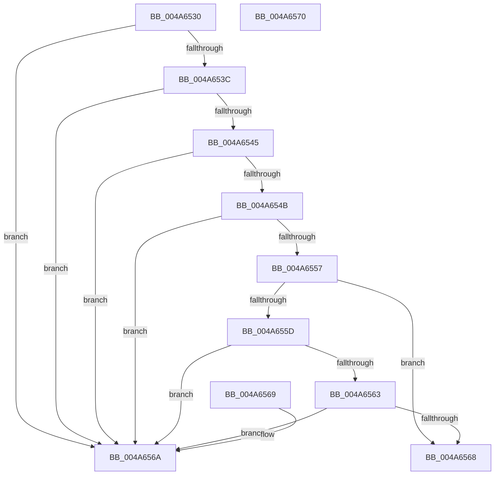

# RtlUnicodeStringValidateWorker

- RVA: `0x004A6530`–`0x004A6571` (길이 `65` bytes)
- VA: `0x00000001404A6530`
- 실행 섹션: `.text`
- PDB 이름 있음: `예`; PDB Function 태그: `예`
- unwind 정보 RVA: `0x000DB714`
- 디코드: `23`개 명령, `65/65` bytes 표시
- 미해석 바이트: `0` (있으면 어셈블리에 `.byte`로 보존)

> 이 문서는 커널 이미지의 기계어와 PDB 기호를 분석해 생성했습니다. 4번과 5번은 함수 원형과 자료형을 바이너리 사용 방식에서 추정한 C 해석이며 원본 소스 복구 결과는 아닙니다.

## 1. Dependencies

- 직접 호출 지점: **0**; 고유 호출 대상: **0**
- 직접 호출자로 확인된 함수: **1**
- RIP 상대 이미지 참조: **0**

### Outgoing calls
- 직접 디코드된 call 명령이 없습니다.

### Direct callers
- [RtlUnicodeStringCbCatStringN](../69/RtlUnicodeStringCbCatStringN_function_0069D2DC.md) at `0x0069D2F4`

### Static image references
- 디코드된 RIP-relative 메모리 참조가 없습니다.

## 2. Other-region calls and transfers

- 다른 실행 섹션으로 향하는 call: **0**
- 별도 외부 분기/꼬리 이동을 확인하지 못했습니다.

## 3. Assembly (complete function range)

```asm
004A6530  44 0F B7 01                     movzx r8d, word ptr [rcx]
004A6534  33 C0                           xor eax, eax
004A6536  41 F6 C0 01                     test r8b, 1
004A653A  75 2E                           jne 0x1404a656a
004A653C  0F B7 51 02                     movzx edx, word ptr [rcx + 2]
004A6540  F6 C2 01                        test dl, 1
004A6543  75 25                           jne 0x1404a656a
004A6545  66 44 3B C2                     cmp r8w, dx
004A6549  77 1F                           ja 0x1404a656a
004A654B  41 B9 FE FF 00 00               mov r9d, 0xfffe
004A6551  66 41 3B D1                     cmp dx, r9w
004A6555  77 13                           ja 0x1404a656a
004A6557  48 39 41 08                     cmp qword ptr [rcx + 8], rax
004A655B  75 0B                           jne 0x1404a6568
004A655D  66 45 85 C0                     test r8w, r8w
004A6561  75 07                           jne 0x1404a656a
004A6563  66 85 D2                        test dx, dx
004A6566  75 02                           jne 0x1404a656a
004A6568  C3                              ret
004A6569  CC                              int3
004A656A  B8 0D 00 00 C0                  mov eax, 0xc000000d
004A656F  C3                              ret
004A6570  CC                              int3
```

## 4. C-style interpretation (structured pseudocode)

```c
__int64 __fastcall RtlUnicodeStringValidateWorker(__int64 a1)
{
    __int64 result;

    result = 0;
    if ((((unsigned __int8)(*(unsigned __int16 *)(a1))) & (1)) != 0) goto loc_004A656A;
    if ((((unsigned __int8)(*(unsigned __int16 *)(a1 + 2))) & (1)) != 0) goto loc_004A656A;
    if (((unsigned __int16)(*(unsigned __int16 *)(a1))) > ((unsigned __int16)(*(unsigned __int16 *)(a1 + 2)))) goto loc_004A656A;
    if (((unsigned __int16)(*(unsigned __int16 *)(a1 + 2))) > ((unsigned __int16)((unsigned int)(0xFFFEULL)))) goto loc_004A656A;
    if ((*(unsigned __int64 *)(a1 + 8)) != 0) goto loc_004A6568;
    if ((unsigned __int16)(*(unsigned __int16 *)(a1)) != 0) goto loc_004A656A;
    if ((unsigned __int16)(*(unsigned __int16 *)(a1 + 2)) != 0) goto loc_004A656A;
loc_004A6568:
    return result;
loc_004A656A:
    return (unsigned int)(0xC000000DULL);
}
```

## 5. (Beta) C Style

```c
int64_t RtlUnicodeStringValidateWorker(void *Arg1)
{
    uint8_t *arg1 = (uint8_t *)Arg1;

    int64_t result;

    result = 0;
    if ((((uint8_t)(*(uint16_t *)(arg1))) & (1)) != 0) goto loc_004A656A;
    if ((((uint8_t)(*(uint16_t *)(arg1 + 0x2))) & (1)) != 0) goto loc_004A656A;
    if (((uint16_t)(*(uint16_t *)(arg1))) > ((uint16_t)(*(uint16_t *)(arg1 + 0x2)))) goto loc_004A656A;
    if (((uint16_t)(*(uint16_t *)(arg1 + 0x2))) > ((uint16_t)((uint32_t)(0xFFFEULL)))) goto loc_004A656A;
    if ((*(uint64_t *)(arg1 + 0x8)) != 0) goto loc_004A6568;
    if ((uint16_t)(*(uint16_t *)(arg1)) != 0) goto loc_004A656A;
    if ((uint16_t)(*(uint16_t *)(arg1 + 0x2)) != 0) goto loc_004A656A;
loc_004A6568:
    return result;
loc_004A656A:
    return (uint32_t)(0xC000000DULL);
}
```

### 관측된 메모리 오프셋

구조체 형식이 확인되지 않은 접근은 인자 기준의 오프셋으로만 기록했습니다.

| 기준 인자 | 오프셋 표현 | 폭 (bit) | 접근 |
|---|---:|---:|---|
| `Arg1` | `+ 0x0` | `16` | `R` |
| `Arg1` | `+ 0x2` | `16` | `R` |
| `Arg1` | `+ 0x8` | `64` | `R` |

## 6. Execution-region graph

[열기: 2D/3D 그래프와 함수 탐색 컨트롤 패널](../../../control-panel.html?section=text&rva=0x004A6530&view=graph)

- 2D 그래프는 위에서 아래로 흐르고, 3D 그래프는 빈 공간을 드래그해 회전합니다. Shift+드래그는 이동, 휠은 확대·축소, 함수 노드 선택은 대상 보고서 이동입니다.

### Static fallback


