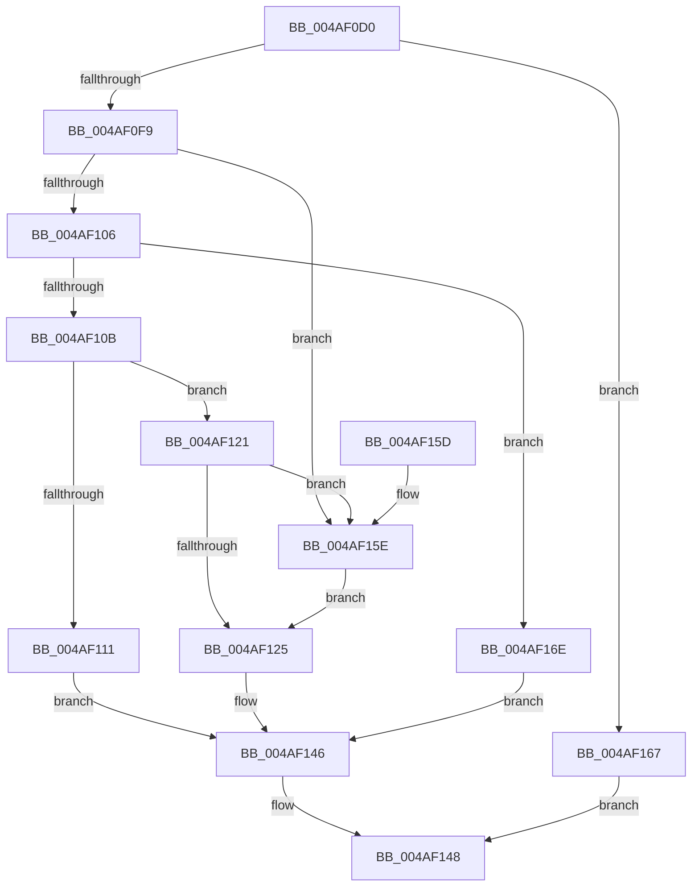

# RtlWriteNonVolatileMemory

- RVA: `0x004AF0D0`–`0x004AF17E` (길이 `174` bytes)
- VA: `0x00000001404AF0D0`
- 실행 섹션: `.text`
- PDB 이름 있음: `예`; PDB Function 태그: `아니요`
- unwind 정보 RVA: `0x0007836C`
- 디코드: `57`개 명령, `174/174` bytes 표시
- 미해석 바이트: `0` (있으면 어셈블리에 `.byte`로 보존)

> 이 문서는 커널 이미지의 기계어와 PDB 기호를 분석해 생성했습니다. 4번과 5번은 함수 원형과 자료형을 바이너리 사용 방식에서 추정한 C 해석이며 원본 소스 복구 결과는 아닙니다.

## 1. Dependencies

- 직접 호출 지점: **4**; 고유 호출 대상: **3**
- 직접 호출자로 확인된 함수: **0**
- RIP 상대 이미지 참조: **0**

### Outgoing calls
- `0x004AF11A` → [RtlCopyMemoryNonTemporal](../6B/RtlCopyMemoryNonTemporal_function_006BA720.md) (function, `0x006BA720`)
- `0x004AF12E` → [memcpy](../6C/memcpy_function_006C6840.md) (function, `0x006C6840`)
- `0x004AF13F` → [RtlFlushNonVolatileMemory](../4F/RtlFlushNonVolatileMemory_function_004FCBF0.md) (function, `0x004FCBF0`)
- `0x004AF177` → [memcpy](../6C/memcpy_function_006C6840.md) (function, `0x006C6840`)

### Direct callers
- 이 함수 시작 RVA로 연결되는 직접 call은 확인되지 않았습니다. 간접 호출은 완전히 역산할 수 없습니다.

### Static image references
- 디코드된 RIP-relative 메모리 참조가 없습니다.

## 2. Other-region calls and transfers

- 다른 실행 섹션으로 향하는 call: **0**
- 별도 외부 분기/꼬리 이동을 확인하지 못했습니다.

## 3. Assembly (complete function range)

```asm
004AF0D0  48 89 5C 24 08                  mov qword ptr [rsp + 8], rbx
004AF0D5  48 89 6C 24 10                  mov qword ptr [rsp + 0x10], rbp
004AF0DA  48 89 74 24 18                  mov qword ptr [rsp + 0x18], rsi
004AF0DF  57                              push rdi
004AF0E0  48 83 EC 20                     sub rsp, 0x20
004AF0E4  33 DB                           xor ebx, ebx
004AF0E6  48 8B F2                        mov rsi, rdx
004AF0E9  49 8B F9                        mov rdi, r9
004AF0EC  48 8B E9                        mov rbp, rcx
004AF0EF  4D 8B C8                        mov r9, r8
004AF0F2  8D 53 01                        lea edx, [rbx + 1]
004AF0F5  84 CA                           test dl, cl
004AF0F7  74 6E                           je 0x1404af167
004AF0F9  8B 4C 24 50                     mov ecx, dword ptr [rsp + 0x50]
004AF0FD  8B C1                           mov eax, ecx
004AF0FF  83 E0 03                        and eax, 3
004AF102  3B C2                           cmp eax, edx
004AF104  74 58                           je 0x1404af15e
004AF106  F6 C1 02                        test cl, 2
004AF109  74 63                           je 0x1404af16e
004AF10B  48 83 FF 08                     cmp rdi, 8
004AF10F  72 10                           jb 0x1404af121
004AF111  4C 8B C7                        mov r8, rdi
004AF114  49 8B D1                        mov rdx, r9
004AF117  48 8B CE                        mov rcx, rsi
004AF11A  E8 01 B6 20 00                  call 0x1406ba720
004AF11F  EB 25                           jmp 0x1404af146
004AF121  3B C2                           cmp eax, edx
004AF123  74 39                           je 0x1404af15e
004AF125  4C 8B C7                        mov r8, rdi
004AF128  49 8B D1                        mov rdx, r9
004AF12B  48 8B CE                        mov rcx, rsi
004AF12E  E8 0D 77 21 00                  call 0x1406c6840
004AF133  44 8B CB                        mov r9d, ebx
004AF136  4C 8B C7                        mov r8, rdi
004AF139  48 8B D6                        mov rdx, rsi
004AF13C  48 8B CD                        mov rcx, rbp
004AF13F  E8 AC DA 04 00                  call 0x1404fcbf0
004AF144  8B D8                           mov ebx, eax
004AF146  8B C3                           mov eax, ebx
004AF148  48 8B 5C 24 30                  mov rbx, qword ptr [rsp + 0x30]
004AF14D  48 8B 6C 24 38                  mov rbp, qword ptr [rsp + 0x38]
004AF152  48 8B 74 24 40                  mov rsi, qword ptr [rsp + 0x40]
004AF157  48 83 C4 20                     add rsp, 0x20
004AF15B  5F                              pop rdi
004AF15C  C3                              ret
004AF15D  CC                              int3
004AF15E  0F BA E1 08                     bt ecx, 8
004AF162  0F 42 DA                        cmovb ebx, edx
004AF165  EB BE                           jmp 0x1404af125
004AF167  B8 0D 00 00 C0                  mov eax, 0xc000000d
004AF16C  EB DA                           jmp 0x1404af148
004AF16E  4C 8B C7                        mov r8, rdi
004AF171  49 8B D1                        mov rdx, r9
004AF174  48 8B CE                        mov rcx, rsi
004AF177  E8 C4 76 21 00                  call 0x1406c6840
004AF17C  EB C8                           jmp 0x1404af146
```

## 4. C-style interpretation (structured pseudocode)

```c
__int64 __fastcall RtlWriteNonVolatileMemory(__int64 a1, __int64 a2, __int64 a3, __int64 a4, unsigned int a5)
{
    __int64 result;
    __int64 v_rbx;
    __int64 v_rsp;
    unsigned __int64 v_stack_p10;
    unsigned __int64 v_stack_p18;
    unsigned __int64 v_stack_p8;

    v_stack_p8 = v_rbx;
    v_stack_p10 = v_rbp;
    v_stack_p18 = v_rsi;
    v_rsp = (v_rsp) - (32);
    v_rbx = 0;
    if ((((unsigned __int8)(v_rbx + 1)) & ((unsigned __int8)(a1))) == 0) goto loc_004AF167;
    result = (unsigned int)(((unsigned int)((unsigned int)((unsigned int)(a5)))) & (3));
    if (((unsigned int)(result)) == ((unsigned int)(v_rbx + 1))) goto loc_004AF15E;
    if ((((unsigned __int8)((unsigned int)(a5))) & (2)) == 0) goto loc_004AF16E;
    if (a4 < 8) goto loc_004AF121;
    result = RtlCopyMemoryNonTemporal(a2, a3, a4, a3);
    goto loc_004AF146;
loc_004AF121:
    if (((unsigned int)(result)) == ((unsigned int)(a3))) goto loc_004AF15E;
loc_004AF125:
    result = memcpy(a2, a3, a4, a3);
    result = RtlFlushNonVolatileMemory(a1, a2, a4, 0);
loc_004AF146:
loc_004AF148:
    v_rsp = (v_rsp) + (32);
    return (unsigned int)((unsigned int)((unsigned int)((unsigned int)(result))));
loc_004AF15E:
    v_rbx = v_stack_p8;
    if (condition_is_below) { v_rbx = (unsigned int)(a2); }
    goto loc_004AF125;
loc_004AF167:
    goto loc_004AF148;
loc_004AF16E:
    result = memcpy(v_stack_p18, 0, a4, 0);
    goto loc_004AF146;
}
```

## 5. (Beta) C Style

```c
int64_t RtlWriteNonVolatileMemory(int64_t Arg1, int64_t Arg2, int64_t Arg3, int64_t Arg4, uint32_t Arg5)
{
    int64_t result;
    int64_t local_rbx;
    int64_t local_rsp;
    uint64_t v_stack_p10;
    uint64_t v_stack_p18;
    uint64_t v_stack_p8;

    v_stack_p8 = local_rbx;
    v_stack_p10 = local_rbp;
    v_stack_p18 = local_rsi;
    local_rsp = (local_rsp) - (32);
    local_rbx = 0;
    if ((((uint8_t)(local_rbx + 1)) & ((uint8_t)(Arg1))) == 0) goto loc_004AF167;
    result = (uint32_t)(((uint32_t)((uint32_t)((uint32_t)(Arg5)))) & (3));
    if (((uint32_t)(result)) == ((uint32_t)(local_rbx + 1))) goto loc_004AF15E;
    if ((((uint8_t)((uint32_t)(Arg5))) & (2)) == 0) goto loc_004AF16E;
    if (Arg4 < 8) goto loc_004AF121;
    result = RtlCopyMemoryNonTemporal(Arg2, Arg3, Arg4, Arg3);
    goto loc_004AF146;
loc_004AF121:
    if (((uint32_t)(result)) == ((uint32_t)(Arg3))) goto loc_004AF15E;
loc_004AF125:
    result = memcpy(Arg2, Arg3, Arg4, Arg3);
    result = RtlFlushNonVolatileMemory(Arg1, Arg2, Arg4, 0);
loc_004AF146:
loc_004AF148:
    local_rsp = (local_rsp) + (32);
    return (uint32_t)((uint32_t)((uint32_t)((uint32_t)(result))));
loc_004AF15E:
    local_rbx = v_stack_p8;
    if (condition_is_below) { local_rbx = (uint32_t)(Arg2); }
    goto loc_004AF125;
loc_004AF167:
    goto loc_004AF148;
loc_004AF16E:
    result = memcpy(v_stack_p18, 0, Arg4, 0);
    goto loc_004AF146;
}
```

## 6. Execution-region graph

[열기: 2D/3D 그래프와 함수 탐색 컨트롤 패널](../../../control-panel.html?section=text&rva=0x004AF0D0&view=graph)

- 2D 그래프는 위에서 아래로 흐르고, 3D 그래프는 빈 공간을 드래그해 회전합니다. Shift+드래그는 이동, 휠은 확대·축소, 함수 노드 선택은 대상 보고서 이동입니다.

### Static fallback


