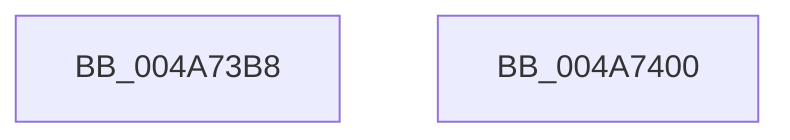

# RtlpFcBufferManagerReferenceBuffers

- RVA: `0x004A73B8`–`0x004A7401` (길이 `73` bytes)
- VA: `0x00000001404A73B8`
- 실행 섹션: `.text`
- PDB 이름 있음: `예`; PDB Function 태그: `아니요`
- unwind 정보 RVA: `0x0005CAAC`
- 디코드: `21`개 명령, `73/73` bytes 표시
- 미해석 바이트: `0` (있으면 어셈블리에 `.byte`로 보존)

> 이 문서는 커널 이미지의 기계어와 PDB 기호를 분석해 생성했습니다. 4번과 5번은 함수 원형과 자료형을 바이너리 사용 방식에서 추정한 C 해석이며 원본 소스 복구 결과는 아닙니다.

## 1. Dependencies

- 직접 호출 지점: **2**; 고유 호출 대상: **2**
- 직접 호출자로 확인된 함수: **9**
- RIP 상대 이미지 참조: **0**

### Outgoing calls
- `0x004A73CB` → [RtlpFcEnterRegion](../../page/A9/RtlpFcEnterRegion_function_00A903F4.md) (function, `0x00A903F4`)
- `0x004A73D0` → [RtlAcquireSwapReference](../37/RtlAcquireSwapReference_function_00378684.md) (function, `0x00378684`)

### Direct callers
- [RtlQueryAllInternalFeatureConfigurations](../5E/RtlQueryAllInternalFeatureConfigurations_function_005E7280.md) at `0x005E72C3`
- [RtlQueryAllInternalRuntimeFeatureConfigurations](../5E/RtlQueryAllInternalRuntimeFeatureConfigurations_function_005E7320.md) at `0x005E7368`
- [RtlQueryInternalFeatureConfiguration](../5E/RtlQueryInternalFeatureConfiguration_function_005E7500.md) at `0x005E7566`
- [RtlQueryAllFeatureConfigurations](../../page/78/RtlQueryAllFeatureConfigurations_function_0078F510.md) at `0x0078F54E`
- [CmFcManagerOverwriteFeatureConfigurationSection](../../page/7F/CmFcManagerOverwriteFeatureConfigurationSection_function_007F4450.md) at `0x007F45D2`
- [CmFcManagerUpdateFeatureConfigurations](../../page/7F/CmFcManagerUpdateFeatureConfigurations_function_007F4CF4.md) at `0x007F4E54`
- [CmFcManagerUpdateFeatureUsageSubscriptions](../../page/A4/CmFcManagerUpdateFeatureUsageSubscriptions_function_00A4490C.md) at `0x00A449BF`
- [CmFcpManagerDrainUsageNotifications](../../page/A4/CmFcpManagerDrainUsageNotifications_function_00A451BC.md) at `0x00A45204`
- [CmFcManagerStartRuntimePhase](../../init/C5/CmFcManagerStartRuntimePhase_function_00C5DC70.md) at `0x00C5DD3E`

### Static image references
- 디코드된 RIP-relative 메모리 참조가 없습니다.

## 2. Other-region calls and transfers

- 다른 실행 섹션으로 향하는 call: **1**
  - `0x004A73CB` → [RtlpFcEnterRegion](../../page/A9/RtlpFcEnterRegion_function_00A903F4.md) (`.text` → `PAGE`)
- 별도 외부 분기/꼬리 이동을 확인하지 못했습니다.

## 3. Assembly (complete function range)

```asm
004A73B8  48 89 5C 24 08                  mov qword ptr [rsp + 8], rbx
004A73BD  57                              push rdi
004A73BE  48 83 EC 20                     sub rsp, 0x20
004A73C2  49 8B F8                        mov rdi, r8
004A73C5  4C 8B DA                        mov r11, rdx
004A73C8  48 8B D9                        mov rbx, rcx
004A73CB  E8 24 90 5E 00                  call 0x140a903f4
004A73D0  E8 AF 12 ED FF                  call 0x140378684
004A73D5  44 8B D0                        mov r10d, eax
004A73D8  4A 8B 84 D3 D8 00 00 00         mov rax, qword ptr [rbx + r10*8 + 0xd8]
004A73E0  48 83 C3 18                     add rbx, 0x18
004A73E4  49 89 03                        mov qword ptr [r11], rax
004A73E7  4B 8D 04 52                     lea rax, [r10 + r10*2]
004A73EB  48 C1 E0 05                     shl rax, 5
004A73EF  48 03 C3                        add rax, rbx
004A73F2  48 8B 5C 24 30                  mov rbx, qword ptr [rsp + 0x30]
004A73F7  48 89 07                        mov qword ptr [rdi], rax
004A73FA  48 83 C4 20                     add rsp, 0x20
004A73FE  5F                              pop rdi
004A73FF  C3                              ret
004A7400  CC                              int3
```

## 4. C-style interpretation (structured pseudocode)

```c
__int64 __fastcall RtlpFcBufferManagerReferenceBuffers(__int64 a1, __int64 a2, __int64 a3)
{
    __int64 result;
    __int64 v_rbx;
    __int64 v_rsp;
    unsigned __int64 v_stack_p8;

    v_stack_p8 = v_rbx;
    v_rsp = (v_rsp) - (32);
    result = RtlpFcEnterRegion(a1, a2, a3, a4);
    result = RtlAcquireSwapReference(a1, a2, a3, a4);
    v_rbx = (a1) + (24);
    *(unsigned __int64 *)(a2) = *(unsigned __int64 *)(a1 + (unsigned int)((unsigned int)(result)) * 8 + 216);
    result = ((unsigned int)((unsigned int)(result)) + (unsigned int)((unsigned int)(result)) * 2) << (5);
    result = (result) + (v_rbx);
    *(unsigned __int64 *)(a3) = result;
    v_rsp = (v_rsp) + (32);
    return result;
}
```

## 5. (Beta) C Style

```c
int64_t RtlpFcBufferManagerReferenceBuffers(void *Arg1, int64_t Arg2, void *Arg3)
{
    uint8_t *arg1 = (uint8_t *)Arg1;
    uint8_t *arg3 = (uint8_t *)Arg3;

    int64_t result;
    int64_t local_rbx;
    int64_t local_rsp;
    uint64_t v_stack_p8;

    v_stack_p8 = local_rbx;
    local_rsp = (local_rsp) - (32);
    result = RtlpFcEnterRegion(Arg1, Arg2, Arg3, a4);
    result = RtlAcquireSwapReference(Arg1, Arg2, Arg3, a4);
    local_rbx = (Arg1) + (24);
    *(uint64_t *)(Arg2) = *(uint64_t *)(arg1 + (uint32_t)((uint32_t)(result)) * 8 + 0xD8);
    result = ((uint32_t)((uint32_t)(result)) + (uint32_t)((uint32_t)(result)) * 2) << (5);
    result = (result) + (local_rbx);
    *(uint64_t *)(arg3) = result;
    local_rsp = (local_rsp) + (32);
    return result;
}
```

### 관측된 메모리 오프셋

구조체 형식이 확인되지 않은 접근은 인자 기준의 오프셋으로만 기록했습니다.

| 기준 인자 | 오프셋 표현 | 폭 (bit) | 접근 |
|---|---:|---:|---|
| `Arg1` | `+ 0xD8 + r10*8` | `64` | `R` |
| `Arg3` | `+ 0x0` | `64` | `W` |

## 6. Execution-region graph

[열기: 2D/3D 그래프와 함수 탐색 컨트롤 패널](../../../control-panel.html?section=text&rva=0x004A73B8&view=graph)

- 2D 그래프는 위에서 아래로 흐르고, 3D 그래프는 빈 공간을 드래그해 회전합니다. Shift+드래그는 이동, 휠은 확대·축소, 함수 노드 선택은 대상 보고서 이동입니다.

### Static fallback


