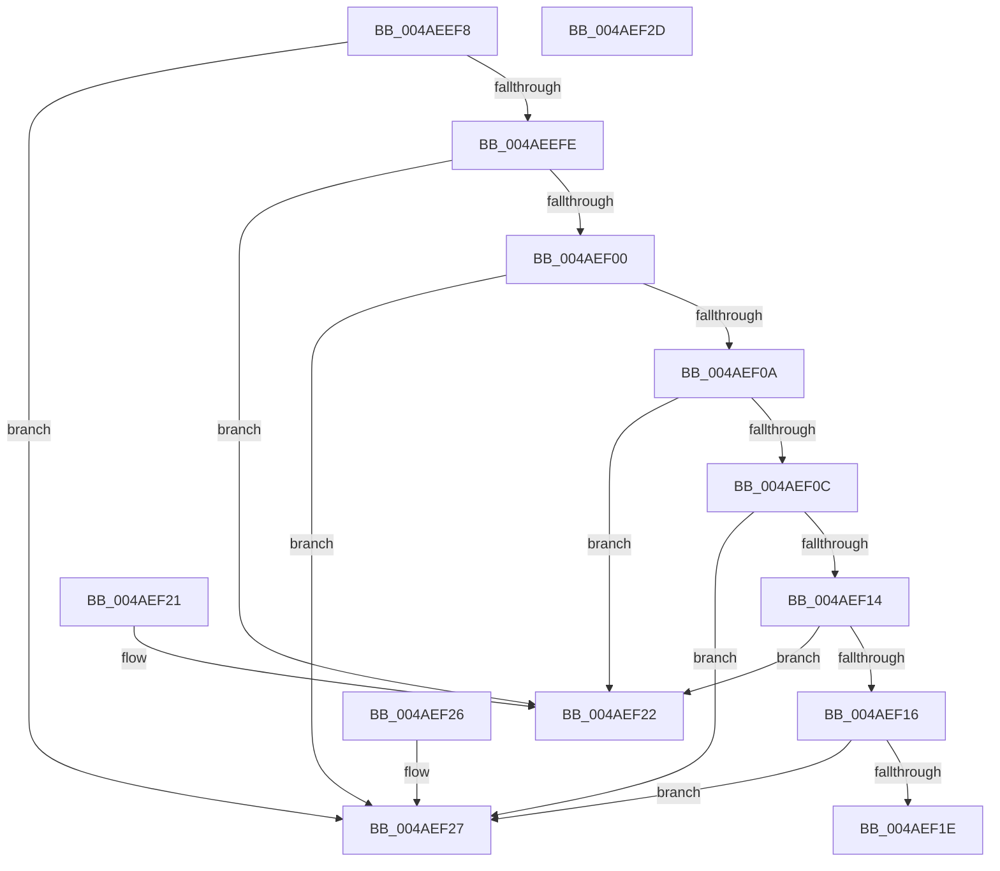

# RtlpFcCompareUsageSubscriptionToUsageSubscription

- RVA: `0x004AEEF8`–`0x004AEF2E` (길이 `54` bytes)
- VA: `0x00000001404AEEF8`
- 실행 섹션: `.text`
- PDB 이름 있음: `예`; PDB Function 태그: `아니요`
- unwind 정보 RVA: `0x000DB714`
- 디코드: `24`개 명령, `54/54` bytes 표시
- 미해석 바이트: `0` (있으면 어셈블리에 `.byte`로 보존)

> 이 문서는 커널 이미지의 기계어와 PDB 기호를 분석해 생성했습니다. 4번과 5번은 함수 원형과 자료형을 바이너리 사용 방식에서 추정한 C 해석이며 원본 소스 복구 결과는 아닙니다.

## 1. Dependencies

- 직접 호출 지점: **0**; 고유 호출 대상: **0**
- 직접 호출자로 확인된 함수: **3**
- RIP 상대 이미지 참조: **0**

### Outgoing calls
- 직접 디코드된 call 명령이 없습니다.

### Direct callers
- [RtlpFcUpdateUsageTriggers](../../page/A4/RtlpFcUpdateUsageTriggers_function_00A44BB0.md) at `0x00A44C93`
- [RtlpFcCalculateRequiredSizeForNewUsageSubscriptionTable](../../page/A4/RtlpFcCalculateRequiredSizeForNewUsageSubscriptionTable_function_00A44FEC.md) at `0x00A45033`
- [RtlpFcValidateFeatureUsageSubscriptionBuffer](../../page/AC/RtlpFcValidateFeatureUsageSubscriptionBuffer_function_00AC93F8.md) at `0x00AC9470`

### Static image references
- 디코드된 RIP-relative 메모리 참조가 없습니다.

## 2. Other-region calls and transfers

- 다른 실행 섹션으로 향하는 call: **0**
- 별도 외부 분기/꼬리 이동을 확인하지 못했습니다.

## 3. Assembly (complete function range)

```asm
004AEEF8  8B 01                           mov eax, dword ptr [rcx]
004AEEFA  3B 02                           cmp eax, dword ptr [rdx]
004AEEFC  77 29                           ja 0x1404aef27
004AEEFE  72 22                           jb 0x1404aef22
004AEF00  0F B7 41 04                     movzx eax, word ptr [rcx + 4]
004AEF04  66 3B 42 04                     cmp ax, word ptr [rdx + 4]
004AEF08  77 1D                           ja 0x1404aef27
004AEF0A  72 16                           jb 0x1404aef22
004AEF0C  8B 41 08                        mov eax, dword ptr [rcx + 8]
004AEF0F  3B 42 08                        cmp eax, dword ptr [rdx + 8]
004AEF12  77 13                           ja 0x1404aef27
004AEF14  72 0C                           jb 0x1404aef22
004AEF16  8B 41 0C                        mov eax, dword ptr [rcx + 0xc]
004AEF19  3B 42 0C                        cmp eax, dword ptr [rdx + 0xc]
004AEF1C  77 09                           ja 0x1404aef27
004AEF1E  1B C0                           sbb eax, eax
004AEF20  C3                              ret
004AEF21  CC                              int3
004AEF22  83 C8 FF                        or eax, 0xffffffff
004AEF25  C3                              ret
004AEF26  CC                              int3
004AEF27  B8 01 00 00 00                  mov eax, 1
004AEF2C  C3                              ret
004AEF2D  CC                              int3
```

## 4. C-style interpretation (structured pseudocode)

```c
__int64 __fastcall RtlpFcCompareUsageSubscriptionToUsageSubscription(__int64 a1, __int64 a2)
{
    __int64 result;

    if (((unsigned int)((unsigned int)(*(unsigned int *)(a1)))) > (*(unsigned int *)(a2))) goto loc_004AEF27;
    if (((unsigned int)((unsigned int)(*(unsigned int *)(a1)))) < (*(unsigned int *)(a2))) goto loc_004AEF22;
    if (((unsigned __int16)(*(unsigned __int16 *)(a1 + 4))) > (*(unsigned __int16 *)(a2 + 4))) goto loc_004AEF27;
    if (((unsigned __int16)(*(unsigned __int16 *)(a1 + 4))) < (*(unsigned __int16 *)(a2 + 4))) goto loc_004AEF22;
    if (((unsigned int)((unsigned int)(*(unsigned int *)(a1 + 8)))) > (*(unsigned int *)(a2 + 8))) goto loc_004AEF27;
    if (((unsigned int)((unsigned int)(*(unsigned int *)(a1 + 8)))) < (*(unsigned int *)(a2 + 8))) goto loc_004AEF22;
    if (((unsigned int)((unsigned int)(*(unsigned int *)(a1 + 12)))) > (*(unsigned int *)(a2 + 12))) goto loc_004AEF27;
    return (unsigned int)(*(unsigned int *)(a1 + 12));
loc_004AEF22:
    result = (unsigned int)(((unsigned int)(*(unsigned int *)(a1 + 12))) | (0xFFFFFFFFULL));
    return result;
loc_004AEF27:
    return 1;
}
```

## 5. (Beta) C Style

```c
int64_t RtlpFcCompareUsageSubscriptionToUsageSubscription(void *Arg1, void *Arg2)
{
    uint8_t *arg1 = (uint8_t *)Arg1;
    uint8_t *arg2 = (uint8_t *)Arg2;

    int64_t result;

    if (((uint32_t)((uint32_t)(*(uint32_t *)(arg1)))) > (*(uint32_t *)(arg2))) goto loc_004AEF27;
    if (((uint32_t)((uint32_t)(*(uint32_t *)(arg1)))) < (*(uint32_t *)(arg2))) goto loc_004AEF22;
    if (((uint16_t)(*(uint16_t *)(arg1 + 0x4))) > (*(uint16_t *)(arg2 + 0x4))) goto loc_004AEF27;
    if (((uint16_t)(*(uint16_t *)(arg1 + 0x4))) < (*(uint16_t *)(arg2 + 0x4))) goto loc_004AEF22;
    if (((uint32_t)((uint32_t)(*(uint32_t *)(arg1 + 0x8)))) > (*(uint32_t *)(arg2 + 0x8))) goto loc_004AEF27;
    if (((uint32_t)((uint32_t)(*(uint32_t *)(arg1 + 0x8)))) < (*(uint32_t *)(arg2 + 0x8))) goto loc_004AEF22;
    if (((uint32_t)((uint32_t)(*(uint32_t *)(arg1 + 0xC)))) > (*(uint32_t *)(arg2 + 0xC))) goto loc_004AEF27;
    return (uint32_t)(*(uint32_t *)(arg1 + 0xC));
loc_004AEF22:
    result = (uint32_t)(((uint32_t)(*(uint32_t *)(arg1 + 0xC))) | (0xFFFFFFFFULL));
    return result;
loc_004AEF27:
    return 1;
}
```

### 관측된 메모리 오프셋

구조체 형식이 확인되지 않은 접근은 인자 기준의 오프셋으로만 기록했습니다.

| 기준 인자 | 오프셋 표현 | 폭 (bit) | 접근 |
|---|---:|---:|---|
| `Arg1` | `+ 0x0` | `32` | `R` |
| `Arg1` | `+ 0x4` | `16` | `R` |
| `Arg1` | `+ 0x8` | `32` | `R` |
| `Arg1` | `+ 0xC` | `32` | `R` |
| `Arg2` | `+ 0x0` | `32` | `R` |
| `Arg2` | `+ 0x4` | `16` | `R` |
| `Arg2` | `+ 0x8` | `32` | `R` |
| `Arg2` | `+ 0xC` | `32` | `R` |

## 6. Execution-region graph

[열기: 2D/3D 그래프와 함수 탐색 컨트롤 패널](../../../control-panel.html?section=text&rva=0x004AEEF8&view=graph)

- 2D 그래프는 위에서 아래로 흐르고, 3D 그래프는 빈 공간을 드래그해 회전합니다. Shift+드래그는 이동, 휠은 확대·축소, 함수 노드 선택은 대상 보고서 이동입니다.

### Static fallback


