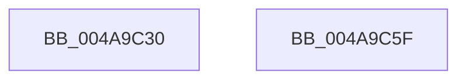

# RtlpHpFixedVsCommit

- RVA: `0x004A9C30`–`0x004A9C60` (길이 `48` bytes)
- VA: `0x00000001404A9C30`
- 실행 섹션: `.text`
- PDB 이름 있음: `예`; PDB Function 태그: `아니요`
- unwind 정보 RVA: `0x000B47B4`
- 디코드: `13`개 명령, `48/48` bytes 표시
- 미해석 바이트: `0` (있으면 어셈블리에 `.byte`로 보존)

> 이 문서는 커널 이미지의 기계어와 PDB 기호를 분석해 생성했습니다. 4번과 5번은 함수 원형과 자료형을 바이너리 사용 방식에서 추정한 C 해석이며 원본 소스 복구 결과는 아닙니다.

## 1. Dependencies

- 직접 호출 지점: **1**; 고유 호출 대상: **1**
- 직접 호출자로 확인된 함수: **0**
- RIP 상대 이미지 참조: **1**

### Outgoing calls
- `0x004A9C55` → [guard_dispatch_icall](../6B/guard_dispatch_icall_function_006BAAD0.md) (function, `0x006BAAD0`)

### Direct callers
- 이 함수 시작 RVA로 연결되는 직접 call은 확인되지 않았습니다. 간접 호출은 완전히 역산할 수 없습니다.

### Static image references
- `0x004A9C3F` → RVA `0x00E28300` (`.data`; read)

## 2. Other-region calls and transfers

- 다른 실행 섹션으로 향하는 call: **0**
- 별도 외부 분기/꼬리 이동을 확인하지 못했습니다.

## 3. Assembly (complete function range)

```asm
004A9C30  4C 8B DC                        mov r11, rsp
004A9C33  49 89 53 10                     mov qword ptr [r11 + 0x10], rdx
004A9C37  48 83 EC 28                     sub rsp, 0x28
004A9C3B  48 8B 41 08                     mov rax, qword ptr [rcx + 8]
004A9C3F  48 33 05 BA E6 97 00            xor rax, qword ptr [rip + 0x97e6ba]
004A9C46  41 8B D0                        mov edx, r8d
004A9C49  49 89 53 08                     mov qword ptr [r11 + 8], rdx
004A9C4D  4D 8D 43 08                     lea r8, [r11 + 8]
004A9C51  49 8D 53 10                     lea rdx, [r11 + 0x10]
004A9C55  E8 76 0E 21 00                  call 0x1406baad0
004A9C5A  48 83 C4 28                     add rsp, 0x28
004A9C5E  C3                              ret
004A9C5F  CC                              int3
```

## 4. C-style interpretation (structured pseudocode)

```c
__int64 __fastcall RtlpHpFixedVsCommit(__int64 a1, __int64 a2, int a3)
{
    __int64 result;
    __int64 v_rsp;

    *(unsigned __int64 *)(v_rsp + 16) = a2;
    v_rsp = (v_rsp) - (40);
    result = (*(unsigned __int64 *)(a1 + 8)) ^ (*(unsigned __int64 *)(v_rip + 9955002));
    *(unsigned __int64 *)(v_rsp + 8) = (unsigned int)(a3);
    result = guard_dispatch_icall(a1, v_rsp + 16, v_rsp + 8, a4);
    v_rsp = (v_rsp) + (40);
    return result;
}
```

## 5. (Beta) C Style

```c
int64_t RtlpHpFixedVsCommit(void *Arg1, int64_t Arg2, int32_t Arg3)
{
    uint8_t *arg1 = (uint8_t *)Arg1;

    int64_t result;
    int64_t local_rsp;

    *(uint64_t *)(local_rsp + 0x10) = Arg2;
    local_rsp = (local_rsp) - (40);
    result = (*(uint64_t *)(arg1 + 0x8)) ^ (*(uint64_t *)(v_rip + 0x97E6BA));
    *(uint64_t *)(local_rsp + 0x8) = (uint32_t)(Arg3);
    result = guard_dispatch_icall(Arg1, local_rsp + 16, local_rsp + 8, a4);
    local_rsp = (local_rsp) + (40);
    return result;
}
```

### 관측된 메모리 오프셋

구조체 형식이 확인되지 않은 접근은 인자 기준의 오프셋으로만 기록했습니다.

| 기준 인자 | 오프셋 표현 | 폭 (bit) | 접근 |
|---|---:|---:|---|
| `Arg1` | `+ 0x8` | `64` | `R` |

## 6. Execution-region graph

[열기: 2D/3D 그래프와 함수 탐색 컨트롤 패널](../../../control-panel.html?section=text&rva=0x004A9C30&view=graph)

- 2D 그래프는 위에서 아래로 흐르고, 3D 그래프는 빈 공간을 드래그해 회전합니다. Shift+드래그는 이동, 휠은 확대·축소, 함수 노드 선택은 대상 보고서 이동입니다.

### Static fallback


